# AutoBleem 2 Brugervejledning

AutoBleem 2 er en spilstarter til **PlayStation Classic** - og fra version 2 også til en **Raspberry Pi**, en **pc,
der starter fra en USB-nøgle**, og **Windows**. Dine PS1-spil står som en række omslag på en hylde, med coverbilleder
og oplysninger, og AutoBleem starter dem i den medfølgende PCSX-emulator. Installerer du RetroArch ved siden af, kan
du også spille spil fra andre systemer. Denne vejledning fortæller, hvordan du installerer AutoBleem på hver
platform, hvordan du bruger det til daglig, og hvad de medfølgende værktøjer kan.

> Du finder alle downloads på **https://autobleem.retromenele.pl/**. Siden er delt op efter platform: Det, du skal
> hente, ligger i panelet *Install* for din platform; *Build inputs* nedenunder er filer, som
> installationsprogrammerne selv henter.

## 1. Hvad du får

AutoBleem gør din PlayStation Classic - eller en Raspberry Pi, en gammel pc eller din Windows-computer - til en lille
spillekonsol med en rigtig menu til dine egne spil. Det her får du:

- **Launcheren.** Det er den, du ser, når du tænder: en hylde med spilomslag, som du bladrer igennem, med oplysninger
  om hvert spil ved siden af. Herfra starter du spil, deler dem op i sæt (PlayStation, RetroArch, Apps), ændrer
  indstillinger, holder styr på memory cards og gemte tilstande og henter apps og spil fra Store. Den ser ens ud og
  virker ens på alle platforme.
- **To PS1-emulatorer.** `pcsx-abnxt` er den nye og står som standard; `pcsx-ab` er den klassiske emulator, som
  altid har fulgt med AutoBleem. Du vælger mellem dem under indstillingerne. De bruger de samme indstillinger og
  memory cards, så du kan skifte når som helst uden at miste noget.
- **RetroArch**, hvis du også vil spille spil fra andre systemer - NES, SNES, Mega Drive, Game Boy, arkademaskiner
  og mange flere. Det er valgfrit på alle platforme. Kopiér dine ROM'er over, så sorterer AutoBleem dem i lister og
  starter hvert spil med den rigtige core. PlayStation-spil kan også køre i RetroArch; dens core *PlayStation 1*
  står øverst i listen over cores (afsnit 3.9). Spil som Doom kører fra dine egne spilfiler i en mappe `Packages`
  (afsnit 3.10).
- **Konsolværktøjerne.** *PSC-Bios* - i menuerne hedder det *Netværk og controllere* - sætter wi-fi, uret,
  Bluetooth-controllere og controllernes knaptildeling op, både på konsollen og på en Raspberry Pi og pc-nøglen.
  *ABFlashKit* installerer AutoBleem-kernen på en PlayStation Classic (kapitel 6).
- **UpdateRoms** til Windows. PlayStation Classic har intet netværk selv. Derfor er det dette pc-program, der
  opdaterer RetroArch-listerne og henter coverbilleder til en konsol-USB-nøgle, mens den sidder i din pc.

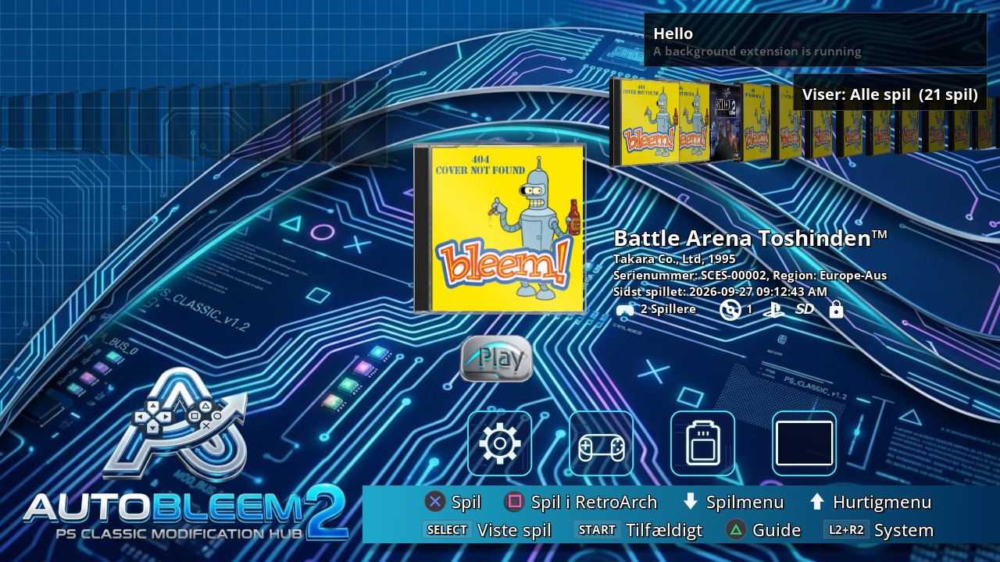

<!-- pagebreak -->

## 2. Installation

### 2.1 PlayStation Classic

AutoBleem kører udelukkende fra en USB-nøgle. Intet inde i konsollen bliver ændret: Tager du nøglen ud, virker
konsollen præcis som før. Du skal bare bruge en Windows-pc, en USB-nøgle (USB 2.0, 8 GB eller mere) og konsollen.

Nøglen behøver ikke at være tom, og den bliver **ikke formateret**, medmindre du selv beder om det: AutoBleem lægges
ved siden af det, der allerede ligger på den, og en nøgle, du allerede bruger med AutoBleem 1.0, bliver opgraderet,
hvor den er (se nedenfor). Til en konsol, der ikke er ændret, skal nøglen være **FAT32**, for konsollens egen kerne
kan ikke læse exFAT. Når AutoBleem-kernen først er installeret (ABFlashKit, kapitel 6), starter konsollen også fra en
exFAT-nøgle, og så slipper du for FAT32's grænse på 4 GB pr. fil.

1. Hent **AutoBleemInstaller-<version>.zip** fra PlayStation Classic-panelet på siden, og pak den ud, hvor du vil.
   Indeni ligger `AutoBleemInstaller.exe` og en README. Selve AutoBleem hentes under installationen, så pc'en skal
   have forbindelse til internettet.
2. Sæt nøglen i, og start `AutoBleemInstaller.exe`. Vælg først **kanalen**: *Release* er den testede version og det
   rigtige valg for de fleste, *Testing* er den næste version, mens den bliver testet, og *Nightly* er den allernyeste
   udviklingsversion, som måske ikke virker. Vælg derefter nøglens drev. Linjen nedenunder fortæller dig, hvilken
   version af AutoBleem du er ved at installere, og hvad der ligger på nøglen nu: *a fresh install* (de andre filer på
   nøglen får lov at blive) eller *AutoBleem <version> is on this stick: it will be updated* (dine spil, gemte spil,
   memory cards og indstillinger bliver).
   **Du behøver ikke formatere.** Knappen **Format** ved siden af drevet er kun til en splinterny nøgle uden
   filsystem, til en nøgle, konsollen ikke kan læse (for eksempel NTFS), eller til en nøgle, du vil tømme helt. Den
   spørger først og sletter så alt på nøglen. Vælg FAT32 dér, medmindre konsollen allerede har AutoBleem-kernen.
   Sæt så flueben ved det, du vil have installeret:
   - **Cover databases** - omslag og beskrivelser til hele PS1-biblioteket, så dine spil selv får deres omslag
     (afkrydset som standard; omkring 300 MB).
   - **RetroArch** - RetroArch med sine cores, ekstra programmer (Doom, Quake, Amiga, ...) og libretros assets, til
     spil fra andre systemer. Slået fra som standard; du kan tilføje det senere ved at køre installationsprogrammet
     igen.
   - **BIOS files** - de BIOS-filer, som nogle RetroArch-cores skal bruge, før de vil starte (kun sammen med
     RetroArch).
   - **Sample games** - et par gratis homebrew-spil, så hylden ikke er tom første gang.
3. Tryk på **Install**, og vent. Statuslinjerne og loggen viser hvert trin. Til sidst hedder nøglen `SONY`, og der
   ligger en kopi af `UpdateRoms` på den (se kapitel 5).
4. Skub nøglen sikkert ud, og sæt den i konsollens **anden USB-port foran** (den højre, til spiller 2) - den første
   holder du fri til din controller. Tænd konsollen: I stedet for den oprindelige menu starter AutoBleem. Vil du
   spille med to controllere, så brug en USB-hub i porten foran eller en Bluetooth-controller.

**Tænd og sluk.** Med nøglen i starter konsollen, lampen blinker et par sekunder, mens den opdager AutoBleem, og
derefter går den på standby, før der overhovedet kommer noget frem på skærmen. Det er helt normalt: AutoBleem starter
via konsollens egen opdateringsmekanisme, og sådan fungerer den mekanisme. Tryk én gang på **Power**, så kommer
launcheren frem.

Vælger du *Sluk* i systemmenuen, eller trykker du på konsollens Power-knap, går konsollen i **AutoBleems standby**:
AutoBleem kobler først nøglen sikkert fra, og så bliver lampen **orange** - tegnet på, at alt gik, som det skulle.
Næste tryk på Power bringer launcheren tilbage på få sekunder. **Mens lampen er orange, kan du trække nøglen ud** og
sætte den i din pc; Windows beder ikke om at kontrollere den, fordi den er koblet ordentligt fra. Sæt den i igen, før
du trykker på Power. Trækker du konsollens strømkabel ud, går den gennem opstartsstandby igen næste gang. En **rød**
lampe betyder, at konsollen er helt slukket.

**Porten bagpå.** Micro-USB-porten bagpå er konsollens strømindgang. Med AutoBleem-kernen kan den også tage en
USB-enhed, men nøglen hører hjemme i en port foran.

**Hvis nøglen mangler.** Starter konsollen uden nøgle, eller trækker du nøglen ud, mens AutoBleem kører, beder et
billede dig om at sætte den i - enhver USB-port duer. AutoBleem venter i 5 minutter og lader så konsollen sove; tryk
på Power, hvis du vil have den til at sove med det samme.


**Når nøglen bliver kontrolleret.** Er nøglen ikke koblet ordentligt fra - du trak den ud, mens AutoBleem kørte,
eller strømmen gik - tjekker AutoBleem den for fejl, før den bruges igen: ved opstart, når konsollen vågner, eller
når du sætter den i igen. En statuslinje viser, hvor langt kontrollen er nået. På en stor nøgle kan det tage et
stykke tid; lad den gøre det færdigt, og sluk ikke konsollen imens.


**Opdatering.** Vil du opdatere en nøgle, kører du bare installationsprogrammet på den igen - knappen hedder nu
*Update*. Det installerer den nyeste version fra den kanal, du vælger; dine spil, gemte spil, indstillinger og
RetroArch-indhold bliver, og kun AutoBleems egne filer bliver skiftet ud. En konsol med AutoBleem-kernen og wi-fi kan
også opdatere sig selv (afsnit 3.12).

**Opgradering fra AutoBleem 1.0 (eller AutoBleem-NG).** Du bruger det samme installationsprogram på den samme nøgle,
uden at formatere den:

1. Kopiér først hele nøglen over på din pc som sikkerhedskopi - for en sikkerheds skyld.
2. Sæt den i, start `AutoBleemInstaller.exe`, og vælg kanal og drev. Tryk **ikke** på Format.
3. Tryk på **Install**. Installationsprogrammet flytter det gamle layout over i det nye: RetroArch, ROM'erne og
   temaerne kommer derhen, hvor AutoBleem 2 forventer dem, og de gamle ROM-mapper (`nes`, `snes`, ...) får
   RetroArchs systemnavne. Dine spil, gemte tilstande, memory cards, ROM'er og RetroArch-gemte spil bliver alle
   sammen, og det gør `config.ini` også - kun PS1-emulatoren i den skiftes til pcsx-abnxt.
4. Sæt nøglen tilbage i konsollen. Den første scanning bygger spillisten og afspilningslisterne op igen. Vil du have
   coverbilleder til dine RetroArch-spil, så kør UpdateRoms på pc'en (kapitel 5).

> En uændret konsol har hverken ur eller netværk. Datoer dukker først op, når AutoBleem-kernen er installeret
> (kapitel 6), og coverbilleder til RetroArch-spil kommer fra UpdateRoms på pc'en (kapitel 5).

Dine PS1-spil skal i nøglens mappe `Games`, én mappe pr. spil - afsnit 3.10 forklarer opbygningen.

### 2.2 Raspberry Pi

Med AutoBleem bliver en Raspberry Pi til en lille spillekonsol: Den starter direkte i launcheren uden noget
skrivebord imellem. Siden har to færdige kortbilleder, 32-bit og 64-bit, og en pakke til en Raspberry Pi OS Lite, du
allerede har kørende.

| Model | 32-bit-billede | 64-bit-billede | Bemærkninger |
|---|---|---|---|
| Raspberry Pi 5 | ja | ja | |
| Raspberry Pi 4 Model B, Pi 400 | ja | ja | |
| Raspberry Pi 3 Model B / B+ / A+ | ja | ja | fin til launcheren og PS1 |
| Raspberry Pi Zero 2 W | ja | ja | 512 MB RAM: PS1 kører, de tungere RetroArch-cores gør ikke |
| Raspberry Pi 2 Model B | ja | kun v1.2 | langsom til alt i 3D |
| Raspberry Pi 1, Zero, Zero W | nej | nej | ARMv6 - ingen af billederne kører |

**Tag 32-bit-billedet til PS1-spil.** Den hurtige ARM-recompiler i den klassiske `pcsx-ab` findes kun i 32-bit, så
PS1-spil kører langsommere på 64-bit-versionen. 64-bit-billedet har til gengæld flere RetroArch-cores, så tag det,
hvis de andre systemer betyder mere for dig end PS1.

**Med Raspberry Pi Imager:**

1. Installér Raspberry Pi Imager (raspberrypi.com/software). Vælg *Use custom* under *Choose OS*, og vælg den
   `autobleem-<version>-rpi-armhf.img.xz` (32-bit) eller `-arm64.img.xz` (64-bit), du har hentet. Du kan også
   tilføje en repository-URL i appens indstillinger og vælge AutoBleem fra listen. Der er én pr. kanal:
   `https://autobleem.retromenele.pl/rpi-imager/os_list.json` til den seneste udgivelse,
   `.../os_list-testing.json` til den version, der bliver testet, og `.../os_list-nightly.json` til den nyeste
   udviklingsversion. Downloadsidens fane Raspberry Pi viser dem, der findes, hver med en knap *Copy*.
2. Brug Imagers tilpasningsskærm (tandhjulet, eller spørgsmålet efter *Next*) til at indstille **brugernavn og
   adgangskode, wi-fi-netværk og land, og slå SSH til**. AutoBleem skal bruge et netværk første gang, den starter.
3. Skriv kortet, sæt det i Pi'en med en skærm og et tastatur eller en controller tilsluttet, og tænd for den.

**Første opstart** tager 5 til 25 minutter, og skærmen fortæller dig, hvad der sker. Er der intet netværk, beder den
dig om et: Vælg dit wi-fi på listen, og skriv adgangskoden. Derefter spørger den, om RetroArch skal installeres -
svarer du ikke inden for et minut, gør den det. Så gør den systempartitionen større, laver resten af kortet til
partitionen `AUTOBLEEM` til dine spil, installerer RetroArch med dens cores, BIOS-pakkerne og eksempelspillene og
genstarter i launcheren.

Har du ikke lyst til at svare på spørgsmål ved første opstart, kan du på forhånd skrive svarene i
**`autobleem.txt`** på kortets boot-partition - enhver pc kan åbne og redigere den:

| Nøgle | Standard | Betydning |
|---|---|---|
| `root_gib` | 8 | Systempartitionens størrelse i GiB; resten bliver spilpartitionen. |
| `hdmi_mode` | 1920x1080@60 | Skærmtilstanden under hele opstarten (`1280x720@60` til et ældre tv). |
| `retroarch` | (spørges) | `yes` / `no` - RetroArch og de andre systemer, eller kun PS1. |
| `thumbnails` | none | `boxarts` henter hele samlingen af omslag ned, så du har dem uden net (~9000 filer). |
| `bios`, `downloads`, `samples` | yes | Sæt til `no` for at springe BIOS-pakkerne, alle downloads eller eksempelspillene over. |

**På en Raspberry Pi OS Lite, du allerede har** (Bookworm eller Trixie): Kopiér `autobleem-rpi.tar.gz` (eller
arm64-udgaven) over på Pi'en, pak den ud, og kør `sudo bash install.sh`. Den stiller de samme spørgsmål, gør plads
til datapartitionen ved at gøre systempartitionen mindre ved næste opstart (`--shrink-root <GiB>`) og lægger
launcheren på den første konsol.

Efter installationen fylder du kortets **partition `AUTOBLEEM`** (exFAT) med dine spil: Tag kortet ud, og åbn det på
en hvilken som helst pc, eller kopiér over netværket (SSH er slået til). PS1-spil skal i `Games/`, ROM'er fra andre
systemer i `RetroArch/roms/<system>/`, PS1-BIOS'en i `System/Bios/` (afsnit 3.11) og temaer i `Themes/`.

### 2.3 Pc-USB-nøgle

Det samme kan lade sig gøre på enhver pc, der kan starte fra USB: Nøglen starter pc'en direkte i AutoBleem og lader
pc'ens egen disk være i fred. Det er et 32-bit-system, så gamle maskiner kan også være med.

1. Skriv billedet til en nøgle på 8 GB eller mere. **På Windows** bruger du **AutoBleemFlasher** (pc-panelet på
   siden - pak den ud, og kør `AutoBleemFlasher.exe`; den beder om administratorrettigheder, fordi den skriver en hel
   disk): Vælg kanal og nøgle, tryk på *Write*, og bekræft to gange - den henter billedet, kontrollerer det, skriver
   det og læser det tilbage. Du får kun USB-nøgler og SD-kort at vælge imellem, aldrig den disk, Windows kører fra,
   og **alt på den valgte nøgle bliver slettet**. På Linux eller macOS henter du
   `autobleem-<version>-pcusb-i386.img.xz` fra pc-panelet og skriver det med
   `xzcat autobleem-*.img.xz | sudo dd of=/dev/sdX bs=4M status=progress` (eller balenaEtcher).
2. Start pc'en fra nøglen (med din pc's tast til startmenuen - F12, F8, Esc ...). Både BIOS- og UEFI-start virker;
   **Secure Boot skal være slået fra**.
3. Første opstart foregår som på Pi'en: Den beder om et netværk, hvis der ikke sidder et kabel i, spørger til
   RetroArch, installerer det hele - cirka otte minutter med kablet netværk - og genstarter i launcheren.

Bagefter har nøglen en partition `AUTOBLEEM` til dine spil. Sætter du nøglen i en kørende pc med Windows 10 (version
1903 eller nyere), dukker den op som et ekstra drev, du kan kopiere spil over på. `autobleem.txt` ligger på den
første partition med de samme nøgler som på Pi'en (undtagen `hdmi_mode` - en pc bruger altid skærmens egen
tilstand).

### 2.4 Windows

Vil du have AutoBleem på din Windows-computer, kører det også som et helt almindeligt program: i fuld skærm, med
emulatorerne og RetroArch startet som selvstændige programmer.

1. Hent **AutoBleemSetup-<version>.exe**, og kør det. Det installerer pr. bruger uden administratorrettigheder:
   programmet under `%LOCALAPPDATA%\Programs\AutoBleem` og dataene (spil, indstillinger, temaer, RetroArch) i en mappe,
   du selv vælger - som standard `Documents\AutoBleem`.
2. Sæt flueben ved komponenterne - cover-databaserne, RetroArch (den officielle Windows-udgave med dens cores),
   BIOS-filerne, eksempelspillene - og lad installationshjælperen hente dem.
3. Start AutoBleem fra menuen Start eller skrivebordet. På en pc fungerer tastaturet som controller (afsnit 3.2).

For at opdatere kører du bare en nyere installation oven i den gamle: Programmet bliver skiftet ud, og din datamappe
forbliver, som den er. Launcheren kigger også forbi siden én gang om dagen og tilbyder en opdatering, når der er en
(afsnit 3.12).

<!-- pagebreak -->

## 3. Sådan bruger du AutoBleem

### 3.1 Launcheren

Launcheren er stedet, hvor du vælger, hvad du vil spille. Dine spil står som omslag på en hylde, ligesom æskerne
ville stå på en rigtig reol, og du bladrer hen ad den, til du finder det, du er ude efter. Alt andet i AutoBleem -
indstillingerne, memory cards, Store - åbner du herfra, og hertil vender du tilbage, når du forlader et spil.

Det valgte spil står midt på hylden med en blød spejling under sig. Ved siden af ser du dets oplysninger i et lille
gitter: udgiveren, året, serienummeret, regionen, hvor mange spillere det er til, og hvornår du sidst spillede det.
Kender AutoBleem ikke en af oplysningerne, udelader den hellere den linje end at vise den tom. Ved siden af
oplysningerne sidder en afspilningsknap. Et spil uden omslagsbillede vises som en disk, der ligger i den sorte bakke
i et tomt etui, så det stadig har en plads på hylden.

Launcherens udseende kommer fra temaet. Standardtemaet er **ab2.0.0**: En ny installation skifter til det, og det
samme gør en opdatering, der bringer det med - men kun én gang. Vælger du et andet tema bagefter (afsnit 3.6), bliver
det ved med at være valgt.

**Hjælpelinjen** nederst på skærmen fortæller dig, hvad knapperne gør lige nu. Den har to linjer med fire pladser
hver. Den første linje handler om det valgte spil: spil det, spil det i RetroArch, åbn ikonrækken under det, eller
åbn hurtigmenuen. Den anden linje ændrer sig aldrig: Select vælger sæt, Start vælger et tilfældigt spil, Triangle
viser knapoversigten, og L2 + R2 åbner systemmenuen. Har en knap ikke noget at gøre i øjeblikket, er dens hjælp
nedtonet.

**Nye spil finder den selv.** Hver gang launcheren starter, scanner den din spilmappe i baggrunden, så et spil, du
har kopieret over, mens maskinen var slukket, dukker op, uden at du skal gøre noget. Mens scanningen kører, viser en
boble øverst til højre, hvor langt den er nået, og nye spil kommer op på hylden, efterhånden som de bliver fundet -
du kan sagtens bladre videre imens.

**En ny installation** har endnu ingen spil. I stedet for en tom hylde ser du et velkomstkort, *Hej, og velkommen
til AutoBleem!*, som beder dig om at lægge dine spil i `Games` og trykke på *Genscan spil*. Kortet nævner stedet for
din platform: på din USB-nøgle (PlayStation Classic, pc-nøgle), på dit SD-kort (Raspberry Pi) eller i din
AutoBleem-mappe (Windows). Kortet forsvinder, så snart en scanning finder det første spil.

**Beskeder** er boblerne øverst til højre. De holder dig orienteret uden at være i vejen: scanningens fremskridt,
navnet på det sæt, du lige har skiftet til (*Viser: ...*), en controller med lavt batteri, en besked efter et nedbrud,
en scanningsprocessor i arbejde og en download fra Store. Boblen for en download viser hastigheden og den resterende
tid, for eksempel `1.4 MB/s · 0:42`. Hvor længe de informerende bobler bliver stående, bestemmer du selv:
Indstillinger → *Visningstid for besked*.

**Controllernes batterier.** På konsollen, en Raspberry Pi og pc-nøglen (ikke på Windows) vises hver trådløs
controller, der oplyser sit batteriniveau, som et lille ikon med procenttallet på sin egen plade, stablet nedad fra
øverste venstre hjørne. En controller, der spiller som Spiller 1 eller Spiller 2, har et mærke P1 eller P2, som følger
indstillingen *Byt spiller 1 / spiller 2* (afsnit 3.6); en controller, der ikke er knyttet til en spiller, eller en
tredje controller, har intet mærke. Når en controllers batteri er ved at løbe tør, får du én gang en besked med
controllerens navn og procenttallet.

**Kanalmærket.** Kører du en version, der ikke er en endelig udgivelse, minder et lille mærke under
batteripladerne i øverste venstre hjørne dig om det. Det er en chip med kanalen og den korte version ved siden af:
`ALPHA`, `BETA` eller `RC` for en forudgivelse, `TESTING` for enhver anden forudgivelse, `NIGHTLY` for en natlig
version og `DEV` for en version, der er bygget i hånden (ved `DEV` er versionen det commit, den er bygget fra). En
udgivelse har intet mærke.

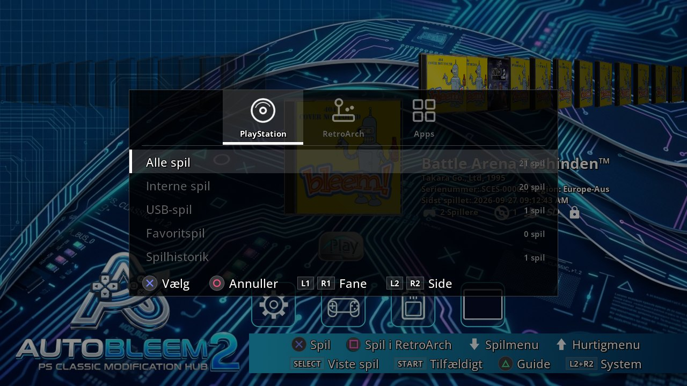

### 3.2 Betjening

AutoBleem er lavet til at blive betjent med controlleren alene, og knapperne betyder det samme på alle skærme: Cross
bekræfter, Circle går tilbage, Triangle hjælper. Glemmer du, hvad en knap gør, fortæller hjælpelinjen nederst på
skærmen dig det, og Triangle på hylden åbner knapoversigten med alle knapper på alle skærme (afsnit 4.3). På hylden
gør knapperne følgende:

| Knap | På hylden |
|---|---|
| Venstre / Højre | Går til det forrige eller næste spil; hold knappen inde for at blive ved med at bladre. |
| L1 / R1 | Springer til det forrige eller næste begyndelsesbogstav i titlerne, så du hurtigt kommer igennem en lang hylde. På en tom hylde med et USB-drev tilsluttet åbner R1 *Disk* (afsnit 3.9a). |
| Cross | Starter det valgte spil: et PS1-spil i PS1-emulatoren, et RetroArch-spil i sin core og en App efter dens læs-mig. |
| Square | Starter i stedet det valgte PS1-spil i RetroArch. Er en disk i et USB-drev valgt, kopierer Square i stedet disken (*Kopiér disk*, afsnit 3.9a). |
| Circle | Tager dig tilbage til diskvisningen, når der ligger en disk i drevet (afsnit 3.9a). |
| Triangle | Åbner knapoversigten. |
| Start | Vælger et tilfældigt spil fra det aktuelle sæt, til når du ikke kan bestemme dig. |
| Select | Åbner sætvælgeren, hvor du bestemmer, hvilke spil hylden viser (afsnit 3.3). |
| Op | Åbner hurtigmenuen (afsnit 3.4). |
| Ned | Åbner ikonrækken under spillet (*INDSTILLINGER*, *Spil*, *MEMORY CARD*, *GENOPTAG*); Op lukker den igen. |
| L2 + R2 | Åbner systemmenuen (afsnit 3.5). |

**Med tastatur.** På en pc uden controller, eller med et USB-tastatur på konsollen, en Pi eller pc-nøglen, træder
tasterne i stedet for knapperne. Piletasterne er d-pad'en, Enter er Cross, Esc eller Backspace er Circle, Tab er
Triangle, og mellemrumstasten er Square. F1 og F2 er Select og Start, Page Up og Page Down er L1 og R1, Home og End er
L2 og R2, og F10 åbner systemmenuen. På en udviklermaskine lukker Esc programmet, og mellemrumstasten er Start.

**I alle lister og menuer** virker det på samme måde: Op og Ned flytter markøren, L2 og R2 bladrer en side, L1 og R1
springer til første eller sidste linje, Cross vælger, og Circle går tilbage. Du skal aldrig lede efter en knap til at
gemme: En skærm med indstillinger gemmer dem, når du forlader den med Circle.

**Sådan kommer du ud af et spil eller en App.** Hold Start + Select, eller Home, inde i 2 sekunder, så er du tilbage i
AutoBleem. Det virker på alle controllere - konsollens egen, en USB-controller eller en Bluetooth-controller. Et kort
tryk på de samme knapper åbner i stedet emulatorens menu. En App har ikke sådan en menu, så dér er det kun det lange
tryk, der gør noget.

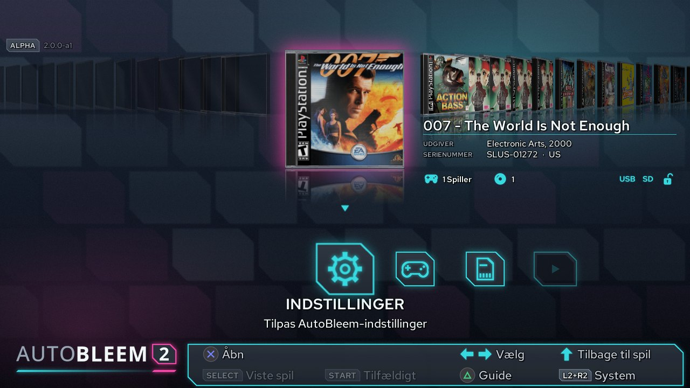

### 3.3 Sættene

Et stort bibliotek er lettere at gennemse i bidder. Med sættene kan du skære hylden ned til én slags spil - kun dine
favoritter, kun Super Nintendo-spillene, kun spillene i én mappe - så du ikke skal rulle forbi hundredvis af omslag
for at finde det ene, du vil have.

Tryk på **Select**, så åbner sætvælgeren. Den har tre faner, PlayStation, RetroArch og Apps: L1 og R1 skifter mellem
dem, Op og Ned går gennem fanens grupper (L2 og R2 en side ad gangen), og Cross viser den valgte gruppe på hylden.
Circle (*Tilbage*) lukker vælgeren uden at ændre noget. Tasterne står også nederst på skærmen. Hver linje viser, hvor
mange elementer den rummer. En tom gruppe åbner på en tom hylde, hvor ikonrækken kun tilbyder *INDSTILLINGER*.

**Fanen PlayStation.** På en PlayStation Classic begynder den med *Alle spil* og *Interne spil* (de tyve spil, der er
indbygget i konsollen), efterfulgt af *USB-spil* - alt i `Games/` - og én gruppe for hver mappe, du har lavet
derunder; et spil i en undermappe hører altså til den mappes gruppe. Så kommer *Favoritspil*, *Spilhistorik* og,
når du har markeret mindst ét spil som lightgun-spil, *Lightgun-spil*. En Raspberry Pi, en pc-nøgle og Windows har
ingen interne spil, så dér begynder listen ved *USB-spil*, som er hele dit bibliotek.

**Fanen RetroArch** findes kun, hvor RetroArch er installeret. Den har én gruppe for hvert system, du har spil til,
plus RetroArchs egne Favoritter og Historik.

**Fanen Apps** sorterer programmerne efter type: *Alle apps*, derefter *Spil*, *Emulatorer*, *Værktøjer*, *Medier* og
*Andet*. Hvilken gruppe en app hører til, står i dens fil `app.ini`. Fanen viser også **PE-apps**: Windows-programmer,
som PE-runneren kører. En, som konsollen ikke kan starte, er markeret med *kan ikke køre på denne konsol*. Hvor
launcheren viser den, står der også en linje *Pakker* på listen (afsnit 3.10).

### 3.4 Hurtigmenuen

Hurtigmenuen er en kort liste med de ting, du oftest har brug for, mens du bladrer i dine spil, så du ikke skal grave
dem frem i den fulde systemmenu. Du åbner den med **Op** på hylden eller med **tandhjulsikonet** i ikonrækken (rækken
med *INDSTILLINGER*, *Spil*, *MEMORY CARD* og *GENOPTAG*).

Op og Ned går gennem punkterne (fra det sidste går markøren rundt til det første), Cross vælger et, og Circle lukker
menuen. En linje under menuen beskriver det valgte punkt. Punkterne er:

- *Genscan spil* leder straks efter nye, ændrede eller fjernede spil - smart, når du lige har kopieret spil over og
  ikke gider vente.
- *Store* åbner AutoBleem Store, hvor du gennemser og installerer spil, apps og udvidelser (afsnit 3.13).
- *RetroArch-cores*, hvor RetroArch er installeret, lader dig vælge den core, der spiller hvert system.
- *Netværk og controllere* åbner skærmene til wi-fi, Bluetooth-parring og controllernes knaptildeling (kapitel 6).
  Punktet findes kun, når en installeret udvidelse leverer dem - det gør PSC-Bios på konsollen, en Raspberry Pi og
  pc-nøglen. Er udvidelsen installeret, men slået fra, er punktet gråt, og beskrivelsen siger, at du skal slå den til
  under Udvidelser; Cross åbner så listen over udvidelser lige dér.
- *Genstart launcher* lukker AutoBleem og starter den igen (kun på konsollen, en Raspberry Pi og pc-nøglen).
- *Systemmenu...* åbner den fulde systemmenu med alt det andet - Indstillinger, Spilbibliotek, Sluk og mere
  (afsnit 3.5).

Alt her undtagen Store, RetroArch-cores og Genstart launcher findes også i systemmenuen.


### 3.5 Systemmenuen

Systemmenuen rummer alt det, AutoBleem kan ud over at spille: indstillingerne, værktøjerne til dit bibliotek og dine
memory cards, oplysninger om maskinen og måden at slukke på. Tryk på **L2 + R2** samtidig (i hvilken som helst
rækkefølge), så åbner den oven på hylden. Punkterne er samlet under overskrifterne *Bibliotek*, *System* og *Forlad*,
med de to, du bruger mest, øverst. En linje nederst i menuen beskriver det valgte punkt, så du kan se dig omkring,
før du vælger.

| Afsnit | Punkt | Hvad det gør |
|---|---|---|
| (øverst) | *Genscan spil* | Leder efter nye, ændrede eller fjernede spil nu. Scanningen holder også selv øje med mappen, så du får kun brug for dette, når du ikke vil vente. |
| | *Udvidelser* | Viser udvidelserne på USB-nøglen, for eksempel AutoBleem Store, så du kan køre dem eller slå dem fra (afsnit 3.13). |
| *Bibliotek* | *Spilbibliotek* | Viser PS1-spillene som en liste med deres mapper, hvor du kan slette et spil eller rydde omslagene (afsnit 4.1). Kan ikke åbnes, mens en scanning kører. |
| | *Memory cards* | Administrerer dine delte sæt af memory cards (afsnit 3.8). |
| | *Scanningsprocessorer* | Bestemmer rækkefølgen af de programmer, hver scanning kører først, og slår dem til eller fra (afsnit 3.14). Kan ikke åbnes, mens en scanning kører. |
| *System* | *Indstillinger* | Åbner AutoBleems indstillinger (afsnit 3.6). |
| | *Netværk og controllere* | Åbner skærmene til wi-fi, parring af Bluetooth-controllere, opsætning af DualShock 3 og controllernes knaptildeling (kapitel 6). Findes kun, når en udvidelse leverer dem - se nedenfor. |
| | *Hardwareinformation* | Viser maskinens fakta - system, CPU, lager, netværksgrænseflader, tidszone, skærm og controllerne med deres knaptildeling - på den samme side på alle platforme (afsnit 4.2). Circle bringer dig tilbage til systemmenuen. |
| | *Virtuelt gamepad* | Viser de controllere, Apps får, og de controllere, daemonen ser - en hjælp, når en controller ikke virker i en App (afsnit 4.5). Circle bringer dig tilbage til systemmenuen. |
| | *Softwareopdatering* | Tjekker siden for en nyere AutoBleem eller RetroArch nu i stedet for at vente på det daglige tjek (afsnit 3.12). Kender launcheren allerede til en, står der *Opdatering tilgængelig*. På en PlayStation Classic kræver det AutoBleem-kernen og et wi-fi-netværk. |
| | *Om* | Viser holdet bag og licensen. |
| *Forlad* | *RetroArch* | Forlader launcheren til fordel for RetroArchs egen menu med dens indstillinger og indholdslister; lukker du RetroArch, er du tilbage i launcheren. Findes kun, hvor RetroArch er installeret. |
| | *Sluk* | Slukker maskinen, når du har bekræftet det (se nedenfor). |

**Netværk og controllere** dukker kun op, når en installeret udvidelse leverer indgangen `network`, hvilket en
udvidelse angiver med `Provides=network` i sin `extension.ini`. Det gør PSC-Bios på konsollen, en Raspberry Pi og
pc-nøglen. Er udvidelsen installeret, men slået fra, bliver punktet stående i menuen, men gråt, og beskrivelsen beder dig slå den
til under Udvidelser; Cross på punktet åbner listen over udvidelser lige ved den udvidelse.

**Sluk** gør det, der passer til maskinen. Konsollen går i AutoBleems standby: Nøglen kobles fra, lampen bliver
orange, og Power bringer launcheren tilbage på få sekunder (afsnit 2.1). En Raspberry Pi eller en pc lukker ned.

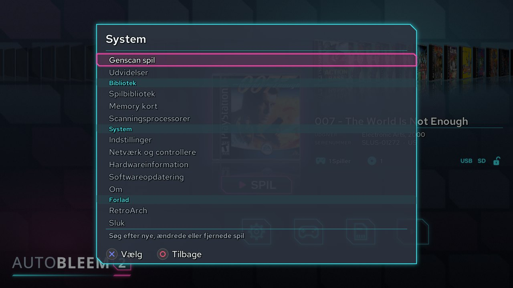

### 3.6 Indstillinger

Under Indstillinger gør du AutoBleem til din egen: billedet på skærmen, launcherens udseende, sproget, lyden og den
PS1-emulator, der spiller dine spil. Du åbner det fra systemmenuen (*Indstillinger*) eller med ikonet *INDSTILLINGER*
under et spil. Som regel indstiller du skærm og sprog én gang og vender først tilbage, når noget ser forkert ud på et
bestemt tv, eller når du har lyst til en forandring.

Indstillingerne er sorteret i grupper, hver under sin overskrift. Op og Ned flytter fra linje til linje, og Venstre og
Højre ændrer værdien på den linje, du står på: Et kort tryk flytter ét trin, og holder du knappen inde, fortsætter
den. L1 og R1 springer til første eller sidste linje, og L2 og R2 bladrer en side. På en linje med et udvalg af temaer,
musik eller skrifttyper vælger Start et tilfældigt. En indstilling, der kan slås til og fra, står på **TIL** eller
**FRA**. Du ser hver ændring med det samme, og Circle forlader skærmen og gemmer det hele - der er ikke andet at
bekræfte. Den eneste undtagelse er skærmtilstanden, som bliver afprøvet, når du forlader Indstillinger (se *Skærm:*
nedenfor).

Nogle linjer ser du kun, hvor de giver mening: CRT-linjerne kun ved et 4:3-billede, RetroArch-linjerne kun hvor
RetroArch er installeret, de interne spil kun på en PlayStation Classic.

| Gruppe / indstilling | Hvad den er til |
|---|---|
| *Grænseflade*: *Skærm:* | Indstiller skærmens opløsning til launcheren og PS1-emulatoren. *Auto* bruger skærmens egen tilstand og viser, hvilken det er, for eksempel *Auto (1920x1080)*; du kan også vælge enhver anden tilstand, skærmen angiver. Konsollen tilbyder 720p, 1080p og *CRT 4:3* (720x480), tilstanden til et gammelt billedrørs-tv eller en 4:3-optageenhed. Skift den, hvis billedet ikke passer til dit tv eller ser sløret ud. Linjen findes ikke, når AutoBleem kører i et vindue på en udviklermaskine. |
| *CRT-margen:* | Gør det hele en anelse mindre, fra 0 til 10 % i trin på 1 %, fordi gamle tv'er skærer kanterne af billedet. Skru op, til hjælpelinjen og hjørnerne er helt synlige. Vises kun ved et 4:3-signal, virker med det samme og gælder allerede før startskærmen. |
| *Billedhøjde:* | Gør billedet højere eller lavere, fra -40 til +40 i trin på 2, på ethvert 4:3-signal - *CRT 4:3* eller en 4:3-tilstand på en VGA- eller pc-udgang. Brug den, når billedet på et gammelt tv er mast sammen eller løber ud over top og bund. Virker med det samme, og RetroArchs spilbillede følger med. |
| *Emulatorens skærmskalering:* | Bestemmer, hvordan PS1-emulatoren tilpasser et spils billede til din skærm. *1x1* viser PlayStationens egne pixels, små og præcise; *2x (heltal)* og *4:3 (heltal)* skalerer kun med hele multipla, hvilket giver det skarpeste billede; *4:3* bevarer billedets oprindelige form; *Fuld skærm* strækker billedet ud over hele skærmen. Den erstatter den gamle Widescreen-kontakt. Den klassiske `pcsx-ab` og RetroArch kender kun fuld skærm og 4:3. |
| *Skærmglorie:* | Står den på TIL, bliver de tomme felter ved siden af spilbilledet (hvor billedet ikke fylder skærmen) fyldt med billedets eget bløde skær i stedet for sort. Virker med `pcsx-abnxt`. |
| *AutoBleem-tema:* | Ændrer launcherens udseende. Temaer ligger i `Themes/`, og en tema-zip, du lægger dér, vises også på listen med sit navn. De temaer, der følger med AutoBleem, bliver fornyet ved hver opdatering, så vil du tilpasse et, skal du først kopiere det under et nyt navn. Standarden er **ab2.0.0**. |
| *Cover-stil:* | Vælger den jewel case-ramme, der tegnes om PS1-omslagene. |
| *Glimt på coveret:* | Lader et glimt glide hen over det valgte omslag, hver gang hylden falder til ro. |
| *Sprog:* | Indstiller launcherens sprog; der er 17, og ændringen sker med det samme. |
| *Visningstid for besked:* | Bestemmer, hvor længe de informerende bobler (*Viser: ...*, scanningens opsummering) bliver stående, fra 0 til 20 sekunder; ved 0 står der *Fra*, og de er slået fra. Fejlmeddelelser har deres egen faste tid, så du aldrig går glip af en. |
| *Startskærm:* | Viser AutoBleem-billedet, mens launcheren starter; slå den fra for at gå direkte til hylden. |
| *Animationer:* | Animerer skiftet fra én skærm til den næste; slå den fra, hvis du foretrækker, at hver skærm dukker op med det samme. |
| *Skrifttyper*: *Brug standardskrifttype:* | Står den på TIL, bruger launcheren sin egen skrifttype (Red Hat Text); slå den fra for at bruge skrifttypen fra næste linje. |
| *Skrifttype:* | Vælger en skrifttype efter eget valg: enhver `.ttf`- eller `.otf`-fil i `resources/fonts`, `RetroArch/fonts` eller temaets mappe. Linjen viser navnet på den skrifttype, der faktisk bruges. |
| *Lyd*: *Musik:*, *Baggrundsmusik:* | *Musik:* vælger det nummer, der spiller under launcheren - temaets eget eller en fil fra `resources/music`. *Baggrundsmusik:* afgør, om der overhovedet spiller musik. |
| *Emulering*: *PS1-emulator:* | Vælger den emulator, dine PS1-spil starter i: `pcsx-abnxt`, standarden (den aktuelle PCSX-ReARMed med AutoBleems tilføjelser), eller `pcsx-ab`, den klassiske. Prøv den anden, når et spil ikke kører godt. Et genoptagelsespunkt, som den ene har gemt, kan fortsættes i den anden, medmindre spillet kørte uden BIOS-fil. |
| *Byt spiller 1 / spiller 2 (PS1-emulatorer):* | Bytter om på, hvilken af de to første controllere der er Spiller 1, og hvilken der er Spiller 2, i begge PS1-emulatorer - praktisk, når controllerne sidder i "forkert" rækkefølge. Det betyder kun noget med to eller flere controllere tilsluttet; med én controller er du altid Spiller 1. RetroArch påvirkes ikke. Kan den PS1-emulator, du bruger, ikke bytte endnu, siger AutoBleem det. |
| *Spil alle PSX-spil med RA:*, *Opdater RA-konfiguration:*, *Gem RetroArch-konfiguration:* | De tre findes kun, hvor RetroArch er installeret. Den første starter alle PS1-spil i RetroArchs PS1-core (*PlayStation 1*; på en pc er det SwanStation). Den anden lader AutoBleem skrive sine indstillinger ind i RetroArchs konfiguration, når den starter et spil dér. Den tredje beholder en ændring, du laver i RetroArchs egen menu, når RetroArch lukker. |
| *Bibliotek*: *Vis interne spil:* | Viser konsollens indbyggede spil i PlayStation-listerne (kun PlayStation Classic). |
| *Rene spilnavne:* | Står den på TIL (standard), viser RetroArch-spillisterne pæne navne uden mærker i parentes som (USA), (Rev 1) eller [!]; FRA viser filnavnene. Filnavnet står stadig i spillets oplysninger. PS1-spil påvirkes ikke, for deres titler kommer fra databasen. |
| *Hent covers online:* | Lader scanningen hente manglende omslag fra libretros servere (Raspberry Pi, pc, Windows). |
| *Opdateringer*: *Opdateringer:* | Vælger, hvilke opdateringer launcheren kigger efter (afsnit 3.12): `release` (den testede version), `testing` (den næste version, mens den testes), `nightly` (den nyeste udviklingsversion) eller `off`. Standarden følger den version, du har installeret. Vises ikke på en udviklermaskine. |
| *Diagnostik*: *Behold logfiler på USB-nøglen:* | Gemmer fra næste opstart alle logfiler på nøglen, ikke kun efter et nedbrud - slå den til, når du er på jagt efter et problem (kapitel 7). |
| *Vis ydeevne:* | Viser et lag i nederste venstre hjørne med billedhastighed, CPU-belastning, tråde og hukommelse; i et spil viser emulatoren også sine FPS og sin CPU. |

**Når du skifter skærmtilstand.** Forlader du Indstillinger med en ny tilstand under *Skærm:*, skifter AutoBleem til
den og spørger *Behold denne skærmtilstand?*. Ser billedet fint ud, så bekræft. Viser dit tv ingenting, så vent bare:
Uden bekræftelse går AutoBleem tilbage til den forrige tilstand efter en nedtælling.

**Temaer på en 4:3-skærm.** I tilstanden *CRT 4:3* viser temalisten kun temaer, der har et 4:3-layout. Har det tema,
du bruger, ikke et, tager standardtemaet dets plads, når du har bekræftet tilstanden (og ved hver opstart i den
tilstand), og en besked fortæller dig det: *Tema skiftet til standardtemaet (CRT 4:3)*.

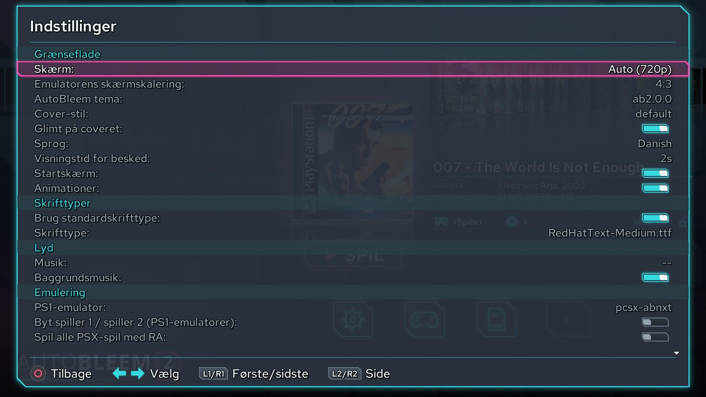


### 3.7 Et spils egne indstillinger

Hvert spil kan have sine egne indstillinger. De fleste spil kører fint, som de er, men en gang imellem har et af dem
brug for lidt hjælp - et skarpere eller blødere billede, et oversprunget billede for at holde det flydende, et andet
memory card - eller du vil markere det som favorit. I spileditoren ændrer du den slags for netop det ene spil uden at
røre ved de andre.

Vælg et spil, og tryk på **Ned** for at åbne ikonrækken under det. Den har fire ikoner: *INDSTILLINGER*
(indstillingerne fra afsnit 3.6), *Spil* (spillets egne indstillinger), *MEMORY CARD* (dets memory card) og
*GENOPTAG* (dets gemte tilstande). Gå hen på et, og åbn det med Cross.

**Spileditoren** (ikonet *Spil*) viser spillets oplysninger til højre - titel, udgiver, år, antal spillere, mappe og
memory card - og indstillingerne til venstre. Op og Ned går mellem indstillingerne, og Venstre og Højre ændrer dem,
ligesom under Indstillinger; holder du en knap inde, gentages bevægelsen. Når du er færdig, gemmer Circle dine
ændringer og tager dig tilbage. Et spil uden titel i sine data vises under navnet på sin mappe.

Indstillingerne er delt i fire grupper:

- **Spil** handler om, hvordan AutoBleem behandler spillet. *Favorit:* sætter det i gruppen *Favoritspil* i
  sætvælgeren. *Lås data:* fortæller scanneren, at den skal lade spillets titel, serienummer og diskliste være præcis,
  som du har sat dem, så en senere scanning ikke overskriver dine ændringer. *Genoptag:* bestemmer, hvad der sker, når
  du starter et spil med genoptagelsespunkter: *Spørg* viser vælgeren af genoptagelsespladser, *Seneste slot*
  fortsætter straks fra den nyeste plads, og *Aldrig* starter altid spillet forfra. Hvor RetroArch er installeret, er
  der to linjer mere. *Lightgun-spil:* er til et spil, der spilles med lyspistol: Det kommer med i gruppen
  *Lightgun-spil* og kører altid i RetroArch, fordi RetroArchs PS1-core har GunCon (slår du den til, slås næste linje
  også til). *Spil med RA:* kører netop dette spil i RetroArch i stedet for i PS1-emulatoren.
- **Skærm** handler om, hvordan billedet ser ud. *Opløsning:* tegner spillet i 1x eller 2x (på den indbyggede GPU),
  og *Fjern sømme:*, som kun virker ved 2x, skjuler de tynde streger, der kan opstå mellem dele af billedet i den
  størrelse. *Dithering:* (*Fra*, *Til*, *Altid*) styrer det fine prikmønster, PlayStation bruger til at blande farver,
  og *Udjævning:* vælger en af emulatorens udjævnende skaleringer. *Filter:* afgør, hvordan billedet skaleres til
  skærmen: *Nærmeste* viser rene pixels, *Lineær* udglatter dem, *Skarp* og *Skarp (enkel)* holder pixelsene skarpe
  uden flimmer, og så er der *Quilez*. CRT-filtrene *CRT (fast)*, *CRT (raster)* og *CRT-Pi* efterligner et gammelt
  tv og tegner deres egne scanlines, så scanline-linjerne bliver grå, så længe et af dem er valgt. Ellers tilføjer
  *Scanlines:* de mørke linjer fra et gammelt tv, og *Scanline-lysstyrke:* bestemmer, hvor mørke de er. *Opløsning*,
  *Fjern sømme*, *Dithering*, *Udjævning* og filtrene ud over *Lineær* og *Nærmeste* er til `pcsx-abnxt`; den
  klassiske `pcsx-ab` og RetroArch viser ethvert andet filter som *Nærmeste*.
- **Gengivelse** har GPU-*Plugin:* og *Frameskip:* (*Auto*, *Fra* eller 1 til 3 billeder). At springe billeder over
  hjælper et spil, der kører for langsomt, med at holde farten, men billedet bliver mindre flydende.
- **Emulator** har *SpeedHack:*, CPU'ens *Ur:*, *SPU-interpolation:* (hvordan lyden udglattes), *Startlogo:* og, med
  `pcsx-abnxt`, *Sony-hacks:*. Slå *Startlogo:* fra for at springe BIOS-skallen over - det skal du bruge til en
  homebrew-disk, hvis eget logo forhindrer den i at starte.

Billedets form og skærmens opløsning indstilles ikke pr. spil, men for dem alle på én gang, under Indstillinger
(*Emulatorens skærmskalering:* og *Skærm:*).

**Andre knapper i editoren.** Triangle giver spillet et nyt navn med skærmtastaturet. Square giver spillet et andet
memory card (*Skift memory card*). Så længe spillet stadig bruger sit eget kort, gør Start det kort til et nyt delt
sæt, så andre spil også kan bruge det (*Del memory card*, afsnit 3.8). De to tilbydes ikke for konsollens interne
spil. Holder du Venstre / Højre eller Op / Ned inde, gentages bevægelsen her, og det samme gælder i RetroArchs
spilindstillinger og core-skærm.

Et spil gemmer sine indstillinger i sin egen fil `pcsx.cfg`. Alle spil på USB-nøglen har en, fordi scanningen
laver den. En original disk i et USB-drev (afsnit 3.9a) får først sin egen mappe med en `pcsx.cfg`, første gang
du starter den; indtil da kan en ændring i editoren ikke gemmes, og editoren siger *Ikke gemt: spillet har ingen
pcsx.cfg*. Start derfor disken én gang - fra da af bliver dens indstillinger gemt som for ethvert andet spil. En
disk, der hører til et spil, du allerede har i din samling, bruger det spils mappe og indstillinger fra starten.

For en **disk i drevet** (afsnit 3.9a) giver nogle indstillinger ingen mening, så editoren gør de linjer grå, og
linjen nederst siger *Ikke tilgængelig for en disk i drevet*, når du går hen på en af dem.


**Indstillinger, der er gemt i emulatoren.** Du kan også finjustere et spil, mens du spiller: Emulatorens egen menu
har *Save settings for this game* (afsnit 3.9). Når et spil har indstillinger gemt dér, er det dem, det spiller med.
Spileditoren viser så linjerne under Skærm, Gengivelse og Emulator grå med de gemte værdier under overskriften *Gemt i
emulatoren*, så du kan læse dem, men ikke ændre dem. Vil du hellere bruge spileditorens indstillinger igen, så vælg
*Lås indstillingerne op* og bekræft: Det sletter de indstillinger, emulatoren har gemt, og linjerne kan ændres igen.
Begge emulatorer, `pcsx-ab` og `pcsx-abnxt`, læser og skriver de samme gemte indstillinger, så det er ligegyldigt,
hvilken af dem der har gemt dem.

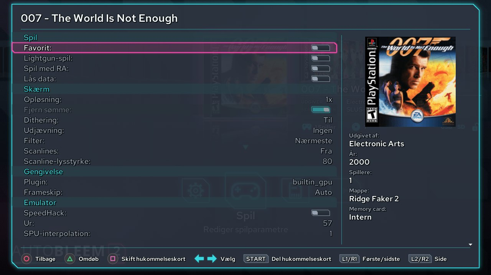

### 3.8 Memory cards og gemte tilstande

På en rigtig PlayStation delte du et eller to memory cards mellem alle dine spil, og før eller siden løb du tør for
plads. I AutoBleem har hvert PS1-spil som standard sit eget memory card, så du aldrig skal tænke på plads eller på,
hvilket kort et gemt spil ligger på. Kortet opbevares sammen med spillets gemte tilstande i
`Games/!SaveStates/<game folder>/`.

**Delte sæt af memory cards.** Nogle gange skal spil kunne se hinandens gemte spil - en efterfølger, der læser det
gemte spil fra det første, for eksempel, eller diskene i en serie, du gerne vil have på ét kort. Til det laver du et
delt sæt: ét kort, som flere spil bruger. Sættene ligger i `Games/!MemCards/`, og du administrerer dem med
*Memory cards* i systemmenuen. Square opretter et nyt sæt (du skriver navnet med skærmtastaturet), Cross omdøber det
valgte, og Triangle sletter det, efter at have spurgt dig først. Vil du sætte et spil på et sæt, så brug *Skift
memory card* i dets spileditor (afsnit 3.7) eller dets ikon *MEMORY CARD*.

**Memory card-editoren** åbner fra et spils ikon *MEMORY CARD*. Den viser spillets kort og et andet kort side om side
med hvert gemt spils ikon og titel, ligesom memory card-skærmen på den originale konsol. Square kopierer det valgte
gemte spil over på det andet kort, Triangle sletter det, og Select defragmenterer et kort: De ledige blokke samles,
så et stort gemt spil kan være der igen. Start lader dig vælge, hvilket sæt der vises til højre, og Cross indlæser
begge kort fra nøglen igen. Et kort, som spillet endnu ikke har skrevet på - et spil, du ikke har gemt i - er tomt og
har *intet kort endnu* ved siden af navnet. Har du lavet ændringer, spørger AutoBleem *Vil du gemme memory
card-data?*, før den forlader editoren, indlæser kortene igen eller viser et andet sæt.

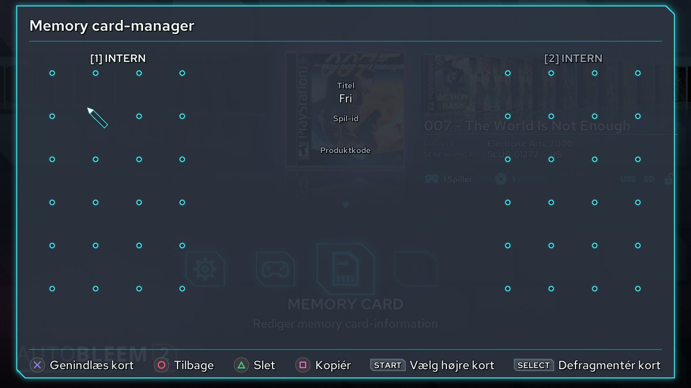

**Genoptagelsespunkter.** Mange PS1-spil lader dig kun gemme bestemte steder, og du når ikke altid hen til et, før du
må stoppe. Det tager genoptagelsespunkterne sig af: Forlader du et PS1-spil med konsollens Reset-knap (eller via
emulatorens menu på en Pi eller en pc), gemmer AutoBleem en tilstand af præcis der, hvor du var. Mens den skriver
den, på vej ud af spillet, viser emulatoren *Please wait...*. Næste gang fortsætter du fra det øjeblik.

Du finder dem under spillets ikon *GENOPTAG*. Et spil med et genoptagelsespunkt viser et lille billede af det på
ikonet; et spil uden har ikonet gråt. Vælgeren af genoptagelsespladser har fire pladser, vist som indrammede kort,
hver med et billede af øjeblikket, pladsens nummer og datoen. Den nyeste er markeret **NYESTE**, og på en plads, der
ikke er brugt, står der *Intet genoptagelsespunkt*. Cross fortsætter spillet fra den valgte plads, og Triangle
sletter den. Om vælgeren overhovedet dukker op, når du starter spillet, afhænger af spillets indstilling *Genoptag:*
(afsnit 3.7).

PS1-spil, du spiller i RetroArch, har også genoptagelsespladser. Hver plads har et mærke - AutoBleem 2-logoet eller
RetroArch-logoet - så du kan se, hvilken emulator der har skrevet den.


### 3.9 Start af spil, RetroArch og Apps

At starte et spil er det, du gør oftest, så det kræver kun én knap: Vælg spillet på hylden, og tryk på **Cross**. Et
PS1-spil åbner i fuld skærm i den PS1-emulator, du har valgt under Indstillinger (afsnit 3.6), og kører, til du
forlader det. Vil du hellere spille et PS1-spil i RetroArch - fordi det kører bedre dér, eller fordi du kan lide
RetroArchs muligheder - så tryk på **Square** i stedet.

**Sådan forlader du et spil.** På PlayStation Classic gør konsollens egne knapper, hvad du ville forvente. **Reset**
foran tager dig tilbage til launcheren og gemmer et genoptagelsespunkt, der hvor du var, så du kan fortsætte senere
(afsnit 3.8); det virker også, mens menuen i spillet er åben. **Power** slukker konsollen. En Raspberry Pi eller en pc
har ikke den slags knapper, så dér forlader du spillet via emulatorens menu, som er beskrevet nedenfor.

Der er også en vej ud, der virker ens på alle controllere - konsollens egen, en USB-controller eller en
Bluetooth-controller: **Hold Start + Select, eller Home, inde i 2 sekunder**, så er du tilbage i AutoBleem. Et kort
tryk på de samme knapper åbner i stedet emulatorens menu. Launcheren minder dig om begge dele i sin hjælp (*Hold
Select+Start eller Home i 2 sekunder: tilbage til AutoBleem* og *Kort tryk på Select+Start eller Home: emulatorens
menu*). En App har ingen emulatormenu, så dér er det kun det lange tryk, der gør noget. På konsollen stopper Reset
altid også en App.

**Menuen i spillet.** Med `pcsx-abnxt` har emulatoren sin egen menu til det, du har brug for, mens du spiller: gemme,
skifte disk, justere billedet, vælge controllere. Tryk på menuknappen - Home på en controller, der har en,
**Select + Start** på en controller uden, eller **Esc** på et tastatur - så holder spillet pause bag menuen med sit
sidste billede i baggrunden. Holder du menuknappen inde i 2 sekunder, gør det det samme som Reset: Du forlader spillet.
Menuen har tre faner, og L1 og R1 skifter mellem dem. Den husker, hvor du var, så næste gang åbner den på samme fane
og linje.

- Fanen **Spil** handler om selve spillet. *Fortsæt spillet* lukker menuen, så du kan spille videre. Under *Gemte
  spil* gemmer *Hurtig gemning* øjeblikket, du er i, og *Hurtig indlæsning* henter det tilbage. *Indlæs autogem*
  tager dig tilbage til, hvordan spillet så ud for op til 30 sekunder siden - emulatoren holder den kopi i
  hukommelsen, mens du spiller, og den kan redde dig ud af en fejl, du ellers ikke kan gøre om. Under *Cd* er
  *Skift disk* til et spil på flere diske, når det beder om den næste, og *Nulstil spillet* starter spillet forfra.
  *Gem indstillinger for dette spil* gemmer de indstillinger, du har valgt til netop dette spil (afsnit 3.7).
  *PCSX-menu* åbner PCSX-ReARMeds egne sider med dens indstillinger, snydekoder og About, og *Afslut* tager dig
  tilbage til AutoBleem.
- På fanen **Billede** ændrer du, hvordan spillet ser ud, mens du kigger på det: *Skærm*, *Opløsning* (1x eller 2x),
  *Fjern sømme*, *Dithering*, *Skalering*, *Skærmglorie*, *Udglatning*, *Filter*, *CRT-maske*, *Scanlines* og
  *Scanline-lysstyrke*. Det er de samme indstillinger som i spileditoren (afsnit 3.7), og hver linje har en
  hjælpelinje til højre, der fortæller, hvad den gør. *Skærm* er skærmens opløsning; på konsollen vælger du den
  under Indstillinger, og her bliver den kun vist. *Skærmglorie* er til de mørke bjælker ved siden af et 4:3-billede
  på en bred skærm: Den fylder dem med billedets egne kanter, spejlet og dæmpet, så spillet ligesom stråler ud i
  dem i stedet for at stå mellem to sorte bjælker. *CRT-maske* lægger et gammelt billedrørs fosformønster over
  billedet - *Apertur* giver en Trinitrons fine striber, *Spalte* og *Delta* andre billedrørs prikker. Den findes
  kun sammen med filteret CRT (raster). Filteret CRT-Pi er for tungt for konsollen ved 1080p. En linje, der ikke
  gælder, er grå, og dens hjælpelinje fortæller hvorfor.
- Fanen **Controllere** bestemmer, hvad der sidder i PlayStationens to porte, *Controller 1* og *Controller 2*: en
  almindelig (digital) controller, en analog controller (DualShock), en pistol eller ingenting. Nogle spil virker kun
  med én slags controller. Ændringen træder i kraft, når du går tilbage til spillet.

Menuen er tegnet i launcherens eget ab2.0.0-udseende, så den ikke føles som et andet program, og den viser dine
controllerbatterier og billedet fra dit seneste quick save.

**RetroArch-spil.** Et spil fra et andet system starter i RetroArch med den core, launcheren har valgt til systemet.
Når du er færdig, bringer *Close Content* eller *Quit RetroArch* i RetroArchs menu dig tilbage til launcheren. Vil du
ændre, hvilken core der spiller et system, så åbn *RetroArch-cores* i hurtigmenuen (afsnit 3.4); listen åbner med
core'en *PlayStation 1* øverst. Og vil du ind i RetroArchs egen menu (XMB) for at se dens indstillinger og egne
indholdslister, så vælg *RetroArch* i systemmenuen: RetroArch åbner så uden noget indlæst.


**Apps.** Apps er programmer snarere end spil: konsolværktøjerne og, på konsollen, de ekstra programmer, der følger
med RetroArchs pakke - Doom, Quake, Amiga og flere. Du finder dem i sættet Apps. Før en App starter, viser AutoBleem
dens læs-mig, så du ved, hvad den er, og hvordan den styres. Cross starter den, og Circle tager dig tilbage til
hylden.

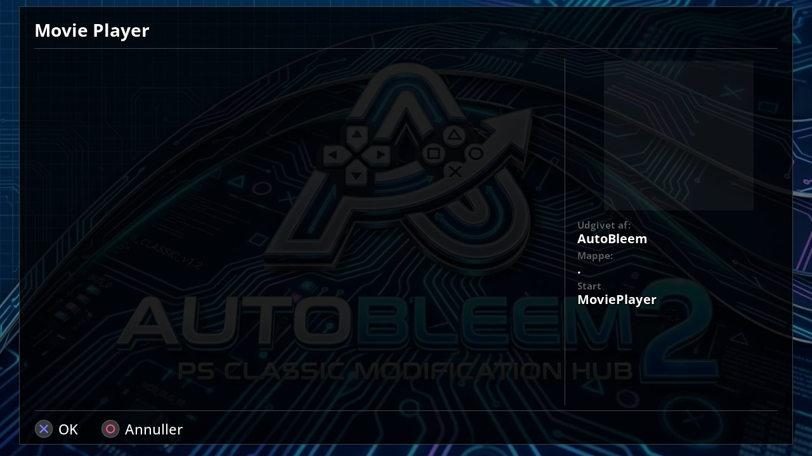

**En Apps indstillinger.** Mange Apps er skrevet til én bestemt controller, så du kan ændre, hvordan de ser din. Vælg
appen, åbn ikonrækken, og vælg *Spil*: Appens *Spilindstillinger* åbner (*Ændr hvordan dette program startes*).
*Controllertilstand:* bestemmer, hvilken controller appen får at vide, at den har. *Automatisk* bruger det, appen
selv beder om; *PSC-controller* og *Xbox 360-controller* præsenterer din controller som konsollens controller eller
som en Xbox 360-controller, og *PSC-controller (system)* og *Xbox 360-controller (system)* gør det samme via selve
systemet. Prøv en anden tilstand, når en App ikke reagerer på din controller, som den skal. *D-pad som stick:* lader
d-pad'en styre den analoge stick, til en App, der kun lytter efter sticken, og *Stick som D-pad:* gør det modsatte.

Nogle Apps stiller dig et spørgsmål, første gang du starter dem. En vil vide *Hvilke styringer har din controller?*,
så den kan sætte sin styring op: Svar *Ét D-pad* til en controller med kun d-pad, eller *Analoge sticks*. En App, der
kører Windows, spørger *Hvad vil du gøre?* og tilbyder at køre Windows, installere det, køre DOS eller afinstallere
Windows. Når en App lader dig vælge en tast, beder den dig *Tryk på en af knapperne.*


Et Windows-program, som PE-runneren kører (en PE-app, afsnit 3.3), taler med dig via AutoBleems egne skærme: En
besked, det vil vise, kommer frem som *Besked*, og et spørgsmål med valgmuligheder som *Vælg en mulighed*, begge med
appens navn som titel.


### 3.9a En disk i et USB-drev

Du kan slutte et almindeligt USB-cd/dvd-drev til konsollen, en Raspberry Pi eller en pc, der er startet fra
AutoBleem-nøglen, og spille direkte fra en original PlayStation-disk - uden at kopiere noget. En disk, du lægger i,
dukker op i launcheren som endnu et spil. Det virker ikke på Windows.

**Kopiér en disk over på nøglen.** Vil du altid have spillet ved hånden uden disken, så tryk på Square (*Kopiér
disk*). AutoBleem spørger først, om spillet skal kopieres, og hvor meget plads det vil fylde, og gemmer det så i mappen
`Games` som én CHD-fil (et spil på flere diske får også en `.m3u`-fil, så diskskift virker i spillet). Mens den
kopierer, ser du hastigheden og den resterende tid, og *Afbryd* stopper den. Når den er færdig, står spillet på
hylden som alle de andre. AutoBleem kopierer ikke et spil, der allerede ligger i `Games`, eller et, der ikke er plads
til - så fortæller den, hvor meget plads den skal bruge. En ridset disk kan også kopieres: De dele, der ikke kunne
læses, fyldes med nuller, og AutoBleem fortæller dig, hvor mange der var. Sådan en kopi virker måske, måske ikke.

Square tilbyder kopien for alle PlayStation-spildiske i diskvisningen, også for en, cover-databaserne ikke kender. Et
spil, databaserne kender, kopieres under sin titel; ved et spil på flere diske kopierer du diskene en efter en, og
`.m3u`-filen sætter dem i rækkefølge med disk 1 først. En disk, databaserne ikke kender, får i stedet sit serienummer
som navn, kopieres som en enkelt disk og har intet omslag på hylden. Kopivinduet, *Kopierer disken*, bliver på
skærmen, til kopien er færdig eller stoppet - launcheren venter imens - og viser hastigheden som et multiplum af et
almindeligt cd-drev. Går kopien galt, fortæller AutoBleem dig hvorfor.


**Spil fra disken.** Når du lægger en disk i, åbner **diskvisningen** af sig selv, så snart disken er læst. Den viser
diskens omslag - fra cover-databaserne eller hentet online - med serienummer og titel, og Cross starter spillet. Et
PS1-spil, der spilles fra disken, gemmer sine genoptagelsespunkter og gemte spil i sin egen mappe, så du kan stoppe
og fortsætte senere, præcis som med et spil på nøglen. Efter spillet, eller når du har været inde i indstillingerne
eller en udvidelses indstillinger, kommer du tilbage til diskvisningen. Forlader du den med Circle for at kigge på
dine andre spil, bliver disken i drevet, og Circle på hylden bringer visningen tilbage; på en tom hylde åbner R1
(*Disk*) den også. På en hylde med spil beholder R1 sin sædvanlige opgave med at springe mellem
begyndelsesbogstaver. Tager du disken ud, lukker diskvisningen.


**Drevchippen** øverst på skærmen fortæller dig, hvad drevet laver, så du ved, om du skal vente. Uden tilsluttet drev
ser du ingenting. Et drev uden disk viser et nedtonet diskikon. Mens en disk bliver læst, blinker ikonet og siger
*Læser disken...*, og når den er klar, lyser ikonet op med diskens titel. Lægger du en disk i, som hverken er et
PlayStation-spil eller en lyd-cd, siger chippen *Dette er ikke en PlayStation-disk*, og kan drevet ikke læse disken
lige nu, siger den *Disken kan ikke læses lige nu*.


**Lyd-cd'er.** Drevet spiller også musik-cd'er. En lyd-cd åbner **cd-afspilleren** i stedet for diskvisningen. Den
viser disken som *Lyd-cd* med listen over numre og den samlede spilletid, og linjen under den nævner det valgte nummer
og siger, om gentagelse og bland er slået til. En disk, afspilleren ikke kan afspille, er markeret med *Denne disk
kan ikke afspilles*. Det er dens knapper:

| Knap | I cd-afspilleren |
|---|---|
| Cross | Afspiller det valgte nummer. |
| Start | Sætter musikken på pause og starter den igen. |
| Square | Stopper musikken. |
| L1 / R1 | Går til det forrige eller næste nummer. |
| L2 / R2 | Spoler tilbage eller frem i nummeret, fem sekunder ad gangen. |
| Triangle | Skifter, hvad der gentages: ingenting, hele disken eller det aktuelle nummer. |
| Select | Slår bland til eller fra, så numrene spilles i tilfældig rækkefølge. |
| Circle | Forlader cd-afspilleren. |


**LibCrypt-diske.** Nogle PlayStation-spil, de fleste fra Europa, har en kopibeskyttelse, der hedder LibCrypt. For at
køre dem skal emulatoren bruge en lille `.sbi`-fil med beskyttelsens data. AutoBleem henter selv den fil fra siden,
før sådan en disk spilles, og når du kopierer den, og den kopieres med spillet. Det kræver et netværk: på en
Raspberry Pi eller en pc det, den allerede har, på konsollen det wi-fi, du har sat op i PSC-Bios.

For en disk i drevet giver nogle af et spils indstillinger ingen mening, så dens spileditor gør de linjer grå
(afsnit 3.7).

### 3.10 Tilføj spil

AutoBleem finder selv dine spil, så længe de ligger det rigtige sted. Dette afsnit fortæller, hvor hver slags hører
hjemme, så hver scanning sætter dem på hylden med navn og omslag.

**PS1-spil** skal i mappen `Games`, **én mappe pr. spil**, opkaldt efter spillet. Du kan også samle spil i dine egne
mapper, og hver sådan mappe bliver en gruppe i sætvælgeren (afsnit 3.3):

```
Games/
  Crash Bandicoot/            Crash Bandicoot.cue + Crash Bandicoot.bin
  Final Fantasy VII/          Final Fantasy VII (Disc 1).chd, (Disc 2).chd, (Disc 3).chd
  Platformers/                a folder of games: a group of its own in the set picker
    Klonoa/                   Klonoa.pbp
```

AutoBleem læser de almindelige formater til diskbilleder: `.cue` med sin `.bin` (eller `.img`), `.pbp`, `.chd`
(også zstd-komprimerede), `.iso` og `.ecm`, som scanningen afkoder for dig. Et zippet spil virker også: Processoren
**Unzip** pakker det ud, før scanningen læser det (afsnit 3.14).

Du behøver ikke være ordentlig. Et spil på flere diske hører hjemme i én mappe med alle sine diske, men kopierer du
mapper med navne som `Game (Disc 1)`, `Game (Disc 2)` og så videre, slår scanningen dem sammen til én mappe `Game`.
Spil, der lægges direkte i `Games/` som løse filer, får også hver deres mappe af scanningen.

**Navne og omslag** kommer af sig selv. Scanningen læser hver disks serienummer og henter titel, udgiver, år, antal
spillere og region fra RetroArchs PlayStation-database eller fra cover-databaserne. Vil du have dit eget omslag, så
læg en PNG eller JPEG med samme navn ved siden af spillets billedfil. Uden et kommer omslaget fra cover-databaserne
eller, med RetroArch installeret, fra libretros samling af miniaturer; på en Raspberry Pi, en pc eller Windows hentes
et manglende omslag online (Indstillinger → *Hent covers online*). Tager scanningen fejl, så ret det i spileditoren,
og slå *Lås data* til, så næste scanning beholder din ændring.

**Spil fra andre systemer** skal under `RetroArch/roms/`, **én mappe pr. system, navngivet sådan som RetroArchs
databaser navngiver det** - for eksempel `Nintendo - Nintendo Entertainment System`, `Nintendo - Super Nintendo
Entertainment System`, `Sega - Mega Drive - Genesis`, `Nintendo - Game Boy Advance` eller `FBNeo - Arcade Games` (eller
`Arcade`). Mapperne bliver lavet for dig, og ROM'erne må gerne blive liggende zippede. På en Raspberry Pi, en pc eller
Windows læser scanningen dem selv og skriver RetroArchs afspilningslister. En konsol-USB-nøgle kan ikke klare det
alene, så dér kører du **UpdateRoms** på pc'en (kapitel 5).

**Apps** skal under `Apps/<name>/`, hver med en `app.ini` - navnet, ikonet og hvad der skal køres - og en `run.sh`.

**Pakker.** Nogle Apps er spilmotorer: De skal bruge data fra et spil, du ejer, før de kan spille det. Doom, Quake,
OpenArena, Heretic, Hexen, Strife, Duke Nukem 3D, Shadow Warrior, Theme Hospital, DOS-spil og flere virker på den
måde. Læg spillets filer i en mappe `Packages` på nøglen, én mappe pr. spil - for eksempel `Packages/Doom/DOOM2.WAD` -
så genkender AutoBleem dem ud fra en tabel, der følger med (`rc/packages.ini`). I en mappe, den genkender, er løse
spilfiler hver deres pakke. AutoBleem læser kun dine filer og ændrer aldrig i dem. En pakke kan også komme fra Store
(afsnit 3.13).

Hvor launcheren viser den, oplister linjen *Pakker* på fanen Apps (afsnit 3.3) de spildata, der er fundet. Cross på et
element åbner dets **Package info**: hvad dataene indeholder, en beskrivelse, hvor filerne ligger, og hvor de kom fra
(dine egne filer, Store, et mod eller filer, der følger med en App), om det er shareware eller gratis, og hvilken
installeret App der kører det. Kan intet af det, du har installeret, køre det, fortæller infoen dig det.

Når du starter en motor-App, leder AutoBleem efter spildata, den kan køre. Er der ét sæt data, starter spillet med det
samme. Er der flere, spørger en liste (*Vælg spildata*), hvilket du vil spille, og den står på det, du valgte sidst.
Er der ingen, fortæller AutoBleem dig, hvilke data appen skal bruge, og hvor de skal ligge, og intet starter.

**Dine egne spil.** Når AutoBleem ikke genkender nogle data, står der i deres Package info *Ikke genkendt. Hvis det er
et spil, se manualen: Dine egne spil.* Tabellen kender kun de spil, den er lavet til. Til et andet skriver du en linje
for det i din egen `packages.ini` i mappen `Packages`: AutoBleem læser din først, så dine linjer vinder.


**Scan kun en del.** Har du kun tilføjet spil til ét sæt eller én mappe, kan *Genscan spil* nøjes med at scanne den
del, hvilket er hurtigere end at scanne det hele, og boblen forsvinder, når den er færdig.

**Temaer** skal under `Themes/<name>/` med deres `theme.json` og deres billeder - eller læg temaets zip i `Themes/`,
som den er.

### 3.11 PS1-BIOS'en

BIOS'en er PlayStationens eget opstartsprogram, og emulatoren spiller spillene mest trofast med den rigtige. På en
**PlayStation Classic** skal du ikke gøre noget: Emulatoren bruger konsollens egen BIOS. På en **Raspberry Pi, en pc
og Windows** lægger du dine egne PS1-BIOS-filer i `System/Bios/`: `romw.bin` (den amerikanske/europæiske
SCPH-5501/5502) og `romJP.bin` (den japanske SCPH-5500, som bruges til japanske spil). Installationsprogrammerne
fylder dem ud fra RetroArchs BIOS-pakker, medmindre dine egne filer allerede ligger der - dem erstatter de aldrig.
Uden dem kører emulatoren på sin indbyggede HLE-BIOS, en erstatning, som mange spil accepterer og nogle ikke gør. Vil
et spil ikke starte, er en manglende BIOS det første, du skal tjekke.

### 3.12 Opdateringer

AutoBleem holder sig selv opdateret, så du får nye funktioner og rettelser uden at geninstallere noget. Når launcheren
starter, og derefter én gang om dagen, tjekker den siden for en ny version på sin **kanal**. Kanalen vælger du under
Indstillinger → *Opdateringer*: `release`, `testing`, `nightly` eller `off`, hvis den slet ikke skal kigge. Vil du
ikke vente på det daglige tjek, tjekker *Softwareopdatering* i systemmenuen med det samme.

Når der er en ny version, spørger AutoBleem dig, hvad du vil. *Opdater nu* henter og installerer den, hvilket tager et
par minutter. *Mind mig om det i morgen* spørger igen om et døgn, og *Spring denne version over* spørger ikke igen om
denne version. Uanset hvad du vælger, bliver dine spil, gemte spil og indstillinger altid; efter en opdatering
scanner launcheren dine spil en gang til. Kanalmærket i øverste venstre hjørne (afsnit 3.1) viser, hvilken version du
har.

Hvordan opdateringen installeres, afhænger af maskinen:

- På en **Raspberry Pi** og **pc-nøglen** kører installationsprogrammet igen efter download, med samme statusskærm som
  ved første opstart, og tilbyder også en nyere RetroArch. Bagefter er launcheren tilbage.
- På **Windows** åbner den hentede installation, installerer den nye version og starter den nye launcher.
- På en **PlayStation Classic** kan kun en konsol med **AutoBleem-kernen** (ABFlashKit, afsnit 6.2) og et
  **wi-fi-netværk** sat op i PSC-Bios (afsnit 6.1) opdatere sig selv - en uændret konsol har intet netværk, så dér
  kigger launcheren ikke. Efter *Opdater nu* lukker launcheren, og AutoBleem-billedet bliver stående på skærmen, mens
  nøglen opdateres, hvilket tager et par minutter; derefter starter den nye launcher. Uden netværk siger
  *Softwareopdatering* *Ikke forbundet*. Enhver konsol-USB-nøgle kan også opdateres fra en pc med
  `AutoBleemInstaller.exe` (afsnit 2.1).

### 3.13 Udvidelser og AutoBleem Store

**Udvidelser** tilføjer nye ting til launcheren - deres egne skærme og funktioner - uden at ændre selve AutoBleem.
AutoBleem Store og PSC-Bios er udvidelser. En udvidelse bor i `Extensions/<name>/` på nøglen (på en Raspberry Pi på
dens datapartition, på Windows i datamappen); vil du installere en, pakker du dens zip ud dér.

Du ser dem ved at åbne systemmenuen (**L2 + R2**) og vælge *Udvidelser*. Dem fra AutoBleem-holdet står øverst, og
alle andre følger under *Tredjepartsudvidelser*. Cross kører den valgte, og Triangle slår den fra, eller til igen.
PSC-Bios på konsollen er undtagelsen: Med den sætter du wi-fi, controllere og ur op, så den kan ikke slås fra dér. Når
en udvidelse ikke kan køre, fortæller dens linje hvorfor - den skal bruge et netværk, og der er intet, den er ikke
lavet til dette system, den er lavet til en anden version af AutoBleem og skal opdateres, eller den kunne ikke
indlæses. Hvis en udvidelse nogensinde får launcheren til at gå i stå, slår AutoBleem den fra, og listen fortæller
dig det; du kan slå den til igen her.

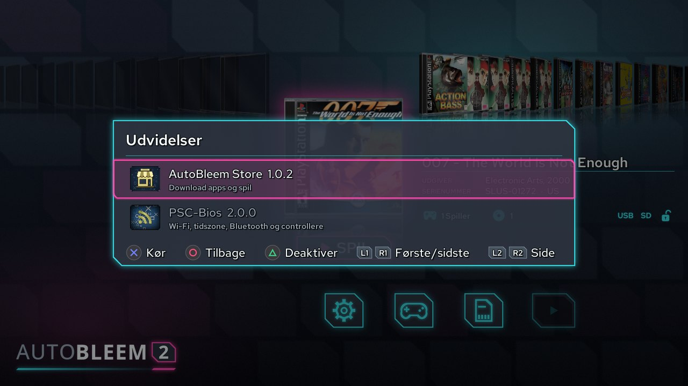

**AutoBleem Store** er den første udvidelse: et sted, hvor du kan gennemse Apps og spil og installere dem med ét tryk,
på alle de systemer, AutoBleem kører på. En PlayStation Classic skal have AutoBleem-kernen til den, fordi wi-fi følger
med kernen. Du åbner den fra hurtigmenuen (*Store*, afsnit 3.4). Den har fire faner, og L1 og R1 skifter mellem dem.

Fanerne **Apps** og **Games** viser, hvad kilderne tilbyder, hvert element med sit billede, sin version, sin størrelse
og det lille ikon for den kilde, det kommer fra. Fanen Apps viser også PE-apps med deres licens og kilde samt pakker
med spildata (afsnit 3.10). Det, du allerede har installeret, har et mærke *Installed*. Hjælpelinjen viser de knapper,
der gælder for den valgte linje:

| Knap | På fanerne Apps og Games |
|---|---|
| Cross | Installerer elementet - eller opdaterer det, prøver igen efter en fejl eller annullerer en download, der venter eller kører. |
| Triangle | Fjerner noget, som Store har installeret. |
| Square | Opdaterer listerne fra kilderne. |
| L2 / R2 | Springer til det forrige eller næste begyndelsesbogstav. |
| Select | Viser én kilde ad gangen, når du vil se, hvad en enkelt kilde tilbyder. |
| Start | Søger i titlerne. |

Billederne gemmes, når de først er indlæst, så listerne kommer hurtigt frem næste gang, og et billede, der ikke blev
indlæst, kan prøves igen.

Fanen **Downloads** viser, hvad der hentes, venter, er mislykket eller installeret, med en statuslinje, der bevæger
sig jævnt. Du behøver ikke holde øje med den: Downloads fortsætter i baggrunden, også når du har forladt Store, og når
du er et andet sted i launcheren, viser en boble den igangværende download med hastighed og resterende tid (for
eksempel `1.4 MB/s · 0:42`). At starte et spil eller slukke sætter dem kun på pause, og en stoppet download
fortsætter, hvor den slap. Falder netværket ud, står der *Waiting for the network* ved elementet, og det fortsætter,
hvor det var, når netværket er tilbage; efter 30 minutter uden netværk giver det op. Downloads på over 2 GB virker på
alle platforme, også 32-bit-versionerne. Et spil, du installerer, dukker op på hylden efter næste scanning med
billedet fra Store som omslag.

Fanen **Sources** viser, hvor listerne kommer fra, hver med sit ikon: AutoBleems eget katalog, enhver TSV-liste, der
er lagt i `System/Extensions/store/sources/`, og de adresser, du selv tilføjer med *Add a source URL*. Cross på en
kilde, du selv har tilføjet, lader dig omdøbe den, ændre dens adresse, skifte den mellem `http://` og `https://` eller
fjerne den.

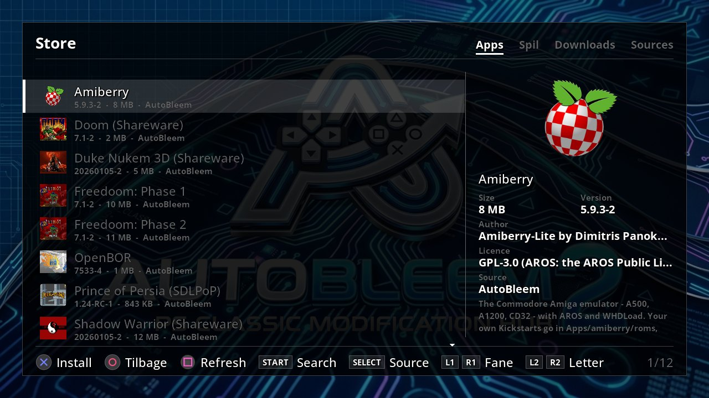


Det, AutoBleems eget katalog tilbyder, står også på downloadsiden, på `https://autobleem.retromenele.pl/store/`. En
kilde, du selv tilføjer, er en anden sag: **Du er selv ansvarlig for indholdet af de kilder, du tilføjer.**

**Dine egne spil på dit eget netværk.** Har du dine PS1-spil liggende på en anden computer derhjemme, kan `abstored`,
Store's LAN-server, tilbyde dem til Store over dit netværk, så du installerer dem som ethvert andet element. Den kører
på enhver Linux-maskine - en Raspberry Pi, en hjemmeserver - og læser kun mappen uden nogensinde at ændre den. Start
den med `abstored <games folder>`, og åbn så `http://<that machine>:8124/` i en browser: Siden viser, hvad den
tilbyder, og eventuelle problemer, den har fundet. Tilføj `http://<that machine>:8124/store.tsv` som kilde i Store.
Færdige programmer til Linux og Windows ligger på Store's side, på fanen **LAN server**, og `INSTALL-linux.md`
(`ext_store/server/` i kildekoden) forklarer, hvordan du sætter den op som tjeneste. **LAN Share** (afsnit 5.2)
lægger spil og diske fra en pc over på sådan en server.

### 3.14 Scanningsprocessorer

Scanningsprocessorer gør dine spil klar, før AutoBleem læser dem. En processor er et lille program, som hver
scanning kører først. Den kan lave et format, AutoBleem ikke læser, om til et, den kan - pakke et zippet spil ud, for
eksempel - eller ændre et spils data, som at lægge en oversættelsespatch på. Processorer bor i
`System/Processors/<name>/` på nøglen (på en Raspberry Pi på dens datapartition, på Windows i datamappen); vil du
installere en, pakker du dens mappe ud dér, og næste scanning kører den.

**Unzip følger med AutoBleem.** Den pakker zippede PS1-spil i `Games/` ud, før scanningen læser dem, og zippede ROM'er
én ad gangen; arkadesæt forbliver zippede, for sådan læser arkade-cores dem. Når du opdaterer AutoBleem, opdateres
Unzip også, og har du slået den fra, forbliver den slået fra.

En processor gør sit arbejde én gang: Når den har behandlet et spil, kører den ikke på det igen, før spillet ændrer
sig. Mens en processor arbejder, viser boblen øverst til højre, hvad den laver, og en advarsel eller en fejl dukker op
på linjen under den; `processors.log` i logmappen har detaljerne. Starter du et spil eller RetroArch, stopper en
processor, der ændrer filer, så spillet har maskinen for sig selv, og næste scanning gør arbejdet færdigt.

Du administrerer dem ved at åbne systemmenuen (**L2 + R2**) og vælge *Scanningsprocessorer*. Du ser dem i den
rækkefølge, de kører, med én fane til PS1-spillene og én til ROM'erne; L1 og R1 skifter mellem fanerne. Rækkefølgen
betyder noget: En processor, der pakker ud, skal komme før en, der patcher det udpakkede.

| Knap | I Scanningsprocessorer |
|---|---|
| Square | Samler den valgte processor op, så Op og Ned flytter den til dens nye plads; Square sætter den ned igen. |
| Cross | Slår processoren fra, eller til igen. |
| Triangle | Får processoren til at kigge på alle spil igen ved næste scanning, også dem, den allerede har behandlet. |
| Circle | Går tilbage og starter en scanning, hvis du har ændret noget. |

En processor, der er bygget til en anden maskine, bliver stående på listen, grå, så du kan se, at den er der, men at
den ikke kører her.

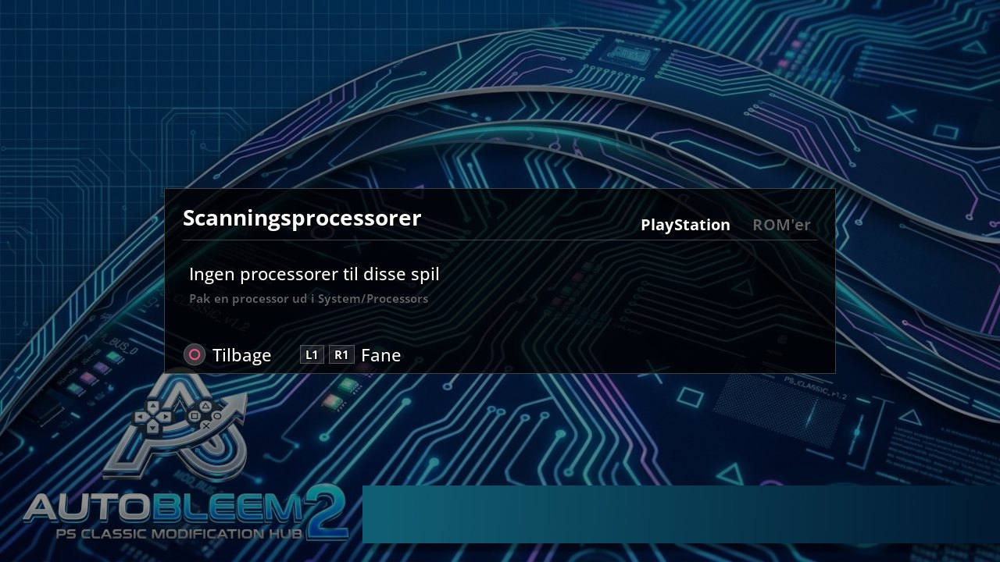

Vil du skrive din egen processor, forklarer Unzips side, `https://github.com/autobleem2/proc_unzip`, alt, hvad en
processor skal gøre, og `tools/proc_check.py` i AutoBleems kildekode tjekker din, før du deler den.

<!-- pagebreak -->

## 4. Skærme

### 4.1 Spilbibliotek

Spilbiblioteket er stedet, hvor du rydder op i din PS1-samling. Brug det, når du vil fjerne et spil, du ikke spiller
mere, åbne et spils indstillinger uden først at finde det på hylden eller få AutoBleem til at hente alle omslag
igen. Du åbner det fra systemmenuen (L2 + R2, *Spilbibliotek*). Mens en scanning kører, er det gråt og venter, til
scanningen er færdig.

Skærmen har titlen *Spilbibliotek - vælg spil*. Til venstre ser du alle dine PS1-spil som en liste over titler i
alfabetisk rækkefølge; til højre det valgte spils omslag med udgiver, år, serienummer og den mappe, det ligger i. Den
ledige plads på drevet står øverst til højre, så du kan se, hvor meget plads en sletning giver dig tilbage. Op og Ned
går gennem listen, L2 / R2 bladrer en side, og L1 / R1 springer til det første eller sidste spil.

- **Cross** åbner det valgte spil i spileditoren - den samme editor som ikonet Spil på hylden (afsnit 3.7). Når du
  forlader den, står du på det samme spil i listen igen.
- **Square sletter spillet.** AutoBleem spørger først og fjerner så hele spillets mappe. Bruges spillets gemte
  tilstande og memory card ikke af noget andet spil, stiller den et spørgsmål mere: om de også skal slettes. Svar nej,
  hvis du måske vil have spillet tilbage senere med dine gemte spil.
- **Triangle sletter alle omslagsbilleder** (PNG eller JPEG), der ligger ved siden af dine spil, efter et spørgsmål.
  Det er nyttigt, når du har samlet omslag, du ikke kan lide: Næste scanning henter omslagene fra cover-databaserne
  igen.

Sidst i listen, efter spillene, ser du måske mapper markeret *Ikke tilføjet*. Det er mapper i `Games`, som scanningen
kiggede på, men ikke kunne gøre til et spil. Vælg en, så fortæller højre side, hvor den ligger, og hvorfor den ikke
blev tilføjet - en manglende cue-fil, for eksempel (kapitel 7). Square sletter sådan en mappe efter et spørgsmål.
Forlader du skærmen med Circle efter at have ændret noget, scanner AutoBleem spillene igen.

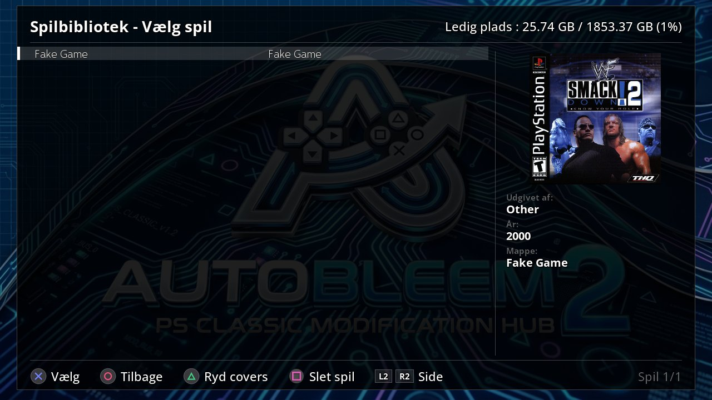

### 4.2 Hardwareinformation

Hardwareinformation er siden, du kigger på, når du vil vide, hvad din maskine er, og hvad den ser: hvor meget plads der
er tilbage på nøglen, hvilken netværksadresse den har, hvilke skærm- og lyddrivere den bruger, og hvilke controllere
der er tilsluttet. Det er den samme side på alle platforme, konsollen inklusive. Du åbner den fra systemmenuen
(L2 + R2, *Hardwareinformation*); Circle tager dig tilbage til systemmenuen.

Siden viser systemet, hardwaren, lageret med den ledige plads, netværksadresserne, skærm- og lyddriverne og de
tilsluttede controllere. Den læser det hele igen hvert sekund, så du kan lade den stå åben, mens du sætter en
controller eller et kabel i, og se ændringen dukke op. Den viser kun ting - vil du sætte netværket eller en controller
op, bruger du *Netværk og controllere* (PSC-Bios, kapitel 6).

Afsnittet om controllere svarer på spørgsmålet "hvilken controller er hvilken spiller?". De to første controllere vises
som *Spiller 1* og *Spiller 2* - de porte, PS1-emulatoren giver dem. Alle yderligere controllere vises som *bruges ikke
af PS1-emulatoren*. RetroArch fordeler portene efter sine egne indstillinger, så i et RetroArch-spil kan rækkefølgen
være en anden. Du behøver ikke åbne siden hver gang: Når en controller sættes i eller tages ud, viser launcheren
kortvarigt, hvilken controller der nu er Spiller 1, og hvilken der er Spiller 2.

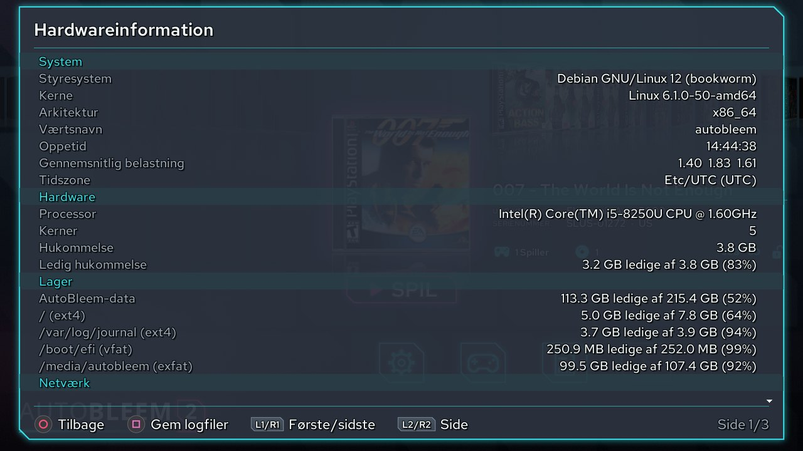

### 4.3 Knapoversigten

Glemmer du, hvad en knap gør et eller andet sted, så tryk på **Triangle** på hylden. Knapoversigten viser alle knapper
på alle skærme på én side, så du kan slå det op uden at forlade launcheren. Er et USB-tastatur tilsluttet, eller har
det været brugt, viser en kolonne *Tastatur* den tilsvarende tast ved siden af hver controllerknap.

Oversigten minder dig også om den ene ting, der er værd at huske i alle spil: hvordan du kommer ud. Hold Select +
Start, eller Home, inde i 2 sekunder for at gå tilbage til AutoBleem; et kort tryk åbner i stedet emulatorens menu.

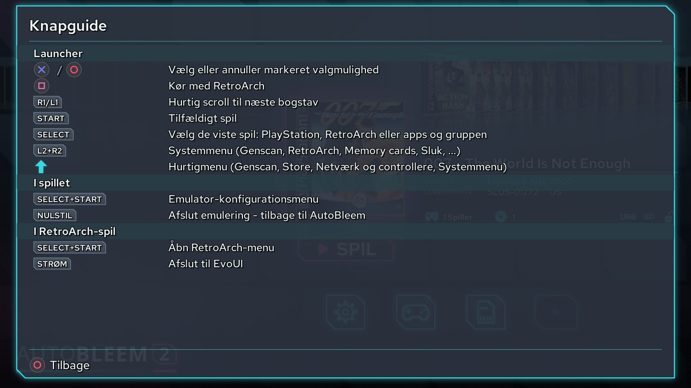

### 4.4 Skærmtastaturet

Når AutoBleem har brug for, at du skriver noget - navnet på et sæt memory cards, et spils titel, en wi-fi-adgangskode,
adressen på en kilde i Store - dukker det samme skærmtastatur op, så du kan skrive med controlleren alene. Det er
bygget op som en telefons tastatur. Ud over bogstaverne har det en side med symboler, med `/ \ : ? & = % @ #` og
resten af det, en adresse eller en adgangskode kræver, og to sider med bogstaver med accenter. Den nederste række
rummer Shift, tasten, der skifter side, mellemrum, Backspace og Bekræft.

Bevæg dig hen over tasterne med retningsknapperne, og tryk på **Cross** for at skrive den, markøren står på.
**Triangle** sletter et bogstav, og **Square** skriver et mellemrum. **L1** er Shift; tryk to gange for Caps Lock.
**R1** går til næste side med taster, og **L2 / R2** flytter markøren inde i teksten. **Start** bekræfter det, du har
skrevet, og **Circle** annullerer. Er et USB-tastatur tilsluttet, kan du når som helst skrive på det i stedet: Enter
bekræfter, og Esc annullerer.

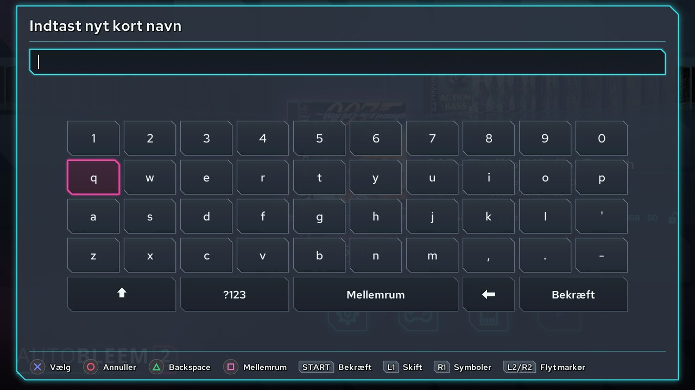

### 4.5 Virtuelt gamepad

Apps - programmerne i sættet Apps, som Doom eller Quake - læser ikke selv din controller. Et lille hjælpeprogram,
dæmonen for det virtuelle gamepad, læser de rigtige controllere og giver hver App en controller, den forstår. Denne
side viser dig, hvilke controllere hjælpeprogrammet ser, og hvordan det læser dem. Kig her, når en App ikke reagerer
på din controller, eller når dens knapper er byttet rundt. Du åbner den fra systemmenuen (L2 + R2,
*Virtuelt gamepad*); Circle tager dig tilbage til systemmenuen.

Under *Gamepads, som daemonen ser* står hver controller med et nummer og sit navn. Ved siden af kan du læse tre ting:
om hjælpeprogrammet kunne åbne controlleren (*tilsluttet*) eller ej (*ikke læsbar*); den driver, controlleren kom
igennem; og hvor dens knaplayout kommer fra - *fra controllerdatabasen* betyder, at controlleren er kendt, og at dens
knapper sidder, hvor de skal, *gættet af daemonen* betyder, at den ikke er kendt, og at hjælpeprogrammet har gættet
så godt, det kunne. Føles knapperne forkerte i en App, er et gættet layout den sandsynlige grund.

Hjælpeprogrammet kører kun, mens en App kører, så siden spørger det én gang, når den åbner. Sætter du en controller i,
mens siden er åben, så tryk på **Cross** (*Søg igen*) for at spørge igen. På Windows findes der ikke sådan et
hjælpeprogram, og siden siger *Ikke i denne build*.


<!-- pagebreak -->

## 5. På pc'en

### 5.1 UpdateRoms - opdatering af en konsol-USB-nøgle

På en Raspberry Pi, en pc eller Windows sorterer launcherens scanning selv dine RetroArch-spil i lister og henter
deres omslag. Det kan PlayStation Classic ikke, fordi den ikke har sit eget netværk. **UpdateRoms** gør i stedet
arbejdet på din Windows-pc: Den bruger pc'ens netværk, men skriver alt med de stier, konsollen forventer, så når du
sætter nøglen tilbage, starter konsollen og finder alt på plads. Kør den, hver gang du har tilføjet eller fjernet
RetroArch-spil på en konsol-USB-nøgle.

1. Kopiér dine ROM'er over på nøglen under `RetroArch/roms/<system>/` (afsnit 3.10). Mappenavnene skal være
   RetroArchs databasenavne; installationsprogrammet har allerede lavet de almindelige.
2. Start **`UpdateRoms\UpdateRoms.exe` fra nøglen** - installationsprogrammet har lagt den dér. Den finder selv ud af,
   hvilken nøgle den ligger på. Mens den arbejder, ser du en linje, der siger, hvad den laver, en statuslinje og en
   log.
   - Har nøglen endnu ingen RetroArch-database, henter den først RetroArchs databasepakke. Med den identificerer den
     så hver ROM, så et spil, databasen kender, får sit rigtige navn.
   - Den skriver én afspilningsliste pr. system i `RetroArch/bin/playlists/` med konsollens stier. Det, som RetroArch
     selv har tilføjet til listerne, bliver bevaret.
   - Til hver ROM uden omslag henter den et omslag fra libretros miniatureservere ind i `RetroArch/bin/thumbnails/`.
3. Skub nøglen sikkert ud, og sæt den tilbage i konsollen. Fanen RetroArch i sætvælgeren viser nu alle de systemer,
   der har spil.

Du kan køre den, så tit du vil: En mappe, hvor intet er ændret, springes over, så anden gang går det hurtigt. Går
noget galt, ligger loggen i `System/Logs/updateroms.log` på nøglen. Et Raspberry Pi-kort i en kortlæser kan opdateres
på samme måde med `UpdateRoms.exe <drive> --target rpi`, selv om en Pi klarer det selv, når den har et netværk.

### 5.2 LAN Share - dine spil og diske på serveren i dit netværk

Store kan installere spil fra en server på dit eget hjemmenetværk (afsnit 3.13). **LAN Share** er det Windows-program,
der fylder den server fra din pc: Det lægger de PS1-spil, du har på pc'en, over på serveren, og det kan læse en
PS1-disk i pc'ens cd/dvd-drev og lægge den derover også. Serveren er en `abstored`, der kører på en Raspberry Pi, en
NAS eller en anden pc. Når et spil først ligger på den, kan Store på konsollen, Pi'en eller pc'en installere det
derfra.

Du får `LanShare.exe` fra Store's side, på fanen **LAN server**. Der er intet at installere: Start det, så gemmer det
sine indstillinger i `%LOCALAPPDATA%\AutoBleem LAN Share\`.


1. **Forbind til serveren.** Skriv dens adresse, som Store kender den, `http://<its address>:<port>`, og tryk på
   **Connect**. Spillene, der allerede ligger på serveren, og eventuelle problemer, dens egen scanning har fundet,
   dukker op til venstre. For at lægge spil på serveren skal LAN Share have én af to veje ind:
   - **Share** er serverens spilmappe, sådan som den deles på dit netværk (Samba), for eksempel
     `\\raspberrypi\games`. LAN Share kopierer spillene ind i den og beder serveren scanne; serveren selv læser stadig
     kun sin mappe.
   - **Token** er til en server, der er startet med `--allow-uploads`. Skriv dens token - serveren skriver den ud, når
     den starter, og gemmer den i `<state>/upload-token`. LAN Share uploader så over HTTP, og en upload, der stopper
     halvvejs, fortsætter, hvor den slap.
2. **Udgiv spillene på din pc.** Vælg den mappe, dine spil ligger i (én mappe pr. spil), sæt flueben ved dem, du vil
   have med, og tryk på **Publish the ticked games**. **On the server** fortæller dig, om serveren allerede har et spil
   - den sammenligner serienummeret, eller titlen, hvis der ikke er noget serienummer - og et spil, serveren har,
   bliver aldrig sendt to gange. **Tick those not on the server** sætter flueben ved alle de andre for dig.
3. **Udgiv en disk.** Læg en PS1-disk i pc'ens drev, og tryk på **Read a disc and publish it**. LAN Share læser hele
   disken ind i en `.bin` + `.cue`, opkaldt efter spillets titel. Til et LibCrypt-spil skriver den også `.sbi`-filen,
   når drevet kan læse underkanalen. Har du valgt databaserne (se nedenfor), tjekker den kopien mod det kendte, gode
   dump. Derefter udgiver den spillet. Ved et spil på flere diske sætter du først flueben ved **The game has more than
   one disc**: LAN Share beder dig om hver af de næste diske og udgiver dem samlet som ét spil.
4. **Tag spil af serveren.** Vælg dem, og tryk på **Remove from the server...**. Intet bliver slettet: Hvert spil
   flyttes ind i en mappe `.removed` ved siden af serverens spil, og flytter du det tilbage, er det tilbage.

**Databases** er valgfrie. Peger du LAN Share hen på AutoBleems omslagsmappe (`coversU/P/J.db`) og RetroArchs
`Sony - PlayStation.rdb`, bruger den dem til at give spillene navne og til at tjekke en disk, den har læst.

Vil du hellere slippe for at kopiere noget, så sæt flueben ved **Also share the games on this PC with the Store** (den
er slået fra som standard): LAN Share tilbyder så spilmappen på din pc direkte til Store. Første gang du gør det,
spørger Windows om sin firewall - tillad kun private netværk.

<!-- pagebreak -->

## 6. Konsolværktøjerne (PlayStation Classic)

To værktøjer følger med en USB-nøgle til PlayStation Classic og hjælper dig med at sætte konsollen op ud over det, den
kan fra fabrikken. Begge ser ud som resten af launcheren, i dens tema og på dens sprog, og du betjener dem med
controlleren - i gamepad-guiden også med konsollens knapper foran. **PSC-Bios** er en udvidelse, der følger med
konsolpakken: Punktet *Netværk og controllere* i hurtigmenuen og i systemmenuen åbner den, og du finder den også på
listen over udvidelser. **ABFlashKit** er en App i sættet Apps.

### 6.1 PSC-Bios

PSC-Bios er stedet, hvor du forbinder maskinen med omverdenen: dit wi-fi-netværk, tidszonen, Bluetooth-controllere og
knaplayoutet for en controller, AutoBleem ikke kender. Den følger med konsolpakken og findes også på en Raspberry Pi og
pc-nøglen. Du åbner den med *Netværk og controllere* i systemmenuen (eller hurtigmenuen) eller fra listen over
udvidelser. Er udvidelsen installeret, men slået fra, er punktet *Netværk og controllere* gråt og siger, at den *er
slået fra - slå den til under Udvidelser*; tryk på Cross på det, så åbner listen over udvidelser ved PSC-Bios, så du
kan slå den til igen.

Den første skærm giver dig et overblik: klokken og tidszonen, netværksadapterne (wi-fi, ethernet, Bluetooth) med
deres adresser og alle tilsluttede controllere med en bemærkning om, hvorvidt de har en knaptildeling. På konsollen
kræver netværks- og Bluetooth-delene AutoBleem-kernen (afsnit 6.2); på en Raspberry Pi eller pc-nøglen bruger de
systemets egne værktøjer. Gamepad-guiden virker overalt.

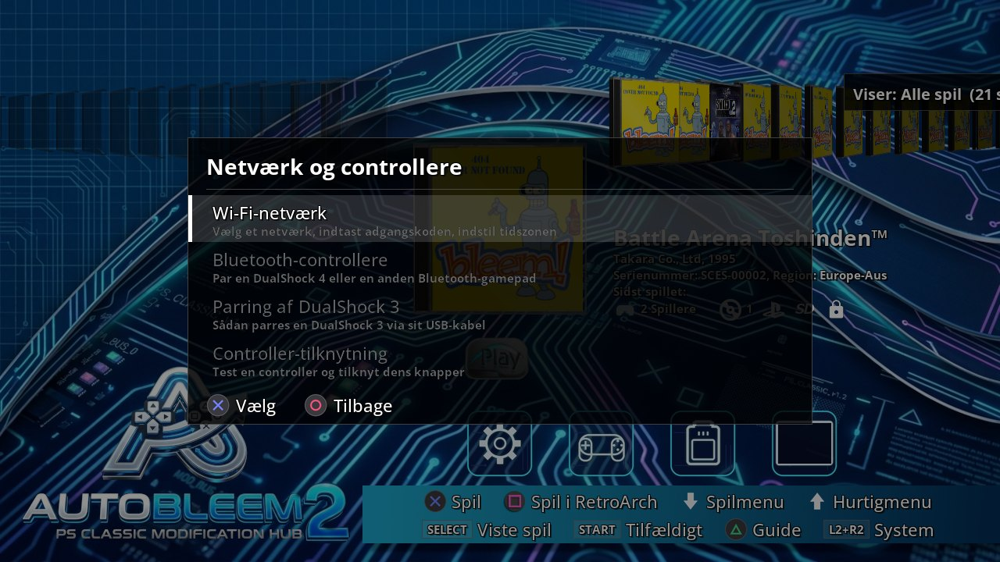

Fra den første skærm fører én knap dig til hver del:

| Knap | Hvad den åbner |
|---|---|
| Select | **Wi-Fi Network** forbinder dig til dit wi-fi (via kernen, eller NetworkManager på en Pi eller pc): Skriv netværkets navn, eller vælg det fra en søgning, indtast adgangskoden, vælg drivertilstand, og tryk på *Apply / Restart Network*. Her indstiller du også tidszonen, og når du er forbundet, ser du konsollens IP-adresse. |
| Square | **Bluetooth Controllers** søger efter Bluetooth-controllere som DualShock 4, så du kan parre en ny eller fjerne en, du ikke bruger længere. |
| L1 | **DualShock 3 Pairing** forbinder din første DualShock 3, som skal være sat til med USB imens, via kernens sixaxis-plugin. |
| R1 | **Controller Mapping** åbner gamepad-guiden, som er beskrevet nedenfor. |
| Triangle | **About** viser, hvad PSC-Bios er. |
| Circle | **Back** tager dig ud af PSC-Bios, tilbage til launcheren. |

**Gamepad-guiden.** Brug den, når en controller ikke gør noget i AutoBleem eller har sine knapper de forkerte steder.
Den viser den tilsluttede controller, som den virkelig er - hver akse, knap og hat som tal - og et billede af en
DualShock, der lyser op, når du trykker. Fordi du endnu ikke kan stole på den controller, du tester, styrer du guiden
med konsollens **knapper foran**: **RESET** skifter til den næste controller, **OPEN** starter tildelingen, og
**POWER** annullerer eller forlader guiden. Under tildelingen beder guiden om den ene knap efter den anden: Tryk på den
knap, der lyser på billedet, eller på OPEN, hvis din controller ikke har sådan en knap. Et kort tryk tildeles som
normalt.

Du kan også forlade guiden fra controlleren: Hold Circle inde i 2 sekunder - en bjælke fyldes op, og bunden af skærmen
siger *Hold 2 s: Exit*. Så længe controlleren endnu ikke har nogen tildeling, gør det samme at holde en hvilken som
helst knap inde i 2 sekunder (*Hold any button 2 s: Exit*). På et tastatur står Esc, mellemrumstasten og Enter for
POWER, RESET og OPEN.

Til sidst tages den nye tildeling i brug, så du kan prøve den, og OPEN gemmer den under et navn, du selv vælger.
Derefter indlæser launcheren den hver gang.

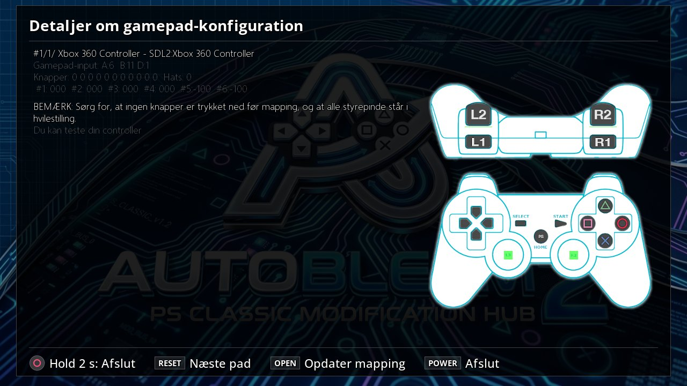

### 6.2 ABFlashKit - AutoBleem-kernen

AutoBleem-kernen erstatter konsollens egen Linux-kerne, og den er valgfri. Du vil have den, hvis du vil have mere ud
af konsollen: Den giver den et ur, der virker, får USB-wi-fi- og Bluetooth-dongler til at virke (til PSC-Bios og
Bluetooth-controllere) og tilføjer understøttelsen af knapperne foran, som emulatoren bruger til genoptagelsespunkter.
ABFlashKit er værktøjet, der installerer den. Det tager først en sikkerhedskopi af konsollen, og det kan også sætte
konsollen tilbage til fabrikstilstand via Sonys egen gendannelse.

> **Dette værktøj skriver til konsollens flashhukommelse.** Bliver skrivningen afbrudt - strømmen går, eller nøglen
> bliver trukket ud - starter konsollen måske ikke længere, og installation af en tilpasset kerne gør garantien
> ugyldig. Lad konsollen have strøm og nøglen sidde i, til konsollen genstarter af sig selv. ABFlashKit åbner med
> denne advarsel: *I understand* går videre, *Quit* forlader programmet.

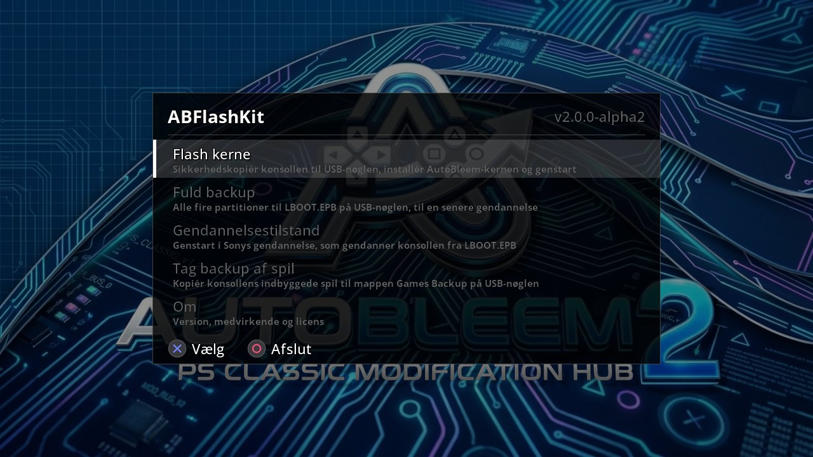

ABFlashKit har tre handlinger:

- **Flash Kernel** installerer kernen. Ligger der endnu ingen sikkerhedskopi til gendannelse på nøglen, laver den først
  en af konsollens partitioner (`LBOOT.EPB`). Den tjekker sikkerhedskopien og kernebilledet, skriver kernen og
  AutoBleems systemfiler og genstarter konsollen. Når den siger *All done - when the screen goes black replace power
  cord*, så vent på den sorte skærm, træk konsollens strømkabel ud, og sæt det i igen.
- **Full backup** gemmer alle fire af konsollens partitioner i `LBOOT.EPB`, så du kan gendanne dem senere. Er der
  allerede en sikkerhedskopi, spørger den, før den overskriver den.
- **Restore Mode** er vejen tilbage til den oprindelige firmware. Den tjekker, at sikkerhedskopien på nøglen er en
  original, sætter gendannelsesflaget og genstarter i Sonys gendannelse, som gendanner konsollen fra `LBOOT.EPB`.

En statuslinje under hvert trin viser, hvor langt den er nået. ABFlashKit flasher ikke en konsol, der kører en anden
tilpasset firmware, som BleemSync eller Project Eris: Sæt den konsol tilbage til fabrikstilstand først.

**Log ind fra en pc.** Kender du Linux og vil kigge ind i konsollen, kan du logge ind på den fra en pc over et
USB-kabel. Det kræver AutoBleem-kernen; det virker ikke på en uændret konsol.

1. Forbind konsollens micro-USB-port med pc'en med et USB-kabel. Pc'en ser konsollen som en ny netværksadapter, og du
   finder konsollens adresse i den adapters indstillinger på pc'en.
2. Log ind med `ssh root@<the console's address>`. Standardadgangskoden er `autobleem`.

I stedet for adgangskoden kan du bruge en nøgle. Læg din offentlige nøgle i filen `System/ssh/authorized_keys` på
USB-nøglen, og genstart konsollen: Ved næste opstart bliver den føjet til root-kontoen. Opdatering eller
geninstallation af launcheren fjerner den ikke.

> **Standardadgangskoden er den samme på alle konsoller**, så alle, der kan sætte et kabel i din, kan logge ind som
> root. Brug en nøgle, hvor du kan, og lad ikke en konsol med standardadgangskoden stå, hvor andre kan komme til den.

<!-- pagebreak -->

## 7. Hvis noget går galt

De fleste problemer har en enkel årsag. Herunder begynder hvert af dem med det, du ser, siger, hvorfor det sker, og
derefter, hvad du skal gøre. Skal du bede om hjælp, er logfilerne det første, nogen vil spørge efter, så de kommer
først.

**Sådan finder du logfilerne.** AutoBleem holder sine logfiler i hukommelsen, mens den kører, så der ikke hele tiden
bliver skrevet til nøglen. De havner først i `System/Logs/` på nøglen, kortet eller i datamappen, når noget er gået
galt: Går launcheren, et PS1-spil eller RetroArch ned, gemmes logfilerne i `System/Logs/crash-<n>/` (de seneste tre
nedbrud gemmes), og launcheren siger det én gang, når den er tilbage. Er du på jagt efter et problem, der ikke er et
nedbrud, så behold alle logfiler: Slå Indstillinger → *Diagnostik* → *Behold logfiler på USB-nøglen* til (det virker
fra næste opstart), eller opret en tom fil `System/Logs/keep` fra en pc. *Hardwareinformation* (afsnit 4.2) viser også,
hvor logfilerne ligger, og Square dér gemmer de aktuelle i `System/Logs/saved-<n>/`.

Det er de filer, du finder:

| Fil | Hvad den fortæller dig |
|---|---|
| `autobleem.log` | Hvad launcheren selv har lavet. |
| `launch.log`, `pcsx.log` | Hvordan et PS1-spil blev startet, og hvad emulatoren sagde, mens den kørte. |
| `retroarch.log` | Hvad RetroArch sagde, mens det kørte. |
| `update.log` | Hvordan en onlineopdatering gik; gemmes altid på nøglen. |
| `updateroms.log` | Hvordan UpdateRoms gik på pc'en (kapitel 5); gemmes altid på nøglen. |

**Et billede beder dig sætte nøglen i, eller konsollen er gået i dvale.** AutoBleem kan ikke finde sin nøgle: Der sad
ingen i, da konsollen startede, eller den blev trukket ud. Sæt den i en hvilken som helst USB-port (helst en foran,
afsnit 2.1), før de 5 minutter er gået, eller tryk på Power. Blev nøglen ikke taget ordentligt ud, tjekker AutoBleem
den først - vent, til statuslinjen er færdig.

**RetroArch siger *RetroArch kræver et nyere systembibliotek, end denne konsol har - brug den RetroArch, der følger
med AutoBleem*.** Den RetroArch er bygget til et nyere system end konsollens, så den kan ikke køre dér. Brug den
RetroArch, der følger med AutoBleem.

**Et spil siger *Dette spil er beskyttet af sin PSN-licens og kan ikke startes*.** Spil købt på PlayStation Network er
låst til deres licens, og AutoBleem kan ikke køre dem. Der er ikke noget at rette.

**Et spil står ikke på hylden.** Som regel er dets mappe ikke bygget op, som scanningen forventer. Tjek, at hvert spil
har sin egen mappe og er i et af formaterne fra afsnit 3.10. *Spilbibliotek* (afsnit 4.1) viser efter spillene de
mapper, scanningen har afvist, markeret *Ikke tilføjet*, og fortæller, hvorfor hver af dem blev afvist; Square sletter
sådan en mappe. Når du har rettet en mappe, kører *Genscan spil* i systemmenuen scanningen igen.

**Spillene har ingen omslag.** Enten blev cover-databaserne ikke installeret - kør installationsprogrammet igen med dem
afkrydset - eller også er UpdateRoms endnu ikke kørt på pc'en, hvis det gælder RetroArch-spil på en konsol
(kapitel 5).

**En controller gør ingenting, eller dens knapper er byttet rundt.** AutoBleem kender ikke den controllers layout. På
en konsol tildeler du knapperne med PSC-Bios' gamepad-guide (afsnit 6.1). På en Pi eller en pc viser siden
Hardwareinformation (afsnit 4.2), hvad systemet ser af controlleren, så du kan se, om den overhovedet bliver fundet.

**Skærmen forbliver sort efter et spil på konsollen.** Launcherens billede kom ikke tilbage, da spillet sluttede.
AutoBleem genopbygger selv sit vindue, op til tre gange. Bliver skærmen stadig ved med at være sort, så hold
Power-knappen inde, og tænd konsollen igen.

**På en Raspberry Pi** kan du komme om bag launcheren, når du har brug for det: `Alt+F2` giver dig en loginprompt på
den anden konsol, og SSH er slået til fra første opstart. `sudo journalctl -u autobleem` viser, hvad launcherens
tjeneste har lavet, og `sudo systemctl restart autobleem` genstarter den. Kunne første opstart ikke gøres færdig,
fordi der ikke var noget netværk, prøver den igen ved næste opstart.

**På Windows** forlader `Esc` launcheren. Din datamappe er den, du valgte under installationen (`Documents\AutoBleem`,
medmindre du ændrede det), og logfilerne ligger i dens mappe `System\Logs`.

**Konsollen genstarter igen og igen efter en onlineopdatering (nøgle formateret som ext4).** Nogle formaterer nøglen
som ext4, Linux' filsystem, i stedet for FAT32 eller exFAT. Indtil næste udgivelse af AutoBleem pakker en
onlineopdatering på sådan en nøgle alle filer ud uden den tilladelse, der lader dem køre som programmer. AutoBleem kan
så ikke starte, og konsollen genstarter igen og igen. Nøgler med FAT32 og exFAT er ikke berørt. Der er to måder at
rette det på.

**Løsning A** kræver en Linux-pc. Sæt nøglen i, og gør AutoBleems programmer kørbare igen. Sæt din egen monteringssti
ind i stedet for `/media/USER/STICK`; den sidste linje skal du kun bruge, hvis RetroArch er installeret:

```
chmod +x /media/USER/STICK/Autobleem/*.sh /media/USER/STICK/Autobleem/rc/*.sh
chmod +x /media/USER/STICK/Autobleem/bin/autobleem/* /media/USER/STICK/Autobleem/bin/emu*/pcsx-ab /media/USER/STICK/Autobleem/bin/abpad/abpadd
chmod +x /media/USER/STICK/RetroArch/bin/retroarch
```

**Løsning B**: Installér den nyeste udgivelse af AutoBleem på nøglen igen, som i afsnit 2.1. Installationsprogrammet
kræver en pc, der kan læse nøglen. Kan den ikke læse din, skal nøglen formateres først, hvilket sletter alt på den -
kopiér dine spil af den, før du gør det.

> Undgå det ved at bruge **FAT32** (en uændret konsol læser kun FAT32; exFAT kræver AutoBleem-kernen, kapitel 6). Næste
> udgivelse bevarer tilladelserne, og AutoBleem reparerer dem ved hver opstart.

AutoBleem er fri software (GNU GPL v3 eller senere) og leveres uden nogen garanti. Hjælp og nyheder får du på den
Discord-server, der linkes til på skærmen Om, eller på https://autobleem.retromenele.pl/.
