# AutoBleem 2 – käyttöopas

AutoBleem 2 on pelien käynnistäjä **PlayStation Classicille**, ja versiosta 2 alkaen myös **Raspberry Pille**,
**USB-tikulta käynnistettävälle PC:lle** ja **Windowsille**. Se esittää PS1-pelisi hyllyllisenä kansia
tietoineen ja käynnistää ne mukana tulevalla PCSX-emulaattorilla. Kun asennat rinnalle RetroArchin, voit pelata
myös muiden laitteiden pelejä. Tässä oppaassa käydään läpi asennus kullekin alustalle, arkikäyttö ja mukana
tulevat työkalut.

> Kaikkien alustojen lataukset löytyvät osoitteesta **https://autobleem.retromenele.pl/**. Sivu on jaettu
> alustoittain: kunkin alustan *Install*-paneelista lataat itse asennuksen, ja sen alla olevat *Build inputs*
> ovat tiedostoja, jotka asennusohjelmat hakevat itse.

## 1. Mitä saat

AutoBleemin avulla PlayStation Classicista – tai Raspberry Pistä, vanhasta PC:stä tai Windows-koneestasi – tulee
pieni pelikonsoli, jossa omilla peleilläsi on kunnollinen valikko. Paketti sisältää seuraavat osat:

- **Käynnistäjä.** Se tulee näkyviin, kun kytket laitteen päälle: hylly pelien kansia, joita selaat sivusuunnassa,
  ja valitun pelin tiedot vieressä. Täältä käynnistät pelit, jaat ne sarjoihin (PlayStation, RetroArch,
  sovellukset), muutat asetuksia, hoidat muistikortteja ja tilatallennuksia sekä lataat sovelluksia ja pelejä
  Kaupasta. Käynnistäjä näyttää ja toimii samalla tavalla kaikilla alustoilla.
- **Kaksi PS1-emulaattoria.** `pcsx-abnxt` on uudempi ja oletuksena käytössä, `pcsx-ab` taas klassinen emulaattori,
  joka on kulkenut AutoBleemin mukana alusta asti. Valitset niiden välillä asetuksista. Molemmat käyttävät samoja
  asetuksia ja muistikortteja, joten voit vaihtaa milloin tahansa menettämättä mitään.
- **RetroArch**, jos haluat pelata myös muiden laitteiden pelejä: NES, SNES, Mega Drive, Game Boy, arcade-pelit ja
  paljon muuta. Se on valinnainen kaikilla alustoilla. Kopioi ROMit paikoilleen, niin AutoBleem lajittelee ne
  listoiksi ja käynnistää jokaisen pelin oikealla ytimellä. Myös PlayStation-pelejä voi pelata RetroArchissa; sen
  *PlayStation 1* -ydin on ydinlistan kärjessä (osio 3.9). Doomin kaltaiset pelit pyörivät omista pelitiedostoistasi
  `Packages`-kansiosta (osio 3.10).
- **Konsolin työkalut.** *PSC-Bios* – valikoissa sen nimi on *Verkko ja ohjaimet* – hoitaa WiFin, kellon,
  Bluetooth-ohjaimet ja ohjainten näppäinasettelut. Se toimii konsolilla sekä Raspberry Pillä ja PC-tikulla.
  *ABFlashKit* asentaa AutoBleem-kernelin PlayStation Classiciin (luku 6).
- **UpdateRoms** Windowsille. PlayStation Classicissa ei ole omaa verkkoyhteyttä, joten tämä PC-ohjelma päivittää
  konsolitikun RetroArch-listat ja hakee kansikuvat sillä aikaa, kun tikku on kiinni PC:ssä.

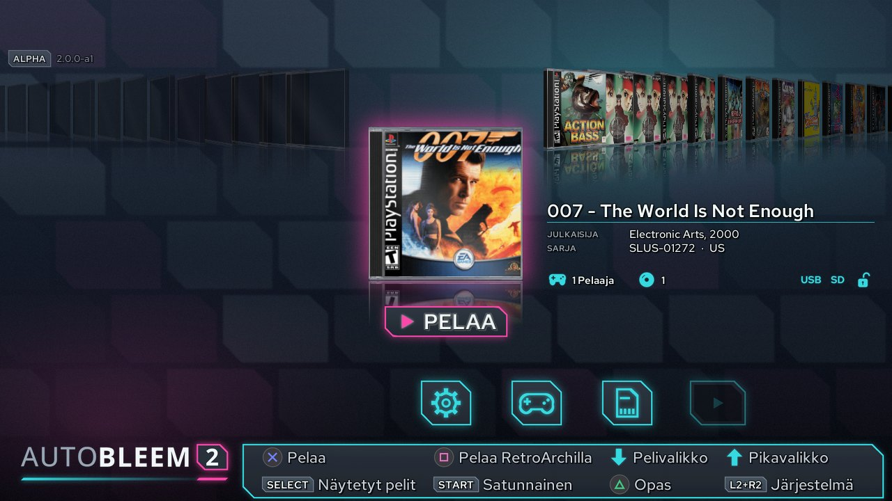

<!-- pagebreak -->

## 2. Asennus

### 2.1 PlayStation Classic

AutoBleem toimii kokonaan USB-tikulta. Konsolin sisälle ei kosketa: kun otat tikun pois, konsoli toimii täsmälleen
kuten ennenkin. Tarvitset vain Windows-PC:n, USB-tikun (USB 2.0, vähintään 8 Gt) ja konsolin.

Tikun ei tarvitse olla tyhjä, eikä sitä **alusteta**, ellet itse pyydä: AutoBleem asennetaan tikulla jo olevien
tiedostojen rinnalle, ja jos tikulla on ennestään AutoBleem 1.0, se päivitetään paikallaan (katso alempaa).
Vakiokonsolia varten tikun on oltava **FAT32**-muotoinen, koska konsolin oma kernel ei osaa lukea exFAT:ia. Kun
AutoBleem-kernel on asennettu (ABFlashKit, luku 6), konsoli käynnistyy myös exFAT-tikulta, ja samalla poistuu
FAT32:n 4 gigatavun tiedostokokoraja.

1. Lataa sivuston PlayStation Classic -paneelista **AutoBleemInstaller-<version>.zip** ja pura se mihin tahansa.
   Paketissa ovat `AutoBleemInstaller.exe` ja sen README. Itse AutoBleem ladataan asennuksen aikana, joten PC:llä
   pitää olla internetyhteys.
2. Kytke tikku koneeseen ja käynnistä `AutoBleemInstaller.exe`. Valitse ensin **kanava**: *Release* on testattu
   versio ja sopii useimmille, *Testing* on tuleva versio testausvaiheessa ja *Nightly* uusin kehitysversio, joka
   ei välttämättä toimi. Valitse sitten tikun asema. Alla oleva rivi kertoo, minkä AutoBleem-version olet
   asentamassa ja mitä tikulla on nyt: *a fresh install* (tikun muut tiedostot jätetään rauhaan) tai *AutoBleem
   <version> is on this stick: it will be updated* (pelisi, tallennuksesi, muistikorttisi ja asetuksesi säilyvät).
   **Alustaminen ei ole tarpeen.** Aseman vieressä oleva **Format**-painike on tarkoitettu vain upouudelle
   tikulle, jolla ei ole tiedostojärjestelmää, tikulle, jota konsoli ei osaa lukea (esimerkiksi NTFS), tai
   tikulle, jonka haluat tyhjentää kokonaan. Se kysyy ensin ja poistaa sitten kaiken tikulta. Valitse siinä
   FAT32, ellei konsolissa ole jo AutoBleem-kerneliä.
   Rastita sitten, mitä haluat asentaa:
   - **Cover databases** – koko PS1-pelikirjaston kansikuvat ja kuvaukset, jotta peleistäsi löytyvät kannet
     itsestään (valittuna oletuksena, noin 300 Mt).
   - **RetroArch** – RetroArch ytimineen, lisäsovellukset (Doom, Quake, Amiga, ...) ja libreton grafiikat muiden
     laitteiden pelejä varten. Oletuksena pois päältä; voit lisätä sen myöhemmin ajamalla asennusohjelman
     uudelleen.
   - **BIOS files** – BIOS-tiedostot, joita osa RetroArchin ytimistä tarvitsee käynnistyäkseen (vain RetroArchin
     kanssa).
   - **Sample games** – muutama ilmainen homebrew-peli, jottei hylly ole ensimmäisellä käynnistyskerralla tyhjä.
3. Paina **Install** ja odota. Edistymispalkit ja loki näyttävät jokaisen vaiheen. Lopuksi tikun nimeksi tulee
   `SONY`, ja sille kopioidaan `UpdateRoms` (katso luku 5).
4. Poista tikku turvallisesti ja kytke se konsolin **etupaneelin toiseen USB-porttiin** (oikeanpuoleinen, pelaaja
   2) – ensimmäinen jää vapaaksi ohjaimellesi. Kytke konsoli päälle: vakiovalikon sijaan käynnistyy AutoBleem.
   Toista ohjainta varten käytä etuportissa USB-hubia tai Bluetooth-ohjainta.

**Päälle ja pois.** Kun tikku on paikallaan, konsoli käynnistyy, vilkuttaa valoaan muutaman sekunnin ajan
huomatessaan AutoBleemin ja siirtyy sitten valmiustilaan ennen kuin ruudulle ilmestyy mitään. Tämä on normaalia:
AutoBleem käynnistyy konsolin oman päivitysmekanismin kautta, ja tuo mekanismi toimii juuri näin. Paina **Power**
kerran, niin käynnistäjä tulee näkyviin.

Kun valitset järjestelmävalikosta *Sammuta* tai painat konsolin Power-painiketta, konsoli siirtyy
**AutoBleemin valmiustilaan**: AutoBleem irrottaa ensin tikun turvallisesti, ja sitten valo muuttuu **oranssiksi**
merkiksi siitä, että kaikki meni kuten pitää. Seuraava Power-painallus tuo käynnistäjän takaisin muutamassa
sekunnissa. **Kun valo palaa oranssina, voit vetää tikun irti** ja kytkeä sen PC:hen; Windows ei pyydä
tarkistamaan sitä, koska se irrotettiin oikein. Laita tikku takaisin ennen kuin painat Poweria. Jos irrotat
konsolin virtajohdon, se käy seuraavalla kerralla taas läpi käynnistyksen valmiustilan. **Punainen** valo
tarkoittaa, että konsoli on todella sammuksissa.

**Takaportti.** Takana oleva micro-USB-portti on konsolin virtaliitäntä. AutoBleem-kernelin kanssa siihen voi
kytkeä myös USB-laitteen, mutta tikun paikka on etupaneelin portissa.

**Jos tikku puuttuu.** Kun konsoli käynnistyy ilman tikkua tai vedät tikun irti AutoBleemin ollessa käynnissä,
ruudulle tulee kuva, joka pyytää laittamaan tikun paikalleen – mikä tahansa USB-portti käy. AutoBleem odottaa 5
minuuttia ja laittaa sitten konsolin lepotilaan; paina Poweria, jos haluat sen lepoon heti.


**Kun tikku tarkistetaan.** Jos tikkua ei irrotettu oikein – vedit sen irti AutoBleemin ollessa käynnissä tai
sähköt katkesivat – AutoBleem tarkistaa sen virheiden varalta ennen kuin ottaa sen taas käyttöön: käynnistyksessä,
lepotilasta herätessä tai kun kytket tikun takaisin. Edistymispalkki näyttää, missä vaiheessa tarkistus on. Isolla
tikulla tämä voi kestää hetken; anna sen valmistua äläkä sammuta konsolia sillä välin.


**Päivittäminen.** Päivitä tikku ajamalla asennusohjelma sille uudelleen – painikkeessa lukee nyt *Update*. Se
asentaa valitsemasi kanavan uusimman version. Pelisi, tallennuksesi, asetuksesi ja RetroArch-sisältösi säilyvät,
ja vain AutoBleemin omat tiedostot vaihdetaan. Konsoli, jossa on AutoBleem-kernel ja WiFi, osaa myös päivittää
itsensä (osio 3.12).

**Päivitys AutoBleem 1.0:sta (tai AutoBleem-NG:stä).** Käytät samaa asennusohjelmaa samalla tikulla, etkä alusta
sitä:

1. Kopioi ensin koko tikku varmuuden vuoksi PC:lle.
2. Kytke tikku, käynnistä `AutoBleemInstaller.exe` ja valitse kanava ja asema. **Älä** paina Formatia.
3. Paina **Install**. Asennusohjelma siirtää vanhan rakenteen uuteen: RetroArch, ROMit ja teemat menevät sinne,
   mistä AutoBleem 2 niitä etsii, ja vanhat ROM-kansiot (`nes`, `snes`, ...) saavat RetroArchin käyttämät
   järjestelmänimet. Pelisi, tilatallennuksesi, muistikorttisi, ROMisi ja RetroArch-tallennuksesi säilyvät, samoin
   `config.ini` – siitä vaihdetaan vain PS1-emulaattoriksi pcsx-abnxt.
4. Laita tikku takaisin konsoliin. Ensimmäinen skannaus rakentaa pelilistan ja soittolistat uudelleen. RetroArch-
   pelien kansikuvat saat ajamalla UpdateRomsin PC:llä (luku 5).

> Vakiokonsolissa ei ole kelloa eikä verkkoa. Päivämäärät näkyvät vasta, kun AutoBleem-kernel on asennettu
> (luku 6), ja RetroArch-pelien kansikuvat tulevat PC:llä ajettavasta UpdateRomsista (luku 5).

PS1-pelisi menevät tikun `Games`-kansioon, jokainen peli omaan kansioonsa – rakenne selitetään osiossa 3.10.

### 2.2 Raspberry Pi

AutoBleemin kanssa Raspberry Pistä tulee pieni konsoli, joka käynnistyy suoraan käynnistäjään ilman työpöytää
välissä. Sivustolla on kaksi valmista muistikorttikuvaa, 32- ja 64-bittinen, sekä paketti jo asennettuun
Raspberry Pi OS Liteen.

| Malli | 32-bittinen kuva | 64-bittinen kuva | Huomioita |
|---|---|---|---|
| Raspberry Pi 5 | kyllä | kyllä | |
| Raspberry Pi 4 Model B, Pi 400 | kyllä | kyllä | |
| Raspberry Pi 3 Model B / B+ / A+ | kyllä | kyllä | riittää hyvin käynnistäjälle ja PS1-peleille |
| Raspberry Pi Zero 2 W | kyllä | kyllä | 512 Mt muistia: PS1 toimii, raskaammat RetroArch-ytimet eivät |
| Raspberry Pi 2 Model B | kyllä | vain v1.2 | hidas kaikkeen 3D-grafiikkaan |
| Raspberry Pi 1, Zero, Zero W | ei | ei | ARMv6 – kumpikaan kuva ei toimi |

**PS1-pelejä varten valitse 32-bittinen kuva.** Klassisen `pcsx-ab`:n nopea ARM-uudelleenkääntäjä on olemassa vain
32-bittisenä, joten 64-bittisessä versiossa PS1-pelit pyörivät hitaammin. 64-bittisessä kuvassa on enemmän
RetroArch-ytimiä, joten valitse se, jos muut laitteet ovat sinulle PS1:tä tärkeämpiä.

**Raspberry Pi Imagerilla:**

1. Asenna Raspberry Pi Imager (raspberrypi.com/software). Valitse *Choose OS* -kohdasta *Use custom* ja
   lataamasi `autobleem-<version>-rpi-armhf.img.xz` (32-bittinen) tai `-arm64.img.xz` (64-bittinen). Voit myös
   lisätä ohjelman asetuksiin repositorion osoitteen ja valita AutoBleemin listalta. Jokaisella kanavalla on
   omansa: `https://autobleem.retromenele.pl/rpi-imager/os_list.json` uusimmalle julkaisulle,
   `.../os_list-testing.json` testattavalle versiolle ja `.../os_list-nightly.json` uusimmalle kehitysversiolle.
   Latussivun Raspberry Pi -välilehdellä luetellaan olemassa olevat osoitteet, kunkin vieressä *Copy*-painike.
2. Avaa Imagerin mukautusnäkymä (hammasratas tai *Next*-painikkeen jälkeen tuleva kysymys) ja aseta siinä
   **käyttäjänimi ja salasana, WiFi-verkko ja maa sekä ota SSH käyttöön**. AutoBleem tarvitsee verkkoyhteyden
   ensimmäisellä käynnistyskerralla.
3. Kirjoita kortti, laita se Pihin, kytke näyttö sekä näppäimistö tai ohjain ja käynnistä laite.

**Ensimmäinen käynnistys** kestää 5–25 minuuttia, ja ruudulla kerrotaan koko ajan, mitä on meneillään. Jos
verkkoa ei ole, Pi pyytää sitä: valitse WiFi-verkkosi listalta ja kirjoita salasana. Sitten se kysyy, asennetaanko
RetroArch – jos et vastaa minuutin kuluessa, se asennetaan. Sen jälkeen Pi kasvattaa järjestelmäosiota, tekee
muusta kortista pelejäsi varten `AUTOBLEEM`-osion, asentaa RetroArchin ytimineen, BIOS-paketit ja esimerkkipelit ja
käynnistyy uudelleen suoraan käynnistäjään.

Jos et halua vastailla kysymyksiin ensimmäisellä käynnistyksellä, kirjoita vastaukset etukäteen kortin
boot-osion tiedostoon **`autobleem.txt`** – sitä voi muokata millä tahansa PC:llä:

| Avain | Oletus | Merkitys |
|---|---|---|
| `root_gib` | 8 | Järjestelmäosion koko gibitavuina; loput kortista tulee peliosioksi. |
| `hdmi_mode` | 1920x1080@60 | Koko käynnistyksen näyttötila (vanhemmalle televisiolle `1280x720@60`). |
| `retroarch` | (kysytään) | `yes` / `no` – asennetaanko RetroArch muine laitteineen, vai pelkkä PS1. |
| `thumbnails` | none | `boxarts` kopioi koko kansikuvakokoelman kortille, jotta kannet näkyvät ilman verkkoakin (~9000 tiedostoa). |
| `bios`, `downloads`, `samples` | yes | Arvolla `no` jätetään pois BIOS-paketit, kaikki lataukset tai esimerkkipelit. |

**Jos sinulla on jo Raspberry Pi OS Lite** (Bookworm tai Trixie): kopioi `autobleem-rpi.tar.gz` (tai arm64-versio)
Pihin, pura se ja aja `sudo bash install.sh`. Se kysyy samat kysymykset, tekee tilaa dataosiolle pienentämällä
järjestelmäosiota seuraavalla käynnistyksellä (`--shrink-root <GiB>`) ja laittaa käynnistäjän ensimmäiselle
konsolille.

Asennuksen jälkeen täytät kortin **`AUTOBLEEM`-osion** (exFAT) peleilläsi: ota kortti pois ja avaa se millä
tahansa PC:llä tai kopioi tiedostot verkon yli (SSH on päällä). PS1-pelit menevät kansioon `Games/`, muiden
laitteiden ROMit kansioon `RetroArch/roms/<system>/`, PS1:n BIOS kansioon `System/Bios/` (osio 3.11) ja teemat
kansioon `Themes/`.

### 2.3 PC:n USB-tikku

Sama onnistuu millä tahansa PC:llä, joka osaa käynnistyä USB:ltä: tikku käynnistää koneen suoraan AutoBleemiin
eikä koske PC:n omaan levyyn. Järjestelmä on 32-bittinen, joten vanhatkin koneet käyvät.

1. Kirjoita levykuva vähintään 8 gigatavun tikulle. **Windowsissa** käytä **AutoBleemFlasheria** (sivuston
   PC-paneelista – pura se ja aja `AutoBleemFlasher.exe`; se pyytää ylläpitäjän oikeuksia, koska se kirjoittaa
   kokonaisen levyn). Valitse kanava ja tikku, paina *Write* ja vahvista kahdesti. Ohjelma lataa levykuvan,
   tarkistaa sen, kirjoittaa sen ja lukee sen vielä takaisin. Valittavana on vain USB-tikkuja ja SD-kortteja, ei
   koskaan levyä, jolta Windows toimii, ja **valitulta tikulta poistetaan kaikki**. Linuxissa ja macOS:ssä lataa
   PC-paneelista `autobleem-<version>-pcusb-i386.img.xz` ja kirjoita se komennolla
   `xzcat autobleem-*.img.xz | sudo dd of=/dev/sdX bs=4M status=progress` (tai balenaEtcherillä).
2. Käynnistä PC tikulta (koneesi käynnistysvalikon näppäin – F12, F8, Esc...). Sekä BIOS- että UEFI-käynnistys
   toimivat; **Secure Bootin on oltava pois päältä**.
3. Ensimmäinen käynnistys etenee kuten Pillä: jos verkkokaapelia ei ole kytketty, se pyytää verkkoa, kysyy
   RetroArchista, asentaa kaiken – langallisella verkolla noin kahdeksassa minuutissa – ja käynnistyy uudelleen
   käynnistäjään.

Sen jälkeen tikulla on `AUTOBLEEM`-osio pelejäsi varten. Kun kytket tikun käynnissä olevaan Windows 10 -koneeseen
(versio 1903 tai uudempi), se näkyy toisena asemana, jolle voit kopioida pelejä. `autobleem.txt` on ensimmäisellä
osiolla, ja siinä ovat samat avaimet kuin Pillä (paitsi `hdmi_mode` – PC käyttää aina näytön omaa tilaa).

### 2.4 Windows

Jos haluat AutoBleemin Windows-koneellesi, se toimii myös tavallisena ohjelmana: koko näytön tilassa, ja
emulaattorit ja RetroArch käynnistyvät omina ohjelminaan.

1. Lataa **AutoBleemSetup-<version>.exe** ja aja se. Se asentuu käyttäjäkohtaisesti ilman ylläpitäjän oikeuksia:
   itse ohjelma kansioon `%LOCALAPPDATA%\Programs\AutoBleem` ja data (pelit, asetukset, teemat, RetroArch)
   valitsemaasi kansioon, oletuksena `Documents\AutoBleem`.
2. Rastita haluamasi osat – kansitietokannat, RetroArch (virallinen Windows-versio ytimineen), BIOS-tiedostot ja
   esimerkkipelit – ja anna asennusohjelman ladata ne.
3. Käynnistä AutoBleem Käynnistä-valikosta tai työpöydältä. PC:llä näppäimistö toimii ohjaimena (osio 3.2).

Päivität ohjelman ajamalla uudemman asennusohjelman vanhan päälle: ohjelma vaihtuu, ja datakansiosi jää ennalleen.
Käynnistäjä myös tarkistaa sivustolta kerran päivässä, onko päivitystä, ja tarjoaa sitä, kun sellainen löytyy
(osio 3.12).

<!-- pagebreak -->

## 3. AutoBleemin käyttö

### 3.1 Käynnistäjä

Käynnistäjässä valitset, mitä pelaat. Pelit näkyvät kansien hyllynä, ihan kuin katselisit pelikoteloita oikealla
hyllyllä, ja selaat sitä, kunnes löydät haluamasi. Kaikki muu AutoBleemissa – asetukset, muistikortit, Kauppa –
avataan täältä, ja tänne palaat myös pelistä poistuessasi.

Valittu peli on hyllyn keskellä, ja sen alla kimmeltää pehmeä heijastus. Vieressä näet pelin tiedot pienessä
ruudukossa: julkaisijan, vuoden, sarjanumeron, alueen, pelaajamäärän ja sen, milloin viimeksi pelasit peliä. Jos
AutoBleem ei tiedä jotain näistä, se jättää rivin kokonaan pois eikä näytä sitä tyhjänä. Tietojen vieressä on
toistopainike. Peli, jolla ei ole kansikuvaa, näytetään levynä tyhjän kotelon mustassa pidikkeessä, joten
sekin saa paikkansa hyllyltä.

Käynnistäjän ulkoasu tulee teemasta. Oletusteema on **ab2.0.0**: uusi asennus vaihtaa siihen, samoin päivitys,
joka tuo sen mukanaan, mutta vain kerran – jos valitset sen jälkeen toisen teeman (osio 3.6), valintasi pysyy.

**Vihjepalkki** ruudun alareunassa kertoo, mitä painikkeet juuri nyt tekevät. Siinä on kaksi riviä, kummassakin
neljä paikkaa. Ylempi rivi koskee valittua peliä: pelaa se, pelaa se RetroArchissa, avaa sen alla oleva
kuvakerivi tai avaa pikavalikko. Alempi rivi pysyy aina samana: Select valitsee sarjan, Start arpoo satunnaisen
pelin, Triangle näyttää painikeoppaan ja L2 + R2 avaa järjestelmävalikon. Vihje himmenee, kun sen painikkeella ei
ole juuri sillä hetkellä tehtävää.

**Uudet pelit löytyvät itsestään.** Aina kun käynnistäjä käynnistyy, se skannaa pelikansiosi taustalla, joten peli,
jonka kopioit laitteen ollessa sammuksissa, ilmestyy hyllylle ilman, että sinun tarvitsee tehdä mitään. Skannauksen
aikana oikean yläkulman kupla näyttää, kuinka pitkällä se on, ja uudet pelit tulevat hyllylle sitä mukaa kuin niitä
löytyy – voit selata rauhassa sillä välin.

**Uudessa asennuksessa** ei ole vielä pelejä. Tyhjän hyllyn sijaan näet tervetulokortin, *Hei ja tervetuloa
AutoBleemiin!*, joka neuvoo kopioimaan pelit `Games`-kansioon ja valitsemaan *Skannaa pelit uudelleen*. Kortti
kertoo paikan alustasi mukaan: tikulla (PlayStation Classic, PC-tikku), SD-kortilla (Raspberry Pi) tai
AutoBleem-kansiossasi (Windows). Kortti katoaa heti, kun skannaus löytää ensimmäisen pelin.

**Ilmoitukset** ovat oikean yläkulman kuplia. Ne pitävät sinut ajan tasalla olematta tiellä: skannauksen eteneminen,
sen sarjan nimi, johon juuri vaihdoit (*Näytetään: ...*), ohjain, jonka akku on vähissä, huomautus kaatumisen
jälkeen, työssä oleva skannauksen prosessori ja Kaupan lataus. Latauksen kupla näyttää nopeuden ja jäljellä olevan
ajan, esimerkiksi `1.4 MB/s · 0:42`. Sen, kuinka kauan tiedottavat kuplat pysyvät näkyvissä, päätät itse:
Vaihtoehdot → *Ilmoituksen näyttöaika:*.

**Ohjainten akut.** Konsolilla, Raspberry Pillä ja PC-tikulla (ei Windowsissa) jokainen langaton ohjain, joka
ilmoittaa akkunsa varaustason, näkyy pienenä kuvakkeena prosenttilukemineen omalla laatallaan. Laatat pinoutuvat
vasemmasta yläkulmasta alaspäin. Pelaajana 1 tai 2 pelaavassa ohjaimessa on merkki P1 tai P2 sen mukaan, miten
*Vaihda pelaaja 1 / pelaaja 2* -asetus on valittu (osio 3.6); ohjaimessa, jota ei ole liitetty pelaajaan, tai
kolmannessa ohjaimessa merkkiä ei ole. Kun ohjaimen akku hiipuu, ilmoitus kertoo siitä kerran ohjaimen nimen ja
prosenttiluvun kera.

**Kanavamerkki.** Jos käytät versiota, joka ei ole lopullinen julkaisu, vasemman yläkulman akkulaatan alla oleva
pieni merkki muistuttaa siitä. Siinä on kanava ja sen vieressä lyhyt versionumero: `ALPHA`, `BETA` tai `RC`
esijulkaisulle, `TESTING` muille esijulkaisuille, `NIGHTLY` yöversiolle ja `DEV` käsin käännetylle versiolle
(`DEV`-version kohdalla versio on se commit, josta se on käännetty). Julkaisuversiossa merkkiä ei ole.

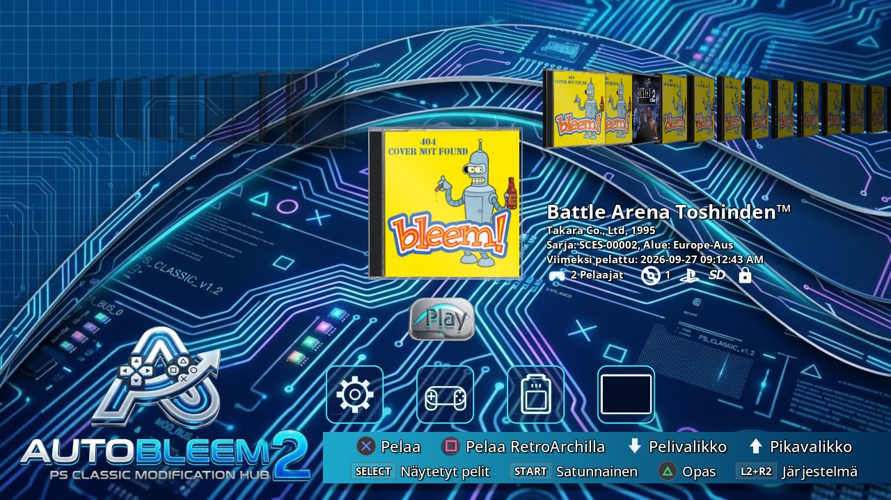

### 3.2 Ohjaimet

AutoBleem on tehty käytettäväksi pelkällä ohjaimella, ja painikkeet tarkoittavat samaa kaikissa näkymissä: Cross
vahvistaa, Circle palaa takaisin ja Triangle auttaa. Jos unohdat, mitä jokin painike tekee, ruudun alareunan
vihjepalkki kertoo sen, ja hyllyllä Triangle avaa painikeoppaan, jossa ovat kaikkien näkymien kaikki painikkeet
(osio 4.3). Hyllyllä painikkeet toimivat näin:

| Painike | Hyllyllä |
|---|---|
| Vasen / Oikea | Siirtyy edelliseen tai seuraavaan peliin; pidä painiketta pohjassa, niin selaus jatkuu. |
| L1 / R1 | Hyppää nimien edelliseen tai seuraavaan alkukirjaimeen, joten pitkänkin hyllyn läpi pääsee nopeasti. Kun hylly on tyhjä ja USB-asema on kytkettynä, R1 avaa *Levy*-näkymän (osio 3.9a). |
| Cross | Käynnistää valitun pelin: PS1-pelin PS1-emulaattorissa, RetroArch-pelin sen ytimessä ja sovelluksen sen lueminut-tekstin jälkeen. |
| Square | Käynnistää valitun PS1-pelin sen sijaan RetroArchissa. Kun valittuna on USB-aseman levy, Square kopioi levyn (*Kopioi levy*, osio 3.9a). |
| Circle | Palaa levynäkymään, kun asemassa on levy (osio 3.9a). |
| Triangle | Avaa painikeoppaan. |
| Start | Arpoo pelin nykyisestä sarjasta, kun et osaa päättää. |
| Select | Avaa sarjavalitsimen, jossa valitset, mitkä pelit hyllyllä näkyvät (osio 3.3). |
| Ylös | Avaa pikavalikon (osio 3.4). |
| Alas | Avaa pelin alla olevan kuvakerivin (*ASETUKSET*, *Peli*, *MUISTIKORTTI*, *JATKA*); Ylös sulkee sen taas. |
| L2 + R2 | Avaa järjestelmävalikon (osio 3.5). |

**Näppäimistöllä.** Jos PC:ssä ei ole ohjainta tai konsoliin, Pihin tai PC-tikkuun on kytketty USB-näppäimistö,
näppäimet hoitavat painikkeiden työt. Nuolinäppäimet ovat ristiohjain, Enter on Cross, Esc tai Backspace on
Circle, Tab on Triangle ja välilyönti on Square. F1 ja F2 ovat Select ja Start, Page Up ja Page Down ovat L1 ja
R1, Home ja End ovat L2 ja R2, ja F10 avaa järjestelmävalikon.

Windowsissa muutama näppäin toimii toisin. Siellä Esc sulkee AutoBleemin (luku 7), joten Circle on vain
Backspace, välilyönti on Start ja S on Square. Lisäksi kirjainnäppäimet korvaavat koko ohjaimen, joten
nuolinäppäimiin ei tarvitse kurottaa: X, O, S ja T ovat Cross, Circle, Square ja Triangle, I, J, K ja L
ristiohjain (ylös, vasemmalle, alas, oikealle), B on Select, Q ja E ovat L1 ja R1 ja 1 ja 2 ovat L2 ja R2.

**Kaikissa listoissa ja valikoissa** liikutaan samalla tavalla: Ylös ja Alas siirtävät kohdistinta, L2 ja R2
kääntävät sivua, L1 ja R1 hyppäävät ensimmäiselle tai viimeiselle riville, Cross valitsee ja Circle palaa
takaisin. Tallenna-painiketta ei tarvitse etsiä: asetusnäkymä tallentaa asetukset, kun poistut siitä Circlellä.

**Pois pelistä tai sovelluksesta.** Pidä Start + Select tai Home pohjassa 2 sekuntia, niin olet takaisin
AutoBleemissa. Tämä toimii jokaisella ohjaimella – konsolin omalla, USB-ohjaimella ja Bluetooth-ohjaimella. Samojen
painikkeiden lyhyt painallus avaa sen sijaan emulaattorin valikon. Sovelluksessa sellaista valikkoa ei ole, joten
siellä toimii vain pitkä painallus.

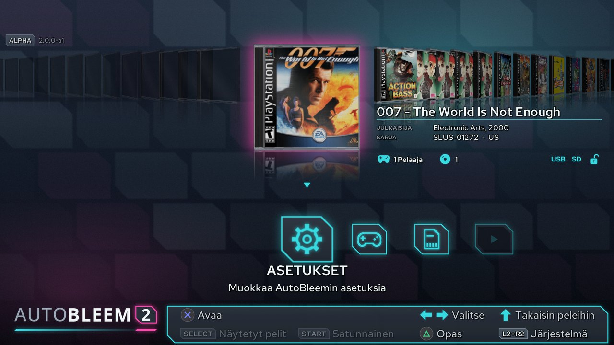

### 3.3 Sarjat

Iso pelikokoelma on helpompi selata osissa. Sarjojen avulla rajaat hyllyn yhdenlaisiin peleihin – vain suosikkeihin,
vain Super Nintendo -peleihin, vain yhden kansion peleihin – eikä sinun tarvitse selata satojen kansien ohi
löytääksesi haluamasi.

Paina **Select**, niin sarjavalitsin aukeaa. Siinä on kolme välilehteä, PlayStation, RetroArch ja Sovellukset:
L1 ja R1 vaihtavat välilehteä, Ylös ja Alas liikkuvat välilehden ryhmissä (L2 ja R2 sivu kerrallaan), ja Cross
näyttää valitsemasi ryhmän hyllyllä. Circle (*Takaisin*) sulkee valitsimen muuttamatta mitään. Nämä näppäimet
näkyvät myös alapalkissa. Jokaisella rivillä lukee, montako kohdetta siinä on. Tyhjä ryhmä avautuu tyhjälle
hyllylle, jonka kuvakerivillä on tarjolla vain *ASETUKSET*.

**PlayStation-välilehti.** PlayStation Classicilla se alkaa riveillä *Kaikki pelit* ja *Sisäiset pelit*
(konsoliin valmiiksi asennetut kaksikymmentä peliä). Niiden jälkeen tulee *USB-pelit* – kaikki, mitä kansiossa
`Games/` on – ja oma ryhmä jokaiselle kansiolle, jonka olet tehnyt sen alle, joten alikansiossa oleva peli kuuluu
sen kansion ryhmään. Sitten tulevat *Suosikkipelit*, *Pelihistoria* ja, kun olet merkinnyt ainakin yhden pelin
valopistoolipeliksi, *Lightgun-pelit*. Raspberry Pissä, PC-tikulla ja Windowsissa sisäisiä pelejä ei ole, joten
siellä lista alkaa *USB-peleistä*, jotka ovat koko kokoelmasi.

**RetroArch-välilehti** on näkyvissä vain, jos RetroArch on asennettu. Siinä on oma ryhmä jokaiselle laitteelle,
jolle sinulla on pelejä, sekä RetroArchin omat suosikit ja historia.

**Sovellukset-välilehti** lajittelee sovellukset tyypin mukaan: *Kaikki sovellukset* ja sitten *Pelit*,
*Emulaattorit*, *Työkalut*, *Media* ja *Muut*. Sovelluksen ryhmä määritetään sen `app.ini`-tiedostossa. Tällä
välilehdellä ovat myös **PE-sovellukset**, eli Windows-ohjelmat, joita PE-ajuri pyörittää; jos konsoli ei pysty
käynnistämään jotakin niistä, siinä lukee *ei toimi tällä konsolilla*. Siellä, missä käynnistäjä sen näyttää,
listalla on lisäksi *Paketit*-rivi (osio 3.10).

### 3.4 Pikavalikko

Pikavalikko on lyhyt lista asioista, joita tarvitset useimmin pelejä selatessasi, joten niitä ei tarvitse kaivaa
koko järjestelmävalikosta. Avaa se hyllyllä painamalla **Ylös** tai valitsemalla kuvakeriviltä **hammasratas**
(rivi, jossa ovat *ASETUKSET*, *Peli*, *MUISTIKORTTI* ja *JATKA*).

Ylös ja Alas liikkuvat kohteissa (viimeisestä kohdistin hyppää takaisin ensimmäiseen), Cross valitsee ja Circle
sulkee valikon. Valikon alla oleva rivi kertoo, mitä valittu kohde tekee. Kohteet ovat nämä:

- *Skannaa pelit uudelleen* etsii uudet, muuttuneet ja poistetut pelit heti – kätevä, kun olet juuri kopioinut
  pelejä etkä halua odottaa.
- *Kauppa* avaa AutoBleemin Kaupan, jossa selaat ja asennat pelejä, sovelluksia ja laajennuksia (osio 3.13).
- *RetroArch-ytimet* (jos RetroArch on asennettu) antaa valita, millä ytimellä kunkin laitteen pelit pelataan.
- *Verkko ja ohjaimet* avaa Wi-Fin, Bluetooth-parituksen ja ohjainten näppäinasettelun näkymät (luku 6). Se on
  valikossa vain, jos jokin asennettu laajennus tarjoaa ne – PSC-Bios tekee sen konsolilla, Raspberry Pillä ja
  PC-tikulla. Jos laajennus on asennettu mutta poistettu käytöstä, kohde on harmaana ja sen kuvaus neuvoo ottamaan
  laajennuksen käyttöön Laajennuksissa; Cross avaa silloin Laajennukset-listan suoraan sen kohdalta.
- *Käynnistä launcher uudelleen* sulkee AutoBleemin ja käynnistää sen uudelleen (vain konsolilla, Raspberry Pillä
  ja PC-tikulla).
- *Järjestelmävalikko...* avaa koko järjestelmävalikon kaikkine muine toimintoineen – Vaihtoehdot, Pelien hallinta,
  Sammuta ja muuta (osio 3.5).

Kauppaa, RetroArch-ytimiä ja launcherin uudelleenkäynnistystä lukuun ottamatta kaikki nämä löytyvät myös
järjestelmävalikosta.


### 3.5 Järjestelmävalikko

Järjestelmävalikossa on kaikki, mitä AutoBleem osaa pelaamisen lisäksi: asetukset, työkalut pelikokoelmalle ja
muistikorteille, tietoa laitteesta ja tapa sammuttaa se. Paina **L2 + R2** yhtä aikaa (kummassa järjestyksessä
tahansa), niin valikko aukeaa hyllyn päälle. Kohteet on ryhmitelty otsikoiden *Kirjasto*, *Järjestelmä* ja
*Poistu* alle, ja kaksi eniten käytettyä ovat ylimpänä. Valikon alareunan rivi kertoo, mitä valittu kohde tekee,
joten voit katsella rauhassa ennen kuin valitset.

| Osa | Kohde | Mitä se tekee |
|---|---|---|
| (ylhäällä) | *Skannaa pelit uudelleen* | Etsii uudet, muuttuneet ja poistetut pelit nyt. Skannaus seuraa kansiota muutenkin itsestään, joten tätä tarvitset vain, kun et halua odottaa. |
| | *Laajennukset* | Listaa tikulla olevat laajennukset, kuten AutoBleemin Kaupan, jotta voit käynnistää ne tai poistaa ne käytöstä (osio 3.13). |
| *Kirjasto* | *Pelien hallinta* | Näyttää PS1-pelit listana kansioineen; täällä voit poistaa pelin tai tyhjentää kannet (osio 4.1). Sitä ei voi avata skannauksen aikana. |
| | *Muistikortit* | Hallitsee jaettuja muistikorttisarjojasi (osio 3.8). |
| | *Skannauksen prosessorit* | Määrää, missä järjestyksessä jokainen skannaus ajaa ensin omat apuohjelmansa, ja kytkee niitä päälle ja pois (osio 3.14). Sitä ei voi avata skannauksen aikana. |
| *Järjestelmä* | *Vaihtoehdot* | Avaa AutoBleemin asetukset (osio 3.6). |
| | *Verkko ja ohjaimet* | Avaa Wi-Fin, Bluetooth-ohjainten parituksen, DualShock 3:n käyttöönoton ja ohjainten näppäinasettelun näkymät (luku 6). Kohde on näkyvissä vain, kun jokin laajennus tarjoaa ne – katso alta. |
| | *Laitteistotiedot* | Näyttää laitteen tiedot – järjestelmän, suorittimen, tallennustilan, verkkoliitännät, aikavyöhykkeen, näytön sekä ohjaimet ja niiden asettelut – samalla sivulla kaikilla alustoilla (osio 4.2). Circle vie takaisin järjestelmävalikkoon. |
| | *Virtuaalinen ohjain* | Näyttää ohjaimet, jotka sovellukset saavat, ja ohjaimet, jotka daemon näkee. Tästä on apua, kun ohjain ei toimi sovelluksessa (osio 4.5). Circle vie takaisin järjestelmävalikkoon. |
| | *Ohjelmistopäivitys* | Tarkistaa heti sivustolta, onko uudempaa AutoBleemia tai RetroArchia, eikä odota päivittäistä tarkistusta (osio 3.12). Kun käynnistäjä tietää jo päivityksestä, rivillä lukee *Päivitys saatavilla*. PlayStation Classicilla tämä vaatii AutoBleem-kernelin ja Wi-Fi-verkon. |
| | *Tietoja* | Näyttää tekijät ja lisenssin. |
| *Poistu* | *RetroArch* | Siirtyy käynnistäjästä RetroArchin omaan valikkoon, jossa ovat sen asetukset ja sisältölistat; kun suljet RetroArchin, palaat käynnistäjään. Kohde on näkyvissä vain, jos RetroArch on asennettu. |
| | *Sammuta* | Sammuttaa laitteen, kun olet vahvistanut sen (katso alta). |

**Verkko ja ohjaimet** näkyy vain, jos jokin asennettu laajennus tarjoaa `network`-kohteen. Laajennus ilmoittaa
sen `extension.ini`-tiedostossaan rivillä `Provides=network`. PSC-Bios tekee näin konsolilla, Raspberry Pillä ja
PC-tikulla. Jos laajennus on asennettu mutta poistettu käytöstä, kohde pysyy valikossa harmaana, ja sen kuvaus
neuvoo ottamaan laajennuksen käyttöön Laajennuksissa; kun painat siinä Crossia, Laajennukset-lista avautuu suoraan
kyseisen laajennuksen kohdalta.

**Sammuta** toimii laitteen mukaan. Konsolilla se vie AutoBleemin valmiustilaan: tikku irrotetaan, valo muuttuu
oranssiksi, ja Power tuo käynnistäjän takaisin muutamassa sekunnissa (osio 2.1). Raspberry Pi ja PC sammuvat.

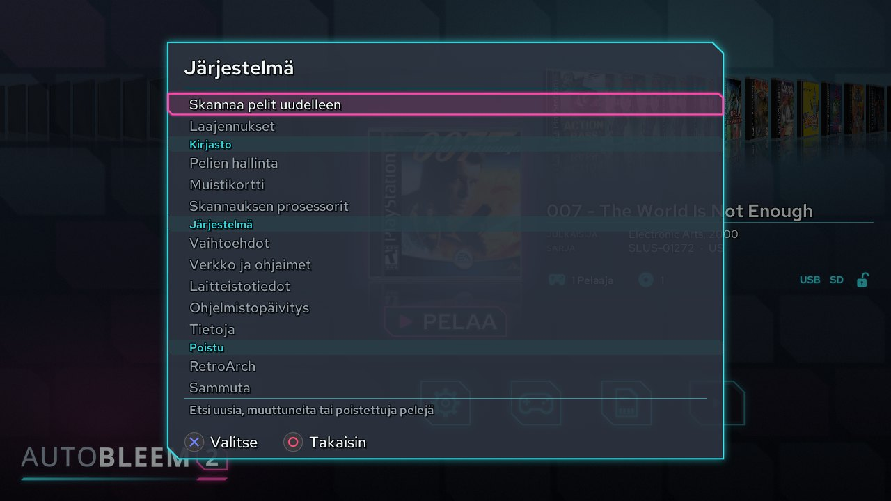

### 3.6 Vaihtoehdot

Vaihtoehdoissa teet AutoBleemista omannäköisesi: kuva ruudullasi, käynnistäjän ulkoasu, kieli, äänet ja se, millä
PS1-emulaattorilla pelisi pyörivät. Avaat ne järjestelmävalikosta (*Vaihtoehdot*) tai pelin alla olevasta
*ASETUKSET*-kuvakkeesta. Näytön ja kielen asetat yleensä kerran, ja palaat tänne, kun jokin näyttää jollakin
televisiolla oudolta tai kaipaat vaihtelua.

Asetukset on jaettu ryhmiin, kukin oman otsikkonsa alle. Ylös ja Alas siirtyvät riviltä toiselle, ja Vasen ja
Oikea muuttavat valitun rivin arvoa: napautus siirtää askeleen, ja pohjassa pitäminen jatkaa. L1 ja R1 hyppäävät
ensimmäiselle tai viimeiselle riville, ja L2 ja R2 kääntävät sivua. Riveillä, joilla valitaan teema, musiikki tai
fontti, Start arpoo vaihtoehdon. Päälle tai pois kytkettävässä asetuksessa lukee **PÄÄLLÄ** tai **POIS**. Näet
jokaisen muutoksen heti, ja Circle poistuu näkymästä ja tallentaa kaiken – muuta vahvistettavaa ei ole. Ainoa
poikkeus on näyttötila, jota kokeillaan vasta, kun poistut Vaihtoehdoista (katso *Näyttö* alempana).

Osa riveistä näkyy vain, kun niillä on merkitystä: CRT-rivit vain 4:3-kuvalla, RetroArch-rivit vain, jos
RetroArch on asennettu, ja sisäiset pelit vain PlayStation Classicilla.

| Ryhmä / asetus | Mihin sitä käytetään |
|---|---|
| *Käyttöliittymä*: *Näyttö:* | Asettaa näytön tarkkuuden käynnistäjälle ja PS1-emulaattorille. *Auto* käyttää näytön omaa tilaa ja kertoo, mikä se on, esimerkiksi *Auto (1920x1080)*; voit myös valita minkä tahansa tilan, jonka näyttö ilmoittaa. Konsoli tarjoaa tilat 720p, 1080p ja *CRT 4:3* (720x480), joka on tarkoitettu vanhalle kuvaputkitelevisiolle tai 4:3-kaappauslaitteelle. Vaihda tilaa, jos kuva ei sovi televisioosi tai näyttää sumealta. Riviä ei ole, kun AutoBleem pyörii ikkunassa kehityskoneella. |
| *CRT-reunus:* | Pienentää kaikkea hiukan, 0–10 % yhden prosentin askelin, koska vanhat televisiot leikkaavat kuvan reunoja. Kasvata arvoa, kunnes vihjepalkki ja kulmat näkyvät kokonaan. Rivi näkyy vain 4:3-kuvalla, muutos tulee voimaan heti, ja se on käytössä jo ennen käynnistyskuvaa. |
| *Kuvan korkeus:* | Tekee kuvasta korkeamman tai matalamman, -40...+40 kahden askelin, millä tahansa 4:3-lähdöllä – *CRT 4:3* tai 4:3-tila VGA- tai PC-lähdössä. Käytä sitä, kun kuva on vanhassa televisiossa litistynyt tai valuu ylä- ja alareunan yli. Muutos tulee voimaan heti, ja RetroArchin pelikuva seuraa sitä. |
| *Emulaattorin näytön skaalaus:* | Määrää, miten PS1-emulaattori sovittaa pelin kuvan näytöllesi. *1x1* näyttää PlayStationin omat pikselit pieninä ja tarkkoina; *2x (kokonaisluku)* ja *4:3 (kokonaisluku)* skaalaavat vain kokonaisilla kerrannaisilla, mikä antaa terävimmän kuvan; *4:3* säilyttää kuvan alkuperäisen muodon; *Koko näyttö* venyttää kuvan koko ruudulle. Asetus korvaa vanhan Widescreen-kytkimen. Klassinen `pcsx-ab` ja RetroArch tuntevat vain koko näytön ja 4:3:n. |
| *Näytön hehku:* | Kun asetus on PÄÄLLÄ, pelikuvan viereiset tyhjät reunat (kun kuva ei täytä ruutua) täytetään kuvan omalla pehmeällä hehkulla mustan sijaan. Toimii `pcsx-abnxt`:n kanssa. |
| *AutoBleem-teema:* | Vaihtaa käynnistäjän ulkoasun. Teemat ovat kansiossa `Themes/`, ja sinne pudotettu teeman zip-tiedosto näkyy listalla myös nimellään. AutoBleemin mukana tulevat teemat päivittyvät jokaisen päivityksen yhteydessä, joten jos haluat muokata jotakin niistä, kopioi se ensin uudelle nimelle. Oletus on **ab2.0.0**. |
| *Kannen tyyli:* | Valitsee PS1-kansien ympärille piirrettävän CD-kotelon kehyksen. |
| *Kannen välähdys:* | Antaa valon välähtää valitun kannen yli aina, kun hylly pysähtyy. |
| *Kieli:* | Asettaa käynnistäjän kielen. Kieliä on 17, ja vaihto tapahtuu heti. |
| *Ilmoituksen näyttöaika:* | Määrää, kuinka kauan tiedottavat kuplat (*Näytetään: ...*, skannauksen yhteenveto) pysyvät näkyvissä, 0–20 sekuntia; arvolla 0 rivillä lukee *Pois*, ja kuplat jäävät pois. Virheilmoituksilla on oma kiinteä aikansa, joten mikään niistä ei mene ohi. |
| *Aloitusnäyttö:* | Näyttää AutoBleem-kuvan käynnistäjän käynnistyessä; kytke se pois, jos haluat suoraan hyllylle. |
| *Animaatiot:* | Animoi siirtymät näkymästä toiseen; kytke ne pois, jos haluat jokaisen näkymän ilmestyvän heti. |
| *Fontit*: *Käytä oletusfonttia:* | Kun asetus on PÄÄLLÄ, käynnistäjä käyttää omaa fonttiaan (Red Hat Text); kytke se pois, jos haluat käyttää seuraavalla rivillä valittua fonttia. |
| *Fontti:* | Valitsee oman fontin: minkä tahansa `.ttf`- tai `.otf`-tiedoston kansioista `resources/fonts`, `RetroArch/fonts` tai teeman kansiosta. Rivillä näkyy oikeasti käytössä olevan fontin nimi. |
| *Ääni*: *Musiikki:*, *Taustamusiikki:* | *Musiikki:* valitsee käynnistäjän taustalla soivan kappaleen – teeman oman tai tiedoston kansiosta `resources/music`. *Taustamusiikki:* päättää, soiko musiikkia ylipäätään. |
| *Emulointi*: *PS1-emulaattori:* | Valitsee emulaattorin, jossa PS1-pelisi käynnistyvät: oletuksena `pcsx-abnxt` (uusin PCSX-ReARMed AutoBleemin lisäyksin) tai klassinen `pcsx-ab`. Kokeile toista, jos peli ei pyöri hyvin. Toisella tallennettu jatkopiste jatkuu toisessakin, paitsi jos peliä pelattiin ilman BIOS-tiedostoa. |
| *Vaihda pelaaja 1 / pelaaja 2 (PS1-emulaattorit):* | Vaihtaa kahden ensimmäisen ohjaimen paikkaa, eli kumpi on pelaaja 1 ja kumpi pelaaja 2, kummassakin PS1-emulaattorissa – kätevää, kun ohjaimet on kytketty "väärin päin". Asetuksella on merkitystä vain, kun ohjaimia on kaksi tai enemmän; yhdellä ohjaimella pelaat aina pelaajana 1. RetroArchiin se ei vaikuta. Jos käytössä oleva PS1-emulaattori ei vielä osaa vaihtaa ohjaimia, AutoBleem kertoo siitä. |
| *Pelaa kaikki PSX-pelit RA:lla:*, *Päivitä RA-asetukset:*, *Säilytä RetroArchin asetukset:* | Nämä kolme näkyvät vain, jos RetroArch on asennettu. Ensimmäinen käynnistää kaikki PS1-pelit RetroArchin PS1-ytimessä (*PlayStation 1*; PC:llä se on SwanStation). Toinen antaa AutoBleemin kirjoittaa omat asetuksensa RetroArchin asetustiedostoon, kun se käynnistää pelin siellä. Kolmas säilyttää RetroArchin omassa valikossa tekemäsi muutokset, kun RetroArch suljetaan. |
| *Kirjasto*: *Näytä sisäiset pelit:* | Näyttää konsolin sisäänrakennetut pelit PlayStation-listoissa (vain PlayStation Classic). |
| *Siistit pelinimet:* | Kun asetus on PÄÄLLÄ (oletus), RetroArch-pelilistoissa näkyvät siistit nimet ilman sulkeissa olevia merkintöjä, kuten (USA), (Rev 1) tai [!]; POIS näyttää tiedostonimet. Tiedostonimi näkyy silti pelin tiedoissa. PS1-peleihin asetus ei vaikuta, koska niiden nimet tulevat tietokannasta. |
| *Hae kansikuvat verkosta:* | Antaa skannauksen ladata puuttuvat kannet libreton palvelimilta (Raspberry Pi, PC, Windows). |
| *Päivitykset*: *Päivitykset:* | Valitsee, mitä päivityksiä käynnistäjä etsii (osio 3.12): `release` (testattu versio), `testing` (seuraava versio testauksessa), `nightly` (uusin kehitysversio) tai `off`. Oletus määräytyy asentamasi version mukaan. Riviä ei näytetä kehityskoneella. |
| *Vianmääritys*: *Säilytä lokit tikulla:* | Säilyttää seuraavasta käynnistyksestä alkaen kaikki lokit tikulla, ei vain kaatumisen jälkeen – kytke se päälle, kun selvität jotakin ongelmaa (luku 7). |
| *Näytä suorituskyky:* | Näyttää vasemmassa alakulmassa kuvataajuuden, suoritinkuorman, säikeet ja muistin; pelissä emulaattori näyttää myös oman FPS- ja CPU-lukemansa. |

**Näyttötilan vaihtaminen.** Kun poistut Vaihtoehdoista uusi *Näyttö:*-tila valittuna, AutoBleem vaihtaa siihen ja
kysyy *Pidetäänkö tämä näyttötila?*. Jos kuva on kunnossa, vahvista. Jos televisio ei näytä mitään, odota: ilman
vahvistusta AutoBleem palaa lähtölaskennan jälkeen edelliseen tilaan.

**Teemat 4:3-näytöllä.** *CRT 4:3* -tilassa teemalistalla näkyvät vain teemat, joissa on 4:3-asettelu. Jos
käyttämässäsi teemassa sellaista ei ole, oletusteema tulee sen tilalle, kun olet vahvistanut tilan (ja jokaisella
käynnistyksellä tässä tilassa), ja ilmoitus kertoo siitä: *Teema vaihdettu oletusteemaan (CRT 4:3)*.

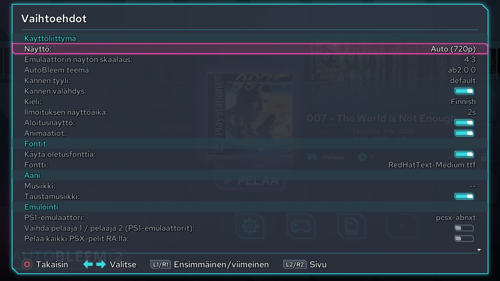


### 3.7 Pelin asetukset

Jokaisella pelillä voi olla omat asetuksensa. Useimmat pelit toimivat sellaisinaan, mutta joskus peli kaipaa
vähän apua – terävämpää tai pehmeämpää kuvaa, ruudun ohitusta, jotta se pysyy sulavana, tai toista muistikorttia –
tai haluat merkitä sen suosikiksi. Pelin muokkaimessa muutat näitä juuri sille pelille koskematta muihin.

Kun peli on valittuna, avaa sen alla oleva kuvakerivi painamalla **Alas**. Rivillä on neljä kuvaketta:
*ASETUKSET* (osion 3.6 asetukset), *Peli* (tämän pelin omat asetukset), *MUISTIKORTTI* (pelin muistikortti) ja
*JATKA* (pelin tilatallennukset). Siirry haluamaasi ja avaa se Crossilla.

**Pelin muokkain** (*Peli*-kuvake) näyttää oikealla pelin tiedot – nimen, julkaisijan, vuoden, pelaajamäärän,
kansion ja muistikortin – ja vasemmalla sen asetukset. Ylös ja Alas siirtyvät asetuksesta toiseen ja Vasen ja
Oikea muuttavat niitä kuten Vaihtoehdoissa; pohjassa pidetty painike toistaa liikkeen. Kun olet valmis, Circle
tallentaa muutokset ja vie sinut takaisin. Jos pelin tiedoissa ei ole nimeä, se näytetään kansionsa nimellä.

Asetukset on jaettu neljään ryhmään:

- **Peli** koskee sitä, miten AutoBleem kohtelee peliä. *Suosikki:* lisää sen sarjavalitsimen *Suosikkipelit*-
  ryhmään. *Lukitse data:* käskee skannausta jättämään pelin nimen, sarjanumeron ja levylistan juuri sellaisiksi
  kuin olet ne asettanut, jottei myöhempi skannaus kirjoita muutoksiasi yli. *Jatkaminen:* päättää, mitä
  tapahtuu, kun käynnistät pelin, jolla on jatkopisteitä: *Kysy* näyttää jatkopaikkojen valitsimen, *Viimeisin
  paikka* jatkaa heti uusimmasta paikasta, ja *Ei koskaan* aloittaa pelin aina alusta. Jos RetroArch on asennettu,
  rivejä on kaksi lisää. *Lightgun-peli:* on valopistoolipeleille: peli siirtyy *Lightgun-pelit*-ryhmään ja
  käynnistyy aina RetroArchissa, koska RetroArchin PS1-ytimessä on GunCon-tuki (asetuksen kytkeminen päälle
  kytkee päälle myös seuraavan rivin). *Pelaa RA:lla:* pelaa juuri tämän pelin RetroArchissa PS1-emulaattorin
  sijaan.
- **Näyttö** koskee kuvan ulkoasua. *Tarkkuus:* piirtää pelin 1x- tai 2x-koossa (sisäisellä grafiikkasuorittimella),
  ja *Poista saumat:*, joka toimii vain 2x-koossa, piilottaa ohuet viivat, joita tuossa koossa voi näkyä kuvan
  osien välissä. *Rasterointi:* (*Pois*, *Päällä*, *Aina*) säätää hienoa pistekuviota, jolla PlayStation sekoittaa
  värejä, ja *Pehmennys:* valitsee yhden emulaattorin pehmentävistä skaalaimista. *Suodatin:* päättää, miten kuva
  skaalataan ruudulle: *Lähin* näyttää pelkät pikselit, *Lineaarinen* pehmentää ne, *Terävä* ja *Terävä
  (yksinkertainen)* pitävät pikselit terävinä ilman värinää, ja lisäksi on *Quilez*. CRT-suodattimet *CRT
  (nopea)*, *CRT (raster)* ja *CRT-Pi* jäljittelevät vanhaa televisiota ja piirtävät omat juovansa, joten
  juovarivit muuttuvat harmaiksi, kun jokin niistä on valittuna. Muuten *Skannauslinjat:* lisää vanhan television
  tummat juovat, ja *Skannauslinjojen kirkkaus* säätää, kuinka tummia ne ovat. *Tarkkuus*, *Poista saumat*,
  *Rasterointi*, *Pehmennys* ja muut suodattimet kuin *Lineaarinen* ja *Lähin* ovat `pcsx-abnxt`:tä varten;
  klassinen `pcsx-ab` ja RetroArch näyttävät minkä tahansa muun suodattimen *Lähin*-suodattimena.
- **Renderöinti** sisältää grafiikan *Liitännäinen:*-asetuksen ja *Frameskip:*-asetuksen (*Auto*, *Pois* tai 1–3
  ruutua). Ruutujen ohittaminen auttaa liian hitaasti pyörivää peliä pitämään vauhtinsa, mutta kuva ei ole yhtä
  sulava.
- **Emulaattori** sisältää asetukset *Nopeuden muutin:*, suorittimen *Kello:*, *SPU-interpolointi:* (miten ääntä
  pehmennetään), *Käynnistyslogo:* ja `pcsx-abnxt`:n kanssa *Sonyn korjaukset:*. Kytke *Käynnistyslogo:* pois,
  jos haluat ohittaa BIOS-valikon – tätä tarvitset homebrew-levylle, jonka oma logo estää sitä käynnistymästä.

Kuvan muotoa ja näytön tarkkuutta ei aseteta pelikohtaisesti vaan kaikille peleille yhteisesti Vaihtoehdoissa
(*Emulaattorin näytön skaalaus:* ja *Näyttö:*).

**Muut painikkeet muokkaimessa.** Triangle nimeää pelin uudelleen näytön näppäimistöllä. Square antaa pelille
toisen muistikortin (*Vaihda muistikortti*). Niin kauan kuin peli käyttää vielä omaa korttiaan, Start tekee siitä
uuden jaetun sarjan, jotta muutkin pelit voivat käyttää sitä (*Jaa muistikortti*, osio 3.8). Näitä kahta ei
tarjota konsolin sisäisille peleille. Vasemman / Oikean tai Ylös / Alas pitäminen pohjassa toistaa liikkeen täällä
sekä RetroArchin pelivalintojen ja ytimien näkymissä.

Peli säilyttää asetuksensa omassa `pcsx.cfg`-tiedostossaan. Jokaisella tikulla olevalla pelillä on sellainen,
koska skannaus luo sen. USB-asemassa oleva alkuperäinen levy (osio 3.9a) saa oman kansionsa ja
`pcsx.cfg`-tiedostonsa vasta, kun käynnistät sen ensimmäisen kerran. Siihen asti muokkaimessa tehtyä muutosta ei
voi tallentaa, ja muokkain ilmoittaa *Ei tallennettu: pelillä ei ole pcsx.cfg-tiedostoa*. Käynnistä siis levy
kerran – siitä lähtien sen asetukset säilyvät kuten minkä tahansa muun pelin. Levy, joka kuuluu kokoelmassasi jo
olevaan peliin, käyttää alusta asti sen pelin kansiota ja asetuksia.

**Asemassa olevalle levylle** (osio 3.9a) osa asetuksista ei ole järkeviä, joten muokkain näyttää ne harmaina, ja
alarivillä lukee *Ei käytettävissä asemassa olevalle levylle*, kun siirryt sellaiselle riville.


**Emulaattoriin tallennetut asetukset.** Peliä voi säätää myös pelatessa: emulaattorin omassa valikossa on *Tallenna
asetukset tälle pelille* (osio 3.9). Kun pelille on tallennettu asetukset sitä kautta, peli käyttää niitä.
Pelin muokkain näyttää silloin Näyttö-, Renderöinti- ja Emulaattori-rivit harmaina tallennetuin arvoin otsikon
*Tallennettu emulaattoriin* alla, joten voit lukea ne mutta et muuttaa niitä. Jos haluat palata pelin muokkaimen
asetuksiin, valitse *Avaa asetusten lukitus* ja vahvista: emulaattorin tallentamat asetukset poistetaan, ja rivejä
voi taas muuttaa. Kumpikin emulaattori, `pcsx-ab` ja `pcsx-abnxt`, lukee ja kirjoittaa samoja tallennettuja
asetuksia, joten ei ole väliä, kumpi ne tallensi.

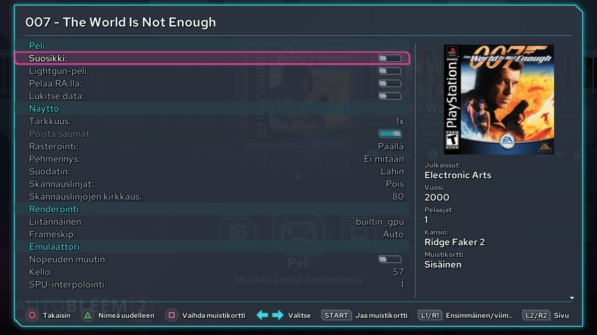

### 3.8 Muistikortit ja tilatallennukset

Oikealla PlayStationilla jaoit yhden tai kaksi muistikorttia kaikkien pelien kesken, ja ennemmin tai myöhemmin
tila loppui. AutoBleemissa jokaisella PS1-pelillä on oletuksena oma muistikorttinsa, joten sinun ei tarvitse
koskaan miettiä tilaa tai sitä, millä kortilla tallennus on. Kortti säilytetään pelin tilatallennusten kanssa
kansiossa `Games/!SaveStates/<pelin kansio>/`.

**Jaetut muistikorttisarjat.** Joskus pelien täytyy nähdä toistensa tallennukset – esimerkiksi jatko-osa, joka
lukee ensimmäisen osan tallennuksen, tai pelisarja, jonka haluat samalle kortille. Tätä varten teet jaetun sarjan:
yhden kortin, jota useampi peli käyttää. Sarjat säilytetään kansiossa `Games/!MemCards/`, ja niitä hallitaan
järjestelmävalikon kohdasta *Muistikortit*. Square luo uuden sarjan (nimi kirjoitetaan näytön näppäimistöllä),
Cross nimeää valitun sarjan uudelleen, ja Triangle poistaa sen kysyttyään ensin. Peli liitetään sarjaan pelin
muokkaimen kohdasta *Vaihda muistikortti* (osio 3.7) tai pelin *MUISTIKORTTI*-kuvakkeesta.

**Muistikorttien muokkain** aukeaa pelin *MUISTIKORTTI*-kuvakkeesta. Se näyttää pelin kortin ja toisen kortin
rinnakkain, jokaisen tallennuksen kuvakkeineen ja nimineen, samaan tapaan kuin alkuperäisen konsolin
muistikorttinäkymä. Square kopioi valitun tallennuksen toiselle kortille, Triangle poistaa sen, ja Select eheyttää
kortin eli kokoaa sen vapaat lohkot yhteen, jotta iso tallennus taas mahtuu. Startilla valitset, mikä sarja
näkyy oikealla, ja Cross lataa molemmat kortit uudelleen tikulta. Kortti, jolle peli ei ole vielä kirjoittanut –
peli, jossa et ole vielä tallentanut – on tyhjä, ja sen nimen vieressä lukee *ei vielä korttia*. Jos teit
muutoksia, AutoBleem kysyy *Haluatko tallentaa muistikorttien datan?* ennen kuin se poistuu muokkaimesta, lataa
kortit uudelleen tai näyttää toisen sarjan.

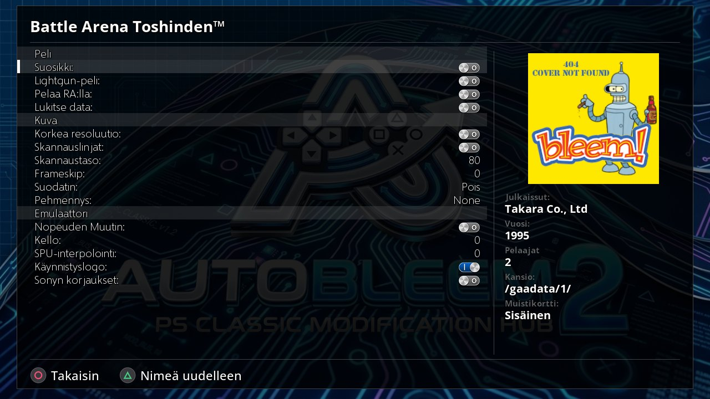

**Jatkopisteet.** Monissa PS1-peleissä voi tallentaa vain tietyissä paikoissa, eikä sellaiseen aina ehdi ennen kuin
on lopetettava. Jatkopisteet hoitavat asian: kun poistut PS1-pelistä konsolin Reset-painikkeella (tai Pillä ja
PC:llä emulaattorin valikon kautta), AutoBleem ottaa tilatallennuksen juuri siitä kohdasta, jossa olit. Kun
tallennusta kirjoitetaan pelistä poistuttaessa, emulaattori näyttää *Please wait...*. Seuraavalla kerralla jatkat
siitä hetkestä.

Jatkopisteet löytyvät pelin *JATKA*-kuvakkeen alta. Jos pelillä on jatkopiste, kuvakkeessa näkyy siitä pieni kuva;
jos ei ole, kuvake on harmaa. Jatkopaikkojen valitsimessa on neljä paikkaa kehystettyinä kortteina, kussakin kuva
hetkestä, paikan numero ja päivämäärä. Uusin on merkitty sanalla **UUSIN**, ja käyttämättömässä paikassa lukee *Ei
jatkopistettä*. Cross jatkaa peliä valitusta paikasta, ja Triangle poistaa sen. Se, tuleeko valitsin näkyviin
lainkaan pelin käynnistyessä, riippuu pelin *Jatkaminen:*-asetuksesta (osio 3.7).

Myös RetroArchissa pelatuilla PS1-peleillä on jatkopaikat. Jokaisessa paikassa on merkki – AutoBleem 2:n tai
RetroArchin logo – josta näet, kumpi emulaattori sen kirjoitti.


### 3.9 Pelien, RetroArchin ja sovellusten käynnistäminen

Pelin käynnistäminen on sitä, mitä teet useimmin, joten siihen riittää yksi painike: valitse peli hyllyltä ja paina
**Cross**. PS1-peli aukeaa koko ruudulle Vaihtoehdoissa valitsemaasi PS1-emulaattoriin (osio 3.6) ja pyörii, kunnes
poistut siitä. Jos haluat pelata PS1-peliä mieluummin RetroArchissa – koska se toimii siellä paremmin tai pidät
RetroArchin asetuksista – paina sen sijaan **Square**.

**Pelistä poistuminen.** PlayStation Classicilla konsolin omat painikkeet tekevät sen, mitä odotatkin. Etupaneelin
**Reset** vie sinut takaisin käynnistäjään ja ottaa jatkopisteen siitä, mihin jäit, jotta voit jatkaa myöhemmin
(osio 3.8); se toimii silloinkin, kun pelin valikko on auki. **Power** sammuttaa konsolin. Raspberry Pissä ja PC:ssä
tällaisia painikkeita ei ole, joten niissä poistut emulaattorin pelinaikaisen valikon kautta (katso alta).

Lisäksi on poistumistapa, joka toimii samoin jokaisella ohjaimella – konsolin omalla, USB-ohjaimella ja
Bluetooth-ohjaimella: **pidä Start + Select tai Home pohjassa 2 sekuntia**, niin olet takaisin AutoBleemissa.
Samojen painikkeiden lyhyt painallus avaa sen sijaan emulaattorin valikon. Käynnistäjä muistuttaa kummastakin
vihjeissään (*Pidä Select+Start tai Home painettuna 2 sekuntia: takaisin AutoBleemiin* ja *Select+Start tai Home
lyhyesti: emulaattorin valikko*). Sovelluksessa ei ole emulaattorin valikkoa, joten siellä toimii vain pitkä
painallus. Konsolilla Reset pysäyttää aina myös sovelluksen.

**Pelinaikainen valikko.** `pcsx-abnxt`:ssä emulaattorilla on oma valikkonsa niitä asioita varten, joita tarvitset
pelatessa: tallentamiseen, levyn vaihtoon, kuvan säätämiseen ja ohjainten valintaan. Paina valikkopainiketta –
Home, jos ohjaimessa sellainen on, **Select + Start** ohjaimessa, jossa sitä ei ole, tai näppäimistöllä **Esc** –
niin peli pysähtyy valikon taakse, ja sen viimeinen kuva jää taustalle. Valikkopainikkeen pitäminen pohjassa 2
sekuntia tekee saman kuin Reset: se poistuu pelistä. Valikossa on kolme välilehteä, joiden välillä L1 ja R1
liikkuvat. Valikko muistaa, missä olit, joten seuraavalla kerralla se aukeaa samalle välilehdelle ja riville.

- **Peli**-välilehti koskee itse peliä. *Jatka peliä* sulkee valikon, ja pelaaminen jatkuu. *Tallennukset*-kohdan
  alla *Pikatallennus* tallentaa senhetkisen tilanteen ja *Pikalataus* palauttaa sen. *Lataa automaattitallennus*
  vie pelin takaisin siihen, millainen se oli enintään 30 sekuntia sitten – emulaattori pitää tätä kopiota
  muistissa pelatessasi, ja se pelastaa sinut virheeltä, jota et muuten saisi peruttua. *CD-levy*-kohdan alla
  *Vaihda levy* on monilevyisiä pelejä varten, kun peli pyytää seuraavaa levyä, ja *Nollaa peli* aloittaa pelin
  alusta. *Tallenna asetukset tälle pelille* tallentaa juuri tätä peliä varten valitsemasi asetukset (osio 3.7).
  *PCSX-valikko* avaa PCSX-ReARMedin omat sivut asetuksineen, huijauskoodeineen ja tietoineen, ja *Lopeta* vie
  sinut takaisin AutoBleemiin.
- **Kuva**-välilehdellä voit muuttaa pelin ulkoasua ja näet muutoksen heti: *Näyttö*, *Tarkkuus* (1x tai 2x),
  *Poista saumat*, *Rasterointi*, *Skaalaus*, *Näytön hehku*, *Pehmennys*, *Suodatin*, *CRT-maski*, *Scanlines*
  ja *Scanlines-kirkkaus*. Ne ovat samat asetukset kuin pelin muokkaimessa (osio 3.7), ja jokaisen rivin
  oikealla puolella on ohjerivi, joka kertoo, mitä asetus tekee. *Näyttö* on näytön tarkkuus; konsolilla se
  valitaan asetuksissa, ja täällä se vain näytetään. *Näytön hehku* on tarkoitettu tummille palkeille, jotka
  jäävät 4:3-kuvan sivuille laajakuvatelevisiossa: se täyttää ne kuvan omilla reunoilla peilattuina ja
  himmennettyinä, joten peli näyttää hehkuvan palkkeihin asti eikä istu kahden mustan palkin välissä. *CRT-maski*
  piirtää kuvan päälle vanhan kuvaputken loisteainekuvion – *Aukko* antaa Trinitronin hienot raidat, *Rako* ja
  *Delta* muiden kuvaputkien pisteet. Se on käytettävissä vain CRT (raster) -suodattimen kanssa. CRT-Pi-suodatin
  on konsolille liian raskas 1080p-tilassa. Rivi, joka ei ole käytettävissä, on harmaa, ja sen ohjerivi kertoo
  syyn.
- **Ohjaimet**-välilehdellä päätät, mitä PlayStationin kahteen porttiin, *Ohjain 1* ja *Ohjain 2*, on
  kytketty: tavallinen (digitaalinen) ohjain, analoginen ohjain (DualShock), valopistooli tai ei mitään. Jotkin pelit
  toimivat vain tietynlaisella ohjaimella. Muutos tulee voimaan, kun palaat peliin.

Valikko on piirretty käynnistäjän omalla ab2.0.0-ulkoasulla, joten se ei tunnu eri ohjelmalta, ja siinä näkyvät
ohjainten akut ja viimeisimmän pikatallennuksen kuva.

**RetroArch-pelit.** Muun laitteen peli käynnistyy RetroArchissa sillä ytimellä, jonka käynnistäjä on valinnut
kyseiselle laitteelle. Kun lopetat, RetroArchin valikon *Close Content* tai *Quit RetroArch* tuo sinut takaisin
käynnistäjään. Jos haluat vaihtaa, millä ytimellä jonkin laitteen pelit pelataan, avaa pikavalikosta
*RetroArch-ytimet* (osio 3.4); lista aukeaa *PlayStation 1* -ydin ylimpänä. Ja jos haluat RetroArchin oman
valikon (XMB) sen asetuksia ja omia sisältölistoja varten, valitse järjestelmävalikosta *RetroArch*: RetroArch
aukeaa silloin ilman ladattua sisältöä.


**Sovellukset.** Sovellukset ovat ohjelmia eivätkä pelejä: konsolin työkalut ja konsolilla myös RetroArch-paketin
mukana tulevat lisäsovellukset – Doom, Quake, Amiga ja muita. Ne löytyvät Sovellukset-sarjasta. Ennen kuin
sovellus käynnistyy, AutoBleem näyttää sen lueminut-tekstin, jotta tiedät, mikä se on ja miten sitä ohjataan.
Cross käynnistää sovelluksen, ja Circle vie takaisin hyllylle.

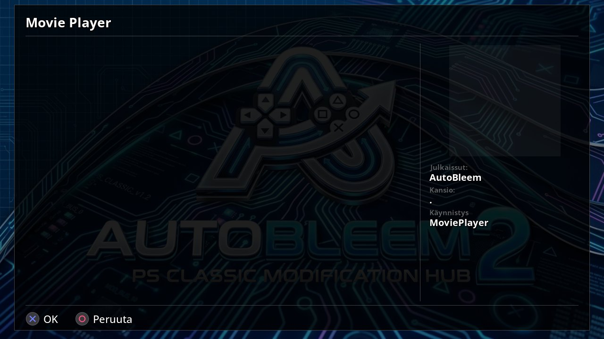

**Sovelluksen asetukset.** Monet sovellukset on tehty tietylle ohjaimelle, joten voit muuttaa sitä, miten ne näkevät
sinun ohjaimesi. Valitse sovellus, avaa kuvakerivi ja valitse *Peli*: sovelluksen *Pelin asetukset* aukeavat
(*Muuta tämän ohjelman käynnistystapaa*). *Ohjaintila:* päättää, millainen ohjain sovellukselle kerrotaan olevan.
*Automaattinen* käyttää sitä, mitä sovellus itse pyytää; *PSC-ohjain* ja *Xbox 360 -ohjain* esittävät ohjaimesi
konsolin ohjaimena tai Xbox 360 -ohjaimena, ja *PSC-ohjain (järjestelmä)* ja *Xbox 360 -ohjain (järjestelmä)*
tekevät saman järjestelmän itsensä kautta. Kokeile toista tilaa, jos sovellus ei reagoi ohjaimeesi niin kuin
pitäisi. *Ristiohjain tikkuna:* antaa ristiohjaimen liikuttaa analogista tikkua sovellukselle, joka kuuntelee vain
tikkua, ja *Tikku ristiohjaimena:* toimii päinvastoin.

Jotkin sovellukset kysyvät jotain ensimmäisellä käynnistyskerralla. Yksi haluaa tietää *Millainen ohjain sinulla
on?*, jotta se voi määrittää ohjauksensa: vastaa *Yksi ristiohjain*, jos ohjaimessasi on vain ristiohjain, tai
muuten *Analogitikut*. Windowsia pyörittävä sovellus kysyy *Mitä haluat tehdä?* ja tarjoaa vaihtoehdoiksi Windowsin
käynnistämisen, Windowsin asentamisen, DOSin käynnistämisen tai Windowsin asennuksen poistamisen. Kun sovelluksessa
asetetaan näppäin, se pyytää: *Paina jotakin painikkeista.*


PE-ajurin pyörittämä Windows-ohjelma (PE-sovellus, osio 3.3) keskustelee kanssasi AutoBleemin omien näkymien kautta:
viesti, jonka se haluaa näyttää, tulee näkyviin *Viesti*-näkymänä ja valintoja sisältävä kysymys *Valitse
vaihtoehto* -näkymänä, kummassakin otsikkona sovelluksen nimi.


### 3.9a Levy USB-asemassa

Konsoliin, Raspberry Pihin tai AutoBleem-tikulta käynnistettyyn PC:hen voi kytkeä tavallisen USB-liitäntäisen
CD/DVD-aseman ja pelata suoraan alkuperäiseltä PlayStation-levyltä kopioimatta mitään. Asemaan laittamasi levy
näkyy käynnistäjässä kuin mikä tahansa muu peli. Windowsissa tämä ei toimi.

**Levyn kopiointi tikulle.** Jos haluat pelin aina käsille ilman levyä, paina Squarea (*Kopioi levy*). AutoBleem
kysyy ensin, kopioidaanko peli, ja kertoo, paljonko se vie tilaa. Sitten se tallentaa pelin `Games`-kansioon
yhtenä CHD-tiedostona (monilevyinen peli saa lisäksi `.m3u`-tiedoston, jotta levynvaihto toimii pelissä).
Kopioinnin aikana näet nopeuden ja jäljellä olevan ajan, ja *Keskeytä* pysäyttää sen. Kun kopio on valmis, peli on
hyllyllä siinä missä muutkin. AutoBleem ei kopioi peliä, joka on jo `Games`-kansiossa, eikä peliä, jolle ei ole
tilaa – silloin se kertoo, paljonko tilaa tarvitaan. Naarmuuntuneenkin levyn voi kopioida: kohdat, joita ei
saatu luettua, täytetään nollilla, ja AutoBleem kertoo, montako niitä oli. Tällainen kopio voi toimia tai olla
toimimatta.

Square tarjoaa kopiointia levynäkymässä jokaiselle PlayStation-pelilevylle, myös sellaiselle, jota kansitietokannat
eivät tunne. Tietokantojen tuntema peli kopioidaan nimellään; monilevyisen pelin levyt kopioit yksi kerrallaan, ja
`.m3u` luettelee ne järjestyksessä levy 1 ensimmäisenä. Tuntematon levy nimetään sen sijaan sarjanumerollaan,
kopioidaan yksittäisenä levynä, eikä sillä ole hyllyllä kantta. Kopiointi-ikkuna, *Levyä kopioidaan*, pysyy
ruudulla, kunnes kopio on valmis tai keskeytetty – käynnistäjä odottaa sillä välin – ja näyttää nopeuden
tavallisen CD-aseman kerrannaisena. Jos kopiointi epäonnistuu, AutoBleem kertoo syyn.


**Pelaaminen levyltä.** Kun laitat levyn asemaan, **levynäkymä** aukeaa itsestään heti, kun levy on luettu. Siinä
näkyvät levyn kansi – kansitietokannoista tai verkosta haettuna – sekä levyn sarjanumero ja nimi, ja Cross
käynnistää pelin. Levyltä pelattu PS1-peli säilyttää jatkopisteensä ja tallennuksensa omassa kansiossaan, joten voit
lopettaa ja jatkaa myöhemmin aivan kuten tikulla olevan pelin kanssa. Pelin jälkeen, samoin kuin käytyäsi
asetuksissa tai laajennuksen asetuksissa, palaat levynäkymään. Jos poistut siitä Circlellä selaamaan muita
pelejäsi, levy jää asemaan, ja hyllyllä Circle tuo näkymän takaisin; tyhjällä hyllyllä myös R1 (*Levy*) avaa sen.
Hyllyllä, jolla on pelejä, R1 hoitaa tavallista tehtäväänsä eli hyppii alkukirjainten välillä. Kun otat levyn pois,
levynäkymä sulkeutuu.


**Asemamerkki** ruudun yläreunassa kertoo, mitä asema tekee, joten tiedät, pitääkö odottaa. Jos asemaa ei ole
kytketty, et näe mitään. Tyhjä asema näkyy himmeänä levykuvakkeena. Kun levyä luetaan, kuvake vilkkuu ja siinä lukee
*Luetaan levyä...*, ja kun levy on valmis, kuvake syttyy ja näyttää levyn nimen. Jos laitat asemaan levyn, joka ei
ole PlayStation-peli eikä ääni-CD, merkissä lukee *Tämä ei ole PlayStation-levy*, ja jos asema ei juuri nyt pysty
lukemaan levyä, siinä lukee *Levyä ei voi lukea nyt*.


**Ääni-CD:t.** Asema soittaa myös musiikki-CD:itä. Ääni-CD avaa levynäkymän sijaan **CD-soittimen**. Se näyttää
levyn nimellä *Ääni-CD* kappalelistoineen ja kokonaiskestoineen, ja sen alla oleva rivi kertoo valitun kappaleen
sekä sen, ovatko toisto ja sekoitus päällä. Levyssä, jota soitin ei pysty soittamaan, lukee *Tätä levyä ei voi
toistaa*. Soittimen painikkeet ovat nämä:

| Painike | CD-soittimessa |
|---|---|
| Cross | Soittaa valitun kappaleen. |
| Start | Keskeyttää musiikin ja jatkaa sitä taas. |
| Square | Pysäyttää musiikin. |
| L1 / R1 | Siirtyvät edelliseen tai seuraavaan kappaleeseen. |
| L2 / R2 | Kelaavat kappaletta taakse- tai eteenpäin viisi sekuntia kerrallaan. |
| Triangle | Vaihtaa, mitä toistetaan uudelleen: ei mitään, koko levyä vai nykyistä kappaletta. |
| Select | Kytkee sekoituksen päälle tai pois, jolloin kappaleet soivat satunnaisessa järjestyksessä. |
| Circle | Poistuu CD-soittimesta. |


**LibCrypt-levyt.** Joissakin PlayStation-peleissä, enimmäkseen eurooppalaisissa, on LibCrypt-niminen kopiosuojaus.
Jotta emulaattori voi ajaa ne, se tarvitsee pienen `.sbi`-tiedoston, jossa on suojauksen tiedot. AutoBleem hakee
tiedoston sivustolta itse ennen kuin tällainen levy pelataan ja kun kopioit sen, ja tiedosto kopioidaan pelin mukana.
Tätä varten tarvitaan verkkoyhteys: Raspberry Pillä ja PC:llä se, joka laitteella jo on, konsolilla PSC-Biosissa
määritetty Wi-Fi.

Asemassa olevalle levylle osa pelin asetuksista ei ole järkeviä, joten sen pelin muokkain näyttää kyseiset rivit
harmaina (osio 3.7).

### 3.10 Pelien lisääminen

AutoBleem löytää pelisi itse, kunhan ne ovat oikeassa paikassa. Tässä osiossa kerrotaan, minne mikäkin menee, jotta
jokainen skannaus nostaa pelit hyllylle nimineen ja kansineen.

**PS1-pelit** menevät `Games`-kansioon, **jokainen peli omaan kansioonsa**, joka on nimetty pelin mukaan. Voit myös
ryhmitellä pelejä omiin kansioihisi, ja jokaisesta tällaisesta kansiosta tulee oma ryhmänsä sarjavalitsimeen
(osio 3.3):

```
Games/
  Crash Bandicoot/            Crash Bandicoot.cue + Crash Bandicoot.bin
  Final Fantasy VII/          Final Fantasy VII (Disc 1).chd, (Disc 2).chd, (Disc 3).chd
  Platformers/                pelien kansio: oma ryhmänsä sarjavalitsimessa
    Klonoa/                   Klonoa.pbp
```

AutoBleem lukee tavalliset levykuvamuodot: `.cue` ja sen `.bin` (tai `.img`), `.pbp`, `.chd` (myös
zstd-pakatut), `.iso` sekä `.ecm`, jonka skannaus purkaa puolestasi. Zip-pakattukin peli toimii: **Unzip**-prosessori
purkaa sen ennen kuin skannaus lukee sen (osio 3.14).

Järjestelmällisyyttä ei vaadita. Monilevyinen peli kuuluu yhteen kansioon kaikkine levyineen, mutta jos kopioit
kansiot nimillä `Game (Disc 1)`, `Game (Disc 2)` ja niin edelleen, skannaus yhdistää ne yhdeksi `Game`-kansioksi.
Suoraan `Games/`-kansioon irrallisina tiedostoina pudotetut pelit skannaus lajittelee omiin kansioihinsa.

**Nimet ja kannet** tulevat itsestään. Skannaus lukee jokaisen levyn sarjanumeron ja hakee nimen, julkaisijan, vuoden,
pelaajamäärän ja alueen RetroArchin PlayStation-tietokannasta tai kansitietokannoista. Jos haluat oman kannen, laita
PNG- tai JPEG-kuva pelin levykuvan viereen samalla nimellä. Muuten kansikuva tulee kansitietokannoista tai, jos
RetroArch on asennettu, libreton pikkukuvakokoelmasta; Raspberry Pissä, PC:llä ja Windowsissa puuttuva kansi
haetaan verkosta (Vaihtoehdot → *Hae kansikuvat verkosta:*). Jos skannaus tekee virheen, korjaa se pelin
muokkaimessa ja kytke päälle *Lukitse data:*, jotta seuraava skannaus säilyttää muutoksesi.

**Muiden laitteiden pelit** menevät kansioon `RetroArch/roms/`, **jokaiselle laitteelle oma kansio, joka on
nimetty samoin kuin RetroArchin tietokannoissa** – esimerkiksi `Nintendo - Nintendo Entertainment System`,
`Nintendo - Super Nintendo Entertainment System`, `Sega - Mega Drive - Genesis`, `Nintendo - Game Boy Advance` tai
`FBNeo - Arcade Games` (tai `Arcade`). Kansiot luodaan valmiiksi, ja ROMit saavat olla zip-pakattuja. Raspberry
Pissä, PC:llä ja Windowsissa skannaus lukee ne itse ja kirjoittaa RetroArchin soittolistat. Konsolitikku ei
pysty tähän yksin, joten sille ajetaan PC:llä **UpdateRoms** (luku 5).

**Sovellukset** menevät kansioon `Apps/<name>/`, kukin `app.ini`-tiedoston – nimi, kuvake ja mitä ajetaan – ja
`run.sh`-tiedoston kera.

**Paketit.** Osa sovelluksista on pelimoottoreita: ne tarvitsevat omistamasi pelin tiedot ennen kuin ne voivat
pyörittää sitä. Näin toimivat Doom, Quake, OpenArena, Heretic, Hexen, Strife, Duke Nukem 3D, Shadow Warrior, Theme
Hospital, DOS-pelit ja muut. Laita pelin tiedostot tikun `Packages`-kansioon, jokainen peli omaan kansioonsa –
esimerkiksi `Packages/Doom/DOOM2.WAD` – niin AutoBleem tunnistaa ne mukana tulevan taulukon (`rc/packages.ini`)
avulla. Tunnistetussa kansiossa irralliset pelitiedostot ovat kukin oma pakettinsa. AutoBleem vain lukee
tiedostojasi eikä koskaan muuta niitä. Paketin voi saada myös Kaupasta (osio 3.13).

Siellä, missä käynnistäjä sen näyttää, Sovellukset-välilehden *Paketit*-rivi (osio 3.3) listaa löydetyt
pelitiedot. Cross avaa valitun kohdan **Package info** -näkymän: mitä tiedot sisältävät, kuvauksen, missä
tiedostot ovat ja mistä ne tulivat (omat tiedostosi, Kauppa, modi vai sovelluksen mukana tulleet tiedostot), onko
kyse shareware- vai ilmaisesta pelistä ja mikä asennettu sovellus pyörittää sitä. Jos mikään asentamasi ei pysty
pyörittämään sitä, tiedot kertovat senkin.

Kun käynnistät pelimoottorisovelluksen, AutoBleem etsii pelitietoja, joita se osaa pyörittää. Jos tietoja on yhdet,
peli käynnistyy heti. Jos niitä on useampia, lista (*Valitse pelitiedot*) kysyy, mitä pelataan, ja kohdistin on
valmiiksi siinä, jonka valitsit viimeksi. Jos tietoja ei ole lainkaan, AutoBleem kertoo, mitä tietoja sovellus
tarvitsee ja minne ne laitetaan, eikä mitään käynnisty.

**Omat pelisi.** Kun AutoBleem ei tunnista jotakin dataa, sen tiedoissa lukee *Ei tunnistettu. Jos tämä on peli,
katso ohje: Omat pelisi.* Taulukko tuntee vain ne pelit, joita varten se on tehty. Muuta peliä varten kirjoita sille
rivi omaan `packages.ini`-tiedostoosi `Packages`-kansioon: AutoBleem lukee sinun tiedostosi ensin, joten sinun
rivisi voittavat.


**Yhden osan skannaus.** Jos olet lisännyt pelejä vain yhteen sarjaan tai kansioon, *Skannaa pelit uudelleen* voi
skannata pelkästään sen osan, mikä on nopeampaa kuin kaiken skannaaminen, ja sen kupla katoaa, kun työ on valmis.

**Teemat** menevät kansioon `Themes/<name>/` tiedostoineen `theme.json` ja kuvineen – tai pudota teeman zip
sellaisenaan kansioon `Themes/`.

### 3.11 PS1:n BIOS

BIOS on PlayStationin oma käynnistysohjelma, ja emulaattori pyörittää pelejä uskollisimmin aidon BIOSin kanssa.
**PlayStation Classicilla** sinun ei tarvitse tehdä mitään: emulaattori käyttää konsolin omaa BIOSia. **Raspberry
Pissä, PC:llä ja Windowsissa** laita omat PS1:n BIOS-tiedostosi kansioon `System/Bios/`: `romw.bin` (yhdysvaltalainen
ja eurooppalainen SCPH-5501/5502) ja `romJP.bin` (japanilainen SCPH-5500, jota käytetään japanilaisissa peleissä).
Asennusohjelmat täyttävät nämä RetroArchin BIOS-paketeista, elleivät omat tiedostosi ole jo paikallaan – omia
tiedostojasi ne eivät koskaan korvaa. Ilman BIOSia emulaattori käyttää sisäänrakennettua HLE-BIOSia. Se on
korvike, jonka monet pelit hyväksyvät mutta jotkin eivät, joten jos peli ei käynnisty, tarkista ensimmäiseksi,
puuttuuko BIOS.

### 3.12 Päivitykset

AutoBleem pitää itsensä ajan tasalla, joten saat uudet ominaisuudet ja korjaukset asentamatta mitään uudelleen. Kun
käynnistäjä käynnistyy ja sen jälkeen kerran päivässä, se tarkistaa sivustolta, onko sen **kanavalla** uutta
versiota. Kanavan valitset kohdasta Vaihtoehdot → *Päivitykset*: `release`, `testing`, `nightly` tai `off`, jos et
halua sen tarkistavan lainkaan. Jos et halua odottaa päivittäistä tarkistusta, järjestelmävalikon
*Ohjelmistopäivitys* tarkistaa heti.

Kun uusi versio löytyy, AutoBleem kysyy, mitä tehdään. *Päivitä nyt* lataa ja asentaa sen, mikä vie muutaman
minuutin. *Muistuta huomenna* kysyy uudelleen vuorokauden päästä, ja *Ohita tämä versio* ei enää kysy tästä
versiosta. Valitsitpa mitä tahansa, pelisi, tallennuksesi ja asetuksesi säilyvät aina; päivityksen jälkeen
käynnistäjä skannaa pelisi kertaalleen uudelleen. Vasemman yläkulman kanavamerkki (osio 3.1) kertoo, mikä versio
sinulla on.

Päivityksen asennustapa riippuu laitteesta:

- **Raspberry Pissä** ja **PC-tikulla** asennusohjelma käynnistyy latauksen jälkeen uudelleen samalla
  edistymisnäkymällä kuin ensimmäisellä käynnistyskerralla ja tarjoaa samalla uudempaa RetroArchia. Sen jälkeen
  käynnistäjä palaa.
- **Windowsissa** ladattu asennusohjelma aukeaa, asentaa uuden version ja käynnistää uuden käynnistäjän.
- **PlayStation Classicilla** vain konsoli, jossa on **AutoBleem-kernel** (ABFlashKit, osio 6.2) ja PSC-Biosissa
  määritetty **Wi-Fi-verkko** (osio 6.1), voi päivittää itsensä – vakiokonsolissa ei ole verkkoa, joten
  käynnistäjä ei edes tarkista. Kun valitset *Päivitä nyt*, käynnistäjä sulkeutuu ja AutoBleem-kuva pysyy ruudulla
  sen aikaa, kun tikkua päivitetään, mikä vie muutaman minuutin; sitten uusi käynnistäjä käynnistyy. Ilman verkkoa
  *Ohjelmistopäivitys* ilmoittaa *Ei yhteyttä*. Minkä tahansa konsolitikun voi päivittää myös PC:llä
  `AutoBleemInstaller.exe`-ohjelmalla (osio 2.1).

### 3.13 Laajennukset ja AutoBleemin Kauppa

**Laajennukset** tuovat käynnistäjään uutta – omia näkymiään ja toimintojaan – muuttamatta itse AutoBleemia.
AutoBleemin Kauppa ja PSC-Bios ovat laajennuksia. Laajennus asuu tikulla kansiossa `Extensions/<name>/` (Raspberry
Pissä sen dataosiolla, Windowsissa datakansiossa); asennat laajennuksen purkamalla sen zip-tiedoston sinne.

Näet laajennukset, kun avaat järjestelmävalikon (**L2 + R2**) ja valitset *Laajennukset*. AutoBleem-tiimin tekemät
ovat ylimpänä, ja muut tulevat niiden jälkeen otsikon *Kolmannen osapuolen laajennukset* alla. Cross käynnistää
valitun laajennuksen, ja Triangle poistaa sen käytöstä tai ottaa sen taas käyttöön. Poikkeus on PSC-Bios
konsolilla: sillä määrität Wi-Fin, ohjaimet ja kellon, joten sitä ei voi siellä poistaa käytöstä. Kun laajennus ei
pysty toimimaan, sen rivi kertoo syyn: se tarvitsee verkkoa eikä verkkoa ole, sitä ei ole tehty tälle
järjestelmälle, se on tehty toiselle AutoBleem-versiolle ja tarvitsee päivityksen, tai sitä ei saatu ladattua. Jos
laajennus joskus kaataa käynnistäjän, AutoBleem poistaa sen käytöstä ja lista kertoo siitä; voit ottaa sen täällä
taas käyttöön.

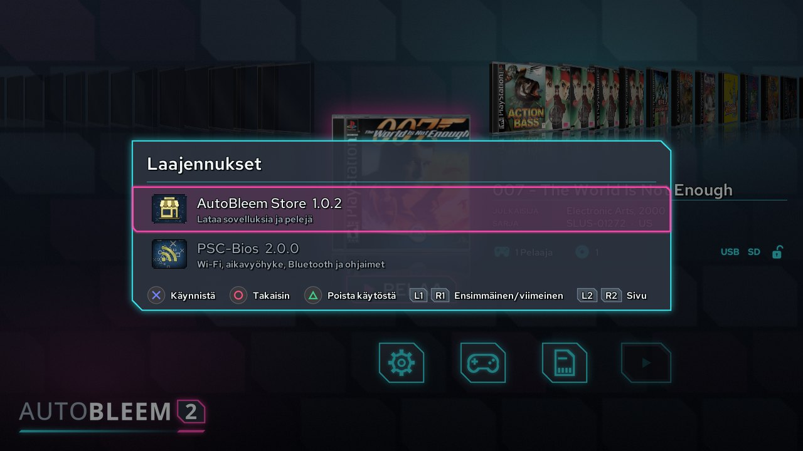

**AutoBleemin Kauppa** on ensimmäinen laajennus: paikka, jossa selaat sovelluksia ja pelejä ja asennat ne yhdellä
painalluksella, kaikilla järjestelmillä, joilla AutoBleem toimii. PlayStation Classic tarvitsee siihen
AutoBleem-kernelin, koska Wi-Fi tulee kernelin mukana. Kauppa avataan pikavalikosta (*Kauppa*, osio 3.4). Siinä on
neljä välilehteä, joiden välillä L1 ja R1 liikkuvat.

**Apps**- ja **Games**-välilehdet listaavat, mitä lähteet tarjoavat. Jokaisella kohteella on kuva, versio, koko ja
sen lähteen pieni kuvake, josta se tulee. Apps-välilehdellä ovat myös PE-sovellukset lisensseineen ja lähteineen
sekä pelitietopaketit (osio 3.10). Jo asentamassasi kohteessa on *Installed*-merkki. Vihjepalkki näyttää ne
painikkeet, jotka valitulla rivillä ovat käytössä:

| Painike | Apps- ja Games-välilehdillä |
|---|---|
| Cross | Asentaa kohteen – tai päivittää sen, yrittää uudelleen epäonnistumisen jälkeen tai peruu odottavan tai käynnissä olevan latauksen. |
| Triangle | Poistaa jotakin, minkä Kauppa on asentanut. |
| Square | Päivittää listat lähteistä. |
| L2 / R2 | Hyppäävät edelliseen tai seuraavaan alkukirjaimeen. |
| Select | Näyttää yhden lähteen kerrallaan, kun haluat nähdä, mitä yksittäinen lähde tarjoaa. |
| Start | Hakee nimistä. |

Kerran ladatut kuvat säilytetään, joten listat aukeavat seuraavalla kerralla nopeasti, ja kuvan, joka ei latautunut,
voi yrittää ladata uudelleen.

**Downloads**-välilehti näyttää, mitä on latautumassa, odottamassa, epäonnistunut tai asennettu, ja sen
edistymispalkki etenee tasaisesti. Sitä ei tarvitse jäädä katsomaan: lataukset jatkuvat taustalla myös Kaupasta
poistuttuasi, ja kun olet muualla käynnistäjässä, kupla näyttää käynnissä olevan latauksen nopeuksineen ja jäljellä
olevine aikoineen (esimerkiksi `1.4 MB/s · 0:42`). Pelin käynnistäminen tai laitteen sammuttaminen vain keskeyttää
lataukset, ja pysähtynyt lataus jatkuu siitä, mihin se jäi. Jos verkkoyhteys katkeaa, kohteessa lukee *Waiting for
the network*, ja lataus jatkuu siitä, mihin se jäi, kun verkko palaa; 30 minuutin jälkeen ilman verkkoa se luovuttaa.
Yli 2 gigatavun lataukset toimivat kaikilla alustoilla, myös 32-bittisissä versioissa. Asentamasi peli ilmestyy
hyllylle seuraavan skannauksen jälkeen, ja sen kantena on Kaupan kuva.

**Sources**-välilehti näyttää, mistä listat tulevat, kukin kuvakkeineen: AutoBleemin oma luettelo, mikä tahansa
kansioon `System/Extensions/store/sources/` pudotettu TSV-lista ja osoitteet, jotka lisäät itse kohdasta *Add a
source URL*. Kun painat Crossia itse lisäämäsi lähteen kohdalla, voit nimetä sen uudelleen, muuttaa sen osoitetta,
vaihtaa sen `http://`- ja `https://`-osoitteen välillä tai poistaa sen.

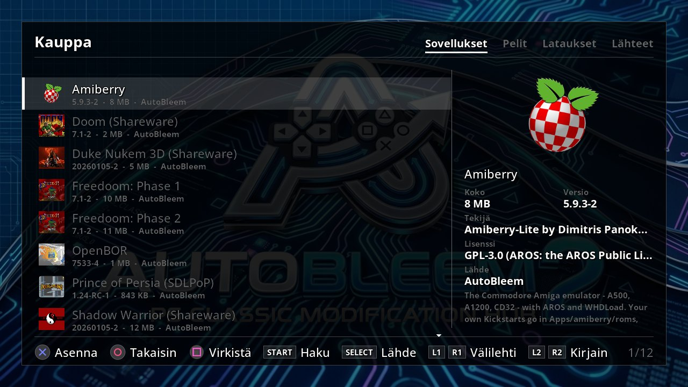


AutoBleemin oman luettelon tarjonta näkyy myös lataussivustolla osoitteessa
`https://autobleem.retromenele.pl/store/`. Itse lisäämäsi lähde on eri asia: **vastaat itse siitä, mitä lisäämäsi
lähteet sisältävät.**

**Omat pelisi kotiverkossa.** Jos säilytät PS1-pelejäsi kotona toisella tietokoneella, Kaupan lähiverkkopalvelin
`abstored` voi tarjota ne Kauppaan verkon yli, jolloin asennat ne kuten minkä tahansa muun kohteen. Se toimii millä
tahansa Linux-koneella – Raspberry Pillä tai kotipalvelimella – ja vain lukee kansiota muuttamatta sitä. Käynnistä se
komennolla `abstored <games folder>` ja avaa selaimessa `http://<that machine>:8124/`: sivu näyttää, mitä palvelin
jakaa ja mitä ongelmia se löysi. Lisää Kauppaan lähteeksi `http://<that machine>:8124/store.tsv`. Valmiit ohjelmat
Linuxille ja Windowsille löytyvät Kaupan sivulta, sen **LAN server** -välilehdeltä, ja `INSTALL-linux.md`
(lähdekoodissa kansiossa `ext_store/server/`) kertoo, miten palvelin asetetaan pyörimään palveluna. **LAN Share**
(osio 5.2) vie PC:ltä pelejä ja levyjä tällaiselle palvelimelle.

### 3.14 Skannauksen prosessorit

Skannauksen prosessorit valmistelevat pelisi ennen kuin AutoBleem lukee ne. Prosessori on pieni ohjelma, jonka
jokainen skannaus ajaa ensin. Se voi muuttaa muodon, jota AutoBleem ei osaa lukea, sellaiseksi, jota se osaa –
esimerkiksi purkaa zip-pakatun pelin – tai muuttaa pelin tietoja, vaikkapa asentaa käännöspaikan. Prosessorit asuvat
tikulla kansiossa `System/Processors/<name>/` (Raspberry Pissä sen dataosiolla, Windowsissa datakansiossa);
asennat prosessorin purkamalla sen kansion sinne, ja seuraava skannaus ajaa sen.

**Unzip tulee AutoBleemin mukana.** Se purkaa `Games/`-kansion zip-pakatut PS1-pelit ennen kuin skannaus lukee ne,
ja zip-pakatut ROMit yksi kerrallaan; arcade-setit jäävät pakatuiksi, koska arcade-ytimet lukevat ne juuri niin.
AutoBleemin päivitys päivittää myös Unzipin, ja jos olet poistanut sen käytöstä, se pysyy poissa käytöstä.

Prosessori tekee työnsä kerran: kun se on käsitellyt pelin, sitä ei ajeta samalle pelille uudelleen ennen kuin peli
muuttuu. Prosessorin työskennellessä oikean yläkulman kupla näyttää, mitä se tekee, ja varoitus tai virhe näkyy sen
alla olevalla rivillä; lokikansion `processors.log` kertoo yksityiskohdat. Pelin tai RetroArchin käynnistäminen
pysäyttää tiedostoja muuttavan prosessorin, jotta peli saa laitteen kokonaan käyttöönsä, ja seuraava skannaus
viimeistelee työn.

Prosessoreita hallitaan järjestelmävalikosta (**L2 + R2**) kohdasta *Skannauksen prosessorit*. Näet ne siinä
järjestyksessä, jossa ne ajetaan, yhdellä välilehdellä PS1-peleille ja toisella ROMeille; L1 ja R1 vaihtavat
välilehteä. Järjestyksellä on väliä: purkavan prosessorin on tultava ennen sitä, joka paikkaa puretut tiedostot.

| Painike | Skannauksen prosessoreissa |
|---|---|
| Square | Nostaa valitun prosessorin, jolloin Ylös ja Alas siirtävät sen uuteen paikkaan; Square laskee sen taas paikalleen. |
| Cross | Poistaa prosessorin käytöstä tai ottaa sen taas käyttöön. |
| Triangle | Saa prosessorin käymään seuraavassa skannauksessa läpi kaikki pelit uudelleen, myös ne, jotka se on jo käsitellyt. |
| Circle | Palaa takaisin ja käynnistää skannauksen, jos muutit jotakin. |

Toiselle laitteelle tehty prosessori pysyy listalla harmaana, joten näet sen olevan olemassa mutta tiedät, ettei se
toimi tässä laitteessa.

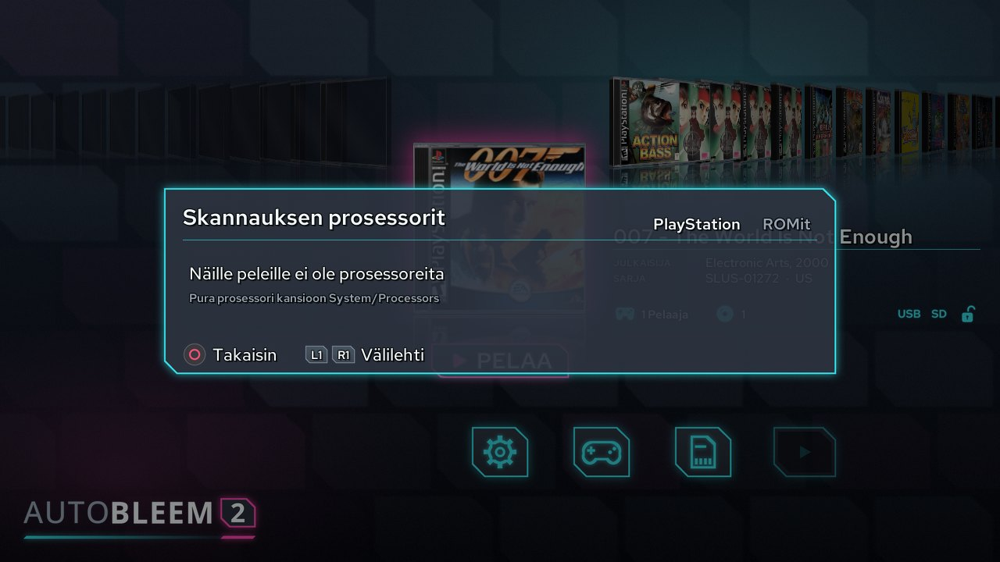

Jos haluat kirjoittaa oman prosessorin, Unzipin sivu `https://github.com/autobleem2/proc_unzip` selittää kaiken,
mitä prosessorin on tehtävä, ja AutoBleemin lähdekoodin `tools/proc_check.py` tarkistaa prosessorisi ennen kuin
jaat sen muille.

<!-- pagebreak -->

## 4. Näkymät

### 4.1 Pelien hallinta

Pelien hallinnassa siistit PS1-pelikokoelmaasi. Käytä sitä, kun haluat poistaa pelin, jota et enää pelaa, avata
pelin asetukset etsimättä sitä ensin hyllyltä tai saada AutoBleemin hakemaan kaikki kannet uudelleen. Avaa se
järjestelmävalikosta (L2 + R2, *Pelien hallinta*). Skannauksen aikana kohde on harmaa ja odottaa, kunnes skannaus
on valmis.

Näkymän otsikko on *Pelien hallinta - Valitse peli*. Vasemmalla näet kaikki PS1-pelisi nimilistana
aakkosjärjestyksessä, oikealla valitun pelin kannen sekä sen julkaisijan, vuoden, sarjanumeron ja kansion. Aseman
vapaa tila näkyy oikeassa yläkulmassa, joten näet, paljonko tilaa poistaminen vapauttaa. Ylös ja Alas liikkuvat
listassa, L2 / R2 kääntävät sivua ja L1 / R1 hyppäävät ensimmäiseen tai viimeiseen peliin.

- **Cross** avaa valitun pelin pelin muokkaimeen – samaan, joka aukeaa hyllyn Peli-kuvakkeesta (osio 3.7). Kun
  poistut siitä, olet listassa taas saman pelin kohdalla.
- **Square poistaa pelin.** AutoBleem kysyy ensin ja poistaa sitten pelin koko kansion. Jos pelin tilatallennuksia
  ja muistikorttia ei käytä mikään muu peli, se kysyy vielä toisen kysymyksen: poistetaanko nekin. Vastaa
  kieltävästi, jos saatat haluta pelin myöhemmin takaisin tallennuksineen.
- **Triangle poistaa kaikki kansikuvat** (PNG tai JPEG), jotka ovat pelien vieressä, kysyttyään ensin. Tästä on
  hyötyä, kun olet kerännyt kansia, joista et pidä: seuraava skannaus hakee kannet taas kansitietokannoista.

Listan lopussa, pelien jälkeen, saattaa olla kansioita, joissa lukee *Ei lisätty*. Ne ovat `Games`-kansion
kansioita, joita skannaus tutki mutta joista se ei saanut tehtyä peliä. Valitse sellainen, niin oikea puoli kertoo,
missä kansio on ja miksi sitä ei lisätty – esimerkiksi cue-tiedosto puuttuu (luku 7). Square poistaa tällaisen
kansion kysyttyään ensin. Kun poistut Circlellä muutettuasi jotakin, AutoBleem skannaa pelit uudelleen.

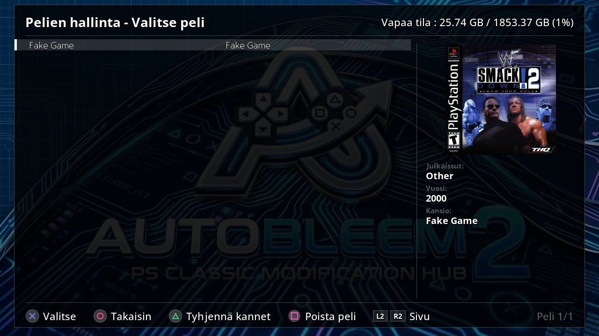

### 4.2 Laitteistotiedot

Laitteistotiedot on sivu, jolta katsot, mikä laitteesi on ja mitä se näkee: paljonko tikulla on tilaa jäljellä,
mikä verkko-osoite laitteella on, mitä näyttö- ja ääniajureita se käyttää ja mitkä ohjaimet on kytketty. Sivu on
sama kaikilla alustoilla, myös konsolilla. Avaa se järjestelmävalikosta (L2 + R2, *Laitteistotiedot*); Circle vie
takaisin järjestelmävalikkoon.

Sivulla näkyvät järjestelmä, laitteisto, tallennustila vapaine tiloineen, verkko-osoitteet, näyttö- ja ääniajurit
sekä kytketyt ohjaimet. Se lukee kaiken uudelleen sekunnin välein, joten voit pitää sen auki, kun kytket ohjaimen
tai verkkokaapelin, ja katsoa muutoksen ilmestyvän. Sivu vain näyttää tietoja – verkon tai ohjaimen määrittämiseen
käytä kohtaa *Verkko ja ohjaimet* (PSC-Bios, luku 6).

Ohjainosio vastaa kysymykseen "mikä ohjain on mikäkin pelaaja?". Kaksi ensimmäistä ohjainta näkyvät nimillä
*Pelaaja 1* ja *Pelaaja 2* – portit, jotka PS1-emulaattori niille antaa. Muut ohjaimet näkyvät merkinnällä *ei
käytössä PS1-emulaattorissa*. RetroArch jakaa portit omien asetustensa mukaan, joten RetroArch-pelissä järjestys
voi olla toinen. Sivua ei tarvitse avata joka kerta: aina kun ohjain kytketään tai irrotetaan, käynnistäjä näyttää
hetken, mikä ohjain on nyt pelaaja 1 ja mikä pelaaja 2.

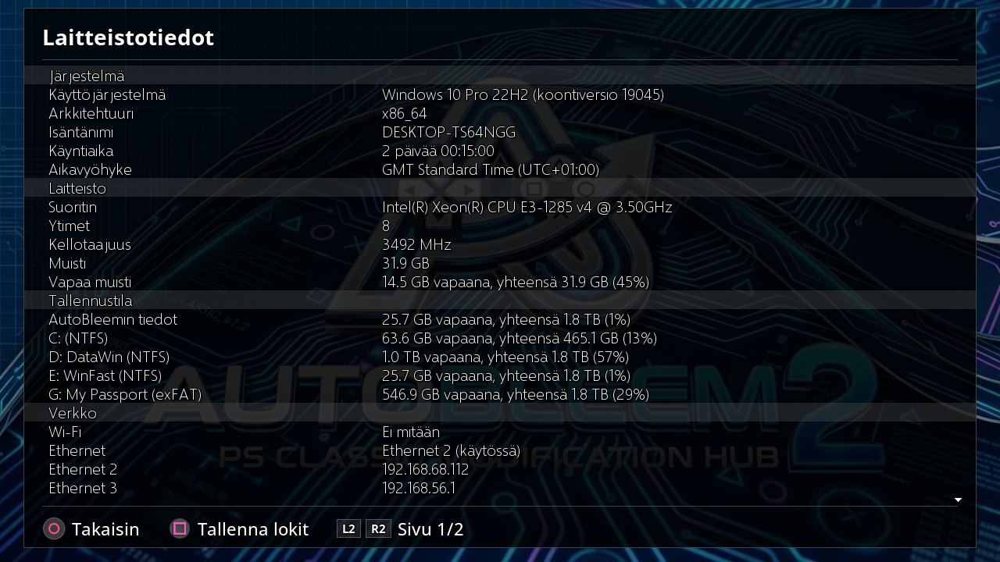

### 4.3 Painikeopas

Jos unohdat, mitä jokin painike jossakin tekee, paina hyllyllä **Triangle**. Painikeopas näyttää kaikkien näkymien
kaikki painikkeet yhdellä sivulla, joten voit tarkistaa asian poistumatta käynnistäjästä. Jos USB-näppäimistö on
kytketty tai sitä on käytetty, *Näppäimistö*-sarake näyttää vastaavan näppäimen jokaisen ohjaimen painikkeen
vieressä.

Opas muistuttaa myös siitä yhdestä asiasta, joka kannattaa muistaa jokaisessa pelissä: miten pelistä pääsee pois.
Pidä Select + Start tai Home pohjassa 2 sekuntia, niin palaat AutoBleemiin; lyhyt painallus avaa sen sijaan
emulaattorin valikon.

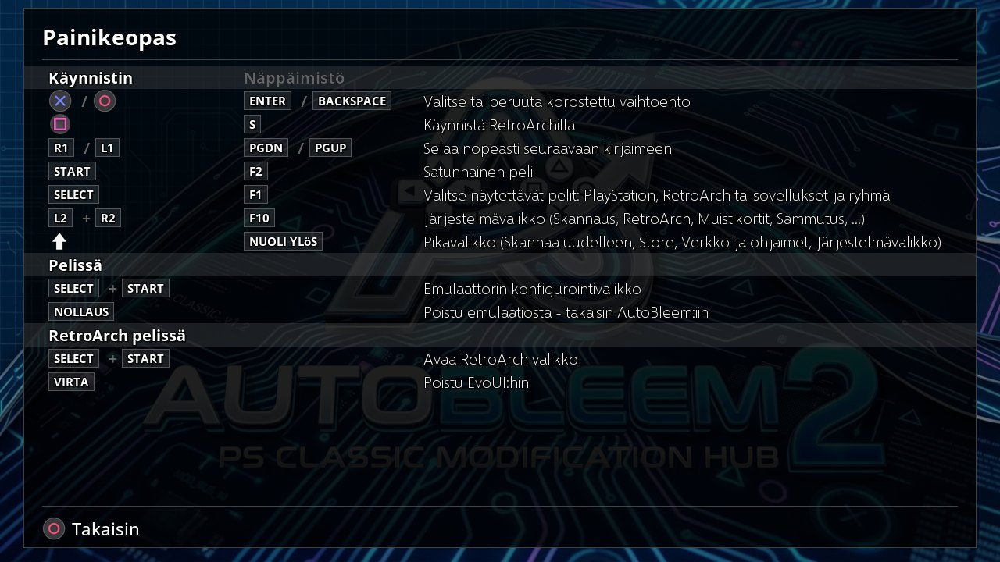

### 4.4 Näytön näppäimistö

Aina kun AutoBleem tarvitsee sinulta tekstiä – muistikorttisarjan nimen, pelin nimen, WiFi-salasanan tai Kaupan
lähteen osoitteen – ruudulle tulee sama näppäimistö, jotta voit kirjoittaa pelkällä ohjaimella. Sen asettelu on
kuin puhelimen näppäimistössä. Kirjainten lisäksi siinä on merkkisivu, jolla ovat `/ \ : ? & = % @ #` ja muut
osoitteissa ja salasanoissa tarvittavat merkit, sekä kaksi sivua tarkkeellisia kirjaimia. Alimmalla rivillä ovat
Vaihto, sivua vaihtava näppäin, välilyönti, askelpalautin ja Varmista.

Liiku näppäimillä suuntapainikkeilla ja kirjoita kohdistimen alla oleva merkki **Crossilla**. **Triangle** poistaa
merkin ja **Square** kirjoittaa välilyönnin. **L1** on Vaihto; painamalla sitä kahdesti saat isot kirjaimet
lukittua. **R1** siirtyy seuraavalle näppäinsivulle, ja **L2 / R2** liikuttavat kohdistinta tekstin sisällä.
**Start** vahvistaa kirjoittamasi ja **Circle** peruu. Jos USB-näppäimistö on kytketty, voit milloin tahansa
kirjoittaa sillä: Enter vahvistaa ja Esc peruu.

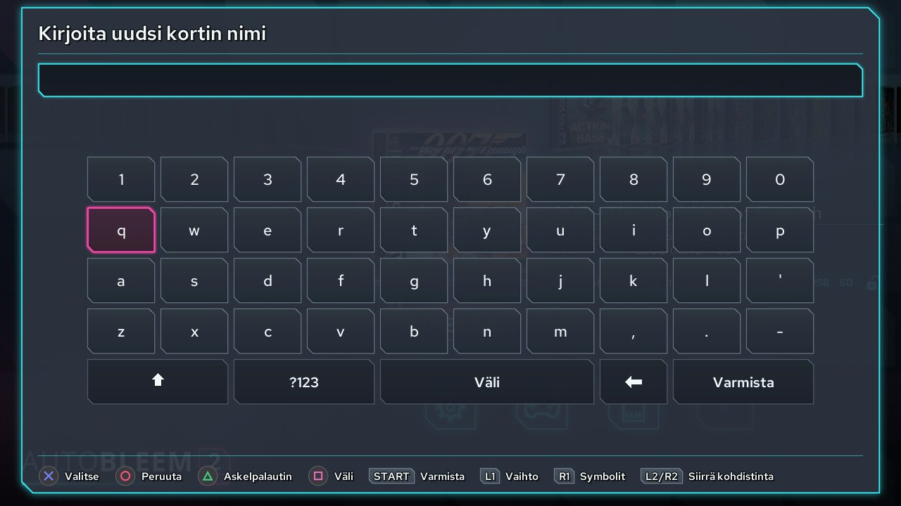

### 4.5 Virtuaalinen ohjain

Sovellukset – Sovellukset-sarjan ohjelmat, kuten Doom tai Quake – eivät lue ohjaintasi itse. Pieni apuohjelma,
virtuaalisen ohjaimen daemon, lukee oikeat ohjaimet ja antaa jokaiselle sovellukselle ohjaimen, jota se ymmärtää.
Tämä sivu näyttää, mitkä ohjaimet apuohjelma näkee ja miten se lukee ne. Katso tänne, kun sovellus ei reagoi
ohjaimeesi tai sen painikkeet ovat sekaisin. Avaa sivu järjestelmävalikosta (L2 + R2, *Virtuaalinen ohjain*);
Circle vie takaisin järjestelmävalikkoon.

Kohdassa *Daemonin näkemät ohjaimet* jokainen ohjain on listattu numeroineen ja nimineen. Sen vieressä näet kolme
asiaa: saiko apuohjelma ohjaimen auki (*yhdistetty*) vai ei (*ei luettavissa*), minkä ajurin kautta ohjain tuli ja
mistä sen painikeasettelu on peräisin. *ohjaintietokannasta* tarkoittaa, että ohjain tunnetaan ja sen painikkeet ovat
oikeilla paikoillaan; *daemonin arvaama* tarkoittaa, ettei ohjainta tunneta ja apuohjelma teki parhaan arvauksensa.
Jos painikkeet tuntuvat sovelluksessa väärältä, arvattu asettelu on todennäköinen syy.

Apuohjelma toimii vain silloin, kun jokin sovellus on käynnissä, joten sivu kysyy siltä tiedot kerran avautuessaan.
Jos kytket ohjaimen sivun ollessa auki, kysy uudelleen painamalla **Cross** (*Etsi uudelleen*). Windowsissa tällaista
apuohjelmaa ei ole, ja sivulla lukee *Ei tässä versiossa*.


<!-- pagebreak -->

## 5. PC:llä

### 5.1 UpdateRoms – konsolitikun päivittäminen

Raspberry Pissä, PC:llä ja Windowsissa käynnistäjän skannaus lajittelee RetroArch-pelisi listoiksi ja hakee niiden
kansikuvat itse. PlayStation Classic ei pysty siihen, koska sillä ei ole omaa verkkoyhteyttä. **UpdateRoms** tekee
saman työn Windows-PC:lläsi: se käyttää PC:n verkkoa mutta kirjoittaa kaiken konsolin odottamilla poluilla, joten
kun laitat tikun takaisin, konsoli käynnistyy ja löytää kaiken paikoiltaan. Aja se aina, kun olet lisännyt tai
poistanut RetroArch-pelejä konsolitikulta.

1. Kopioi ROMisi tikulle kansioon `RetroArch/roms/<system>/` (osio 3.10). Kansioiden nimien on oltava RetroArchin
   tietokantanimiä; asennusohjelma on jo tehnyt yleisimmät.
2. Käynnistä **`UpdateRoms\UpdateRoms.exe` tikulta** – asennusohjelma laittoi sen sinne. Se päättelee itse, millä
   tikulla se on. Työn aikana näet rivin, joka kertoo, mitä se tekee, sekä edistymispalkin ja lokin.
   - Jos tikulla ei vielä ole RetroArchin tietokantaa, se lataa ensin RetroArchin tietokantapaketin. Sen avulla se
     tunnistaa jokaisen ROMin, joten tietokannan tuntema peli saa oikean nimensä.
   - Se kirjoittaa jokaiselle laitteelle oman soittolistan kansioon `RetroArch/bin/playlists/` konsolin poluilla.
     Kaikki, mitä RetroArch on itse lisännyt noihin listoihin, säilyy.
   - Jokaiselle ROMille, jolla ei ole kansikuvaa, se hakee kannen libreton pikkukuvapalvelimilta kansioon
     `RetroArch/bin/thumbnails/`.
3. Poista tikku turvallisesti ja laita se takaisin konsoliin. Sarjavalitsimen RetroArch-välilehdellä on nyt jokainen
   laite, jolle on pelejä.

Voit ajaa sen niin usein kuin haluat: kansio, jossa mikään ei ole muuttunut, ohitetaan, joten toinen ajokerta on
nopea. Jos jokin menee vikaan, loki on tikulla tiedostossa `System/Logs/updateroms.log`. Kortinlukijassa olevan
Raspberry Pin kortin voi päivittää samalla tavalla komennolla `UpdateRoms.exe <drive> --target rpi`, vaikka Pi
tekee tämän itse, kun sillä on verkko.

### 5.2 LAN Share – pelisi ja levysi kotiverkon palvelimelle

Kauppa voi asentaa pelejä kotiverkkosi palvelimelta (osio 3.13). **LAN Share** on Windows-ohjelma, joka täyttää
tuon palvelimen PC:ltäsi: se vie PC:lläsi olevat PS1-pelit palvelimelle, ja se voi myös lukea PS1-levyn PC:n
CD/DVD-asemasta ja viedä senkin sinne. Palvelin on `abstored`, joka pyörii Raspberry Pillä, NAS-laitteella tai
toisella PC:llä. Kun peli on palvelimella, konsolin, Pin tai PC:n Kauppa voi asentaa sen sieltä.

`LanShare.exe` löytyy Kaupan sivulta, sen **LAN server** -välilehdeltä. Mitään ei tarvitse asentaa: käynnistä se,
niin se tallentaa asetuksensa kansioon `%LOCALAPPDATA%\AutoBleem LAN Share\`.


1. **Yhdistä palvelimeen.** Kirjoita sen osoite samassa muodossa kuin Kaupassa, `http://<its address>:<port>`, ja
   paina **Connect**. Palvelimella jo olevat pelit ja sen oman skannauksen löytämät ongelmat näkyvät vasemmalla.
   Viedäkseen pelejä palvelimelle LAN Share tarvitsee toisen kahdesta pääsytavasta:
   - **Share** on palvelimen pelikansio sellaisena kuin se on jaettu verkkoosi (Samba), esimerkiksi
     `\\raspberrypi\games`. LAN Share kopioi pelit sinne ja pyytää palvelinta skannaamaan; palvelin itse vain lukee
     kansiotaan edelleen.
   - **Token** on palvelimelle, joka on käynnistetty valitsimella `--allow-uploads`. Kirjoita sen tunniste –
     palvelin tulostaa sen käynnistyessään ja säilyttää sitä tiedostossa `<state>/upload-token`. LAN Share lähettää
     silloin pelit HTTP:n yli, ja kesken jäänyt lähetys jatkuu siitä, mihin se jäi.
2. **Julkaise PC:si pelit.** Valitse kansio, jossa pelisi ovat (yksi kansio per peli), rastita haluamasi ja paina
   **Publish the ticked games**. **On the server** kertoo, onko peli jo palvelimella – se vertaa sarjanumeroa tai,
   jos sitä ei ole, nimeä – eikä palvelimella jo olevaa peliä koskaan lähetetä kahdesti. **Tick those not on the
   server** rastittaa kaikki muut puolestasi.
3. **Julkaise levy.** Laita PS1-levy PC:n asemaan ja paina **Read a disc and publish it**. LAN Share lukee koko levyn
   `.bin`- ja `.cue`-tiedostoiksi, jotka nimetään pelin nimen mukaan. LibCrypt-pelille se kirjoittaa myös
   `.sbi`-tiedoston, jos asema pystyy lukemaan alikanavan. Jos olet valinnut tietokannat (katso alta), se
   tarkistaa kopion tunnettua hyvää vedosta vasten. Sitten se julkaisee pelin. Monilevyiselle pelille rastita
   ensin **The game has more than one disc**: LAN Share pyytää sinulta kunkin seuraavan levyn ja julkaisee ne
   yhdessä yhtenä pelinä.
4. **Poista pelejä palvelimelta.** Valitse ne ja paina **Remove from the server...**. Mitään ei poisteta: jokainen
   peli siirretään palvelimen pelien viereen `.removed`-kansioon, ja kun siirrät sen takaisin, se palaa.

**Databases** ovat valinnaisia. Jos osoitat LAN Sharelle AutoBleemin kansikansion (`coversU/P/J.db`) ja
RetroArchin tiedoston `Sony - PlayStation.rdb`, se käyttää niitä pelien nimeämiseen ja lukemansa levyn
tarkistamiseen.

Jos et halua kopioida mitään, rastita **Also share the games on this PC with the Store** (oletuksena pois päältä):
LAN Share jakaa silloin PC:si pelikansion suoraan Kaupalle. Kun teet tämän ensimmäisen kerran, Windows kysyy
palomuuristaan – salli vain yksityiset verkot.

<!-- pagebreak -->

## 6. Konsolin työkalut (PlayStation Classic)

PlayStation Classic -tikun mukana tulee kaksi työkalua, joiden avulla saat konsolista irti enemmän kuin se osaa
tehtaalta tullessaan. Kumpikin näyttää samalta kuin muu käynnistäjä, sen teemalla ja kielellä, ja niitä käytetään
ohjaimella – ohjainvelhossa myös konsolin etupaneelin painikkeilla. **PSC-Bios** on konsolipaketin mukana tuleva
laajennus: pikavalikon ja järjestelmävalikon *Verkko ja ohjaimet* -kohde avaa sen, ja se löytyy myös
Laajennukset-listasta. **ABFlashKit** on sovellus, ja se on Sovellukset-sarjassa.

### 6.1 PSC-Bios

PSC-Biosilla liität laitteen ulkomaailmaan: WiFi-verkkoosi, oikeaan aikavyöhykkeeseen, Bluetooth-ohjaimiin, ja
sillä määrität painikeasettelun ohjaimelle, jota AutoBleem ei tunne. Se tulee konsolipaketin mukana, ja se on
käytettävissä myös Raspberry Pissä ja PC-tikulla. Avaa se järjestelmävalikon (tai pikavalikon) kohdasta *Verkko ja
ohjaimet* tai Laajennukset-listasta. Jos laajennus on asennettu mutta poistettu käytöstä, *Verkko ja ohjaimet*
-kohde on harmaa, ja siinä lukee, että se *on pois päältä - ota se käyttöön Laajennuksissa*; paina siinä Crossia,
niin Laajennukset-lista aukeaa PSC-Biosin kohdalta, ja voit ottaa sen taas käyttöön.

Ensimmäinen näkymä antaa yleiskuvan: kellonajan ja aikavyöhykkeen, verkkosovittimet (WiFi, Ethernet, Bluetooth)
osoitteineen ja jokaisen kytketyn ohjaimen sekä tiedon siitä, onko sille painikeasettelu. Konsolilla verkko- ja
Bluetooth-osat vaativat AutoBleem-kernelin (osio 6.2); Raspberry Pissä ja PC-tikulla ne käyttävät järjestelmän omia
työkaluja. Ohjainvelho toimii kaikkialla.

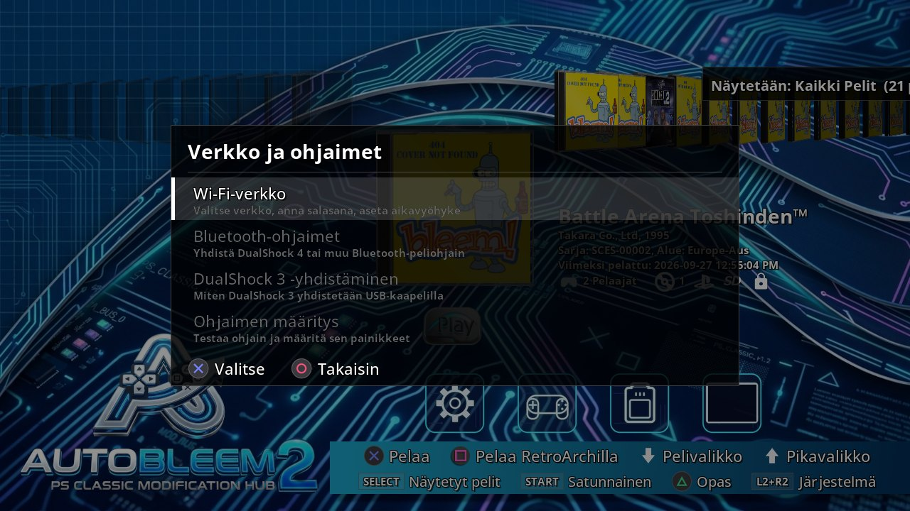

Ensimmäisestä näkymästä pääset jokaiseen osaan yhdellä painikkeella:

| Painike | Mitä se avaa |
|---|---|
| Select | **Wi-Fi Network** yhdistää WiFi-verkkoosi (kernelin kautta, Pissä ja PC:llä NetworkManagerin kautta): kirjoita verkon nimi tai valitse se hakutuloksista, anna salasana, valitse ajurin tila ja paina *Apply / Restart Network*. Täällä asetat myös aikavyöhykkeen, ja kun yhteys on muodostettu, näet konsolin IP-osoitteen. |
| Square | **Bluetooth Controllers** etsii Bluetooth-ohjaimia, kuten DualShock 4:ää, jotta voit parittaa uuden tai poistaa ohjaimen, jota et enää käytä. |
| L1 | **DualShock 3 Pairing** yhdistää ensimmäisen DualShock 3 -ohjaimesi kernelin sixaxis-liitännäisen kautta; ohjaimen on oltava tätä varten kytkettynä USB:llä. |
| R1 | **Controller Mapping** avaa ohjainvelhon, joka kuvataan alla. |
| Triangle | **About** kertoo, mikä PSC-Bios on. |
| Circle | **Back** vie sinut pois PSC-Biosista takaisin käynnistäjään. |

**Ohjainvelho.** Käytä sitä, kun ohjain ei tee AutoBleemissa mitään tai sen painikkeet ovat väärissä paikoissa.
Velho näyttää kytketyn ohjaimen sellaisena kuin se oikeasti on – jokaisen akselin, painikkeen ja hatun numeroina – ja
DualShock-kuvan, joka syttyy painaessasi. Koska testattavaan ohjaimeen ei vielä voi luottaa, velhoa ohjataan
konsolin **etupaneelin painikkeilla**: **RESET** vaihtaa seuraavaan ohjaimeen, **OPEN** aloittaa asettelun ja
**POWER** peruu tai poistuu. Asettelun aikana velho pyytää painikkeita yksi kerrallaan: paina kuvassa palavaa
painiketta tai OPENia, jos ohjaimessasi ei ole sellaista painiketta. Lyhyt painallus asetetaan tavalliseen tapaan.

Voit poistua myös ohjaimelta: pidä Circleä pohjassa 2 sekuntia – palkki täyttyy, ja alapalkissa lukee *Hold 2 s:
Exit*. Niin kauan kuin ohjaimella ei ole asettelua, minkä tahansa painikkeen pitäminen pohjassa 2 sekuntia tekee
saman (*Hold any button 2 s: Exit*). Näppäimistöllä Esc, välilyönti ja Enter vastaavat painikkeita POWER, RESET ja
OPEN.

Lopuksi uusi asettelu otetaan käyttöön, jotta voit kokeilla sitä, ja OPEN tallentaa sen valitsemallasi nimellä.
Siitä lähtien käynnistäjä lataa sen joka kerta.

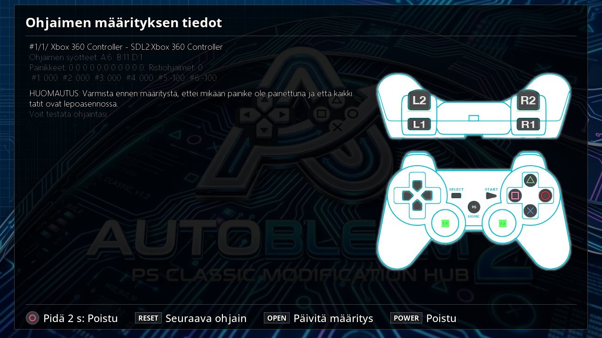

### 6.2 ABFlashKit – AutoBleem-kernel

AutoBleem-kernel korvaa konsolin oman Linux-kernelin, ja se on valinnainen. Haluat sen, jos haluat konsolista
enemmän irti: se antaa konsolille toimivan kellon, saa USB-WiFi- ja Bluetooth-sovittimet toimimaan (PSC-Biosia ja
Bluetooth-ohjaimia varten) ja lisää etupaneelin painikkeiden tuen, jota emulaattori käyttää jatkopisteisiin.
ABFlashKit on työkalu, joka asentaa sen. Se varmuuskopioi ensin konsolin, ja sillä voi myös palauttaa konsolin
tehdastilaan Sonyn oman palautustilan kautta.

> **Tämä työkalu kirjoittaa konsolin flash-muistiin.** Jos kirjoitus keskeytyy – virta katkeaa tai tikku vedetään
> irti – konsoli ei välttämättä enää käynnisty, ja oman kernelin asentaminen mitätöi takuun. Pidä konsoli virrassa
> ja tikku paikallaan, kunnes konsoli käynnistyy itse uudelleen. ABFlashKit aukeaa tähän varoitukseen: *I
> understand* jatkaa, *Quit* poistuu.

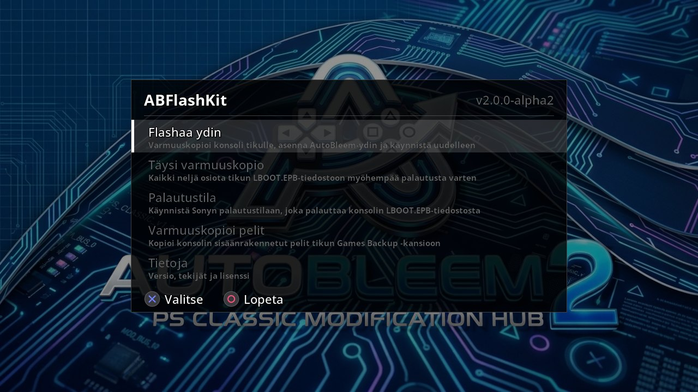

ABFlashKitissä on kolme toimintoa:

- **Flash Kernel** asentaa kernelin. Jos tikulla ei vielä ole palautusvarmuuskopiota, se tekee ensin sellaisen
  konsolin osioista (`LBOOT.EPB`). Se tarkistaa varmuuskopion ja kernelin levykuvan, kirjoittaa kernelin ja
  AutoBleemin järjestelmätiedostot ja käynnistää konsolin uudelleen. Kun ruudulla lukee *All done - when the screen
  goes black replace power cord*, odota, että ruutu pimenee, irrota sitten konsolin virtajohto ja kytke se takaisin.
- **Full backup** tallentaa konsolin kaikki neljä osiota tiedostoon `LBOOT.EPB`, jotta voit palauttaa ne myöhemmin.
  Jos varmuuskopio on jo olemassa, se kysyy ennen kuin kirjoittaa sen yli.
- **Restore Mode** on paluutie tehdasohjelmistoon. Se tarkistaa, että tikulla oleva varmuuskopio on
  tehdasversiosta, asettaa palautuslipun ja käynnistää konsolin Sonyn palautustilaan, joka palauttaa konsolin
  tiedostosta `LBOOT.EPB`.

Jokaisen vaiheen alla oleva edistymispalkki näyttää, kuinka pitkällä se on. ABFlashKit ei asenna kerneliä konsoliin,
jossa on jokin muu muokattu ohjelmisto, kuten BleemSync tai Project Eris: palauta tällainen konsoli ensin
tehdastilaan.

**Kirjautuminen PC:ltä.** Jos tunnet Linuxin ja haluat kurkistaa konsolin sisään, voit kirjautua siihen PC:ltä
USB-kaapelin kautta. Tämä vaatii AutoBleem-kernelin; vakiokonsolissa se ei toimi.

1. Yhdistä konsolin micro-USB-portti PC:hen USB-kaapelilla. PC näkee konsolin uutena verkkosovittimena, ja
   konsolin osoitteen löydät tuon sovittimen asetuksista PC:llä.
2. Kirjaudu komennolla `ssh root@<the console's address>`. Oletussalasana on `autobleem`.

Salasanan sijaan voit käyttää avainta. Laita julkinen avaimesi tikulle tiedostoon `System/ssh/authorized_keys` ja
käynnistä konsoli uudelleen: seuraavalla käynnistyksellä avain lisätään root-tunnukselle. Käynnistäjän
päivittäminen tai uudelleenasennus ei poista sitä.

> **Oletussalasana on sama jokaisessa konsolissa**, joten kuka tahansa, joka voi kytkeä kaapelin konsoliisi, voi
> kirjautua sisään roottina. Käytä avainta aina kun voit, äläkä jätä oletussalasanalla olevaa konsolia muiden
> ulottuville.

<!-- pagebreak -->

## 7. Jos jokin menee vikaan

Useimmilla ongelmilla on yksinkertainen syy. Alla jokainen ongelma alkaa siitä, mitä näet, kertoo, miksi niin
käy, ja sitten, mitä tehdä. Jos joudut kysymään apua, lokeja pyydetään ensimmäisenä, joten ne käsitellään ensin.

**Lokien löytäminen.** AutoBleem pitää lokejaan käytön aikana muistissa, jottei tikulle kirjoiteta koko ajan.
Kansioon `System/Logs/` tikulla, kortilla tai datakansiossa ne päätyvät vain, kun jokin meni pieleen: kun
käynnistäjä, PS1-peli tai RetroArch kaatuu, lokit tallennetaan kansioon `System/Logs/crash-<n>/` (kolme viimeisintä
kaatumista säilytetään), ja käynnistäjä kertoo siitä kerran palatessaan. Jos selvität ongelmaa, joka ei ole
kaatuminen, säilytä kaikki lokit: kytke päälle Vaihtoehdot → *Vianmääritys* → *Säilytä lokit tikulla:* (toimii
seuraavasta käynnistyksestä alkaen) tai luo PC:llä tyhjä tiedosto `System/Logs/keep`. Myös *Laitteistotiedot*
(osio 4.2) näyttää, missä lokit ovat, ja Square tallentaa siellä nykyiset lokit kansioon `System/Logs/saved-<n>/`.

Löydät seuraavat tiedostot:

| Tiedosto | Mitä se kertoo |
|---|---|
| `autobleem.log` | Mitä käynnistäjä itse teki. |
| `launch.log`, `pcsx.log` | Miten PS1-peli käynnistettiin ja mitä emulaattori kertoi sen pyöriessä. |
| `retroarch.log` | Mitä RetroArch kertoi pyöriessään. |
| `update.log` | Miten verkkopäivitys sujui; se säilytetään tikulla aina. |
| `updateroms.log` | Miten UpdateRoms sujui PC:llä (luku 5); se säilytetään tikulla aina. |

**Kuva pyytää laittamaan tikun paikalleen, tai konsoli meni lepotilaan.** AutoBleem ei löydä tikkuaan: sitä ei
ollut paikallaan konsolin käynnistyessä, tai se vedettiin irti. Laita tikku mihin tahansa USB-porttiin (mieluiten
etupaneeliin, osio 2.1) ennen kuin 5 minuuttia on kulunut, tai paina Poweria. Jos tikkua ei irrotettu oikein,
AutoBleem tarkistaa sen ensin – odota, että edistymispalkki valmistuu.

**RetroArch ilmoittaa, että se *needs a newer system library than this console has*.** Kyseinen RetroArch on tehty
konsolin järjestelmää uudemmalle järjestelmälle, joten se ei voi toimia konsolilla. Käytä AutoBleemin mukana tulevaa
RetroArchia.

**Peli ilmoittaa, että se *is protected by its PSN license and cannot be started*.** PlayStation Networkista ostetut
pelit on lukittu lisenssiinsä, eikä AutoBleem pysty ajamaan niitä. Asialle ei voi tehdä mitään.

**Peli puuttuu hyllyltä.** Yleensä sen kansio ei ole sellainen kuin skannaus odottaa. Tarkista, että jokaisella
pelillä on oma kansionsa ja että se on jossakin osion 3.10 muodoista. *Pelien hallinta* (osio 4.1) listaa pelien
jälkeen kansiot, jotka skannaus hylkäsi, merkinnällä *Ei lisätty*, ja kertoo, miksi kukin hylättiin; Square poistaa
tällaisen kansion. Kun olet korjannut kansion, järjestelmävalikon *Skannaa pelit uudelleen* ajaa skannauksen
uudelleen.

**Peleillä ei ole kansia.** Joko kansitietokantoja ei asennettu – aja asennusohjelma uudelleen ja rastita ne – tai
konsolin RetroArch-peleille ei ole vielä ajettu UpdateRomsia PC:llä (luku 5).

**Ohjain ei tee mitään, tai sen painikkeet ovat sekaisin.** AutoBleem ei tunne ohjaimen asettelua. Konsolilla määritä
asettelu PSC-Biosin ohjainvelholla (osio 6.1). Pissä ja PC:llä Laitteistotiedot-sivu (osio 4.2) näyttää, mitä
järjestelmä näkee ohjaimesta, joten näet, tunnistetaanko se ylipäätään.

**Ruutu jää konsolilla mustaksi pelin jälkeen.** Käynnistäjän kuva ei palannut pelin päättyessä. AutoBleem rakentaa
ikkunansa uudelleen itse, enintään kolme kertaa. Jos ruutu on yhä musta, pidä Power-painiketta pohjassa ja käynnistä
konsoli uudelleen.

**Raspberry Pissä** pääset tarvittaessa käynnistäjän taakse: `Alt+F2` antaa kirjautumiskehotteen toiselle
konsolille, ja SSH on päällä ensimmäisestä käynnistyksestä alkaen. `sudo journalctl -u autobleem` näyttää, mitä
käynnistäjän palvelu teki, ja `sudo systemctl restart autobleem` käynnistää sen uudelleen. Jos ensimmäinen käynnistys
ei päässyt loppuun verkon puuttuessa, se yrittää uudelleen seuraavalla käynnistyksellä.

**Windowsissa** `Esc` sulkee käynnistäjän. Datakansiosi on se, jonka valitsit asennuksessa (`Documents\AutoBleem`,
ellet muuttanut sitä), ja lokit ovat sen kansiossa `System\Logs`.

**Konsoli käynnistyy yhä uudelleen verkkopäivityksen jälkeen (tikku alustettu ext4:ksi).** Jotkut alustavat tikun
FAT32:n tai exFAT:n sijaan Linuxin ext4-tiedostojärjestelmään. Seuraavaan AutoBleem-julkaisuun asti verkkopäivitys
purkaa tällaiselle tikulle jokaisen tiedoston ilman oikeutta, jonka ansiosta tiedostoa voi ajaa ohjelmana. AutoBleem
ei silloin pysty käynnistymään, ja konsoli käynnistyy uudelleen kerta toisensa jälkeen. FAT32- ja exFAT-tikkuja
tämä ei koske. Korjaukseen on kaksi tapaa.

**Korjaus A** vaatii Linux-PC:n. Kytke tikku ja tee AutoBleemin ohjelmista taas ajettavia. Korvaa
`/media/USER/STICK` omalla liitospolullasi; viimeistä riviä tarvitset vain, jos RetroArch on asennettu:

```
chmod +x /media/USER/STICK/Autobleem/*.sh /media/USER/STICK/Autobleem/rc/*.sh
chmod +x /media/USER/STICK/Autobleem/bin/autobleem/* /media/USER/STICK/Autobleem/bin/emu*/pcsx-ab /media/USER/STICK/Autobleem/bin/abpad/abpadd
chmod +x /media/USER/STICK/RetroArch/bin/retroarch
```

Toisen rivin malli `bin/emu*/pcsx-ab` kattaa molemmat emulaattorit: perinteisen `pcsx-ab`:n ja `pcsx-abnxt`:n, joka
asennetaan nimellä `Autobleem/bin/emunxt/pcsx-ab`, joten uudempi emulaattori ei tarvitse omaa komentoaan.

**Korjaus B**: asenna uusin AutoBleem-julkaisu tikulle uudelleen kuten osiossa 2.1. Asennusohjelma tarvitsee PC:n,
joka pystyy lukemaan tikun. Jos se ei pysty lukemaan sinun tikkuasi, tikku on alustettava ensin, mikä poistaa siltä
kaiken – kopioi pelisi talteen ennen sitä.

> Välttääksesi tämän käytä **FAT32**-muotoa (vakiokonsoli lukee vain FAT32:ta; exFAT vaatii AutoBleem-kernelin,
> luku 6). Seuraava julkaisu säilyttää oikeudet, ja AutoBleem korjaa ne jokaisella käynnistyksellä.

AutoBleem on vapaa ohjelmisto (GNU GPL v3 tai uudempi), eikä sillä ole takuuta. Tukea ja uutisia saat Tietoja-näkymässä
linkitetyltä Discord-palvelimelta tai osoitteesta https://autobleem.retromenele.pl/.
