# Manuel utilisateur d'AutoBleem 2

AutoBleem 2 est un lanceur de jeux conçu pour la **PlayStation Classic** et qui, depuis la version 2, tourne aussi
sur un **Raspberry Pi**, sur un **PC démarré depuis une clé USB** et sous **Windows**. Vos jeux PS1 y sont rangés
comme sur une étagère, chacun avec sa jaquette et sa fiche ; ils se lancent dans l'émulateur PCSX fourni et, si
RetroArch est installé à côté, les jeux d'autres consoles sont de la partie. Ce manuel explique comment
l'installer sur chaque plateforme, comment s'en servir au quotidien et à quoi servent les outils qui
l'accompagnent.

> Tout se télécharge sur **https://autobleem.retromenele.pl/**. La page est classée par plateforme : pour chacune,
> le panneau *Install* contient ce que vous devez télécharger, et les *Build inputs* placés en dessous sont les
> fichiers que les installateurs vont chercher d'eux-mêmes.

## 1. Ce que vous obtenez

Avec AutoBleem, votre PlayStation Classic - ou un Raspberry Pi, un vieux PC, voire votre ordinateur sous
Windows - devient une petite console de salon dotée d'un vrai menu pour vos propres jeux. Voici ce qu'il contient :

- **Le lanceur.** C'est lui qui vous accueille à l'allumage : une étagère de jaquettes que vous faites défiler,
  avec la fiche du jeu affichée à côté. C'est de là que vous lancez vos jeux, que vous les classez en listes
  (PlayStation, RetroArch, applications), que vous réglez les options, que vous gérez cartes mémoire et
  sauvegardes d'état, et que vous téléchargez des applications et des jeux dans la Boutique. Il a la même allure et
  fonctionne de la même façon sur toutes les plateformes.
- **Deux émulateurs PS1.** `pcsx-abnxt` est l'émulateur actuel, utilisé par défaut ; `pcsx-ab` est l'émulateur
  classique qu'AutoBleem fournit depuis toujours. Vous passez de l'un à l'autre dans les options. Comme ils
  partagent les mêmes réglages et les mêmes cartes mémoire, vous pouvez changer quand vous voulez sans rien perdre.
- **RetroArch**, pour jouer aussi aux jeux d'autres systèmes : NES, Super Nintendo, Mega Drive, Game Boy, bornes
  d'arcade et bien d'autres. Il est facultatif sur toutes les plateformes. Copiez vos ROM, et AutoBleem les range
  en listes et lance chaque jeu avec le bon cœur. Les jeux PlayStation peuvent eux aussi tourner dans RetroArch : son
  cœur *PlayStation 1* figure en tête de la liste des cœurs (section 3.9). Quant aux jeux comme Doom, ils
  fonctionnent à partir de vos propres fichiers de jeu, placés dans un dossier `Packages` (section 3.10).
- **Les outils de la console.** *PSC-Bios* - qui s'appelle *Réseau et manettes* dans les menus - s'occupe du WiFi,
  de l'horloge, des manettes Bluetooth et de la configuration des manettes, sur la console comme sur un Raspberry
  Pi ou la clé PC. *ABFlashKit* installe le noyau AutoBleem sur une PlayStation Classic (chapitre 6).
- **UpdateRoms**, pour Windows. La PlayStation Classic n'ayant pas de réseau à elle, ce programme pour PC met à jour
  les listes RetroArch et récupère les jaquettes pendant que la clé de la console est branchée sur votre PC.

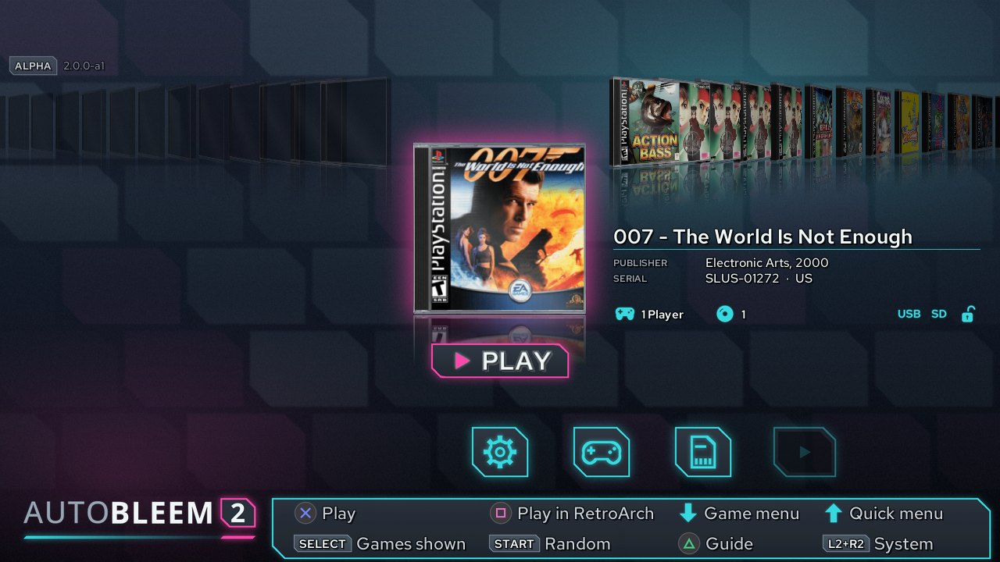

<!-- pagebreak -->

## 2. Installation

### 2.1 PlayStation Classic

AutoBleem tourne entièrement depuis une clé USB. Rien n'est modifié à l'intérieur de la console : retirez la clé,
et elle redevient exactement ce qu'elle était. Il vous faut un PC sous Windows, une clé USB (USB 2.0, 8 Go ou plus)
et la console.

La clé n'a pas besoin d'être vide, et elle **n'est pas formatée** sauf si vous le demandez : AutoBleem s'installe à
côté de ce qu'elle contient déjà, et une clé qui sert déjà à AutoBleem 1.0 est mise à niveau sur place (voir plus
bas). Pour une console d'origine, la clé doit être en **FAT32**, car le noyau de la console ne sait pas lire
l'exFAT. Une fois le noyau AutoBleem installé (ABFlashKit, chapitre 6), la console démarre aussi depuis une clé
exFAT, ce qui supprime la limite de 4 Go par fichier propre au FAT32.

1. Téléchargez **AutoBleemInstaller-<version>.zip** depuis le panneau PlayStation Classic du site et décompressez-le
   où vous voulez. Vous y trouverez `AutoBleemInstaller.exe` et son fichier README. AutoBleem lui-même est
   téléchargé pendant l'installation : le PC doit donc être connecté à Internet.
2. Branchez la clé et lancez `AutoBleemInstaller.exe`. Choisissez le **canal** - *Release* est la version testée,
   celle qui convient à presque tout le monde ; *Testing* est la prochaine version, en cours de test ; *Nightly* est
   la toute dernière version de développement, qui peut ne pas fonctionner - puis choisissez le lecteur de la clé.
   La ligne du dessous vous indique quelle version d'AutoBleem vous allez installer et ce que contient la clé :
   *a fresh install* (une nouvelle installation, les autres fichiers de la clé restent en place) ou *AutoBleem
   <version> is on this stick: it will be updated* (la clé sera mise à jour, et vos jeux, sauvegardes, cartes
   mémoire et réglages sont conservés).
   **Inutile de formater.** Le bouton **Format**, à côté du lecteur, ne sert que pour une clé neuve sans système de
   fichiers, pour une clé que la console ne sait pas lire (en NTFS, par exemple) ou pour une clé que vous voulez
   vider. Il vous demande confirmation, puis efface tout ce que contient la clé. Choisissez alors FAT32, sauf si la
   console a déjà le noyau AutoBleem.
   Cochez ensuite ce que vous voulez installer :
   - **Bases de jaquettes** - les jaquettes et les descriptions de toute la ludothèque PS1, pour que vos jeux
     trouvent leur jaquette tout seuls (coché par défaut ; environ 300 Mo).
   - **RetroArch** - RetroArch avec ses cœurs, des applications supplémentaires (Doom, Quake, Amiga, ...) et les
     ressources de libretro, pour les jeux d'autres systèmes. Décoché par défaut ; vous pourrez l'ajouter plus tard
     en relançant l'installateur.
   - **Fichiers BIOS** - les BIOS dont certains cœurs RetroArch ont besoin pour démarrer (seulement avec
     RetroArch).
   - **Jeux d'exemple** - quelques jeux homebrew gratuits, pour que l'étagère ne soit pas vide au premier
     démarrage.
3. Appuyez sur **Install** et patientez. Les barres de progression et le journal affichent chaque étape. À la fin,
   la clé porte le nom `SONY` et contient une copie d'`UpdateRoms` (voir le chapitre 5).
4. Éjectez proprement la clé, branchez-la sur le **deuxième port USB en façade** de la console (celui de droite,
   le joueur 2) - le premier reste libre pour votre manette - et allumez la console. C'est AutoBleem qui démarre à la
   place du menu d'origine. Pour une deuxième manette, passez par un hub USB sur le port en façade ou utilisez une
   manette Bluetooth.

**Allumer et éteindre.** Clé branchée, la console démarre, fait clignoter son voyant quelques secondes le temps de
repérer AutoBleem, puis se met en veille avant que quoi que ce soit n'apparaisse à l'écran. C'est normal : AutoBleem
démarre par le mécanisme de mise à jour de la console elle-même, et ce mécanisme fonctionne ainsi. Appuyez une fois
sur **Power**, et le lanceur s'affiche.

Quand vous choisissez *Arrêt* dans le menu système, ou que vous appuyez sur le bouton Power de la console, celle-ci
passe dans la **veille d'AutoBleem** : AutoBleem commence par déconnecter proprement la clé, puis le voyant passe à
l'**orange** - signe que tout s'est bien passé. Un nouvel appui sur Power ramène le lanceur en quelques secondes.
**Tant que le voyant est orange, vous pouvez retirer la clé** et la brancher sur votre PC ; Windows ne proposera pas
de la vérifier, puisqu'elle a été déconnectée correctement. Remettez-la en place avant d'appuyer sur Power. Si vous
débranchez le câble d'alimentation de la console, elle repassera par la veille du démarrage la fois suivante. Un
voyant **rouge** signifie que la console est vraiment éteinte.

**Le port à l'arrière.** Le port micro-USB à l'arrière est la prise d'alimentation de la console. Avec le noyau
AutoBleem, il accepte aussi un périphérique USB, mais la place de la clé est sur un port en façade.

**Si la clé est absente.** Quand la console démarre sans clé, ou si vous retirez la clé pendant qu'AutoBleem tourne,
une image vous demande de la brancher - n'importe quel port USB fera l'affaire. AutoBleem attend 5 minutes, puis
met la console en veille ; appuyez sur Power si vous voulez qu'elle s'endorme tout de suite.


**Quand la clé est vérifiée.** Si la clé n'a pas été déconnectée proprement - vous l'avez retirée pendant
qu'AutoBleem tournait, ou le courant a été coupé -, AutoBleem cherche d'éventuelles erreurs avant de s'en resservir :
au démarrage, au réveil ou quand vous la rebranchez. Une barre de progression montre où en est la vérification. Sur
une clé de grande capacité, cela peut prendre un moment ; laissez-la aller jusqu'au bout et n'éteignez pas la
console entre-temps.


**Mettre à jour.** Pour mettre une clé à jour, relancez l'installateur dessus - le bouton indique maintenant
*Update*. Il installe la version la plus récente du canal choisi ; vos jeux, sauvegardes, réglages et contenus
RetroArch restent en place, seuls les fichiers d'AutoBleem lui-même sont remplacés. Une console équipée du noyau
AutoBleem et du WiFi peut aussi se mettre à jour toute seule (section 3.12).

**Passer d'AutoBleem 1.0 (ou d'AutoBleem-NG) à AutoBleem 2.** On garde le même installateur et la même clé, sans
formater :

1. Copiez d'abord toute la clé sur votre PC, comme sauvegarde, au cas où.
2. Branchez-la, lancez `AutoBleemInstaller.exe`, puis choisissez le canal et le lecteur. N'appuyez **pas** sur
   Format.
3. Appuyez sur **Install**. L'installateur passe de l'ancienne organisation à la nouvelle : RetroArch, les ROM et les
   thèmes vont là où AutoBleem 2 les attend, et les anciens dossiers de ROM (`nes`, `snes`, ...) prennent les noms de
   systèmes de RetroArch. Vos jeux, sauvegardes d'état, cartes mémoire, ROM et sauvegardes RetroArch sont tous
   conservés, tout comme `config.ini`, dont seul l'émulateur PS1 passe à pcsx-abnxt.
4. Remettez la clé dans la console. La première analyse reconstruit la liste des jeux et les playlists. Pour obtenir
   les jaquettes de vos jeux RetroArch, lancez UpdateRoms sur le PC (chapitre 5).

> La console d'origine n'a ni horloge ni réseau. Les dates n'apparaissent qu'une fois le noyau AutoBleem installé
> (chapitre 6), et les jaquettes des jeux RetroArch viennent d'UpdateRoms, sur le PC (chapitre 5).

Vos jeux PS1 se placent dans le dossier `Games` de la clé, à raison d'un dossier par jeu - la section 3.10 détaille
l'organisation.

### 2.2 Raspberry Pi

Avec AutoBleem, un Raspberry Pi devient une petite console : il démarre directement sur le lanceur, sans passer par
un bureau. Le site propose deux images de carte toutes prêtes, en 32 et en 64 bits, ainsi qu'une archive pour un
Raspberry Pi OS Lite déjà installé.

| Modèle | Image 32 bits | Image 64 bits | Remarques |
|---|---|---|---|
| Raspberry Pi 5 | oui | oui | |
| Raspberry Pi 4 Model B, Pi 400 | oui | oui | |
| Raspberry Pi 3 Model B / B+ / A+ | oui | oui | suffisant pour le lanceur et la PS1 |
| Raspberry Pi Zero 2 W | oui | oui | 512 Mo de RAM : la PS1 tourne, les cœurs RetroArch les plus lourds non |
| Raspberry Pi 2 Model B | oui | v1.2 uniquement | lent dès qu'il y a de la 3D |
| Raspberry Pi 1, Zero, Zero W | non | non | ARMv6 - aucune des deux images ne fonctionne |

**Pour les jeux PS1, prenez l'image 32 bits.** Le recompilateur ARM rapide du `pcsx-ab` classique n'existe qu'en
32 bits, si bien que les jeux PS1 tournent moins vite avec la version 64 bits. L'image 64 bits offre en revanche
plus de cœurs RetroArch : choisissez-la si les autres systèmes comptent davantage pour vous que la PS1.

**Avec Raspberry Pi Imager :**

1. Installez Raspberry Pi Imager (raspberrypi.com/software). Dans *Choose OS*, choisissez *Use custom* puis le
   fichier `autobleem-<version>-rpi-armhf.img.xz` (32 bits) ou `-arm64.img.xz` (64 bits) que vous avez
   téléchargé - ou bien ajoutez l'URL d'un dépôt dans les réglages de l'application et choisissez AutoBleem dans la
   liste. Il y en a une par canal : `https://autobleem.retromenele.pl/rpi-imager/os_list.json` pour la dernière
   version publiée, `.../os_list-testing.json` pour la version en cours de test et `.../os_list-nightly.json` pour
   la toute dernière version de développement. L'onglet Raspberry Pi de la page de téléchargement donne la liste de
   celles qui existent, chacune avec un bouton *Copy*.
2. Dans l'écran de personnalisation d'Imager (la roue dentée, ou la question posée après *Next*), indiquez **le
   nom d'utilisateur et le mot de passe, le réseau WiFi et le pays, et activez SSH**. AutoBleem a besoin d'un
   réseau lors de son premier démarrage.
3. Écrivez la carte, insérez-la dans le Pi, branchez un écran et un clavier ou une manette, puis mettez sous
   tension.

**Le premier démarrage** prend de 5 à 25 minutes, et l'écran vous tient au courant de ce qui se passe. S'il n'y a
pas de réseau, il vous en demande un : choisissez votre WiFi dans la liste et tapez le mot de passe. Il vous demande
ensuite s'il doit installer RetroArch - sans réponse au bout d'une minute, il l'installe. Puis il agrandit la
partition système, transforme le reste de la carte en partition `AUTOBLEEM` pour vos jeux, installe RetroArch et ses
cœurs, les packs de BIOS et les jeux d'exemple, et redémarre sur le lanceur.

Si vous préférez ne répondre à aucune question au premier démarrage, inscrivez les réponses à l'avance dans
**`autobleem.txt`**, sur la partition de démarrage de la carte - n'importe quel PC peut l'ouvrir et le modifier :

| Clé | Par défaut | Rôle |
|---|---|---|
| `root_gib` | 8 | La taille de la partition système, en Gio ; le reste devient la partition des jeux. |
| `hdmi_mode` | 1920x1080@60 | Le mode d'affichage pendant tout le démarrage (`1280x720@60` pour un téléviseur plus ancien). |
| `retroarch` | (demandé) | `yes` / `no` - RetroArch et les autres systèmes, ou la PS1 seule. |
| `thumbnails` | none | `boxarts` copie toute la collection de jaquettes, pour en disposer hors ligne (~9000 fichiers). |
| `bios`, `downloads`, `samples` | yes | Mettez `no` pour vous passer des packs de BIOS, de tout téléchargement ou des jeux d'exemple. |

**Sur un Raspberry Pi OS Lite déjà installé** (Bookworm ou Trixie) : copiez `autobleem-rpi.tar.gz` (ou sa version
arm64) sur le Pi, décompressez-le et lancez `sudo bash install.sh`. Le script pose les mêmes questions, fait de la
place pour la partition de données en réduisant la partition système au démarrage suivant (`--shrink-root <GiB>`) et
installe le lanceur sur la première console.

Une fois l'installation terminée, c'est la **partition `AUTOBLEEM`** de la carte (en exFAT) que vous remplissez de
jeux : retirez la carte et ouvrez-la sur n'importe quel PC, ou copiez par le réseau (SSH est activé). Les jeux PS1 vont
dans `Games/`, les ROM des autres systèmes dans `RetroArch/roms/<système>/`, le BIOS PS1 dans `System/Bios/`
(section 3.11) et les thèmes dans `Themes/`.

### 2.3 Clé USB pour PC

Même principe pour n'importe quel PC capable de démarrer sur USB : la clé lance directement AutoBleem sans toucher au
disque du PC. Comme il s'agit d'un système 32 bits, les vieilles machines conviennent aussi.

1. Écrivez l'image sur une clé de 8 Go ou plus. **Sous Windows**, utilisez **AutoBleemFlasher** (panneau PC du
   site : décompressez-le et lancez `AutoBleemFlasher.exe` ; il demande les droits d'administrateur, puisqu'il écrit
   un disque entier). Choisissez le canal et la clé, appuyez sur *Write* et confirmez deux fois : il télécharge
   l'image, la vérifie, l'écrit, puis la relit. Seuls les clés USB et les cartes SD sont proposés, jamais le disque
   sur lequel tourne Windows, et **tout le contenu de la clé choisie est effacé**. Sous Linux ou macOS, téléchargez
   `autobleem-<version>-pcusb-i386.img.xz` depuis le panneau PC et écrivez-le avec
   `xzcat autobleem-*.img.xz | sudo dd of=/dev/sdX bs=4M status=progress` (ou avec balenaEtcher).
2. Démarrez le PC sur la clé (avec la touche du menu de démarrage de votre PC - F12, F8, Échap...). Le démarrage
   fonctionne en BIOS comme en UEFI ; **le Secure Boot doit être désactivé**.
3. Le premier démarrage se passe comme sur le Pi : il demande un réseau si aucun câble n'est branché, pose la
   question de RetroArch, installe le tout - environ huit minutes avec un réseau filaire - et redémarre sur le
   lanceur.

La clé dispose ensuite d'une partition `AUTOBLEEM` pour vos jeux. Branchez-la sur un PC allumé sous Windows 10
(version 1903 ou plus récente) : elle apparaît comme un second lecteur sur lequel vous pouvez copier vos jeux.
`autobleem.txt` se trouve sur la première partition, avec les mêmes clés que sur le Pi (sauf `hdmi_mode` : un PC
utilise toujours le mode natif de l'écran).

### 2.4 Windows

Si vous voulez AutoBleem sur votre ordinateur Windows, il fonctionne aussi comme un programme ordinaire : en plein
écran, les émulateurs et RetroArch étant lancés comme des programmes à part.

1. Téléchargez **AutoBleemSetup-<version>.exe** et lancez-le. L'installation se fait pour votre seul compte, sans
   droits d'administrateur : le programme va dans `%LOCALAPPDATA%\Programs\AutoBleem`, et les données (jeux,
   réglages, thèmes, RetroArch) dans le dossier de votre choix - `Documents\AutoBleem` par défaut.
2. Cochez les composants - les bases de jaquettes, RetroArch (la version Windows officielle et ses cœurs), les
   fichiers BIOS, les jeux d'exemple - et laissez l'assistant d'installation les télécharger.
3. Lancez AutoBleem depuis le menu Démarrer ou le Bureau. Sur un PC, le clavier fait office de manette
   (section 3.2).

Pour mettre à jour, installez une version plus récente par-dessus : le programme est remplacé, votre
dossier de données reste tel quel. Le lanceur consulte aussi le site une fois par jour et vous propose la mise à
jour quand il y en a une (section 3.12).

<!-- pagebreak -->

## 3. Utiliser AutoBleem

### 3.1 Le lanceur

Le lanceur, c'est l'endroit où vous choisissez à quoi jouer. Vos jeux y sont présentés comme une rangée de
boîtiers sur une vraie étagère, et vous la parcourez jusqu'à trouver celui qui vous tente. Tout le reste
d'AutoBleem - les options, les cartes mémoire, la Boutique - s'ouvre depuis cet écran, et c'est là que vous revenez
en quittant un jeu.

Le jeu sélectionné trône au milieu de l'étagère, avec un léger reflet en dessous. Sa fiche s'affiche à côté, sous
forme d'une petite grille : l'éditeur, l'année, le numéro de série, la région, le nombre de joueurs et la date de
votre dernière partie. Quand AutoBleem ignore l'une de ces informations, il omet la ligne plutôt que de l'afficher
vide. Un bouton de lecture se trouve à côté de la fiche. Un jeu sans jaquette est représenté par un disque posé dans
le plateau noir d'un boîtier vide : il garde ainsi sa place sur l'étagère.

L'apparence du lanceur dépend de son thème. Le thème par défaut est **ab2.0.0** : une nouvelle installation
l'adopte, tout comme une mise à jour qui l'apporte, mais une seule fois - si vous choisissez ensuite un autre thème
(section 3.6), votre choix est respecté.

**La barre d'aide**, en bas de l'écran, indique à tout moment le rôle des boutons. Elle compte deux lignes de quatre
emplacements. La première concerne le jeu sélectionné : y jouer, y jouer dans RetroArch, ouvrir la rangée d'icônes
placée dessous ou ouvrir le menu rapide. La seconde ne change jamais : Select choisit la liste, Start tire un jeu au
hasard, Triangle affiche le guide des touches et L2 + R2 ouvre le menu système. Une indication est grisée tant que son
bouton n'a rien à faire.

**Les nouveaux jeux sont repérés tout seuls.** À chaque démarrage, le lanceur analyse votre dossier de jeux en
arrière-plan : un jeu copié pendant que la machine était éteinte apparaît donc sans que vous ayez rien à faire.
Pendant l'analyse, une bulle en haut à droite indique où elle en est, et les nouveaux jeux viennent se ranger sur
l'étagère à mesure qu'ils sont trouvés - vous pouvez continuer à naviguer en attendant.

**Après une nouvelle installation**, il n'y a encore aucun jeu. Au lieu d'une étagère vide, une carte d'accueil
s'affiche, *Bonjour et bienvenue dans AutoBleem !*, qui vous invite à déposer vos jeux dans `Games` puis à choisir
*Ré-analyser les jeux*. Elle précise où se trouve ce dossier selon votre plateforme : sur votre clé (PlayStation
Classic, clé PC), sur votre carte SD (Raspberry Pi) ou dans votre dossier AutoBleem (Windows). La carte disparaît dès
qu'une analyse trouve un premier jeu.

**Les notifications** sont les bulles qui apparaissent en haut à droite. Elles vous informent sans vous gêner : la
progression de l'analyse, le nom de la liste que vous venez d'afficher (*Affichage : ...*), une manette dont la
batterie faiblit, un message après un plantage, un processeur d'analyse au travail, un téléchargement depuis la
Boutique. La bulle d'un téléchargement montre sa vitesse et le temps restant, par exemple `1.4 MB/s · 0:42`. La durée
d'affichage des bulles d'information, c'est vous qui la choisissez : Options → *Durée de l'annonce*.

**Les batteries des manettes.** Sur la console, un Raspberry Pi et la clé PC (pas sous Windows), chaque manette sans
fil qui indique le niveau de sa batterie apparaît sous forme d'une petite icône avec son pourcentage, sur sa propre
plaquette, les plaquettes s'empilant à partir du coin supérieur gauche. Une manette qui joue en tant que joueur 1 ou
joueur 2 porte l'étiquette P1 ou P2, selon l'option *Échanger joueur 1 / joueur 2* (section 3.6) ; une manette qui
n'est associée à aucun joueur, ou une troisième manette, n'en porte pas. Quand la batterie d'une manette devient
faible, une notification vous prévient une fois, avec le nom de la manette et le pourcentage.

**L'étiquette du canal.** Si vous utilisez une version qui n'est pas une version finale, une petite étiquette vous le
rappelle, sous la plaquette des batteries, dans le coin supérieur gauche. C'est une pastille portant le canal, avec la
version abrégée à côté : `ALPHA`, `BETA` ou `RC` pour une préversion, `TESTING` pour toute autre préversion, `NIGHTLY`
pour une version nocturne et `DEV` pour une version compilée à la main (pour `DEV`, la version indiquée est le commit
à partir duquel elle a été compilée). Une version finale n'affiche aucune étiquette.

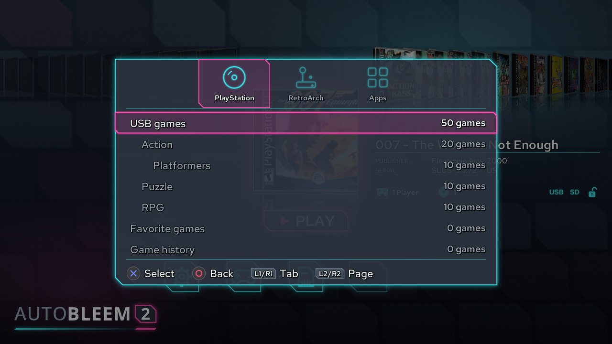

### 3.2 Les commandes

AutoBleem se pilote entièrement à la manette, et les boutons gardent le même sens sur tous les écrans : Cross
valide, Circle revient en arrière, Triangle vient en aide. Si vous ne savez plus à quoi sert un bouton, la barre
d'aide en bas de l'écran vous le dit, et Triangle, sur l'étagère, ouvre le guide des touches qui présente tous les
boutons de tous les écrans (section 4.3). Voici ce que font les boutons sur l'étagère :

| Bouton | Sur l'étagère |
|---|---|
| Gauche / Droite | Passe au jeu précédent ou suivant ; gardez le bouton enfoncé pour faire défiler. |
| L1 / R1 | Saute à l'initiale précédente ou suivante des titres, pour traverser vite une longue étagère. Sur une étagère vide, avec un lecteur USB branché, R1 ouvre *Disque* (section 3.9a). |
| Cross | Lance le jeu sélectionné : un jeu PS1 dans l'émulateur PS1, un jeu RetroArch dans son cœur, une application après sa notice. |
| Square | Lance plutôt le jeu PS1 sélectionné dans RetroArch. Quand c'est un disque dans un lecteur USB qui est sélectionné, il copie ce disque (*Copier le disque*, section 3.9a). |
| Circle | Vous ramène à la vue du disque quand un disque est dans le lecteur (section 3.9a). |
| Triangle | Ouvre le guide des touches. |
| Start | Tire un jeu au hasard dans la liste en cours, pour les jours où vous n'arrivez pas à choisir. |
| Select | Ouvre le choix de la liste, où vous décidez quels jeux l'étagère affiche (section 3.3). |
| Haut | Ouvre le menu rapide (section 3.4). |
| Bas | Ouvre la rangée d'icônes sous le jeu (*RÉGLAGES*, *Jeu*, *Carte mémoire*, *Retour au jeu*) ; Haut la referme. |
| L2 + R2 | Ouvre le menu système (section 3.5). |

**Au clavier.** Sur un PC sans manette, ou avec un clavier USB branché sur la console, un Pi ou la clé PC, les touches
remplacent les boutons. Les flèches font office de croix directionnelle, Entrée de Cross, Échap ou Retour arrière de
Circle, Tab de Triangle et Espace de Square. F1 et F2 correspondent à Select et Start, Page précédente et Page
suivante à L1 et R1, Origine et Fin à L2 et R2, et F10 ouvre le menu système.

Sous Windows, quelques touches changent. Échap y ferme AutoBleem (chapitre 7) ; Circle n'est donc plus que Retour
arrière, Espace fait office de Start et S de Square. Les lettres peuvent en plus remplacer toute la manette, sans
avoir à passer par les flèches : X, O, S et T sont Cross, Circle, Square et Triangle, I, J, K et L la croix
directionnelle (haut, gauche, bas, droite), B est Select, Q et E sont L1 et R1, 1 et 2 sont L2 et R2.

**Dans toutes les listes et tous les menus**, on se déplace de la même façon : Haut et Bas déplacent le curseur, L2 et
R2 tournent la page, L1 et R1 sautent à la première ou à la dernière ligne, Cross sélectionne et Circle revient en
arrière. Pas besoin de chercher un bouton Enregistrer : un écran de réglages les enregistre quand vous le quittez avec
Circle.

**Sortir d'un jeu ou d'une application.** Maintenez Start + Select, ou Home, pendant 2 secondes, et vous voilà de
retour dans AutoBleem. Cela fonctionne avec n'importe quelle manette - celle de la console, une manette USB ou une
manette Bluetooth. Un appui bref sur ces mêmes boutons ouvre plutôt le menu de l'émulateur. Une application n'a pas
de tel menu : seul l'appui long y fait quelque chose.

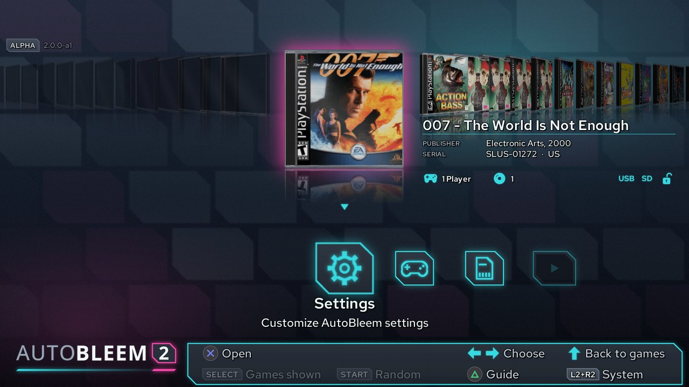

### 3.3 Les listes

Une grande ludothèque se parcourt plus facilement par morceaux. Les listes permettent de restreindre l'étagère à un
seul genre de jeux - vos favoris seulement, les jeux Super Nintendo seulement, ceux d'un seul dossier - pour ne pas
faire défiler des centaines de jaquettes avant de tomber sur la bonne.

Appuyez sur **Select** pour ouvrir le choix de la liste. Il comporte trois onglets, PlayStation, RetroArch et
applications : L1 et R1 passent de l'un à l'autre, Haut et Bas parcourent les groupes de l'onglet (L2 et R2 page par
page), et Cross affiche sur l'étagère le groupe choisi. Circle (*Retour*) referme le tout sans rien changer. Le pied
de page rappelle ces touches. Chaque ligne indique combien d'éléments elle contient. Un groupe vide s'ouvre sur une
étagère vide, où la rangée d'icônes ne propose que *RÉGLAGES*.

**L'onglet PlayStation.** Sur une PlayStation Classic, il commence par *Tous les jeux* et *Jeux internes* (les vingt
jeux intégrés à la console), suivis de *Jeux USB* - tout ce qui se trouve dans `Games/` - et d'un groupe pour chaque
dossier que vous y avez créé : un jeu rangé dans un sous-dossier appartient donc au groupe de ce dossier. Viennent
ensuite *Jeux favoris*, *Historique des jeux* et, dès qu'au moins un jeu est marqué comme jeu au pistolet, *Jeux
Lightgun*. Un Raspberry Pi, une clé PC et Windows n'ont pas de jeux internes : la liste y commence donc à *Jeux USB*,
qui regroupe toute votre ludothèque.

**L'onglet RetroArch** n'existe que là où RetroArch est installé. Il contient un groupe pour chaque système dont vous
avez des jeux, plus les favoris et l'historique propres à RetroArch.

**L'onglet des applications** les classe par type : *Toutes les applications*, puis *Jeux*, *Émulateurs*, *Outils*,
*Média* et *Autre*. Le groupe d'une application est défini dans son fichier `app.ini`. Cet onglet présente aussi les
**applications PE**, des programmes Windows exécutés par le lanceur PE ; celles que la console ne peut pas faire
tourner portent la mention *ne peut pas fonctionner sur cette console*. Là où le lanceur l'affiche, une ligne
*Paquets* figure aussi dans la liste (section 3.10).

### 3.4 Le menu rapide

Le menu rapide rassemble, dans une courte liste, ce dont on a le plus souvent besoin en parcourant ses jeux, pour vous
éviter de fouiller dans le menu système complet. Ouvrez-le avec **Haut** sur l'étagère, ou avec l'**icône en forme de
roue dentée** de la rangée d'icônes (celle de *RÉGLAGES*, *Jeu*, *Carte mémoire* et *Retour au jeu*).

Haut et Bas parcourent les éléments (après le dernier, le curseur revient au premier), Cross en choisit un et Circle
referme le menu. Une ligne sous le menu décrit l'élément sélectionné. Voici ce qu'il propose :

- *Ré-analyser les jeux* recherche sur-le-champ les jeux nouveaux, modifiés ou supprimés - pratique quand vous venez
  de copier des jeux et que vous ne voulez pas attendre.
- *Boutique* ouvre la Boutique AutoBleem, où vous parcourez et installez jeux, applications et extensions
  (section 3.13).
- *Cœurs RetroArch*, là où RetroArch est installé, vous laisse choisir le cœur qui fait tourner chaque système.
- *Réseau et manettes* ouvre les écrans du WiFi, de l'appairage Bluetooth et de la configuration des manettes
  (chapitre 6). Cet élément n'apparaît que si une extension installée fournit ces écrans - c'est le cas de PSC-Bios,
  sur la console, un Raspberry Pi et la clé PC. Si cette extension est installée mais désactivée, l'élément est grisé
  et sa description vous invite à l'activer dans Extensions ; Cross ouvre alors la liste des extensions directement
  sur elle.
- *Redémarrer le lanceur* ferme AutoBleem et le relance (seulement sur la console, un Raspberry Pi et la clé PC).
- *Menu système...* ouvre le menu système complet, avec tout le reste - Options, Gestionnaire de jeux, Arrêt et plus
  encore (section 3.5).

À part la Boutique, les cœurs RetroArch et *Redémarrer le lanceur*, tout ce qui se trouve ici figure aussi dans le menu
système.

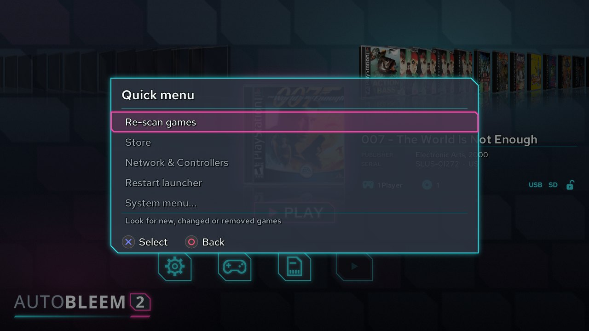

### 3.5 Le menu système

Le menu système regroupe tout ce qu'AutoBleem sait faire en dehors du jeu proprement dit : les réglages, les outils
pour votre ludothèque et vos cartes mémoire, les informations sur la machine, et de quoi l'éteindre. Appuyez en même
temps sur **L2 + R2** (dans n'importe quel ordre), et il s'ouvre par-dessus l'étagère. Ses éléments sont rangés sous
les titres *Bibliothèque*, *Système* et *Quitter*, les deux plus utilisés étant placés tout en haut. Une ligne au bas
du menu décrit l'élément sélectionné : vous pouvez donc faire le tour avant de choisir.

| Rubrique | Élément | À quoi il sert |
|---|---|---|
| (en haut) | *Ré-analyser les jeux* | Recherche tout de suite les jeux nouveaux, modifiés ou supprimés. L'analyse surveille déjà le dossier d'elle-même : cet élément ne sert que si vous ne voulez pas attendre. |
| | *Extensions* | Affiche les extensions présentes sur la clé, comme la Boutique AutoBleem, pour les lancer ou les désactiver (section 3.13). |
| *Bibliothèque* | *Gestionnaire de jeux* | Présente les jeux PS1 sous forme de liste avec leurs dossiers ; vous pouvez y supprimer un jeu ou effacer les jaquettes (section 4.1). Il ne s'ouvre pas pendant une analyse. |
| | *Cartes mémoire* | Sert à gérer vos jeux de cartes mémoire partagées (section 3.8). |
| | *Processeurs d'analyse* | Règle l'ordre des programmes que chaque analyse exécute en premier, et les active ou les désactive (section 3.14). Il ne s'ouvre pas pendant une analyse. |
| *Système* | *Options* | Ouvre les réglages d'AutoBleem (section 3.6). |
| | *Réseau et manettes* | Ouvre les écrans du WiFi, de l'appairage des manettes Bluetooth, de la configuration de la DualShock 3 et de la configuration des manettes (chapitre 6). Il n'apparaît que si une extension les fournit - voir plus bas. |
| | *Informations matérielles* | Présente la machine - système, processeur, stockage, interfaces réseau, fuseau horaire, affichage, ainsi que les manettes et leur configuration - sur une page identique sur toutes les plateformes (section 4.2). Circle vous ramène au menu système. |
| | *Manette virtuelle* | Montre les manettes transmises aux applications et celles que le démon voit, ce qui aide quand une manette ne répond pas dans une application (section 4.5). Circle vous ramène au menu système. |
| | *Mise à jour logicielle* | Cherche tout de suite sur le site une version plus récente d'AutoBleem ou de RetroArch, sans attendre la vérification quotidienne (section 3.12). Quand le lanceur en connaît déjà une, la ligne indique *Mise à jour disponible*. Sur une PlayStation Classic, il faut pour cela le noyau AutoBleem et un réseau WiFi. |
| | *À propos* | Affiche les remerciements et la licence. |
| *Quitter* | *RetroArch* | Quitte le lanceur pour le menu de RetroArch lui-même, avec ses réglages et ses listes de contenus ; quand vous fermez RetroArch, vous revenez au lanceur. Il n'apparaît que là où RetroArch est installé. |
| | *Arrêt* | Éteint la machine après vous avoir demandé confirmation (voir plus bas). |

**Réseau et manettes** n'apparaît que si une extension installée fournit l'entrée `network`, ce qu'elle déclare par
la ligne `Provides=network` de son `extension.ini`. C'est ce que fait PSC-Bios sur la console, un Raspberry Pi et la
clé PC. Si cette extension est installée mais désactivée, l'élément reste dans le menu, grisé, et sa description vous
invite à l'activer dans Extensions ; Cross ouvre alors la liste des extensions directement sur elle.

**Arrêt** agit selon la machine. Sur la console, il la met dans la veille d'AutoBleem : la clé est déconnectée, le
voyant passe à l'orange, et Power ramène le lanceur en quelques secondes (section 2.1). Sur un Raspberry Pi ou un PC,
la machine s'éteint.

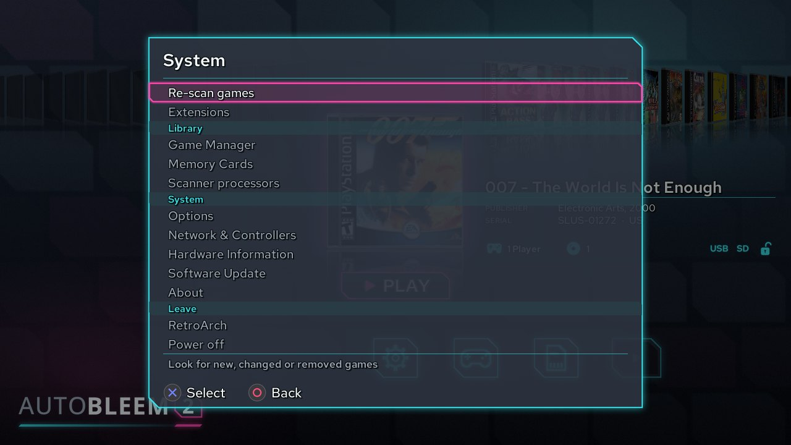

### 3.6 Options

C'est dans les options que vous faites d'AutoBleem votre lanceur à vous : l'image à l'écran, l'apparence, la langue,
le son, l'émulateur PS1 qui fait tourner vos jeux. Vous les ouvrez depuis le menu système (*Options*) ou avec l'icône
*RÉGLAGES* sous un jeu. En général, on règle l'écran et la langue une bonne fois pour toutes, et l'on y revient quand
l'image n'est pas bonne sur un téléviseur donné ou qu'on a envie de changement.

Les réglages sont classés en groupes, chacun sous un titre. Haut et Bas passent d'une ligne à l'autre, Gauche et Droite
changent la valeur de la ligne courante : un appui avance d'un cran, un appui maintenu fait défiler. L1 et R1 sautent à
la première ou à la dernière ligne, L2 et R2 tournent la page. Sur une ligne où l'on choisit un thème, une musique ou
une police, Start en tire une au hasard. Un réglage qu'on active ou désactive affiche **ON** ou **OFF**. Chaque
changement se voit aussitôt, et Circle quitte l'écran en enregistrant le tout - rien d'autre à confirmer. Seule
exception : le mode d'affichage, qui est essayé au moment où vous quittez les options (voir *Affichage* plus bas).

Certaines lignes n'apparaissent que là où elles ont un sens : les lignes CRT seulement avec une image en 4:3, celles
de RetroArch seulement là où il est installé, les jeux internes seulement sur une PlayStation Classic.

| Groupe / réglage | À quoi il sert |
|---|---|
| *Interface* : *Affichage :* | Règle la résolution de l'écran, pour le lanceur comme pour l'émulateur PS1. *Auto* utilise le mode natif de l'écran et indique lequel, par exemple *Auto (1920x1080)* ; vous pouvez aussi choisir n'importe quel mode proposé par l'écran. La console propose 720p, 1080p et *CRT 4:3* (720x480), le mode pour un vieux téléviseur cathodique ou un boîtier de capture 4:3. Changez-le quand l'image ne tient pas sur votre téléviseur ou qu'elle est floue. Cette ligne est absente quand AutoBleem tourne dans une fenêtre sur une machine de développement. |
| *Marge CRT :* | Réduit légèrement l'ensemble de l'image, de 0 à 10 % par pas de 1 %, parce que les vieux téléviseurs rognent les bords de l'image. Augmentez-la jusqu'à voir entièrement la barre d'aide et les coins. Elle n'apparaît qu'avec une sortie 4:3, agit immédiatement et s'applique dès l'écran de démarrage. |
| *Hauteur de l'image :* | Rend l'image plus haute ou plus basse, de -40 à +40 par pas de 2, sur toute sortie 4:3 - *CRT 4:3*, ou un mode 4:3 sur une sortie VGA ou PC. Servez-vous-en quand l'image d'un vieux téléviseur paraît écrasée ou déborde en haut et en bas. Le réglage agit immédiatement, et l'image des jeux sous RetroArch suit. |
| *Mise à l'échelle de l'émulateur :* | Décide comment l'émulateur PS1 adapte l'image du jeu à votre écran. *1x1* montre les pixels de la PlayStation tels quels, petits mais exacts ; *2x (entier)* et *4:3 (entier)* agrandissent uniquement par multiples entiers, ce qui donne l'image la plus nette ; *4:3* conserve les proportions d'origine ; *Plein écran* étire l'image sur tout l'écran. Ce réglage remplace l'ancien interrupteur Widescreen. Le `pcsx-ab` classique et RetroArch ne connaissent que le plein écran et le 4:3. |
| *Halo d'écran :* | Sur ON, les bandes vides de part et d'autre de l'image du jeu (là où elle ne remplit pas l'écran) se remplissent d'une douce lueur tirée de l'image elle-même au lieu de rester noires. Fonctionne avec `pcsx-abnxt`. |
| *Thème AutoBleem :* | Change l'apparence du lanceur. Les thèmes se trouvent dans `Themes/`, et un thème au format zip déposé là apparaît aussi sous son nom. Les thèmes fournis avec AutoBleem sont rafraîchis à chaque mise à jour : si vous voulez en personnaliser un, copiez-le d'abord sous un autre nom. Le thème par défaut est **ab2.0.0**. |
| *Style de jaquette :* | Choisit le boîtier cristal dessiné autour des jaquettes PS1. |
| *Reflet de la jaquette :* | Fait passer un reflet sur la jaquette sélectionnée chaque fois que l'étagère s'immobilise. |
| *Langue :* | Règle la langue du lanceur ; il y en a 17, et le changement est immédiat. |
| *Durée de l'annonce :* | Règle combien de temps restent affichées les bulles d'information (*Affichage : ...*, le résumé de l'analyse), de 0 à 20 secondes ; 0 affiche *Désactivé* et les supprime. Les messages d'erreur gardent leur propre durée, fixe, pour que vous n'en manquiez aucun. |
| *Écran de démarrage :* | Affiche l'image d'AutoBleem pendant le démarrage du lanceur ; désactivez-le pour arriver directement sur l'étagère. |
| *Animations :* | Anime le passage d'un écran à l'autre ; désactivez-les si vous préférez que chaque écran apparaisse instantanément. |
| *Polices* : *Utiliser la police par défaut :* | Sur ON, le lanceur utilise sa propre police (Red Hat Text) ; désactivez-le pour utiliser la police choisie à la ligne suivante. |
| *Police :* | Choisit une police à vous : n'importe quel fichier `.ttf` ou `.otf` placé dans `resources/fonts`, `RetroArch/fonts` ou le dossier du thème. La ligne indique le nom de la police réellement utilisée. |
| *Son* : *Musique :*, *Musique de fond :* | *Musique :* choisit le morceau qui accompagne le lanceur - celui du thème, ou un fichier de `resources/music`. *Musique de fond :* décide s'il y a de la musique ou non. |
| *Émulation* : *Émulateur PS1 :* | Choisit l'émulateur dans lequel démarrent vos jeux PS1 : `pcsx-abnxt`, celui par défaut (le PCSX-ReARMed actuel, avec les ajouts d'AutoBleem), ou `pcsx-ab`, le classique. Essayez l'autre quand un jeu tourne mal. Un point de reprise enregistré par l'un se poursuit dans l'autre, sauf si le jeu tournait sans fichier BIOS. |
| *Échanger joueur 1 / joueur 2 (émulateurs PS1) :* | Inverse, dans les deux émulateurs PS1, laquelle des deux premières manettes est le joueur 1 et laquelle est le joueur 2 - bien pratique quand les manettes sont branchées « à l'envers ». Cela ne compte qu'avec au moins deux manettes ; avec une seule, vous jouez toujours en joueur 1. RetroArch n'est pas concerné. Si l'émulateur PS1 utilisé ne sait pas encore faire l'échange, AutoBleem vous le signale. |
| *Jouer à tous les jeux PSX avec RA :*, *Mettre à jour la config RA :*, *Conserver la config RetroArch :* | Ces trois lignes n'apparaissent que là où RetroArch est installé. La première lance tous les jeux PS1 dans le cœur PS1 de RetroArch (*PlayStation 1* ; sur PC, c'est SwanStation). La deuxième autorise AutoBleem à écrire ses réglages dans la configuration de RetroArch quand il y lance un jeu. La troisième conserve, quand RetroArch se ferme, les changements faits dans le menu de RetroArch lui-même. |
| *Bibliothèque* : *Afficher les jeux internes :* | Affiche les jeux intégrés à la console dans les listes PlayStation (PlayStation Classic uniquement). |
| *Noms de jeux épurés :* | Sur ON (par défaut), les listes de jeux RetroArch affichent des noms propres, sans les mentions entre crochets ou parenthèses comme (USA), (Rev 1) ou [!] ; sur OFF, ce sont les noms de fichiers qui s'affichent. Le nom du fichier reste visible dans la fiche du jeu. Les jeux PS1 ne sont pas concernés, puisque leurs titres viennent de la base de données. |
| *Récupérer les jaquettes en ligne :* | Permet à l'analyse de télécharger les jaquettes manquantes depuis les serveurs de libretro (Raspberry Pi, PC, Windows). |
| *Mises à jour* : *Mises à jour :* | Choisit les mises à jour que le lanceur recherche (section 3.12) : `release` (la version testée), `testing` (la prochaine version, en cours de test), `nightly` (la toute dernière version de développement) ou `off`. Par défaut, il suit la version que vous avez installée. Cette ligne n'apparaît pas sur une machine de développement. |
| *Diagnostic* : *Garder les journaux sur la clé :* | À partir du démarrage suivant, conserve tous les journaux sur la clé, et pas seulement après un plantage - à activer quand vous traquez un problème (chapitre 7). |
| *Afficher les performances :* | Affiche dans le coin inférieur gauche le nombre d'images par seconde, la charge du processeur, les threads et la mémoire ; en jeu, l'émulateur affiche aussi ses FPS et son processeur. |

**Changer de mode d'affichage.** Quand vous quittez les options après avoir choisi un nouveau mode dans *Affichage :*,
AutoBleem bascule sur ce mode et vous demande *Garder ce mode d'affichage ?*. Si l'image est correcte, confirmez. Si
votre téléviseur n'affiche plus rien, patientez : faute de confirmation, AutoBleem revient au mode précédent à la fin
d'un compte à rebours.

**Les thèmes sur un écran 4:3.** En mode *CRT 4:3*, la liste des thèmes ne montre que ceux qui ont une mise en page
4:3. Si votre thème n'en a pas, il est remplacé par le thème par défaut une fois le mode confirmé (et à chaque
démarrage dans ce mode), et une annonce vous en informe : *Thème remplacé par le thème par défaut (CRT 4:3)*.

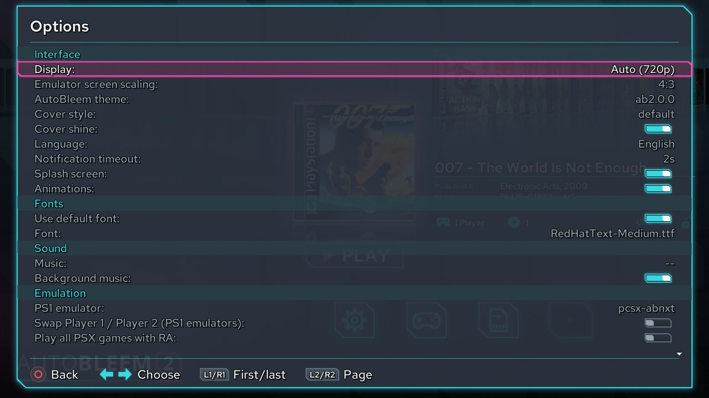


### 3.7 Les réglages d'un jeu

Chaque jeu peut avoir ses propres réglages. La plupart tournent très bien tels quels, mais il arrive qu'un jeu ait
besoin d'un petit coup de pouce - une image plus nette ou plus douce, une image sautée de temps en temps pour garder
de la fluidité, une autre carte mémoire - ou que vous vouliez le mettre en favori. L'éditeur de jeu sert à changer
tout cela pour ce jeu-là, sans toucher aux autres.

Le jeu sélectionné, appuyez sur **Bas** pour ouvrir la rangée d'icônes placée dessous. Elle compte quatre icônes :
*RÉGLAGES* (les options de la section 3.6), *Jeu* (les réglages propres à ce jeu), *Carte mémoire* (sa carte
mémoire) et *Retour au jeu* (ses sauvegardes d'état). Placez-vous sur l'une d'elles et appuyez sur Cross pour
l'ouvrir.

**L'éditeur de jeu** (l'icône *Jeu*) affiche à droite la fiche du jeu - titre, éditeur, année, nombre de joueurs,
dossier et carte mémoire - et à gauche ses réglages. Haut et Bas passent d'un réglage à l'autre, Gauche et Droite les
modifient, comme dans les options ; un bouton maintenu répète le mouvement. Quand vous avez fini, Circle enregistre
vos changements et vous ramène en arrière. Un jeu dont les données ne contiennent pas de titre apparaît sous le nom
de son dossier.

Les réglages se répartissent en quatre groupes :

- **Jeu** concerne la façon dont AutoBleem traite le jeu. *Favori :* le place dans le groupe *Jeux favoris* du choix
  de la liste. *Verrouiller les données :* demande à l'analyse de laisser le titre, le numéro de série et la liste des
  disques exactement tels que vous les avez réglés : une analyse ultérieure n'écrasera pas vos changements.
  *Reprise :* décide de ce qui se passe quand vous lancez un jeu qui a des points de reprise : *Demander* affiche le
  choix de l'emplacement, *Dernier emplacement* reprend aussitôt au plus récent, et *Jamais* démarre toujours le jeu
  depuis le début. Là où RetroArch est installé, deux lignes s'y ajoutent. *Jeu Lightgun :* est destiné aux jeux au
  pistolet : le jeu rejoint le groupe *Jeux Lightgun* et tourne toujours dans RetroArch, car c'est le cœur PS1 de
  RetroArch qui gère le GunCon (l'activer active aussi la ligne suivante). *Jouer avec RA :* fait tourner ce jeu-là
  dans RetroArch plutôt que dans l'émulateur PS1.
- **Affichage** concerne le rendu de l'image. *Résolution :* dessine le jeu en 1x ou en 2x (avec le GPU intégré), et
  *Supprimer les coutures :*, qui ne fonctionne qu'en 2x, masque les fines lignes qui peuvent apparaître entre les
  morceaux de l'image à cette taille. *Tramage :* (*Désactivé*, *Activé*, *Toujours*) contrôle le fin motif de points
  dont la PlayStation se sert pour mélanger les couleurs, et *Lissage :* choisit l'un des algorithmes de lissage de
  l'émulateur. *Filtre :* décide comment l'image est mise à l'échelle de l'écran : *Plus proche* montre des pixels
  bruts, *Linéaire* les adoucit, *Net* et *Net (simple)* gardent des pixels nets sans scintillement, et il y a aussi
  *Quilez*. Les filtres CRT, *CRT (fast)*, *CRT (raster)* et *CRT-Pi*, imitent un vieux téléviseur et tracent leurs
  propres lignes de balayage : les lignes consacrées au balayage sont donc grisées tant que l'un d'eux est choisi.
  Sinon, *Lignes de balayage :* ajoute les lignes sombres d'un vieux téléviseur, et *Luminosité des lignes de
  balayage :* règle leur intensité. *Résolution*, *Supprimer les coutures*, *Tramage*, *Lissage* et les filtres autres
  que *Linéaire* et *Plus proche* sont réservés à `pcsx-abnxt` ; le `pcsx-ab` classique et RetroArch traitent tout
  autre filtre comme *Plus proche*.
- **Rendu** regroupe le *Plugin :* graphique et *Saut d'images :* (*Auto*, *Désactivé*, ou de 1 à 3 images). Sauter
  des images aide un jeu trop lent à garder sa vitesse, au prix d'une image moins fluide.
- **Émulateur** regroupe *SpeedHack :*, la *Fréquence :* du processeur, *Interpolation SPU :* (la façon dont le son
  est lissé), *Logo de démarrage :* et, avec `pcsx-abnxt`, *Correctifs Sony :*. Désactivez *Logo de démarrage :* pour
  sauter l'écran du BIOS - c'est indispensable pour un disque homebrew dont le logo personnalisé l'empêche de
  démarrer.

Les proportions de l'image et la résolution de l'écran ne se règlent pas jeu par jeu, mais pour tous à la fois, dans
les options (*Mise à l'échelle de l'émulateur :* et *Affichage :*).

**Les autres boutons de l'éditeur.** Triangle renomme le jeu, à l'aide du clavier virtuel. Square donne au jeu une
autre carte mémoire (*Changer de carte mémoire*). Tant que le jeu utilise encore sa propre carte, Start transforme
cette carte en un nouveau jeu de cartes partagé, pour que d'autres jeux puissent s'en servir (*Partager la carte
mémoire*, section 3.8). Ces deux boutons ne sont pas proposés pour les jeux internes de la console. Ici, comme dans les
écrans des options de jeu et des cœurs de RetroArch, maintenir Gauche / Droite ou Haut / Bas répète le mouvement.

Un jeu garde ses réglages dans son propre fichier `pcsx.cfg`. Tous les jeux de la clé en ont un, puisque le scan
le crée. Un disque original dans un lecteur USB (section 3.9a), lui, ne reçoit son dossier et son `pcsx.cfg`
qu'au premier lancement ; d'ici là, une modification faite dans l'éditeur ne peut pas être conservée, et
l'éditeur vous prévient : *Non enregistré : ce jeu n'a pas de pcsx.cfg*. Lancez donc le disque une fois - ensuite,
ses réglages sont conservés comme ceux de n'importe quel autre jeu. Un disque qui appartient à un jeu déjà
présent dans votre collection utilise d'emblée le dossier et les réglages de ce jeu.

Pour un **disque dans le lecteur** (section 3.9a), certains réglages n'ont pas de sens : l'éditeur grise ces lignes, et
la ligne du bas indique *Indisponible pour un disque dans le lecteur* quand vous passez dessus.


**Les réglages enregistrés dans l'émulateur.** Vous pouvez aussi peaufiner un jeu en cours de partie : le menu de
l'émulateur propose *Enregistrer les réglages pour ce jeu* (section 3.9). Dès qu'un jeu a des réglages enregistrés de cette
façon, ce sont eux qui s'appliquent. L'éditeur de jeu affiche alors ses lignes Affichage, Rendu et Émulateur grisées,
avec les valeurs enregistrées, sous le titre *Enregistré dans l'émulateur* : vous pouvez les lire, mais pas les
modifier. Si vous préférez revenir aux réglages de l'éditeur, choisissez *Déverrouiller les réglages* et confirmez :
les réglages enregistrés par l'émulateur sont supprimés, et les lignes redeviennent modifiables. Les deux émulateurs,
`pcsx-ab` et `pcsx-abnxt`, lisent et écrivent les mêmes réglages enregistrés : peu importe donc lequel les a
enregistrés.

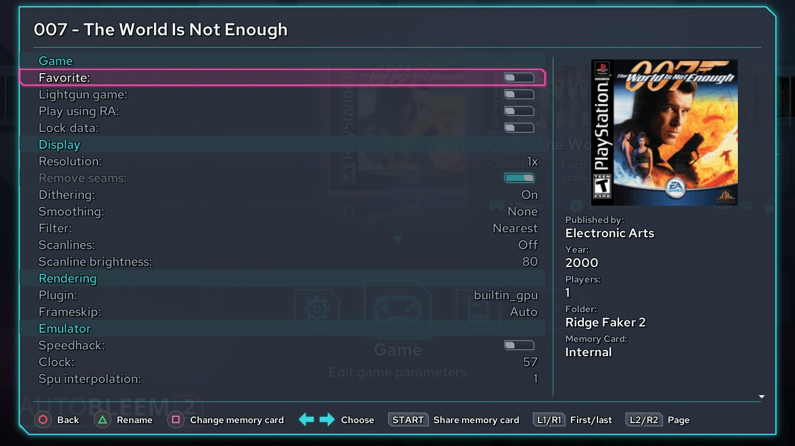

### 3.8 Cartes mémoire et sauvegardes d'état

Sur une vraie PlayStation, on partage une ou deux cartes mémoire entre tous ses jeux, et on finit tôt ou tard par
manquer de place. Dans AutoBleem, chaque jeu PS1 a par défaut sa propre carte mémoire : plus besoin de vous soucier de
la place disponible ni de savoir sur quelle carte se trouve telle sauvegarde. La carte est rangée avec les
sauvegardes d'état du jeu, dans `Games/!SaveStates/<dossier du jeu>/`.

**Les jeux de cartes mémoire partagées.** Il arrive que des jeux aient besoin de voir les sauvegardes les uns des
autres - une suite qui lit la sauvegarde du premier épisode, par exemple, ou les disques d'une série que vous voulez
réunir sur une même carte. Vous créez alors un jeu de cartes partagé : une carte unique que plusieurs jeux utilisent.
Ces jeux de cartes sont rangés dans `Games/!MemCards/`, et vous les gérez avec *Cartes mémoire* dans le menu système.
Square en crée un nouveau (dont vous tapez le nom avec le clavier virtuel), Cross renomme celui qui est sélectionné et
Triangle le supprime, après vous avoir demandé confirmation. Pour mettre un jeu sur un jeu de cartes, passez par
*Changer de carte mémoire* dans son éditeur (section 3.7), ou par son icône *Carte mémoire*.

**L'éditeur de cartes mémoire** s'ouvre depuis l'icône *Carte mémoire* d'un jeu. Il présente côte à côte la carte du
jeu et une seconde carte, chaque sauvegarde avec son icône et son titre, comme l'écran des cartes mémoire de la
console d'origine. Square copie la sauvegarde sélectionnée sur l'autre carte, Triangle la supprime, et Select
défragmente une carte, en regroupant ses blocs libres pour qu'une grosse sauvegarde puisse de nouveau y tenir. Start
vous laisse choisir le jeu de cartes affiché à droite, et Cross recharge les deux cartes depuis la clé. Une carte sur
laquelle le jeu n'a encore rien écrit - un jeu où vous n'avez jamais sauvegardé - est vide et porte la mention *pas
encore de carte* à côté de son nom. Si vous avez fait des changements, AutoBleem vous demande *Voulez-vous enregistrer
les données des cartes mémoire ?* avant de quitter l'éditeur, de recharger les cartes ou d'afficher un autre jeu de cartes.

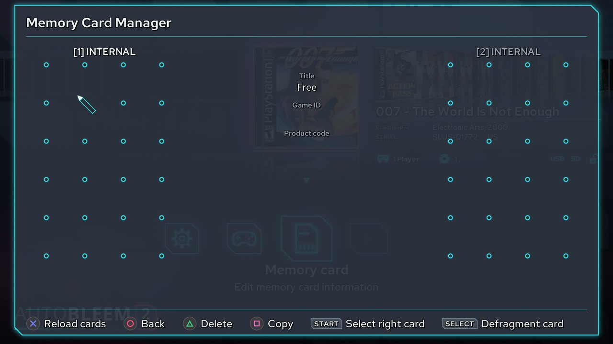

**Les points de reprise.** Beaucoup de jeux PS1 ne permettent de sauvegarder qu'à certains endroits, et on n'en atteint
pas toujours un avant de devoir s'arrêter. Les points de reprise règlent ce problème : quand vous quittez un jeu PS1
avec le bouton Reset de la console (ou par le menu de l'émulateur sur un Pi ou un PC), AutoBleem enregistre une
sauvegarde d'état à l'endroit précis où vous en étiez. Pendant cet enregistrement, au moment de quitter le jeu,
l'émulateur affiche *Please wait...*. La fois suivante, vous reprenez à cet instant précis.

Vous les trouverez sous l'icône *Retour au jeu* du jeu. Un jeu qui a un point de reprise en montre une petite image
sur l'icône ; un jeu qui n'en a aucun a l'icône grisée. Le choix de l'emplacement de reprise propose quatre
emplacements, présentés comme des cartes encadrées, chacune avec une image du moment, son numéro et sa date. Le plus
récent porte la mention **RÉCENT**, et un emplacement inutilisé indique *Aucun point de reprise*. Cross reprend la
partie à l'emplacement sélectionné, Triangle le supprime. C'est le réglage *Reprise :* du jeu (section 3.7) qui décide
si ce choix s'affiche ou non quand vous lancez le jeu.

Les jeux PS1 que vous lancez dans RetroArch ont eux aussi des emplacements de reprise. Chaque emplacement porte un
badge - le logo d'AutoBleem 2 ou celui de RetroArch - pour que vous sachiez quel émulateur l'a écrit.


### 3.9 Lancer les jeux, RetroArch et les applications

Lancer un jeu, c'est ce que vous ferez le plus souvent ; il suffit donc d'un bouton : sélectionnez le jeu sur
l'étagère et appuyez sur **Cross**. Un jeu PS1 s'ouvre en plein écran dans l'émulateur PS1 choisi dans les options
(section 3.6) et tourne jusqu'à ce que vous le quittiez. Si vous préférez jouer à un jeu PS1 dans RetroArch - parce
qu'il y tourne mieux, ou parce que vous aimez les options de RetroArch -, appuyez plutôt sur **Square**.

**Quitter un jeu.** Sur la PlayStation Classic, les boutons de la console font ce qu'on attend d'eux. **Reset**, en
façade, vous ramène au lanceur en enregistrant un point de reprise à l'endroit où vous en étiez, pour reprendre plus
tard (section 3.8) ; il fonctionne même quand le menu en jeu est ouvert. **Power** éteint la console. Un Raspberry Pi
ou un PC n'ayant pas ces boutons, c'est par le menu en jeu de l'émulateur, décrit plus bas, que vous en sortez.

Il existe aussi une façon de sortir qui marche pareil sur toutes les manettes - celle de la console, une manette USB
ou une manette Bluetooth : **maintenez Start + Select, ou Home, pendant 2 secondes**, et vous voilà de retour dans
AutoBleem. Un appui bref sur ces mêmes boutons ouvre plutôt le menu de l'émulateur. Le lanceur vous rappelle les deux
dans ses indications (*Maintenir Select+Start ou Home 2 secondes : retour à AutoBleem* et *Appui bref sur
Select+Start ou Home : le menu de l'émulateur*). Une application n'a pas de menu d'émulateur : seul l'appui long y fait
quelque chose. Sur la console, Reset arrête toujours aussi une application.

**Le menu en jeu.** Avec `pcsx-abnxt`, l'émulateur a son propre menu pour tout ce dont on a besoin en cours de partie :
sauvegarder, changer de disque, régler l'image, choisir les manettes. Appuyez sur le bouton du menu - Home sur une
manette qui en a un, **Select + Start** sur une manette qui n'en a pas, ou **Échap** au clavier - et le jeu se met en
pause derrière le menu, sa dernière image restant en fond. Maintenir le bouton du menu pendant 2 secondes revient à
appuyer sur Reset : vous quittez le jeu. Le menu a trois onglets, que L1 et R1 permettent de parcourir. Il se souvient
de l'endroit où vous étiez et se rouvre la fois suivante sur le même onglet et la même ligne.

- L'onglet **Jeu** concerne le jeu lui-même. *Reprendre le jeu* referme le menu et vous laisse continuer. Sous
  *Sauvegardes*, *Sauvegarde rapide* enregistre l'instant présent et *Chargement rapide* vous y ramène. *Charger la
  sauvegarde automatique* vous ramène à l'état du jeu d'il y a 30 secondes au plus - l'émulateur garde cette copie
  en mémoire pendant la partie, ce qui vous sauve d'une erreur irréparable. Sous *Disque CD*, *Changer de disque*
  sert aux jeux sur plusieurs disques quand ils réclament le suivant, et *Réinitialiser le jeu* recommence la
  partie depuis le début. *Enregistrer les réglages pour ce jeu* conserve les réglages que vous avez choisis pour
  ce jeu-là (section 3.7). *Menu PCSX* ouvre les pages de PCSX-ReARMed lui-même, avec ses options, ses codes de
  triche et sa page À propos, et *Quitter* vous ramène à AutoBleem.
- L'onglet **Image** vous permet de changer l'apparence du jeu tout en le regardant : *Affichage*, *Résolution* (1x
  ou 2x), *Supprimer les coutures*, *Tramage*, *Mise à l'échelle*, *Halo d'écran*, *Lissage*, *Filtre*, *Masque
  CRT*, *Scanlines* et *Luminosité des scanlines*. Ce sont les mêmes réglages que dans l'éditeur de jeu (section
  3.7), et chaque ligne a, à droite, une ligne d'aide qui explique à quoi elle sert. *Affichage* est la résolution
  de l'écran ; sur la console, elle se choisit dans les options et n'est qu'affichée ici. *Halo d'écran* s'occupe
  des bandes sombres qui encadrent une image 4:3 sur un écran large : il les remplit avec les bords mêmes de
  l'image, en miroir et assombris, si bien que le jeu semble déborder dans ces bandes au lieu de rester coincé
  entre deux barres noires. *Masque CRT* pose sur l'image le motif des luminophores d'un vieux tube - *Grille*
  donne les fines bandes d'un Trinitron, *Fentes* et *Delta* les points d'autres tubes ; il n'est proposé qu'avec
  le filtre CRT (raster). Le filtre CRT-Pi est trop lourd pour la console en 1080p. Une ligne qui ne s'applique
  pas est grisée, et sa ligne d'aide vous explique pourquoi.
- L'onglet **Manettes** décide de ce qui est branché sur les deux ports de la PlayStation, *Manette 1* et
  *Manette 2* : une manette standard (numérique), une manette analogique (DualShock), un pistolet, ou rien du tout.
  Certains jeux ne fonctionnent qu'avec un type de manette précis. Le changement prend effet quand vous retournez au
  jeu.

Le menu adopte l'allure ab2.0.0 du lanceur, pour ne pas donner l'impression d'un autre programme, et il affiche les
batteries de vos manettes ainsi que l'image de votre dernière sauvegarde rapide.

**Les jeux RetroArch.** Un jeu d'un autre système démarre dans RetroArch, avec le cœur que le lanceur a choisi pour ce
système. Quand vous avez terminé, *Close Content* ou *Quit RetroArch* dans le menu de RetroArch vous ramène au
lanceur. Pour changer le cœur qui fait tourner un système, ouvrez *Cœurs RetroArch* dans le menu rapide
(section 3.4) ; la liste s'ouvre avec le cœur *PlayStation 1* en tête. Et si vous voulez le menu de RetroArch lui-même
(le XMB), pour ses réglages et ses propres listes de contenus, choisissez *RetroArch* dans le menu système : RetroArch
s'ouvre alors sans rien charger.


**Les applications.** Les applications sont des programmes plutôt que des jeux : les outils de la console et, sur la
console, les applications supplémentaires livrées avec le paquet RetroArch - Doom, Quake, Amiga et d'autres. Vous les
trouverez dans la liste des applications. Avant qu'une application démarre, AutoBleem affiche sa notice, pour que vous
sachiez de quoi il s'agit et comment elle se contrôle. Cross la lance, Circle vous ramène à l'étagère.

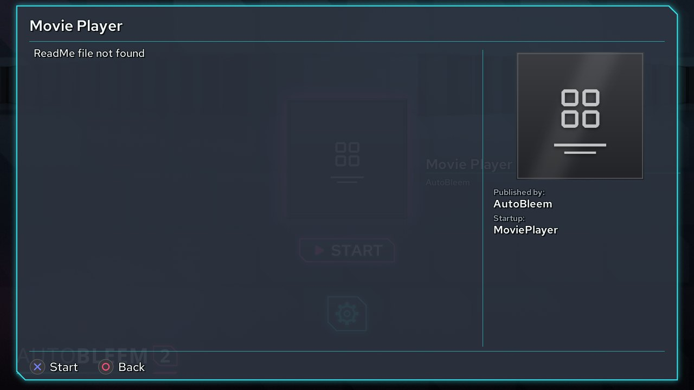

**Les réglages d'une application.** Beaucoup d'applications ont été écrites pour une manette bien précise : vous pouvez
donc changer la façon dont elles voient la vôtre. Sélectionnez l'application, ouvrez la rangée d'icônes et choisissez
*Jeu* : les *Réglages du jeu* de l'application s'ouvrent (*Change how this program is started*). *Mode manette :*
décide de la manette que l'application croit avoir. *Automatique* s'en tient à ce que l'application demande elle-même ;
*Manette PSC* et *Manette Xbox 360* présentent votre manette comme celle de la console ou comme une manette Xbox 360, et
*Manette PSC (système)* et *Manette Xbox 360 (système)* font de même en passant par le système lui-même. Essayez un
autre mode quand une application ne réagit pas comme il faut à votre manette. *Croix comme stick :* permet à la croix
directionnelle de déplacer le stick analogique, pour une application qui n'écoute que le stick, et *Stick comme
croix :* fait l'inverse.

Certaines applications vous posent une question au premier lancement. L'une veut savoir *Quelles commandes a votre
manette ?*, afin de régler ses commandes : répondez *Une croix directionnelle* pour une manette qui n'a que la croix,
ou *Sticks analogiques*. Une application qui fait tourner Windows demande *Que voulez-vous faire ?* et propose de
lancer Windows, de l'installer, de lancer DOS ou de désinstaller Windows. Quand une application vous laisse attribuer
une touche, elle vous demande *Appuyez sur l'un des boutons.*


Un programme Windows exécuté par le lanceur PE (une application PE, section 3.3) communique avec vous par les écrans
d'AutoBleem lui-même : un message qu'il veut afficher apparaît sous le titre *Message*, une question à choix multiple
sous le titre *Choisir une option*, avec chaque fois le nom de l'application en en-tête.


### 3.9a Un disque dans un lecteur USB

Vous pouvez brancher un lecteur CD/DVD USB ordinaire sur la console, sur un Raspberry Pi ou sur un PC démarré depuis
la clé AutoBleem, et jouer directement avec un disque PlayStation original - sans rien copier. Le disque inséré
apparaît dans le lanceur comme un jeu de plus. Cela ne fonctionne pas sous Windows.

**Copier un disque sur la clé.** Si vous voulez avoir le jeu toujours sous la main, sans le disque, appuyez sur Square
(*Copier le disque*). AutoBleem vous demande d'abord si vous voulez copier le jeu et combien de place il prendra, puis
l'enregistre dans le dossier `Games` sous la forme d'un seul fichier CHD (un jeu sur plusieurs disques reçoit en plus
un fichier `.m3u`, pour que le changement de disque fonctionne en cours de partie). Pendant la copie, vous voyez la
vitesse et le temps restant, et *Interrompre* l'arrête. Une fois la copie terminée, le jeu est sur l'étagère comme les
autres. AutoBleem refuse de copier un jeu qui se trouve déjà dans `Games`, ou un jeu pour lequel la place manque - il
vous indique alors combien il lui en faut. Un disque rayé peut lui aussi être copié : les parties illisibles sont
remplies de zéros, et AutoBleem vous dit combien il y en a eu. Une telle copie fonctionnera, ou pas.

Square propose la copie pour tout disque de jeu PlayStation affiché dans la vue du disque, même pour un disque que les
bases de jaquettes ne connaissent pas. Un jeu connu des bases est copié sous son titre ; pour un jeu sur plusieurs
disques, copiez-les l'un après l'autre, et le `.m3u` les répertorie dans l'ordre, en commençant par le disque 1. Un
disque inconnu des bases est nommé d'après son numéro de série, copié comme un disque unique, et n'a pas de jaquette
sur l'étagère. La fenêtre de copie, *Copie du disque*, reste à l'écran jusqu'à ce que la copie soit terminée ou
interrompue - le lanceur attend pendant ce temps - et affiche la vitesse en multiple de celle d'un lecteur CD
ordinaire. Si la copie échoue, AutoBleem vous en donne la raison.


**Jouer depuis le disque.** Quand vous insérez un disque, la **vue du disque** s'ouvre d'elle-même dès qu'il a été lu.
Elle montre la jaquette du disque - tirée des bases de jaquettes, ou récupérée en ligne - avec son numéro de série et
son titre, et Cross lance le jeu. Un jeu PS1 lancé depuis le disque conserve ses points de reprise et ses sauvegardes
dans un dossier à lui : vous pouvez vous arrêter et reprendre plus tard, exactement comme avec un jeu sur la clé. Après
la partie, ou après un passage par les options ou les réglages d'une extension, vous revenez à la vue du disque. Si
vous la quittez avec Circle pour parcourir vos autres jeux, le disque reste dans le lecteur et Circle, sur l'étagère,
fait revenir la vue ; sur une étagère vide, R1 (*Disque*) l'ouvre aussi. Sur une étagère qui contient des jeux, R1
garde son rôle habituel de saut d'une initiale à l'autre. Quand vous retirez le disque, la vue du disque se ferme.


**La pastille du lecteur**, en haut de l'écran, vous indique ce que fait le lecteur, pour que vous sachiez s'il faut
attendre. Sans lecteur branché, rien ne s'affiche. Un lecteur vide montre une icône de disque estompée. Pendant la
lecture d'un disque, l'icône clignote et indique *Lecture du disque...*, puis, une fois le disque prêt, elle s'allume
avec le titre du disque. Si vous insérez un disque qui n'est ni un jeu PlayStation ni un CD audio, la pastille
indique *Ce n'est pas un disque PlayStation*, et si le lecteur ne parvient pas à lire le disque pour l'instant, elle
indique *Le disque ne peut pas être lu pour le moment*.


**Les CD audio.** Le lecteur lit aussi les CD de musique. Un CD audio ouvre le **lecteur CD** au lieu de la vue du
disque. Celui-ci présente le disque comme un *CD audio*, avec la liste de ses pistes et sa durée totale, et la ligne du
dessous donne le nom de la piste sélectionnée et indique si la répétition et la lecture aléatoire sont actives. Un
disque que le lecteur ne sait pas lire porte la mention *Ce disque ne peut pas être lu*. Voici ses boutons :

| Bouton | Dans le lecteur CD |
|---|---|
| Cross | Lit la piste sélectionnée. |
| Start | Met la musique en pause, puis la relance. |
| Square | Arrête la musique. |
| L1 / R1 | Passent à la piste précédente ou suivante. |
| L2 / R2 | Reculent ou avancent dans la piste, cinq secondes à la fois. |
| Triangle | Change ce qui est répété : rien, tout le disque, ou la piste en cours. |
| Select | Active ou désactive la lecture aléatoire, pour écouter les pistes dans le désordre. |
| Circle | Quitte le lecteur CD. |


**Les disques LibCrypt.** Certains jeux PlayStation, européens pour la plupart, sont protégés contre la copie par un
système appelé LibCrypt. Pour les faire tourner, l'émulateur a besoin d'un petit fichier `.sbi` contenant les données
de cette protection. AutoBleem va le chercher tout seul sur le site avant de lancer un tel disque et quand vous le
copiez, et le fichier est copié avec le jeu. Il lui faut pour cela un réseau : sur un Raspberry Pi ou un PC, celui
dont la machine dispose déjà ; sur la console, le WiFi que vous avez configuré dans PSC-Bios.

Pour un disque dans le lecteur, certains réglages du jeu n'ont pas de sens : son éditeur de jeu grise donc ces lignes
(section 3.7).

### 3.10 Ajouter des jeux

AutoBleem trouve vos jeux tout seul, à condition qu'ils soient au bon endroit. Cette section vous indique où ranger
chaque type de jeu pour que chaque analyse les place sur l'étagère avec leur nom et leur jaquette.

**Les jeux PS1** vont dans le dossier `Games`, **un dossier par jeu**, au nom du jeu. Vous pouvez aussi les regrouper
dans des dossiers à vous ; chacun de ces dossiers devient alors un groupe dans le choix de la liste (section 3.3) :

```
Games/
  Crash Bandicoot/            Crash Bandicoot.cue + Crash Bandicoot.bin
  Final Fantasy VII/          Final Fantasy VII (Disc 1).chd, (Disc 2).chd, (Disc 3).chd
  Platformers/                un dossier de jeux : un groupe à part dans le choix de la liste
    Klonoa/                   Klonoa.pbp
```

AutoBleem lit les formats d'image disque courants : `.cue` avec son `.bin` (ou `.img`), `.pbp`, `.chd` (y compris
ceux compressés en zstd), `.iso`, et `.ecm`, que l'analyse décode pour vous. Un jeu zippé fonctionne aussi : le
processeur **Unzip** le décompresse avant que l'analyse ne le lise (section 3.14).

Inutile d'être parfaitement ordonné. Un jeu sur plusieurs disques doit se trouver dans un seul dossier avec tous ses
disques, mais si vous copiez des dossiers nommés `Game (Disc 1)`, `Game (Disc 2)` et ainsi de suite, l'analyse les
fusionne en un seul dossier `Game`. De même, les jeux déposés en vrac directement dans `Games/` sont rangés par
l'analyse dans des dossiers à eux.

**Les noms et les jaquettes** arrivent tout seuls. L'analyse lit le numéro de série de chaque disque et récupère le
titre, l'éditeur, l'année, le nombre de joueurs et la région dans la base de données PlayStation de RetroArch ou dans
les bases de jaquettes. Si vous voulez votre propre jaquette, placez une image PNG ou JPEG à côté de l'image du jeu,
sous le même nom. À défaut, la jaquette vient des bases de jaquettes ou, si RetroArch est installé, de la collection de
vignettes de libretro ; sur un Raspberry Pi, un PC ou Windows, une jaquette manquante est récupérée en ligne
(Options → *Récupérer les jaquettes en ligne*). Si l'analyse se trompe, corrigez dans l'éditeur de jeu et activez
*Verrouiller les données*, pour que l'analyse suivante respecte votre correction.

**Les jeux des autres systèmes** vont dans `RetroArch/roms/`, **un dossier par système, nommé comme dans les bases de
données de RetroArch** - par exemple `Nintendo - Nintendo Entertainment System`, `Nintendo - Super Nintendo
Entertainment System`, `Sega - Mega Drive - Genesis`, `Nintendo - Game Boy Advance` ou `FBNeo - Arcade Games` (ou
`Arcade`). Les dossiers sont créés pour vous, et les ROM peuvent rester zippées. Sur un Raspberry Pi, un PC ou Windows,
l'analyse les lit d'elle-même et écrit les playlists de RetroArch. Une clé de console n'en est pas capable seule : vous
lancez alors **UpdateRoms** sur le PC (chapitre 5).

**Les applications** vont dans `Apps/<nom>/`, chacune avec un `app.ini` - son nom, son icône et ce qu'il faut
exécuter - et un `run.sh`.

**Les paquets.** Certaines applications sont des moteurs de jeu : elles ont besoin des données d'un jeu que vous
possédez pour pouvoir y jouer. C'est le cas de Doom, Quake, OpenArena, Heretic, Hexen, Strife, Duke Nukem 3D, Shadow
Warrior, Theme Hospital, des jeux DOS et d'autres encore. Placez les fichiers du jeu dans un dossier `Packages` sur la
clé, un dossier par jeu - par exemple `Packages/Doom/DOOM2.WAD` -, et AutoBleem les reconnaît grâce à une table qu'il
fournit (`rc/packages.ini`). Dans un dossier qu'il reconnaît, les fichiers de jeu en vrac forment chacun un paquet. AutoBleem
se contente de lire vos fichiers et ne les modifie jamais. Un paquet peut aussi venir de la Boutique (section 3.13).

Là où le lanceur l'affiche, la ligne *Paquets* de l'onglet des applications (section 3.3) recense les données de jeu
trouvées. Cross sur une entrée ouvre sa fiche, **Package info** : ce que contiennent les données, une description,
l'emplacement des fichiers et leur provenance (vos propres fichiers, la Boutique, un mod, ou des fichiers fournis
avec une application), s'il s'agit d'un shareware ou d'un jeu libre, et quelle application installée le fait tourner.
Si aucune de vos applications ne peut le faire tourner, la fiche vous le signale.

Quand vous lancez une application qui est un moteur de jeu, AutoBleem cherche des données de jeu qu'elle sait faire
tourner. S'il n'y a qu'un jeu de données, le jeu démarre aussitôt. S'il y en a plusieurs, une liste (*Choisir les
données de jeu*) vous demande lequel lancer, en se plaçant sur celui que vous avez choisi la dernière fois. S'il n'y
en a aucun, AutoBleem vous indique de quelles données l'application a besoin et où les placer, et rien ne démarre.

**Vos propres jeux.** Quand AutoBleem ne reconnaît pas des données, leur fiche indique *Non reconnu. S'il s'agit d'un
jeu, voir le manuel : Vos propres jeux.* La table ne connaît que les jeux pour lesquels elle a été faite. Pour un
autre jeu, écrivez-lui une ligne dans votre propre `packages.ini`, dans le dossier `Packages` : AutoBleem lit le vôtre
en premier, si bien que vos lignes l'emportent.


**N'analyser qu'une partie.** Si vous n'avez ajouté des jeux qu'à une seule liste ou à un seul dossier, *Ré-analyser
les jeux* peut se limiter à cette partie, ce qui va plus vite que de tout analyser, et sa bulle disparaît une fois le
travail terminé.

**Les thèmes** vont dans `Themes/<nom>/`, avec leur `theme.json` et leurs images - ou bien déposez le zip du thème tel
quel dans `Themes/`.

### 3.11 Le BIOS PS1

Le BIOS est le programme de démarrage de la PlayStation, et c'est avec le vrai que l'émulateur fait tourner les jeux
le plus fidèlement. Sur une **PlayStation Classic**, vous n'avez rien à faire : l'émulateur utilise le BIOS de la
console. Sur un **Raspberry Pi, un PC et Windows**, placez vos propres fichiers BIOS PS1 dans `System/Bios/` :
`romw.bin` (le SCPH-5501/5502 américain et européen) et `romJP.bin` (le SCPH-5500 japonais, utilisé pour les jeux
japonais). Les installateurs les fournissent à partir des packs de BIOS de RetroArch, sauf si vos propres fichiers
sont déjà là - ils ne remplacent jamais les vôtres. Sans eux, l'émulateur se rabat sur son BIOS HLE intégré, un
substitut que beaucoup de jeux acceptent et d'autres non : si un jeu refuse de démarrer, c'est l'absence de BIOS qu'il
faut vérifier en premier.

### 3.12 Les mises à jour

AutoBleem se tient à jour tout seul : vous profitez des nouveautés et des corrections sans rien réinstaller. Au
démarrage du lanceur, puis une fois par jour, il vérifie sur le site si une nouvelle version est sortie sur son
**canal**. Vous choisissez ce canal dans Options → *Mises à jour* : `release`, `testing`, `nightly`, ou `off` si vous ne
voulez pas qu'il vérifie du tout. Si vous ne voulez pas attendre la vérification quotidienne, *Mise à jour logicielle*
dans le menu système vérifie tout de suite.

Quand une nouvelle version existe, AutoBleem vous demande ce que vous voulez faire. *Mettre à jour maintenant* la
télécharge et l'installe, ce qui prend quelques minutes. *Me le rappeler demain* vous reposera la question le
lendemain, et *Ignorer cette version* ne vous parlera plus de celle-ci. Quel que soit votre choix, vos jeux,
sauvegardes et réglages sont toujours conservés ; après une mise à jour, le lanceur analyse une nouvelle fois vos
jeux. L'étiquette du canal, dans le coin supérieur gauche (section 3.1), indique quelle version vous avez.

La façon dont la mise à jour s'installe dépend de la machine :

- Sur un **Raspberry Pi** et la **clé PC**, l'installateur se relance après le téléchargement, avec le même écran de
  progression qu'au premier démarrage, et propose aussi un RetroArch plus récent. Puis le lanceur revient.
- Sous **Windows**, le programme d'installation téléchargé s'ouvre, installe la nouvelle version et lance le nouveau
  lanceur.
- Sur une **PlayStation Classic**, seule une console équipée du **noyau AutoBleem** (ABFlashKit, section 6.2) et d'un
  **réseau WiFi** configuré dans PSC-Bios (section 6.1) peut se mettre à jour toute seule - une console d'origine n'a
  pas de réseau, donc le lanceur ne vérifie rien. Après *Mettre à jour maintenant*, le lanceur se ferme et l'image
  d'AutoBleem reste affichée pendant la mise à jour de la clé, qui prend quelques minutes ; puis le nouveau lanceur
  démarre. Sans réseau, *Mise à jour logicielle* vous répond *Non connecté*. Toute clé de console peut aussi être mise
  à jour depuis un PC avec `AutoBleemInstaller.exe` (section 2.1).

### 3.13 Les extensions et la Boutique AutoBleem

Les **extensions** ajoutent des choses au lanceur - leurs propres écrans, leurs propres fonctions - sans modifier
AutoBleem lui-même. La Boutique AutoBleem et PSC-Bios sont des extensions. Une extension se trouve dans
`Extensions/<nom>/` sur la clé (sur un Raspberry Pi, sur sa partition de données ; sous Windows, dans le dossier de
données) ; pour en installer une, décompressez son zip à cet endroit.

Pour les voir, ouvrez le menu système (**L2 + R2**) et choisissez *Extensions*. Celles qui viennent de l'équipe
d'AutoBleem sont en haut, les autres suivent sous *Extensions tierces*. Cross lance celle qui est sélectionnée, et
Triangle la désactive, ou la réactive. PSC-Bios sur la console fait exception : comme c'est avec elle que vous réglez
le WiFi, les manettes et l'horloge, elle ne peut pas y être désactivée. Quand une extension ne peut pas fonctionner,
sa ligne vous dit pourquoi : elle a besoin d'un réseau et il n'y en a pas, elle n'est pas faite pour ce système, elle a
été faite pour une autre version d'AutoBleem et doit être mise à jour, ou elle n'a pas pu être chargée. Si une
extension fait un jour planter le lanceur, AutoBleem la désactive et la liste vous le signale ; vous pouvez la
réactiver ici.

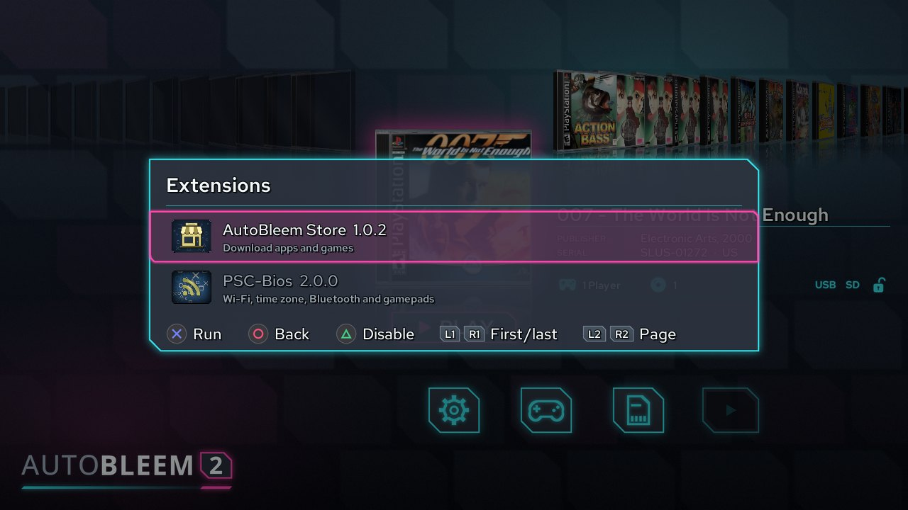

**La Boutique AutoBleem** est la première de ces extensions : un endroit où parcourir applications et jeux, et les
installer d'une seule pression, sur tous les systèmes où tourne AutoBleem. Une PlayStation Classic a besoin pour cela
du noyau AutoBleem, car c'est lui qui apporte le WiFi. Ouvrez-la depuis le menu rapide (*Boutique*, section 3.4). Elle
compte quatre onglets, que L1 et R1 permettent de parcourir.

Les onglets **Apps** et **Games** présentent ce que proposent les sources, chaque élément avec son image, sa version, sa
taille et la petite icône de la source dont il vient. L'onglet Apps présente aussi les applications PE, avec leur
licence et leur source, ainsi que les paquets de données de jeu (section 3.10). Ce que vous avez déjà installé porte le
badge *Installed*. La barre d'aide montre les boutons valables pour la ligne sélectionnée :

| Bouton | Dans les onglets Apps et Games |
|---|---|
| Cross | Installe l'élément - ou le met à jour, refait une tentative après un échec, ou annule un téléchargement en attente ou en cours. |
| Triangle | Supprime un élément installé par la Boutique. |
| Square | Actualise les listes à partir des sources. |
| L2 / R2 | Sautent à l'initiale précédente ou suivante. |
| Select | N'affiche qu'une source à la fois, quand vous voulez voir ce que propose une source en particulier. |
| Start | Recherche dans les titres. |

Une fois chargées, les images sont conservées : les listes s'affichent donc plus vite la fois suivante, et une image
qui n'a pas pu se charger peut être réessayée.

L'onglet **Downloads** montre ce qui est en cours de téléchargement, en attente, en échec ou installé, avec une barre
de progression qui avance régulièrement. Inutile de garder l'œil dessus : les téléchargements se poursuivent en
arrière-plan, y compris quand vous avez quitté la Boutique, et quand vous êtes ailleurs dans le lanceur une bulle
affiche le téléchargement en cours avec sa vitesse et le temps restant (par exemple `1.4 MB/s · 0:42`). Lancer un jeu ou
éteindre la machine ne fait que les mettre en pause, et un téléchargement interrompu reprend là où il s'était arrêté.
Si le réseau tombe, l'élément indique *Waiting for the network* et reprend où il en était dès que le réseau revient ;
au bout de 30 minutes sans réseau, il abandonne. Les téléchargements de plus de 2 Go fonctionnent sur toutes les
plateformes, y compris les versions 32 bits. Un jeu que vous installez apparaît sur l'étagère après l'analyse
suivante, avec l'image de la Boutique pour jaquette.

L'onglet **Sources** montre d'où viennent les listes, chacune avec son icône : le catalogue d'AutoBleem lui-même, toute
liste TSV déposée dans `System/Extensions/store/sources/`, et les adresses que vous ajoutez vous-même avec *Add a source
URL*. Cross sur une source que vous avez ajoutée vous permet de la renommer, de changer son adresse, de la faire passer
de `http://` à `https://` ou inversement, ou de la supprimer.

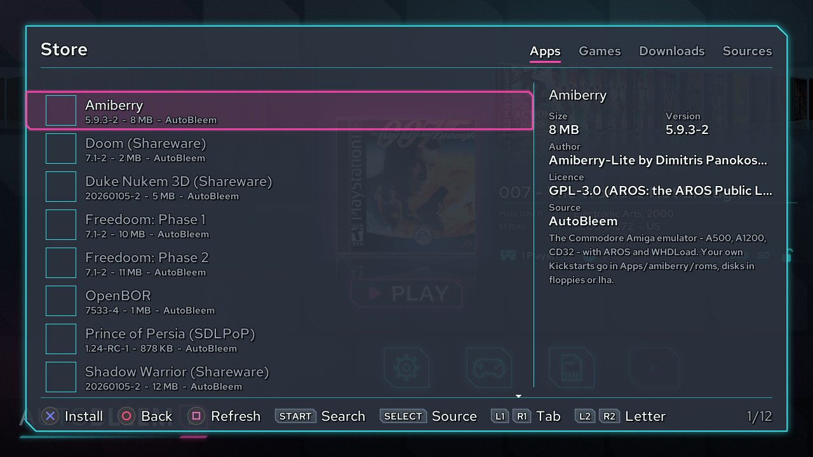

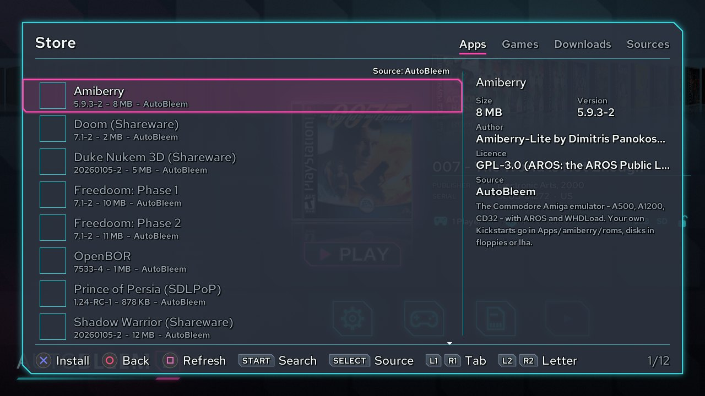

Le contenu du catalogue d'AutoBleem figure aussi sur le site de téléchargement, à l'adresse
`https://autobleem.retromenele.pl/store/`. Une source que vous ajoutez vous-même, c'est une autre affaire : **vous êtes
responsable du contenu des sources que vous ajoutez.**

**Vos propres jeux sur votre réseau.** Si vous gardez vos jeux PS1 sur un autre ordinateur de la maison, `abstored`, le
serveur local de la Boutique, peut les proposer à la Boutique par votre réseau : vous les installez alors comme
n'importe quel autre élément. Il tourne sur n'importe quelle machine Linux - un Raspberry Pi, un serveur domestique -
et se contente de lire le dossier, sans jamais le modifier. Lancez-le avec `abstored <dossier des jeux>`, puis ouvrez
`http://<cette machine>:8124/` dans un navigateur : la page montre ce qu'il partage et les problèmes qu'il a trouvés.
Dans la Boutique, ajoutez `http://<cette machine>:8124/store.tsv` comme source. Des programmes prêts à l'emploi pour
Linux et Windows se trouvent sur la page de la Boutique, dans son onglet **LAN server**, et `INSTALL-linux.md`
(`ext_store/server/` dans les sources) explique comment l'installer en tant que service. **LAN Share** (section 5.2)
place sur un tel serveur des jeux et des disques venant d'un PC.

### 3.14 Les processeurs d'analyse

Les processeurs d'analyse préparent vos jeux avant qu'AutoBleem ne les lise. Un processeur est un petit programme que
chaque analyse exécute en premier. Il peut convertir un format qu'AutoBleem ne lit pas en un format qu'il lit - en
décompressant un jeu zippé, par exemple - ou modifier les données d'un jeu, comme appliquer un patch de traduction.
Les processeurs se trouvent dans `System/Processors/<nom>/` sur la clé (sur un Raspberry Pi, sur sa partition de
données ; sous Windows, dans le dossier de données) ; pour en installer un, décompressez son dossier à cet endroit, et
l'analyse suivante l'exécutera.

**Unzip est fourni avec AutoBleem.** Il décompresse les jeux PS1 zippés de `Games/` avant que l'analyse ne les lise,
ainsi que les ROM zippées, une par une ; les jeux d'arcade restent zippés, car c'est ainsi que les cœurs d'arcade les
lisent. La mise à jour d'AutoBleem met aussi Unzip à jour, et si vous l'avez désactivé, il reste désactivé.

Un processeur ne fait son travail qu'une fois : quand il a traité un jeu, il n'y revient plus tant que le jeu ne change
pas. Pendant qu'un processeur travaille, la bulle en haut à droite indique ce qu'il fait, et un avertissement ou un
échec s'affiche sur la ligne du dessous ; le fichier `processors.log`, dans le dossier des journaux, donne les détails.
Lancer un jeu ou RetroArch arrête un processeur qui modifie des fichiers, pour laisser toute la machine au jeu, et
l'analyse suivante termine le travail.

Pour les gérer, ouvrez le menu système (**L2 + R2**) et choisissez *Processeurs d'analyse*. Ils s'affichent dans leur
ordre d'exécution, avec un onglet pour les jeux PS1 et un autre pour les ROM ; L1 et R1 passent d'un onglet à l'autre.
L'ordre compte : un processeur qui décompresse doit passer avant un processeur qui modifie ce qui a été décompressé.

| Bouton | Dans les processeurs d'analyse |
|---|---|
| Square | Saisit le processeur sélectionné, que Haut et Bas déplacent alors jusqu'à sa nouvelle place ; Square le repose. |
| Cross | Désactive le processeur, ou le réactive. |
| Triangle | Fait réexaminer tous les jeux au processeur lors de la prochaine analyse, y compris ceux qu'il a déjà traités. |
| Circle | Revient en arrière, et lance une analyse si vous avez changé quelque chose. |

Un processeur conçu pour une autre machine reste dans la liste, grisé : vous voyez qu'il est là, mais aussi qu'il ne
tourne pas ici.

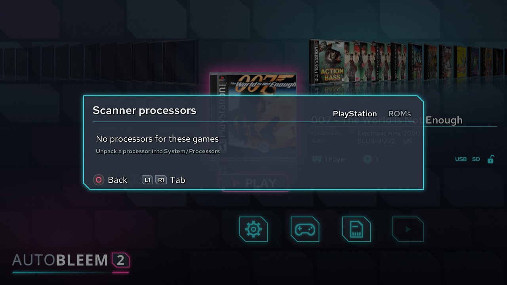

Si vous voulez écrire votre propre processeur, la page d'Unzip, `https://github.com/autobleem2/proc_unzip`, explique
tout ce qu'un processeur doit faire, et `tools/proc_check.py`, dans les sources d'AutoBleem, vérifie le vôtre avant
que vous ne le partagiez.

<!-- pagebreak -->

## 4. Les écrans

### 4.1 Le gestionnaire de jeux

Le gestionnaire de jeux est l'endroit où vous faites le ménage dans votre ludothèque PS1. Servez-vous-en pour
supprimer un jeu auquel vous ne jouez plus, pour ouvrir les réglages d'un jeu sans avoir à le chercher sur l'étagère,
ou pour qu'AutoBleem récupère de nouveau toutes les jaquettes. Ouvrez-le depuis le menu système (L2 + R2,
*Gestionnaire de jeux*). Pendant une analyse, il est grisé et attend qu'elle soit terminée.

L'écran s'intitule *Gestionnaire de jeux - choisir un jeu*. À gauche, tous vos jeux PS1 sont listés par titre, dans
l'ordre alphabétique ; à droite apparaissent la jaquette du jeu sélectionné, son éditeur, son année, son numéro de
série et le dossier où il se trouve. L'espace libre restant sur le support est affiché en haut à droite, pour que
vous voyiez combien de place une suppression vous rend. Haut et Bas parcourent la liste, L2 / R2 tournent la page et
L1 / R1 sautent au premier ou au dernier jeu.

- **Cross** ouvre le jeu sélectionné dans l'éditeur de jeu - le même que celui de l'icône Jeu sur l'étagère
  (section 3.7). Quand vous le quittez, vous retrouvez le même jeu dans la liste.
- **Square supprime le jeu.** AutoBleem vous demande d'abord confirmation, puis efface tout le dossier du jeu. Si les
  sauvegardes d'état et la carte mémoire du jeu ne servent à aucun autre jeu, il pose une seconde question : faut-il
  les supprimer aussi ? Répondez non si vous risquez de vouloir récupérer le jeu plus tard avec vos sauvegardes.
- **Triangle supprime toutes les images de jaquette** (PNG ou JPEG) placées à côté de vos jeux, après confirmation.
  C'est utile quand vous avez accumulé des jaquettes qui ne vous plaisent pas : l'analyse suivante reprend les
  jaquettes dans les bases de jaquettes.

Au bout de la liste, après les jeux, vous verrez peut-être des dossiers marqués *Non ajouté*. Ce sont des dossiers de
`Games` que l'analyse a examinés sans parvenir à en faire un jeu. Sélectionnez-en un, et la partie droite vous dit où
il se trouve et pourquoi il n'a pas été ajouté - un fichier cue manquant, par exemple (chapitre 7). Square supprime un
tel dossier après confirmation. Si vous quittez avec Circle après avoir changé quelque chose, AutoBleem analyse de
nouveau les jeux.

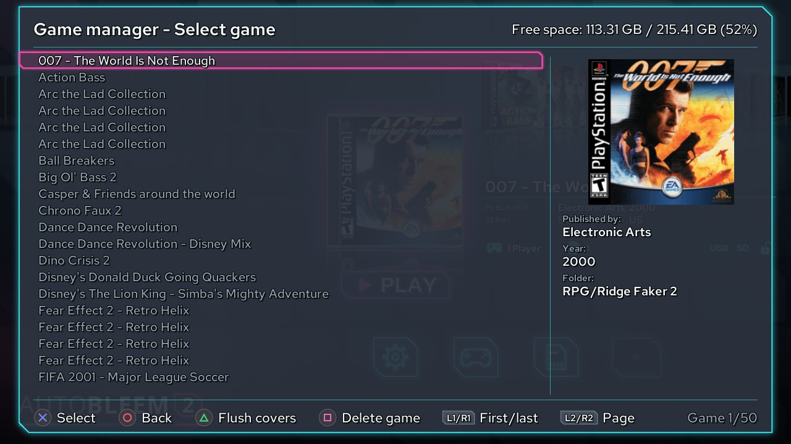

### 4.2 Informations matérielles

La page des informations matérielles est celle à consulter quand vous voulez savoir ce qu'est votre machine et ce
qu'elle voit : la place qui reste sur la clé, l'adresse réseau qu'elle a reçue, les pilotes d'affichage et de son
qu'elle utilise, les manettes branchées. C'est la même page sur toutes les plateformes, console comprise. Ouvrez-la
depuis le menu système (L2 + R2, *Informations matérielles*) ; Circle vous ramène au menu système.

La page présente le système, le matériel, le stockage avec son espace libre, les adresses réseau, les pilotes
d'affichage et de son, et les manettes branchées. Elle relit tout chaque seconde : vous pouvez donc la laisser
ouverte pendant que vous branchez une manette ou un câble, et voir le changement apparaître. Elle ne fait qu'afficher
- pour configurer le réseau ou une manette, passez par *Réseau et manettes* (PSC-Bios, chapitre 6).

La partie consacrée aux manettes répond à la question « quelle manette correspond à quel joueur ? ». Les deux
premières apparaissent comme *Joueur 1* et *Joueur 2* - les ports que leur attribue l'émulateur PS1. Toute manette
supplémentaire est indiquée comme *non utilisé par l'émulateur PS1*. RetroArch attribue les ports selon ses propres
réglages : dans un jeu RetroArch, l'ordre peut donc être différent. Inutile d'ouvrir cette page à chaque fois : dès
qu'une manette est branchée ou débranchée, le lanceur affiche brièvement quelle manette est désormais le joueur 1 et
laquelle est le joueur 2.

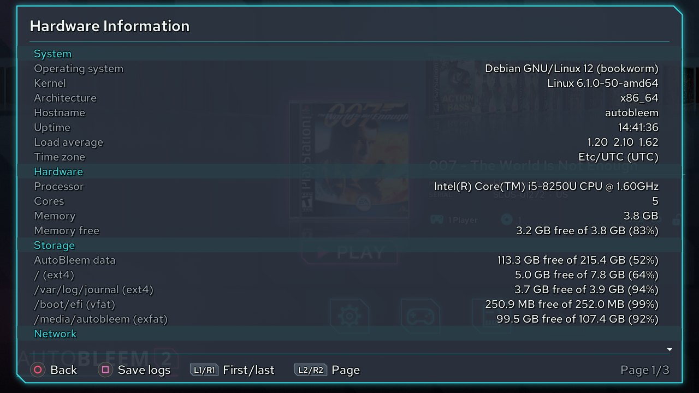

### 4.3 Le guide des touches

Si vous ne savez plus à quoi sert un bouton à tel ou tel endroit, appuyez sur **Triangle** depuis l'étagère. Le guide
des touches présente sur une seule page tous les boutons de tous les écrans : vous pouvez vérifier sans quitter le
lanceur. Si un clavier USB est branché, ou l'a été, une colonne *Clavier* indique la touche correspondante à côté de
chaque bouton de la manette.

Le guide vous rappelle aussi la seule chose à retenir pour tous les jeux : comment en sortir. Maintenez Select + Start,
ou Home, pendant 2 secondes pour revenir à AutoBleem ; un appui bref ouvre plutôt le menu de l'émulateur.

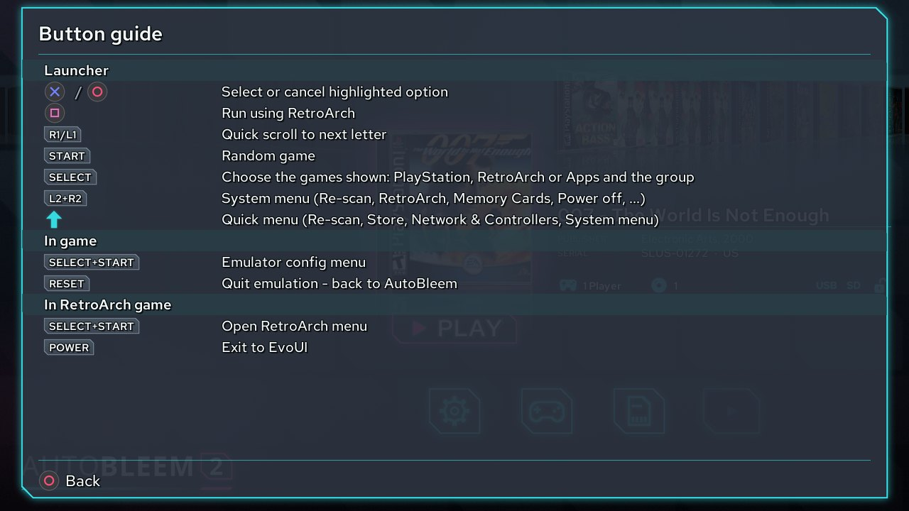

### 4.4 Le clavier virtuel

Chaque fois qu'AutoBleem a besoin que vous tapiez quelque chose - le nom d'un jeu de cartes mémoire, le titre d'un
jeu, un mot de passe WiFi, l'adresse d'une source de la Boutique -, c'est le même clavier virtuel qui apparaît, pour
que vous puissiez écrire avec la seule manette. Il est disposé comme celui d'un téléphone. En plus des lettres, il
offre une page de symboles, avec `/ \ : ? & = % @ #` et tout ce qu'il faut pour une adresse ou un mot de passe, ainsi
que deux pages de lettres accentuées. La rangée du bas regroupe Maj, la touche qui change de page, Espace, Retour
arrière et Valider.

Déplacez-vous sur les touches avec les directions et appuyez sur **Cross** pour taper celle qui est sous le curseur.
**Triangle** efface une lettre et **Square** tape une espace. **L1** fait office de Maj ; appuyez deux fois pour le
verrouillage des majuscules. **R1** passe à la page de touches suivante, et **L2 / R2** déplacent le curseur dans le
texte. **Start** valide ce que vous avez tapé et **Circle** annule. Si un clavier USB est branché, vous pouvez taper
dessus à tout moment : Entrée valide et Échap annule.

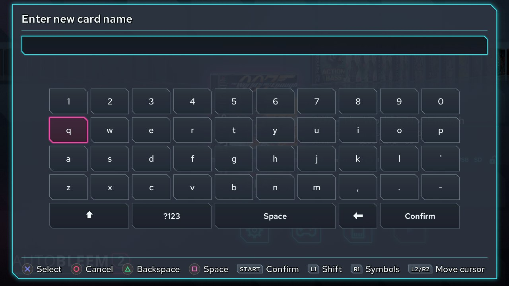

### 4.5 Manette virtuelle

Les applications - les programmes de la liste des applications, comme Doom ou Quake - ne lisent pas votre manette
elles-mêmes. Un petit programme auxiliaire, le démon de manette virtuelle, lit les vraies manettes et fournit à chaque
application une manette qu'elle comprend. Cette page vous montre quelles manettes ce programme voit et comment il les
lit. Consultez-la quand une application ne réagit pas à votre manette, ou que ses boutons sont mélangés. Ouvrez-la
depuis le menu système (L2 + R2, *Manette virtuelle*) ; Circle vous ramène au menu système.

Sous *Manettes vues par le démon*, chaque manette est listée avec un numéro et son nom. À côté, vous lisez trois
informations : si le démon a pu ouvrir la manette (*connectée*) ou non (*illisible*) ; le pilote par lequel elle est
arrivée ; et l'origine de la disposition de ses boutons - *de la base des manettes* signifie que la manette est connue
et que ses boutons sont à leur place, *devinée par le démon* signifie qu'elle est inconnue et que le démon a fait de
son mieux pour deviner. Si les boutons ne répondent pas comme il faut dans une application, une disposition devinée en
est probablement la cause.

Le démon ne tourne que pendant qu'une application tourne : la page l'interroge donc une fois, à son ouverture. Si vous
branchez une manette pendant que la page est ouverte, appuyez sur **Cross** (*Chercher à nouveau*) pour l'interroger de
nouveau. Sous Windows, ce programme n'existe pas, et la page indique *Absent de cette version*.


<!-- pagebreak -->

## 5. Sur le PC

### 5.1 UpdateRoms - rafraîchir une clé de console

Sur un Raspberry Pi, un PC ou Windows, l'analyse du lanceur range d'elle-même vos jeux RetroArch en listes et récupère
leurs jaquettes. La PlayStation Classic n'en est pas capable, faute de réseau. **UpdateRoms** fait donc ce travail sur
votre PC sous Windows : il utilise le réseau du PC, mais écrit tout avec les chemins qu'attend la console, si bien que
lorsque vous remettez la clé, la console démarre et trouve tout à sa place. Lancez-le chaque fois que vous avez ajouté
ou supprimé des jeux RetroArch sur une clé de console.

1. Copiez vos ROM sur la clé, dans `RetroArch/roms/<système>/` (section 3.10). Les noms de dossiers doivent être ceux
   des bases de données de RetroArch ; l'installateur a déjà créé les plus courants.
2. Lancez **`UpdateRoms\UpdateRoms.exe` depuis la clé** - l'installateur l'y a placé. Il détermine tout seul sur quelle
   clé il se trouve. Pendant qu'il travaille, une ligne indique ce qu'il fait, accompagnée d'une barre de progression
   et d'un journal.
   - Si la clé n'a pas encore de base de données RetroArch, il télécharge d'abord le paquet de bases de données de
     RetroArch. Il s'en sert ensuite pour identifier chaque ROM, de sorte qu'un jeu connu de la base reçoit son vrai
     nom.
   - Il écrit une playlist par système dans `RetroArch/bin/playlists/`, avec les chemins de la console. Ce que
     RetroArch a lui-même ajouté à ces listes est conservé.
   - Pour chaque ROM sans jaquette, il en récupère une sur les serveurs de vignettes de libretro, dans
     `RetroArch/bin/thumbnails/`.
3. Éjectez proprement la clé et remettez-la dans la console. L'onglet RetroArch du choix de la liste présente
   désormais tous les systèmes qui ont des jeux.

Vous pouvez le lancer aussi souvent que vous voulez : un dossier où rien n'a changé est ignoré, donc un deuxième
passage est rapide. En cas de problème, le journal se trouve dans `System/Logs/updateroms.log` sur la clé. Une carte de
Raspberry Pi insérée dans un lecteur de cartes peut être rafraîchie de la même manière, avec
`UpdateRoms.exe <lecteur> --target rpi`, même si un Pi le fait de lui-même quand il a un réseau.

### 5.2 LAN Share - vos jeux et vos disques sur le serveur de votre réseau

La Boutique peut installer des jeux depuis un serveur de votre réseau domestique (section 3.13). **LAN Share** est le
programme Windows qui alimente ce serveur depuis votre PC : il y place les jeux PS1 que vous avez sur le PC, et il sait
aussi lire un disque PS1 dans le lecteur CD/DVD du PC pour l'y mettre. Le serveur est un `abstored` qui tourne sur un
Raspberry Pi, un NAS ou un autre PC. Une fois qu'un jeu s'y trouve, la Boutique de la console, du Pi ou du PC peut
l'installer à partir de là.

Vous trouverez `LanShare.exe` sur la page de la Boutique, dans son onglet **LAN server**. Rien à installer : lancez-le,
il range ses réglages dans `%LOCALAPPDATA%\AutoBleem LAN Share\`.


1. **Se connecter au serveur.** Saisissez son adresse telle que la Boutique la connaît, `http://<son adresse>:<port>`,
   et appuyez sur **Connect**. Les jeux déjà présents sur le serveur, ainsi que les problèmes relevés par sa propre
   analyse, s'affichent à gauche. Pour déposer des jeux sur le serveur, LAN Share a besoin de l'un de ces deux accès :
   - **Share** est le dossier des jeux du serveur tel qu'il est partagé sur votre réseau (Samba), par exemple
     `\\raspberrypi\games`. LAN Share y copie les jeux et demande au serveur de lancer une analyse ; le serveur, lui,
     se contente toujours de lire son dossier.
   - **Token** est destiné à un serveur lancé avec `--allow-uploads`. Saisissez son jeton - le serveur l'affiche au
     démarrage et le garde dans `<state>/upload-token`. LAN Share envoie alors les jeux par HTTP, et un envoi
     interrompu en cours de route reprend là où il s'est arrêté.
2. **Publier les jeux de votre PC.** Choisissez le dossier où se trouvent vos jeux (un dossier par jeu), cochez ceux que
   vous voulez et appuyez sur **Publish the ticked games**. La colonne **On the server** vous dit si le serveur a déjà
   un jeu - elle compare le numéro de série, ou le titre s'il n'y a pas de numéro de série -, et un jeu que le serveur
   possède déjà n'est jamais envoyé deux fois. **Tick those not on the server** coche pour vous tous les autres.
3. **Publier un disque.** Insérez un disque PS1 dans le lecteur du PC et appuyez sur **Read a disc and publish it**. LAN
   Share lit tout le disque dans un `.bin` + `.cue`, nommé d'après le titre du jeu. Pour un jeu protégé par LibCrypt, il
   écrit aussi le fichier `.sbi`, si le lecteur sait lire le sous-canal. Si vous avez indiqué les bases de données
   (voir plus bas), il compare la copie à la copie de référence connue. Puis il publie le jeu. Pour un jeu sur
   plusieurs disques, cochez d'abord **The game has more than one disc** : LAN Share vous demande chaque disque
   suivant et les publie ensemble comme un seul jeu.
4. **Retirer des jeux du serveur.** Sélectionnez-les et appuyez sur **Remove from the server...**. Rien n'est effacé :
   chaque jeu est déplacé dans un dossier `.removed`, à côté des jeux du serveur, et il suffit de l'en sortir pour le
   remettre.

Les **Databases** sont facultatives. Si vous indiquez à LAN Share le dossier des jaquettes d'AutoBleem
(`coversU/P/J.db`) et le fichier `Sony - PlayStation.rdb` de RetroArch, il s'en sert pour nommer les jeux et pour
vérifier un disque qu'il a lu.

Si vous préférez ne rien copier, cochez **Also share the games on this PC with the Store** (décoché par défaut) : LAN
Share sert alors directement à la Boutique le dossier de jeux de votre PC. La première fois, Windows vous interroge
sur son pare-feu - n'autorisez que les réseaux privés.

<!-- pagebreak -->

## 6. Les outils de la console (PlayStation Classic)

Deux outils accompagnent une clé de PlayStation Classic et vous aident à aller plus loin que ce que la console sait
faire d'origine. Tous deux ressemblent au reste du lanceur, avec son thème et sa langue, et se pilotent à la manette -
l'assistant de configuration des manettes aussi avec les boutons en façade de la console. **PSC-Bios** est une
extension fournie avec le paquet de la console : c'est elle que l'élément *Réseau et manettes* ouvre dans le menu
rapide et dans le menu système, et vous la trouvez aussi dans la liste des extensions. **ABFlashKit** est une
application, dans la liste des applications.

### 6.1 PSC-Bios

PSC-Bios, c'est là que vous reliez la machine au monde extérieur : votre réseau WiFi, le fuseau horaire, les manettes
Bluetooth, et la disposition des boutons d'une manette qu'AutoBleem ne connaît pas. Il est fourni avec le paquet de la
console et existe aussi sur un Raspberry Pi et la clé PC. Ouvrez-le avec *Réseau et manettes* dans le menu système (ou
le menu rapide), ou depuis la liste des extensions. Si l'extension est installée mais désactivée, l'élément *Réseau et
manettes* est grisé et indique qu'elle *est désactivée - activez-la dans Extensions* ; appuyez sur Cross dessus et la
liste des extensions s'ouvre sur PSC-Bios, pour que vous puissiez la réactiver.

Le premier écran donne une vue d'ensemble : l'heure et le fuseau horaire, les cartes réseau (WiFi, Ethernet,
Bluetooth) avec leurs adresses, et chaque manette branchée, avec la mention de l'existence ou non d'une configuration
de ses boutons. Sur la console, les parties réseau et Bluetooth demandent le noyau AutoBleem (section 6.2) ; sur un
Raspberry Pi ou la clé PC, elles s'appuient sur les outils du système. L'assistant de configuration des manettes
fonctionne partout.

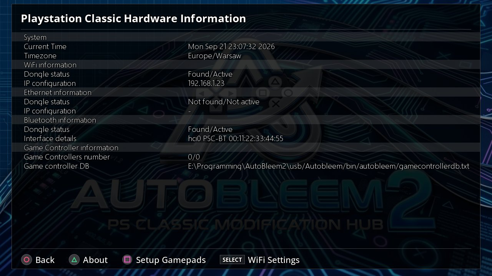

Depuis le premier écran, chaque partie s'ouvre d'un bouton :

| Bouton | Ce qu'il ouvre |
|---|---|
| Select | **Wi-Fi Network** vous connecte à votre WiFi (par le noyau, ou par NetworkManager sur un Pi ou un PC) : tapez le nom du réseau ou choisissez-le dans une recherche, saisissez le mot de passe, choisissez le mode du pilote et appuyez sur *Apply / Restart Network*. C'est aussi là que vous réglez le fuseau horaire, et une fois connecté, vous voyez l'adresse IP de la console. |
| Square | **Bluetooth Controllers** recherche les manettes Bluetooth comme la DualShock 4, pour que vous puissiez en appairer une nouvelle ou supprimer celle qui ne vous sert plus. |
| L1 | **DualShock 3 Pairing** connecte votre première DualShock 3, qui doit pour cela être branchée en USB, à l'aide du module sixaxis du noyau. |
| R1 | **Controller Mapping** ouvre l'assistant de configuration des manettes, décrit plus bas. |
| Triangle | **About** présente PSC-Bios. |
| Circle | **Back** vous fait sortir de PSC-Bios et vous ramène au lanceur. |

**L'assistant de configuration des manettes.** Servez-vous-en quand une manette ne fait rien dans AutoBleem ou que ses
boutons ne sont pas au bon endroit. Il montre la manette branchée telle qu'elle est réellement - chaque axe, chaque
bouton et chaque chapeau sous forme de numéros - ainsi qu'une image de DualShock qui s'allume au fil de vos appuis.
Comme on ne peut pas encore se fier à la manette que vous testez, c'est avec les **boutons en façade** de la console que
vous pilotez l'assistant : **RESET** passe à la manette suivante, **OPEN** lance la configuration et **POWER** annule
ou quitte. Pendant la configuration, l'assistant vous demande les boutons l'un après l'autre : appuyez sur le bouton
allumé sur l'image, ou sur OPEN si votre manette n'a pas ce bouton. Un appui bref est enregistré normalement.

Vous pouvez aussi quitter depuis la manette : maintenez Circle pendant 2 secondes - une barre se remplit et le pied de
page indique *Hold 2 s: Exit*. Tant que la manette n'a pas encore de configuration, maintenir n'importe quel bouton
pendant 2 secondes produit le même effet (*Hold any button 2 s: Exit*). Au clavier, Échap, Espace et Entrée
remplacent POWER, RESET et OPEN.

À la fin, la nouvelle configuration est mise en service pour que vous puissiez l'essayer, et OPEN l'enregistre sous le
nom de votre choix. Le lanceur la charge ensuite à chaque démarrage.

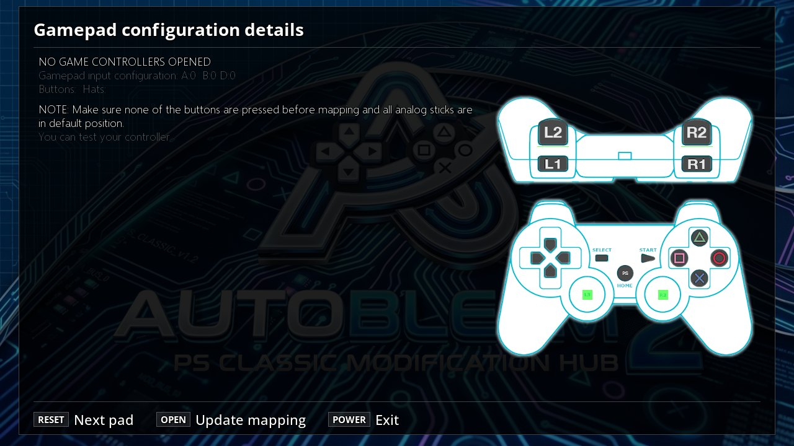

### 6.2 ABFlashKit - le noyau AutoBleem

Le noyau AutoBleem remplace le noyau Linux de la console, et il est facultatif. Il vous intéressera si vous attendez
davantage de la console : il lui donne une horloge qui fonctionne, fait marcher les dongles WiFi et Bluetooth USB (pour
PSC-Bios et les manettes Bluetooth) et ajoute la prise en charge des boutons en façade dont l'émulateur se sert pour
les points de reprise. ABFlashKit est l'outil qui l'installe. Il commence par sauvegarder la console, et il sait aussi
la remettre dans son état d'origine grâce à la restauration de Sony.

> **Cet outil écrit dans la mémoire flash de la console.** Si l'écriture est interrompue - coupure de courant, clé
> retirée -, la console risque de ne plus démarrer, et l'installation d'un noyau personnalisé annule sa garantie.
> Laissez la console alimentée et la clé en place jusqu'à ce que la console redémarre d'elle-même. ABFlashKit s'ouvre
> sur cet avertissement : *I understand* pour continuer, *Quit* pour sortir.

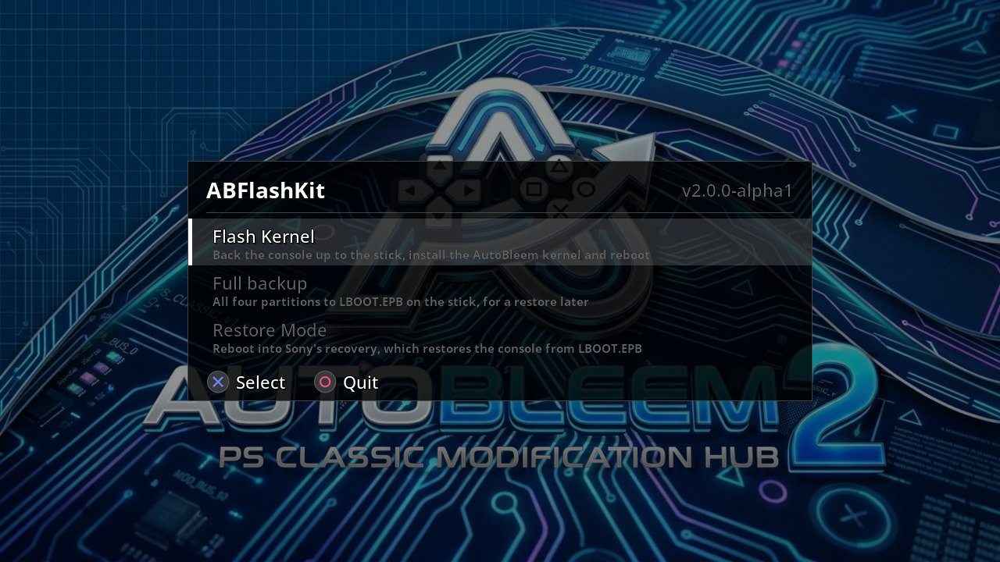

ABFlashKit propose trois actions :

- **Flash Kernel** installe le noyau. S'il n'y a pas encore de sauvegarde de restauration sur la clé, il commence par
  en faire une des partitions de la console (`LBOOT.EPB`). Il vérifie la sauvegarde et l'image du noyau, écrit le noyau
  et les fichiers système d'AutoBleem, puis redémarre la console. Quand il affiche *All done - when the screen goes
  black replace power cord*, attendez que l'écran devienne noir, puis débranchez le câble d'alimentation de la console
  et rebranchez-le.
- **Full backup** enregistre les quatre partitions de la console dans `LBOOT.EPB`, pour que vous puissiez les
  restaurer plus tard. S'il existe déjà une sauvegarde, il vous demande avant de l'écraser.
- **Restore Mode** permet de revenir au firmware d'origine. Il vérifie que la sauvegarde présente sur la clé est bien
  d'origine, active l'indicateur de restauration et redémarre dans la restauration de Sony, qui remet la console en
  état à partir de `LBOOT.EPB`.

Une barre de progression sous chaque étape montre où en est l'opération. ABFlashKit refuse de flasher une console qui
fait tourner un autre firmware personnalisé, comme BleemSync ou Project Eris : remettez d'abord cette console dans son
état d'origine.

**Se connecter depuis un PC.** Si vous connaissez Linux et voulez regarder sous le capot de la console, vous pouvez
vous y connecter depuis un PC à l'aide d'un câble USB. Il faut pour cela le noyau AutoBleem ; cela ne fonctionne pas
sur une console d'origine.

1. Reliez le port micro-USB de la console au PC avec un câble USB. Le PC voit la console comme une nouvelle carte
   réseau, et vous trouvez l'adresse de la console dans les paramètres de cette carte, sur le PC.
2. Connectez-vous avec `ssh root@<adresse de la console>`. Le mot de passe par défaut est `autobleem`.

Au lieu du mot de passe, vous pouvez utiliser une clé. Placez votre clé publique dans le fichier
`System/ssh/authorized_keys` de la clé USB et redémarrez la console : au démarrage suivant, elle est ajoutée au compte
root. Mettre à jour ou réinstaller le lanceur ne la supprime pas.

> **Le mot de passe par défaut est le même sur toutes les consoles** : n'importe qui pouvant brancher un câble sur la
> vôtre peut donc se connecter en root. Utilisez une clé quand c'est possible, et ne laissez pas une console avec le
> mot de passe par défaut à la portée d'autres personnes.

<!-- pagebreak -->

## 7. En cas de problème

La plupart des problèmes ont une cause toute simple. Ci-dessous, chacun commence par ce que vous voyez, explique
pourquoi cela arrive, puis ce qu'il faut faire. Si vous devez demander de l'aide, on vous réclamera d'abord les
journaux : c'est donc par eux que l'on commence.

**Trouver les journaux.** Pendant qu'il tourne, AutoBleem garde ses journaux en mémoire, pour ne pas écrire sans cesse
sur la clé. Ils ne sont copiés dans `System/Logs/`, sur la clé, la carte ou le dossier de données, que si quelque chose
s'est mal passé : quand le lanceur, un jeu PS1 ou RetroArch plante, les journaux sont enregistrés dans
`System/Logs/crash-<n>/` (les trois derniers plantages sont conservés), et le lanceur vous le signale une fois à son
retour. Si vous traquez un problème qui n'est pas un plantage, gardez tous les journaux : activez Options →
*Diagnostic* → *Garder les journaux sur la clé* (effectif à partir du démarrage suivant), ou créez depuis un PC un
fichier vide `System/Logs/keep`. La page *Informations matérielles* (section 4.2) indique aussi où se trouvent les
journaux, et Square y enregistre ceux du moment dans `System/Logs/saved-<n>/`.

Voici les fichiers que vous y trouverez :

| Fichier | Ce qu'il vous apprend |
|---|---|
| `autobleem.log` | Ce que le lanceur lui-même a fait. |
| `launch.log`, `pcsx.log` | Comment un jeu PS1 a été lancé, et ce que l'émulateur a dit pendant qu'il tournait. |
| `retroarch.log` | Ce que RetroArch a dit pendant qu'il tournait. |
| `update.log` | Comment s'est passée une mise à jour en ligne ; il est toujours conservé sur la clé. |
| `updateroms.log` | Comment s'est passé UpdateRoms sur le PC (chapitre 5) ; il est toujours conservé sur la clé. |

**Une image vous demande de brancher la clé, ou la console s'est mise en veille.** AutoBleem ne trouve pas sa clé :
aucune n'était branchée au démarrage de la console, ou elle a été retirée. Branchez-la sur n'importe quel port USB (de
préférence en façade, section 2.1) avant la fin des 5 minutes, ou appuyez sur Power. Si la clé n'a pas été retirée
proprement, AutoBleem la vérifie d'abord - attendez que la barre de progression arrive au bout.

**RetroArch indique *a besoin d'une bibliothèque système plus récente que celle de cette console*.** Ce RetroArch a été
compilé pour un système plus récent que celui de la console : il ne peut donc pas y tourner. Utilisez le RetroArch
fourni avec AutoBleem.

**Un jeu indique qu'il *est protégé par sa licence PSN et ne peut pas être lancé*.** Les jeux achetés sur le
PlayStation Network sont liés à leur licence, et AutoBleem ne peut pas les faire tourner. Il n'y a rien à réparer.

**Un jeu n'apparaît pas sur l'étagère.** Le plus souvent, son dossier n'est pas organisé comme l'analyse l'attend.
Vérifiez que chaque jeu a son propre dossier et qu'il est dans l'un des formats de la section 3.10. Le *Gestionnaire de
jeux* (section 4.1) liste, après les jeux, les dossiers que l'analyse a refusés, marqués *Non ajouté*, et explique
pourquoi chacun a été refusé ; Square supprime un tel dossier. Une fois un dossier corrigé, *Ré-analyser les jeux* dans
le menu système relance l'analyse.

**Les jeux n'ont pas de jaquette.** Soit les bases de jaquettes n'ont pas été installées - relancez l'installateur en
les cochant -, soit, pour les jeux RetroArch sur une console, UpdateRoms n'a pas encore été lancé sur le PC
(chapitre 5).

**Une manette ne fait rien, ou ses boutons sont mélangés.** AutoBleem ne connaît pas la disposition de cette manette.
Sur une console, configurez-la avec l'assistant de configuration des manettes de PSC-Bios (section 6.1). Sur un Pi ou
un PC, la page des informations matérielles (section 4.2) montre ce que le système voit de la manette, ce qui vous
permet de savoir si elle est seulement détectée.

**L'écran reste noir après un jeu sur la console.** L'image du lanceur n'est pas revenue à la fin du jeu. AutoBleem
reconstruit sa fenêtre de lui-même, jusqu'à trois fois. Si l'écran reste malgré tout noir, maintenez le bouton Power
enfoncé, puis rallumez la console.

**Sur un Raspberry Pi**, vous pouvez passer derrière le lanceur en cas de besoin : `Alt+F2` vous donne une invite de
connexion sur la deuxième console, et SSH est activé dès le premier démarrage. `sudo journalctl -u autobleem` montre ce
qu'a fait le service du lanceur, et `sudo systemctl restart autobleem` le redémarre. Si le premier démarrage n'a pas pu
aller jusqu'au bout faute de réseau, il réessaie au démarrage suivant.

**Sous Windows**, `Esc` quitte le lanceur. Votre dossier de données est celui que vous avez choisi à l'installation
(`Documents\AutoBleem` si vous ne l'avez pas changé), et les journaux se trouvent dans son dossier `System\Logs`.

**La console redémarre en boucle après une mise à jour en ligne (clé formatée en ext4).** Certains formatent la clé en
ext4, le système de fichiers de Linux, au lieu du FAT32 ou de l'exFAT. Jusqu'à la prochaine version d'AutoBleem, une
mise à jour en ligne sur une telle clé décompresse tous les fichiers sans la permission qui leur permet de s'exécuter
comme des programmes. AutoBleem ne peut alors plus démarrer, et la console redémarre sans fin. Les clés en FAT32 et en
exFAT ne sont pas concernées. Il y a deux façons d'y remédier.

**Solution A** : il vous faut un PC sous Linux. Branchez-y la clé et rendez de nouveau exécutables les programmes
d'AutoBleem. Remplacez `/media/USER/STICK` par votre propre point de montage ; la dernière ligne ne sert que si RetroArch
est installé :

```
chmod +x /media/USER/STICK/Autobleem/*.sh /media/USER/STICK/Autobleem/rc/*.sh
chmod +x /media/USER/STICK/Autobleem/bin/autobleem/* /media/USER/STICK/Autobleem/bin/emu*/pcsx-ab /media/USER/STICK/Autobleem/bin/abpad/abpadd
chmod +x /media/USER/STICK/RetroArch/bin/retroarch
```

**Solution B** : réinstallez la dernière version d'AutoBleem sur la clé, comme à la section 2.1. L'installateur a
besoin d'un PC capable de lire la clé. Si le vôtre n'y arrive pas, il faut d'abord formater la clé, ce qui efface tout
ce qu'elle contient - copiez vos jeux ailleurs avant de le faire.

> Pour éviter ce problème, utilisez le **FAT32** (une console d'origine ne lit que le FAT32 ; l'exFAT demande le noyau
> AutoBleem, chapitre 6). La prochaine version conserve les permissions, et AutoBleem les répare à chaque démarrage.

AutoBleem est un logiciel libre (GNU GPL v3 ou ultérieure) et il est fourni sans aucune garantie. Pour obtenir de
l'aide et suivre l'actualité, rejoignez le serveur Discord indiqué sur l'écran À propos, ou rendez-vous sur
https://autobleem.retromenele.pl/.
