# AutoBleem 2 - Podręcznik użytkownika

AutoBleem 2 to launcher gier dla **PlayStation Classic**, a od wersji 2 także dla **Raspberry Pi**, **komputera
uruchamianego z pendrive'a** i **Windows**. Twoje gry z PS1 pokazuje jak pudełka ustawione na półce - z okładkami
i opisami - i uruchamia je w dołączonym emulatorze PCSX. Jeśli obok zainstalujesz RetroArch, zagrasz też w gry z
innych konsol. Ten podręcznik prowadzi przez instalację na każdej platformie, codzienne korzystanie z AutoBleem i
narzędzia, które przychodzą razem z nim.

> Pliki do pobrania na każdą platformę znajdziesz na **https://autobleem.retromenele.pl/**. Strona jest
> podzielona według platform: to, co pobierasz, jest w panelu *Install* danej platformy, a *Build inputs* pod
> nim to pliki, które instalatory ściągają same.

## 1. Co dostajesz

AutoBleem zamienia PlayStation Classic - albo Raspberry Pi, stary komputer czy Twój pecet z Windows - w małą
konsolę z porządnym menu do Twoich własnych gier. W zestawie jest:

- **Launcher.** To jego widzisz po włączeniu: rząd okładek, które przewijasz, a obok wybranej gry jej opis.
  Stąd uruchamiasz gry, dzielisz je na zestawy (PlayStation, RetroArch, Aplikacje), zmieniasz ustawienia,
  zarządzasz kartami pamięci i stanami gry oraz pobierasz aplikacje i gry ze Sklepu. Na każdej platformie
  wygląda i działa tak samo.
- **Dwa emulatory PS1.** `pcsx-abnxt` jest nowszy i to on działa domyślnie; `pcsx-ab` to klasyczny emulator,
  który AutoBleem ma od zawsze. Wybierasz między nimi w opcjach. Oba korzystają z tych samych ustawień i kart
  pamięci, więc możesz się przełączać w każdej chwili i niczego nie stracisz.
- **RetroArch** - jeśli chcesz grać także w gry z innych systemów: NES, SNES, Mega Drive, Game Boy, automaty i
  wiele innych. Na każdej platformie jest opcjonalny. Wgrywasz swoje ROM-y, a AutoBleem sam układa je w listy i
  uruchamia każdą grę z właściwym rdzeniem. Gry z PlayStation też mogą działać w RetroArch - jego rdzeń
  *PlayStation 1* jest na samej górze listy rdzeni (punkt 3.9). Gry takie jak Doom działają z Twoich własnych
  plików gry, umieszczonych w folderze `Packages` (punkt 3.10).
- **Narzędzia konsoli.** *PSC-Bios* - w menu nazywa się *Sieć i kontrolery* - ustawia WiFi, zegar, pady
  Bluetooth i mapowanie przycisków, i to nie tylko na konsoli, ale też na Raspberry Pi i pendrivie dla PC.
  *ABFlashKit* instaluje na PlayStation Classic jądro AutoBleem (rozdział 6).
- **UpdateRoms** dla Windows. PlayStation Classic nie ma własnej sieci, więc ten program na PC odświeża listy
  gier RetroArch i pobiera okładki na pendrive konsoli, gdy jest on podłączony do komputera.

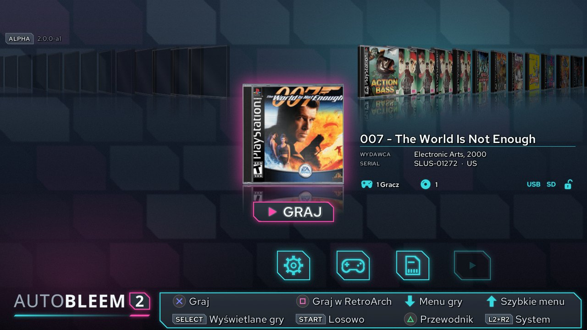

<!-- pagebreak -->

## 2. Instalacja

### 2.1 PlayStation Classic

AutoBleem działa w całości z pendrive'a. Wewnątrz konsoli nic się nie zmienia: wyjmiesz pendrive i konsola
działa dokładnie tak jak przedtem. Potrzebujesz komputera z Windows, pendrive'a (USB 2.0, co najmniej 8 GB) i
samej konsoli.

Pendrive nie musi być pusty i **nie zostanie sformatowany**, dopóki sam o to nie poprosisz: AutoBleem instaluje
się obok tego, co już na nim jest, a pendrive, którego używasz z AutoBleem 1.0, zostanie zaktualizowany na
miejscu (o tym niżej). Dla konsoli w stanie fabrycznym pendrive musi mieć system plików **FAT32**, bo jej
oryginalne jądro nie czyta exFAT. Po zainstalowaniu jądra AutoBleem (ABFlashKit, rozdział 6) konsola uruchomi
się też z pendrive'a exFAT - i znika wtedy ograniczenie FAT32 do 4 GB na jeden plik.

1. Pobierz **AutoBleemInstaller-<wersja>.zip** z panelu PlayStation Classic na stronie i rozpakuj go gdziekolwiek.
   W środku są `AutoBleemInstaller.exe` i plik README. Sam AutoBleem pobiera się dopiero w trakcie instalacji,
   więc komputer musi mieć dostęp do internetu.
2. Podłącz pendrive i uruchom `AutoBleemInstaller.exe`. Wybierz **kanał**: *Release* to wersja sprawdzona i
   najlepszy wybór dla większości osób, *Testing* to następna wersja w trakcie testów, a *Nightly* to najnowsza
   wersja rozwojowa, która może nie działać. Potem wybierz literę pendrive'a. Wiersz poniżej mówi, którą wersję
   AutoBleem zaraz zainstalujesz i co jest teraz na pendrivie: nowa instalacja (pozostałe pliki na pendrivie
   zostają nietknięte) albo AutoBleem w starszej wersji, który zostanie zaktualizowany (Twoje gry, zapisy,
   karty pamięci i ustawienia zostają).
   **Formatować nie trzeba.** Przycisk **Format** obok napędu przydaje się tylko przy całkiem nowym pendrivie
   bez systemu plików, przy takim, którego konsola nie odczyta (na przykład NTFS), albo gdy chcesz go
   wyczyścić do zera. Najpierw pyta, a potem kasuje wszystko, co jest na pendrivie. Wybierz tam FAT32, chyba że
   konsola ma już jądro AutoBleem.
   Następnie zaznacz, co ma zostać zainstalowane:
   - **Bazy okładek** - okładki i opisy całej biblioteki PS1, dzięki którym Twoje gry same dostaną swoje
     okładki (zaznaczone domyślnie; około 300 MB).
   - **RetroArch** - RetroArch z rdzeniami, dodatkowymi aplikacjami (Doom, Quake, Amiga...) i plikami libretro,
     do gier z innych systemów. Domyślnie wyłączony; możesz go dodać później, uruchamiając instalator jeszcze raz.
   - **Pliki BIOS** - pliki BIOS, których niektóre rdzenie RetroArch potrzebują do startu (tylko z RetroArch).
   - **Przykładowe gry** - kilka darmowych gier homebrew, żeby przy pierwszym uruchomieniu półka nie była pusta.
3. Naciśnij **Install** i poczekaj. Paski postępu i dziennik pokazują każdy krok. Na koniec pendrive dostaje
   nazwę `SONY` i kopię programu `UpdateRoms` (rozdział 5).
4. Bezpiecznie odłącz pendrive, włóż go do **drugiego przedniego portu USB** konsoli (prawego, gracza 2) -
   pierwszy zostaje wolny dla pada - i włącz konsolę. Zamiast oryginalnego menu uruchomi się AutoBleem. Drugi
   pad podłączysz przez hub USB w przednim porcie albo przez Bluetooth.

**Włączanie i wyłączanie.** Z włożonym pendrivem konsola startuje, przez kilka sekund miga diodą, kiedy
wykrywa AutoBleem, a potem przechodzi w czuwanie, zanim cokolwiek pojawi się na ekranie. Tak ma być: AutoBleem
uruchamia się przez mechanizm aktualizacji samej konsoli, a ten mechanizm właśnie tak działa. Naciśnij raz
**Power** i pojawi się launcher.

Gdy w menu systemowym wybierzesz *Wyłączanie* albo naciśniesz przycisk Power na konsoli, konsola przejdzie w
**czuwanie AutoBleem**: AutoBleem najpierw bezpiecznie odłącza pendrive, a potem dioda zmienia kolor na
**pomarańczowy** - to znak, że wszystko poszło jak trzeba. Kolejne naciśnięcie Power przywraca launcher w kilka
sekund. **Gdy dioda świeci na pomarańczowo, możesz wyjąć pendrive** i włożyć go do komputera; Windows nie
będzie proponował sprawdzania dysku, bo pendrive został odłączony poprawnie. Przed naciśnięciem Power włóż go z
powrotem. Jeśli wyjmiesz wtyczkę zasilania konsoli, następnym razem znów przejdzie przez czuwanie startowe.
Dioda **czerwona** oznacza, że konsola jest naprawdę wyłączona.

**Port z tyłu.** Port micro-USB z tyłu to gniazdo zasilania konsoli. Z jądrem AutoBleem przyjmie też urządzenie
USB, ale miejsce pendrive'a jest w przednim porcie.

**Gdy pendrive'a nie ma.** Jeśli konsola wystartuje bez pendrive'a albo wyjmiesz go w trakcie działania
AutoBleem, na ekranie pojawi się obrazek z prośbą o jego włożenie - nadaje się do tego każdy port USB.
AutoBleem czeka 5 minut, a potem usypia konsolę; jeśli chcesz, żeby zasnęła od razu, naciśnij Power.


**Gdy pendrive jest sprawdzany.** Jeśli pendrive nie został poprawnie odłączony - wyjęto go w czasie działania
AutoBleem albo zabrakło prądu - AutoBleem przed ponownym użyciem sprawdza go pod kątem błędów: przy starcie, po
wybudzeniu albo po ponownym włożeniu. Pasek postępu pokazuje, jak daleko zaszło sprawdzanie. Na dużym
pendrivie może to chwilę potrwać; pozwól mu dokończyć i nie wyłączaj w tym czasie konsoli.


**Aktualizacja.** Żeby zaktualizować pendrive, uruchom na nim instalator jeszcze raz - przycisk ma wtedy napis
*Update*. Instaluje najnowszą wersję z wybranego kanału; Twoje gry, zapisy, ustawienia i zawartość RetroArch
zostają, wymieniane są tylko pliki samego AutoBleem. Konsola z jądrem AutoBleem i WiFi potrafi też
zaktualizować się sama (punkt 3.12).

**Przejście z AutoBleem 1.0 (albo AutoBleem-NG).** Używasz tego samego instalatora na tym samym pendrivie, bez
formatowania:

1. Najpierw skopiuj cały pendrive na komputer jako kopię zapasową - na wszelki wypadek.
2. Podłącz go, uruchom `AutoBleemInstaller.exe`, wybierz kanał i napęd. **Nie** naciskaj Format.
3. Naciśnij **Install**. Instalator przeniesie stary układ plików na nowy: RetroArch, ROM-y i motywy trafią tam,
   gdzie spodziewa się ich AutoBleem 2, a stare foldery ROM-ów (`nes`, `snes`...) dostaną nazwy systemów z
   RetroArch. Twoje gry, stany gry, karty pamięci, ROM-y i zapisy RetroArch zostają, tak samo jak plik
   `config.ini` - zmienia się w nim tylko emulator PS1, na pcsx-abnxt.
4. Włóż pendrive z powrotem do konsoli. Pierwsze skanowanie odbuduje listę gier i playlisty. Okładki do gier
   RetroArch pobierzesz, uruchamiając UpdateRoms na komputerze (rozdział 5).

> Konsola w stanie fabrycznym nie ma zegara ani sieci. Daty pojawiają się dopiero po zainstalowaniu jądra
> AutoBleem (rozdział 6), a okładki gier RetroArch pobiera UpdateRoms na komputerze (rozdział 5).

Gry z PS1 wgrywasz do folderu `Games` na pendrivie, każdą do osobnego folderu - jak to ułożyć, wyjaśnia punkt
3.10.

### 2.2 Raspberry Pi

Z AutoBleem Raspberry Pi staje się małą konsolą: startuje prosto do launchera, bez pulpitu po drodze. Na
stronie są dwa gotowe obrazy karty, 32- i 64-bitowy, oraz paczka do Raspberry Pi OS Lite, które już masz.

| Model | Obraz 32-bitowy | Obraz 64-bitowy | Uwagi |
|---|---|---|---|
| Raspberry Pi 5 | tak | tak | |
| Raspberry Pi 4 Model B, Pi 400 | tak | tak | |
| Raspberry Pi 3 Model B / B+ / A+ | tak | tak | wystarczy do launchera i PS1 |
| Raspberry Pi Zero 2 W | tak | tak | 512 MB RAM: PS1 działa, cięższe rdzenie RetroArch już nie |
| Raspberry Pi 2 Model B | tak | tylko v1.2 | za wolne na cokolwiek w 3D |
| Raspberry Pi 1, Zero, Zero W | nie | nie | ARMv6 - żaden obraz na nich nie ruszy |

**Do gier z PS1 wybierz obraz 32-bitowy.** Szybki rekompilator ARM klasycznego `pcsx-ab` istnieje tylko w
wersji 32-bitowej, więc w wersji 64-bitowej gry z PS1 chodzą wolniej. Obraz 64-bitowy ma za to więcej rdzeni
RetroArch - wybierz go, jeśli inne systemy są dla Ciebie ważniejsze niż PS1.

**Przez Raspberry Pi Imager:**

1. Zainstaluj Raspberry Pi Imager (raspberrypi.com/software). W *Choose OS* wybierz *Use custom* i pobrany plik
   `autobleem-<wersja>-rpi-armhf.img.xz` (32 bity) albo `-arm64.img.xz` (64 bity) - albo dodaj w ustawieniach
   programu adres repozytorium i wybierz AutoBleem z listy. Każdy kanał ma swój adres:
   `https://autobleem.retromenele.pl/rpi-imager/os_list.json` dla najnowszego wydania,
   `.../os_list-testing.json` dla wersji w testach i `.../os_list-nightly.json` dla najnowszej wersji
   rozwojowej. Zakładka Raspberry Pi na stronie pobierania pokazuje te, które istnieją, każdy z przyciskiem
   *Copy*.
2. Na ekranie dostosowania w Imagerze (ikona zębatki albo pytanie po *Next*) ustaw **nazwę użytkownika i hasło,
   sieć WiFi i kraj oraz włącz SSH**. Przy pierwszym starcie AutoBleem potrzebuje sieci.
3. Zapisz kartę, włóż ją do Pi z podłączonym ekranem i klawiaturą albo padem i włącz zasilanie.

**Pierwsze uruchomienie** trwa od 5 do 25 minut, a ekran na bieżąco mówi, co się dzieje. Jeśli nie ma sieci,
AutoBleem o nią poprosi: wybierz swoje WiFi z listy i wpisz hasło. Potem zapyta, czy zainstalować RetroArch -
jeśli nie odpowiesz w ciągu minuty, zainstaluje go. Następnie powiększa partycję systemową, z reszty karty robi
partycję `AUTOBLEEM` na Twoje gry, instaluje RetroArch z rdzeniami, paczki BIOS i przykładowe gry, a na koniec
uruchamia się ponownie prosto do launchera.

Jeśli wolisz nie odpowiadać na pytania przy pierwszym starcie, wpisz odpowiedzi wcześniej do pliku
**`autobleem.txt`** na partycji startowej karty - otworzysz go i zmienisz na każdym komputerze:

| Klucz | Domyślnie | Do czego służy |
|---|---|---|
| `root_gib` | 8 | Wielkość partycji systemowej w GiB; reszta karty staje się partycją na gry. |
| `hdmi_mode` | 1920x1080@60 | Tryb obrazu przez cały start (`1280x720@60` dla starszego telewizora). |
| `retroarch` | (pyta) | `yes` / `no` - RetroArch i inne systemy albo tylko PS1. |
| `thumbnails` | none | `boxarts` pobiera cały zestaw okładek, żeby były dostępne bez sieci (około 9000 plików). |
| `bios`, `downloads`, `samples` | yes | Wpisz `no`, żeby pominąć paczki BIOS, wszystkie pobierania albo przykładowe gry. |

**Na Raspberry Pi OS Lite, które już masz** (Bookworm albo Trixie): skopiuj `autobleem-rpi.tar.gz` (albo wersję
arm64) na Pi, rozpakuj i uruchom `sudo bash install.sh`. Instalator zada te same pytania, przy następnym starcie
zmniejszy partycję systemową, żeby zrobić miejsce na partycję z danymi (`--shrink-root <GiB>`), i ustawi
launcher na pierwszej konsoli tekstowej.

Po instalacji wgrywasz gry na **partycję `AUTOBLEEM`** karty (exFAT): wyjmij kartę i otwórz ją na dowolnym
komputerze albo kopiuj przez sieć (SSH jest włączone). Gry z PS1 trafiają do `Games/`, ROM-y innych systemów do
`RetroArch/roms/<system>/`, BIOS PS1 do `System/Bios/` (punkt 3.11), a motywy do `Themes/`.

### 2.3 Pendrive dla PC

To samo dla każdego komputera, który potrafi wystartować z USB: pendrive uruchamia komputer prosto do AutoBleem
i nie rusza jego własnego dysku. To system 32-bitowy, więc nadają się też stare maszyny.

1. Zapisz obraz na pendrivie o pojemności co najmniej 8 GB. **W Windows** użyj **AutoBleemFlasher** (panel PC na
   stronie - rozpakuj i uruchom `AutoBleemFlasher.exe`; poprosi o uprawnienia administratora, bo zapisuje cały
   dysk): wybierz kanał i pendrive, naciśnij *Write* i dwa razy potwierdź - program pobierze obraz, sprawdzi
   go, zapisze i odczyta z powrotem dla kontroli. Do wyboru są tylko pendrive'y i karty SD, nigdy dysk, z
   którego działa Windows, a **wszystko na wybranym pendrivie zostanie skasowane**. W Linuksie albo macOS pobierz
   z panelu PC plik `autobleem-<wersja>-pcusb-i386.img.xz` i zapisz go poleceniem
   `xzcat autobleem-*.img.xz | sudo dd of=/dev/sdX bs=4M status=progress` (albo programem balenaEtcher).
2. Uruchom komputer z pendrive'a (klawisz menu startowego Twojego komputera - F12, F8, Esc...). Działa zarówno
   BIOS, jak i UEFI; **Secure Boot musi być wyłączony**.
3. Pierwszy start wygląda jak na Pi: jeśli nie ma podłączonego kabla sieciowego, AutoBleem poprosi o sieć,
   zapyta o RetroArch, zainstaluje wszystko - z siecią przewodową trwa to około ośmiu minut - i uruchomi się
   ponownie prosto do launchera.

Potem pendrive ma partycję `AUTOBLEEM` na Twoje gry. Podłącz go do działającego komputera z Windows 10 (wersja
1903 lub nowsza), a pojawi się jako drugi dysk, na który możesz kopiować gry. Plik `autobleem.txt` jest na
pierwszej partycji i ma te same klucze co na Pi (poza `hdmi_mode` - komputer zawsze używa trybu, który podaje
ekran).

### 2.4 Windows

Jeśli chcesz mieć AutoBleem na swoim komputerze z Windows, działa on też jako zwykły program: na pełnym ekranie,
a emulatory i RetroArch uruchamia jako osobne programy.

1. Pobierz **AutoBleemSetup-<wersja>.exe** i uruchom go. Instaluje się dla bieżącego użytkownika, bez uprawnień
   administratora: program trafia do `%LOCALAPPDATA%\Programs\AutoBleem`, a dane (gry, ustawienia, motywy,
   RetroArch) do wybranego przez Ciebie folderu - domyślnie `Documents\AutoBleem`.
2. Zaznacz składniki - bazy okładek, RetroArch (oficjalną wersję dla Windows z rdzeniami), pliki BIOS,
   przykładowe gry - i pozwól instalatorowi je pobrać.
3. Uruchom AutoBleem z menu Start albo z pulpitu. Na komputerze klawiatura działa jak pad (punkt 3.2).

Żeby zaktualizować, uruchom nowszy instalator na istniejącej instalacji: program zostanie wymieniony, a folder z
danymi zostaje taki, jaki był. Launcher sam też raz dziennie sprawdza stronę i proponuje aktualizację, gdy jest
nowa wersja (punkt 3.12).

<!-- pagebreak -->

## 3. Korzystanie z AutoBleem

### 3.1 Launcher

W launcherze wybierasz, w co chcesz zagrać. Gry są w nim ustawione jak pudełka na półce: przewijasz rząd
okładek, aż trafisz na tę, której szukasz. Wszystko inne w AutoBleem - ustawienia, karty pamięci, Sklep -
otwierasz właśnie stąd i tu wracasz po wyjściu z gry.

Wybrana gra stoi na środku, z delikatnym odbiciem pod spodem. Obok widać jej dane w małej tabelce: wydawcę, rok,
numer seryjny, region, liczbę graczy i datę, kiedy ostatnio w nią grałeś. Jeśli AutoBleem czegoś o grze nie wie,
po prostu pomija ten wiersz, zamiast pokazywać go pustego. Obok danych jest przycisk uruchamiania. Gra bez
okładki ma postać płyty leżącej w czarnej tacce pustego pudełka, więc i ona ma swoje miejsce w rzędzie.

Wygląd launchera zależy od motywu. Domyślny to **ab2.0.0**: przełącza się na niego nowa instalacja oraz
aktualizacja, która go przynosi - ale tylko raz. Jeśli potem wybierzesz inny motyw (punkt 3.6), zostanie on z
Tobą.

**Pasek podpowiedzi** na dole ekranu mówi, co w danej chwili robią przyciski. Ma dwa wiersze po cztery pola.
Pierwszy dotyczy wybranej gry: uruchomienie jej, uruchomienie w RetroArch, otwarcie rzędu ikon pod grą i
otwarcie Szybkiego menu. Drugi wiersz się nie zmienia: Select wybiera zestaw, Start losuje grę, Trójkąt pokazuje
przewodnik po przyciskach, a L2 + R2 otwiera menu systemowe. Podpowiedź jest przygaszona, kiedy jej przycisk
akurat nic nie robi.

**Nowe gry znajdują się same.** Przy każdym starcie launcher przeszukuje w tle folder z grami, więc gra wgrana,
gdy urządzenie było wyłączone, pojawi się bez Twojego udziału. W trakcie skanowania dymek w prawym górnym rogu
pokazuje postęp, a nowe gry wskakują do rzędu na bieżąco - możesz w tym czasie spokojnie przeglądać resztę.

**Świeża instalacja** nie ma jeszcze żadnych gier. Zamiast pustej półki zobaczysz kartę powitalną, *Cześć i
witaj w AutoBleem!*, która podpowiada, żeby wgrać gry do folderu `Games` i wybrać *Ponownie skanuj gry*. Mówi
też, gdzie ten folder jest na Twojej platformie: na pendrivie (PlayStation Classic, pendrive dla PC), na karcie
SD (Raspberry Pi) albo w folderze AutoBleem (Windows). Karta znika, gdy tylko skanowanie znajdzie pierwszą grę.

**Powiadomienia** to dymki w prawym górnym rogu. Informują Cię na bieżąco, nie przeszkadzając: o postępie
skanowania, o zestawie, na który właśnie się przełączyłeś (*Wyświetla: ...*), o słabej baterii pada, o awarii,
po której launcher wrócił, o pracy procesora skanowania i o pobieraniu ze Sklepu. Dymek pobierania pokazuje
prędkość i pozostały czas, na przykład `1.4 MB/s · 0:42`. To, jak długo zostają dymki informacyjne, ustawiasz w
Opcjach → *Czas komunikatu:*.

**Baterie padów.** Na konsoli, Raspberry Pi i pendrivie dla PC (ale nie w Windows) każdy bezprzewodowy pad, który
podaje stan baterii, ma w lewym górnym rogu małą ikonkę z procentami, na osobnej plakietce; kolejne pady
układają się pod spodem. Pad grający jako Gracz 1 albo Gracz 2 ma oznaczenie P1 lub P2, zgodnie z opcją *Zamień
gracza 1 / gracza 2* (punkt 3.6); pad bez przypisanego gracza, na przykład trzeci, oznaczenia nie ma. Kiedy bateria
pada się kończy, powiadomienie mówi o tym raz, podając nazwę pada i procent.

**Znacznik kanału.** Jeśli używasz wersji, która nie jest wydaniem końcowym, przypomina Ci o tym mały znacznik
pod plakietkami baterii, w lewym górnym rogu. To etykieta z nazwą kanału i skróconym numerem wersji: `ALPHA`,
`BETA` albo `RC` dla wersji przedpremierowej, `TESTING` dla każdej innej wersji testowej, `NIGHTLY` dla wersji
nocnej i `DEV` dla wersji zbudowanej ręcznie (przy `DEV` numerem wersji jest commit, z którego ją zbudowano).
Wydanie końcowe nie ma znacznika.

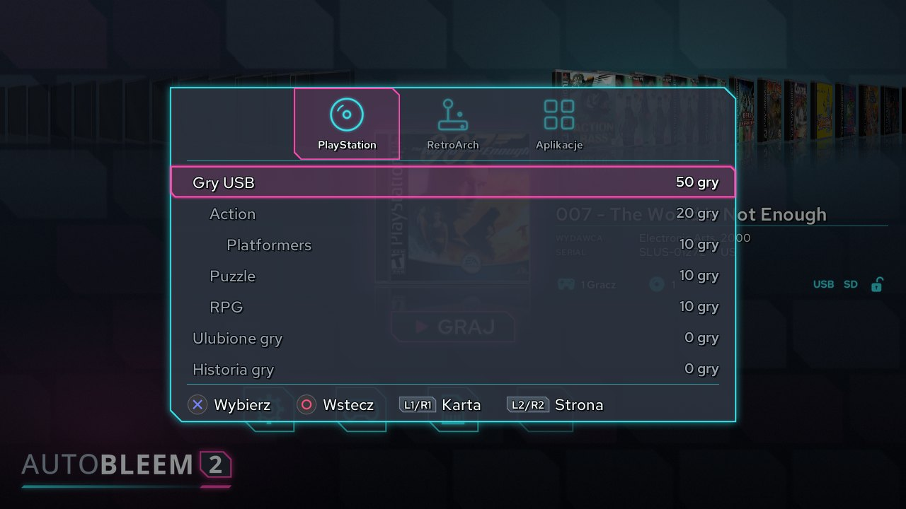

### 3.2 Sterowanie

AutoBleem obsługuje się samym padem, a przyciski znaczą to samo na każdym ekranie: Krzyżyk zatwierdza, Kółko
cofa, Trójkąt pomaga. Jeśli zapomnisz, co robi który przycisk, podpowie Ci pasek na dole ekranu, a Trójkąt
otwiera przewodnik po przyciskach wszystkich ekranów (punkt 4.3). Tak działają przyciski w rzędzie gier:

| Przycisk | W rzędzie gier |
|---|---|
| Lewo / Prawo | Przechodzi do poprzedniej albo następnej gry; przytrzymaj, żeby przewijać dalej. |
| L1 / R1 | Przeskakuje do poprzedniej albo następnej pierwszej litery tytułów, dzięki czemu szybko przejdziesz przez długą listę. Gdy rząd jest pusty, a podłączony jest napęd USB, R1 otwiera *Płyta* (punkt 3.9a). |
| Krzyżyk | Uruchamia wybraną grę: grę z PS1 w emulatorze PS1, grę RetroArch w jej rdzeniu, a aplikację po wyświetleniu jej opisu. |
| Kwadrat | Uruchamia wybraną grę z PS1 w RetroArch. Gdy wybrana jest płyta w napędzie USB, zamiast tego kopiuje ją (*Kopiuj płytę*, punkt 3.9a). |
| Kółko | Wraca do widoku płyty, gdy w napędzie jest płyta (punkt 3.9a). |
| Trójkąt | Otwiera przewodnik po przyciskach. |
| Start | Losuje grę z bieżącego zestawu - na wypadek, gdy nie możesz się zdecydować. |
| Select | Otwiera wybór zestawu, w którym decydujesz, jakie gry ma pokazywać rząd (punkt 3.3). |
| Góra | Otwiera Szybkie menu (punkt 3.4). |
| Dół | Otwiera rząd ikon pod grą (*Ustawienia*, *Gra*, *Karta pamięci*, *Wznów*); Góra go zamyka. |
| L2 + R2 | Otwiera menu systemowe (punkt 3.5). |

**Z klawiaturą.** Na komputerze bez pada albo z klawiaturą USB podłączoną do konsoli, Pi czy pendrive'a dla PC
klawisze zastępują przyciski. Strzałki to krzyżak, Enter to Krzyżyk, Esc albo Backspace to Kółko, Tab to Trójkąt,
a spacja to Kwadrat. F1 i F2 to Select i Start, Page Up i Page Down to L1 i R1, Home i End to L2 i R2, a F10
otwiera menu systemowe.

W Windows kilka klawiszy działa inaczej. Esc zamyka tam AutoBleem (rozdział 7), więc Kółko to wyłącznie
Backspace, spacja działa jak Start, a S to Kwadrat. Do tego litery mogą zastąpić cały pad, więc nie trzeba
sięgać do strzałek: X, O, S i T to Krzyżyk, Kółko, Kwadrat i Trójkąt, I, J, K i L to krzyżak (góra, lewo, dół,
prawo), B to Select, Q i E to L1 i R1, a 1 i 2 to L2 i R2.

**Na każdej liście i w każdym menu** obowiązują te same ruchy: Góra i Dół przesuwają kursor, L2 i R2 przewijają
stronę, L1 i R1 skaczą do pierwszego albo ostatniego wiersza, Krzyżyk wybiera, a Kółko cofa. Nie musisz szukać
przycisku Zapisz: ekran z ustawieniami zapisuje je, kiedy wychodzisz z niego Kółkiem.

**Wyjście z gry albo aplikacji.** Przytrzymaj Start + Select albo Home przez 2 sekundy, a wrócisz do AutoBleem.
Działa to na każdym padzie - oryginalnym padzie konsoli, padzie USB i padzie Bluetooth. Krótkie naciśnięcie tych
samych przycisków otwiera za to menu emulatora. Aplikacja takiego menu nie ma, więc tam działa tylko długie
przytrzymanie.

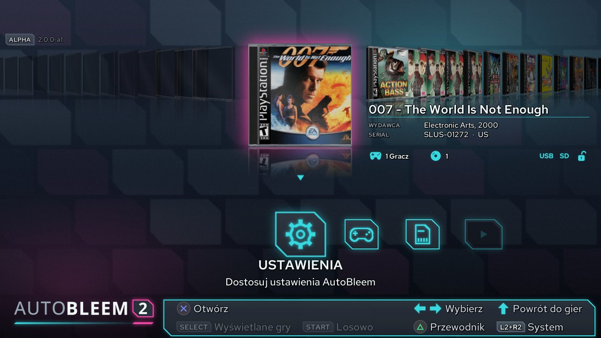

### 3.3 Zestawy

Dużą bibliotekę łatwiej przeglądać po kawałku. Zestawy pozwalają zawęzić rząd do jednego rodzaju gier - tylko
ulubionych, tylko gier z Super Nintendo, tylko gier z jednego folderu - żebyś nie przewijał setek okładek w
poszukiwaniu tej jednej.

Naciśnij **Select**, a otworzy się wybór zestawu. Ma trzy zakładki: PlayStation, RetroArch i Aplikacje. L1 i R1
przełączają zakładki, Góra i Dół przesuwają po grupach danej zakładki (L2 i R2 o całą stronę), a Krzyżyk pokazuje
wybraną grupę w rzędzie. Kółko (*Wstecz*) zamyka wybór bez żadnych zmian. Te same przyciski widać w stopce. Przy
każdym wierszu stoi liczba elementów, które zawiera. Pusta grupa otwiera się na pustym rzędzie, w którym rząd
ikon proponuje tylko *Ustawienia*.

**Zakładka PlayStation.** Na PlayStation Classic zaczyna się od *Wszystkie gry* i *Wewnętrzne gry* (dwudziestu
gier wbudowanych w konsolę), potem są *Gry USB* - wszystko, co jest w `Games/` - i po jednej grupie na każdy
folder, który tam założyłeś; gra w podfolderze należy do grupy tego folderu. Dalej są *Ulubione gry*, *Historia
gry*, a gdy oznaczysz choć jedną grę jako grę na pistolet świetlny, także *Gry Lightgun*. Raspberry Pi, pendrive
dla PC i Windows nie mają gier wewnętrznych, więc tam lista zaczyna się od *Gry USB*, czyli całej Twojej
biblioteki.

**Zakładka RetroArch** jest tylko tam, gdzie zainstalowano RetroArch. Ma po jednej grupie na każdy system, do
którego masz gry, a do tego Ulubione i Historię samego RetroArch.

**Zakładka Aplikacje** dzieli programy według rodzaju: *Wszystkie aplikacje*, a potem *Gry*, *Emulatory*,
*Narzędzia*, *Multimedia* i *Inne*. To, do której grupy trafia aplikacja, ustala jej plik `app.ini`. Ta zakładka
pokazuje też **aplikacje PE**, czyli programy dla Windows uruchamiane przez PE runner; taką, której konsola nie
uruchomi, oznaczono jako *nie może działać na tej konsoli*. Tam, gdzie launcher go pokazuje, na liście jest
również wiersz *Pakiety* (punkt 3.10).

### 3.4 Szybkie menu

Szybkie menu to krótka lista rzeczy, po które najczęściej sięgasz w trakcie przeglądania gier - żeby nie
przekopywać się po nie przez całe menu systemowe. Otwierasz je **Górą** w rzędzie gier albo **ikoną zębatki** w
rzędzie ikon (tym z *Ustawienia*, *Gra*, *Karta pamięci* i *Wznów*).

Góra i Dół przesuwają po pozycjach (z ostatniej kursor wraca na pierwszą), Krzyżyk wybiera, a Kółko zamyka menu.
Wiersz pod menu opisuje zaznaczoną pozycję. Oto, co w nim jest:

- *Ponownie skanuj gry* od razu szuka nowych, zmienionych i usuniętych gier - przydaje się, gdy właśnie wgrałeś
  gry i nie chcesz czekać.
- *Sklep* otwiera Sklep AutoBleem, w którym przeglądasz i instalujesz gry, aplikacje i rozszerzenia (punkt 3.13).
- *Rdzenie RetroArch*, tam gdzie jest RetroArch, pozwalają wybrać rdzeń, który uruchamia gry danego systemu.
- *Sieć i kontrolery* otwiera ekrany WiFi, parowania Bluetooth i mapowania padów (rozdział 6). Ta pozycja jest
  tylko wtedy, gdy zapewnia je zainstalowane rozszerzenie - robi to PSC-Bios na konsoli, Raspberry Pi i
  pendrivie dla PC. Jeśli to rozszerzenie jest zainstalowane, ale wyłączone, pozycja jest wyszarzona, a jej opis
  podpowiada, żeby włączyć je w Rozszerzeniach; Krzyżyk otwiera wtedy listę rozszerzeń właśnie na nim.
- *Uruchom ponownie launcher* zamyka AutoBleem i uruchamia go od nowa (tylko na konsoli, Raspberry Pi i
  pendrivie dla PC).
- *Menu systemowe...* otwiera pełne menu systemowe ze wszystkim innym - Opcjami, Menadżerem gier, wyłączaniem i
  resztą (punkt 3.5).

Wszystko poza Sklepem, rdzeniami RetroArch i ponownym uruchomieniem launchera jest też w menu systemowym.


### 3.5 Menu systemowe

W menu systemowym jest wszystko, co AutoBleem potrafi poza samym graniem: ustawienia, narzędzia do biblioteki i
kart pamięci, informacje o urządzeniu i wyłączanie. Naciśnij razem **L2 + R2** (w dowolnej kolejności), a menu
otworzy się nad rzędem gier. Pozycje są pogrupowane pod nagłówkami *Biblioteka*, *System* i *Wyjście*, a dwie
najczęściej używane stoją na samej górze. Wiersz na dole menu opisuje zaznaczoną pozycję, więc możesz się
rozejrzeć, zanim cokolwiek wybierzesz.

| Część | Pozycja | Do czego służy |
|---|---|---|
| (góra) | *Ponownie skanuj gry* | Od razu szuka nowych, zmienionych i usuniętych gier. Skanowanie i tak samo pilnuje folderu, więc ta pozycja przydaje się, gdy nie chcesz czekać. |
| | *Rozszerzenia* | Pokazuje rozszerzenia na pendrivie, na przykład Sklep AutoBleem, i pozwala je uruchomić albo wyłączyć (punkt 3.13). |
| *Biblioteka* | *Menadżer gier* | Pokazuje gry z PS1 jako listę z ich folderami; możesz w nim usunąć grę albo wyczyścić okładki (punkt 4.1). Nie otworzy się w trakcie skanowania. |
| | *Karty pamięci* | Tu zarządzasz wspólnymi zestawami kart pamięci (punkt 3.8). |
| | *Procesory skanowania* | Ustala kolejność programów, które uruchamia każde skanowanie, i pozwala je włączać i wyłączać (punkt 3.14). Nie otworzy się w trakcie skanowania. |
| *System* | *Opcje* | Otwiera ustawienia AutoBleem (punkt 3.6). |
| | *Sieć i kontrolery* | Otwiera ekrany WiFi, parowania padów Bluetooth, konfiguracji DualShock 3 i mapowania padów (rozdział 6). Jest tylko wtedy, gdy zapewnia je rozszerzenie - patrz niżej. |
| | *Informacje o sprzęcie* | Pokazuje dane urządzenia - system, procesor, pamięć masową, interfejsy sieciowe, strefę czasową, ekran oraz pady z ich mapowaniem - na takiej samej stronie na każdej platformie (punkt 4.2). Kółko wraca do menu systemowego. |
| | *Wirtualny pad* | Pokazuje pady, które dostają aplikacje, i pady widoczne dla demona - przydaje się, gdy pad nie działa w aplikacji (punkt 4.5). Kółko wraca do menu systemowego. |
| | *Aktualizacja oprogramowania* | Sprawdza od razu, czy na stronie jest nowszy AutoBleem albo RetroArch, zamiast czekać na codzienne sprawdzenie (punkt 3.12). Gdy launcher już wie o nowej wersji, wiersz ma napis *Dostępna aktualizacja*. Na PlayStation Classic wymaga jądra AutoBleem i sieci WiFi. |
| | *O programie* | Pokazuje autorów i licencję. |
| *Wyjście* | *RetroArch* | Przechodzi z launchera do menu samego RetroArch, z jego ustawieniami i listami treści; po zamknięciu RetroArch wracasz do launchera. Jest tylko tam, gdzie zainstalowano RetroArch. |
| | *Wyłączanie* | Wyłącza urządzenie, gdy to potwierdzisz (patrz niżej). |

**Sieć i kontrolery** pojawia się tylko tam, gdzie zainstalowane rozszerzenie zapewnia funkcję `network` -
rozszerzenie zgłasza ją wpisem `Provides=network` w swoim pliku `extension.ini`. PSC-Bios robi to na konsoli,
Raspberry Pi i pendrivie dla PC. Jeśli to rozszerzenie jest zainstalowane, ale wyłączone, pozycja zostaje w menu,
wyszarzona, a jej opis mówi, że trzeba je włączyć w Rozszerzeniach; Krzyżyk na niej otwiera listę rozszerzeń
dokładnie na nim.

**Wyłączanie** robi to, co pasuje do urządzenia. Konsolę przełącza w czuwanie AutoBleem: pendrive zostaje
odłączony, dioda świeci na pomarańczowo, a Power przywraca launcher w kilka sekund (punkt 2.1). Raspberry Pi i
komputer po prostu się wyłączają.

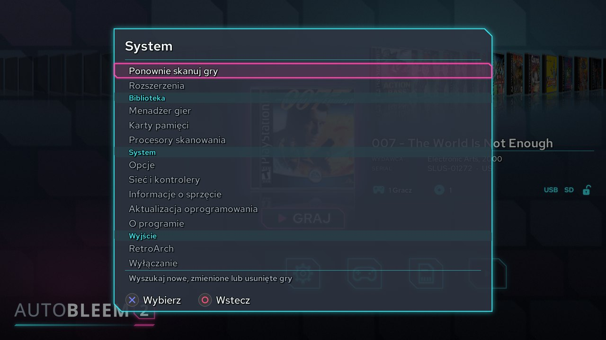

### 3.6 Opcje

W Opcjach dopasowujesz AutoBleem do siebie: obraz na swoim ekranie, wygląd launchera, język, dźwięk i emulator,
w którym działają gry z PS1. Otwierasz je z menu systemowego (*Opcje*) albo ikoną *Ustawienia* pod grą. Ekran i
język zwykle ustawia się raz, a wraca tu, gdy coś źle wygląda na konkretnym telewizorze albo masz ochotę na
zmianę.

Ustawienia są podzielone na grupy, każda pod swoim nagłówkiem. Góra i Dół przechodzą między wierszami, a Lewo i
Prawo zmieniają wartość wiersza, na którym jesteś: krótkie naciśnięcie zmienia o jeden krok, przytrzymanie zmienia
dalej. L1 i R1 skaczą do pierwszego albo ostatniego wiersza, a L2 i R2 przewijają stronę. W wierszu z wyborem
motywu, muzyki albo czcionki Start losuje jedną z nich. Ustawienie, które można tylko włączyć albo wyłączyć,
pokazuje **Włączony** albo **Wyłączony**. Każdą zmianę widzisz od razu, a Kółko zamyka ekran i wszystko zapisuje -
niczego więcej nie trzeba potwierdzać. Jedynym wyjątkiem jest tryb obrazu, który zostaje wypróbowany dopiero po
wyjściu z Opcji (patrz *Obraz* niżej).

Niektóre wiersze pojawiają się tylko tam, gdzie mają sens: wiersze CRT tylko przy obrazie 4:3, wiersze RetroArch
tylko tam, gdzie jest RetroArch, a gry wewnętrzne tylko na PlayStation Classic.

| Grupa / ustawienie | Do czego służy |
|---|---|
| *Interfejs*: *Obraz:* | Ustawia rozdzielczość ekranu dla launchera i emulatora PS1. *Auto* używa trybu, który podaje ekran, i pokazuje, jaki to tryb, na przykład *Auto (1920x1080)*; możesz też wybrać dowolny tryb z listy ekranu. Konsola oferuje 720p, 1080p i *CRT 4:3* (720x480) - tryb dla starego telewizora kineskopowego albo urządzenia nagrywającego w 4:3. Zmień go, gdy obraz nie mieści się na telewizorze albo jest rozmyty. Tego wiersza nie ma, gdy AutoBleem działa w oknie na komputerze deweloperskim. |
| *Margines CRT:* | Lekko zmniejsza cały obraz, od 0 do 10 % co 1 %, bo stare telewizory obcinają jego brzegi. Zwiększaj go, aż pasek podpowiedzi i narożniki będą w całości widoczne. Pojawia się tylko przy obrazie 4:3, działa od razu i obowiązuje już od ekranu startowego. |
| *Wysokość obrazu:* | Wydłuża albo skraca obraz w pionie, od -40 do +40 co 2, przy każdym obrazie 4:3 - w trybie *CRT 4:3* albo w trybie 4:3 na wyjściu VGA czy komputerowym. Przydaje się, gdy obraz na starym telewizorze jest spłaszczony albo wychodzi poza górną i dolną krawędź. Działa od razu, a obraz gier w RetroArch dopasowuje się do niego. |
| *Skalowanie ekranu emulatora:* | Decyduje, jak emulator PS1 dopasowuje obraz gry do ekranu. 1x1 pokazuje oryginalne piksele PlayStation, małe i dokładne; *2x (całkowite)* i *4:3 (całkowite)* powiększają tylko o pełne wielokrotności, co daje najostrzejszy obraz; *4:3* zachowuje oryginalne proporcje obrazu; *Pełny ekran* rozciąga obraz na cały ekran. To ustawienie zastąpiło dawny przełącznik Widescreen. Klasyczny `pcsx-ab` i RetroArch znają tylko pełny ekran i 4:3. |
| *Poświata ekranu:* | Gdy jest włączona, puste pasy obok obrazu gry (tam, gdzie obraz nie wypełnia ekranu) zamiast czerni wypełnia miękka poświata samego obrazu. Działa z `pcsx-abnxt`. |
| *Motyw AutoBleem:* | Zmienia wygląd launchera. Motywy są w folderze `Themes/`, a wrzucony tam plik zip z motywem też pojawia się na liście pod swoją nazwą. Motywy dostarczane z AutoBleem są odświeżane przy każdej aktualizacji, więc jeśli chcesz któryś przerobić, najpierw skopiuj go pod nową nazwą. Domyślny to **ab2.0.0**. |
| *Styl okładek:* | Wybiera ramkę pudełka rysowaną wokół okładek gier z PS1. |
| *Błysk okładki:* | Po każdym zatrzymaniu rzędu przez wybraną okładkę przesuwa się błysk światła. |
| *Język:* | Ustawia język launchera; do wyboru jest 17 języków, a zmiana działa od razu. |
| *Czas komunikatu:* | Ustala, jak długo zostają dymki informacyjne (*Wyświetla: ...*, podsumowanie skanowania) - od 0 do 20 sekund; przy 0 widać *Wyłączony* i dymki się nie pokazują. Komunikaty o błędach mają swój stały czas, żeby żaden Ci nie umknął. |
| *Ekran startowy:* | Pokazuje obrazek AutoBleem w trakcie uruchamiania launchera; wyłącz go, żeby od razu trafiać do gier. |
| *Animacje:* | Animuje przejścia między ekranami; wyłącz je, jeśli wolisz, żeby każdy ekran pojawiał się natychmiast. |
| *Czcionki*: *Użyj domyślnej czcionki:* | Gdy jest włączone, launcher używa własnej czcionki (Red Hat Text); wyłącz, żeby użyć czcionki wybranej w następnym wierszu. |
| *Czcionka:* | Wybiera Twoją własną czcionkę: dowolny plik `.ttf` albo `.otf` z `resources/fonts`, `RetroArch/fonts` lub folderu motywu. Wiersz pokazuje nazwę czcionki, która jest naprawdę używana. |
| *Dźwięk*: *Muzyka:*, *Muzyka w tle:* | *Muzyka:* wybiera utwór grający w launcherze - własny utwór motywu albo plik z `resources/music`. *Muzyka w tle:* decyduje, czy w ogóle gra jakakolwiek muzyka. |
| *Emulacja*: *Emulator PS1:* | Wybiera emulator, w którym uruchamiają się gry z PS1: domyślny `pcsx-abnxt` (aktualny PCSX-ReARMed z dodatkami AutoBleem) albo klasyczny `pcsx-ab`. Spróbuj drugiego, gdy gra działa źle. Punkt wznowienia zapisany przez jeden emulator da się kontynuować w drugim, chyba że gra działała bez pliku BIOS. |
| *Zamień gracza 1 / gracza 2 (emulatory PS1):* | Zamienia, który z dwóch pierwszych padów jest Graczem 1, a który Graczem 2, w obu emulatorach PS1 - przydaje się, gdy pady są podłączone „odwrotnie”. Ma znaczenie tylko przy dwóch lub więcej padach; z jednym padem zawsze grasz jako Gracz 1. Nie dotyczy RetroArch. Jeśli używany emulator PS1 jeszcze nie potrafi zamieniać padów, AutoBleem Ci to powie. |
| *Graj we wszystkie gry PSX przez RA:*, *Aktualizuj konfigurację RA:*, *Zachowuj konfigurację RetroArch:* | Te trzy wiersze są tylko tam, gdzie zainstalowano RetroArch. Pierwszy uruchamia każdą grę z PS1 w rdzeniu PS1 RetroArch (*PlayStation 1*; na komputerze jest to SwanStation). Drugi pozwala AutoBleem wpisywać swoje ustawienia do konfiguracji RetroArch przy uruchamianiu w nim gry. Trzeci zachowuje zmiany wprowadzone w menu samego RetroArch po jego zamknięciu. |
| *Biblioteka*: *Pokazuj wewnętrzne gry:* | Pokazuje gry wbudowane w konsolę na listach PlayStation (tylko PlayStation Classic). |
| *Czyste nazwy gier:* | Gdy jest włączone (domyślnie), listy gier RetroArch pokazują schludne nazwy, bez dopisków w nawiasach, takich jak (USA), (Rev 1) czy [!]; wyłączone pokazuje nazwy plików. Nazwa pliku i tak jest w danych gry. Nie dotyczy gier z PS1, bo ich tytuły pochodzą z bazy. |
| *Pobieraj okładki z sieci:* | Pozwala skanowaniu pobierać brakujące okładki z serwerów libretro (Raspberry Pi, PC, Windows). |
| *Aktualizacje*: *Aktualizacje:* | Wybiera, jakich aktualizacji szuka launcher (punkt 3.12): `release` (wersja sprawdzona), `testing` (następna wersja, w testach), `nightly` (najnowsza wersja rozwojowa) albo `off`. Domyślnie odpowiada wersji, którą zainstalowałeś. Na komputerze deweloperskim tego wiersza nie ma. |
| *Diagnostyka*: *Zachowuj logi na pendrivie:* | Od następnego startu zapisuje na pendrivie wszystkie logi, a nie tylko te po awarii - włącz, gdy szukasz przyczyny jakiegoś problemu (rozdział 7). |
| *Pokazuj wydajność:* | Wyświetla w lewym dolnym rogu nakładkę z liczbą klatek na sekundę, obciążeniem procesora, wątkami i pamięcią; w grze emulator pokazuje też swoje FPS i obciążenie procesora. |

**Zmiana trybu obrazu.** Gdy wyjdziesz z Opcji z nowym trybem w *Obraz:*, AutoBleem przełączy się na niego i
zapyta *Zostawić ten tryb obrazu?*. Jeśli obraz jest w porządku, potwierdź. Jeśli telewizor nic nie pokazuje,
po prostu poczekaj: bez potwierdzenia AutoBleem po odliczaniu wróci do poprzedniego trybu.

**Motywy na ekranie 4:3.** W trybie *CRT 4:3* lista motywów pokazuje tylko te, które mają układ 4:3. Jeśli Twój
motyw go nie ma, po potwierdzeniu trybu (i przy każdym starcie w tym trybie) jego miejsce zajmuje motyw domyślny,
a komunikat Ci o tym mówi: *Motyw zmieniony na domyślny (CRT 4:3)*.

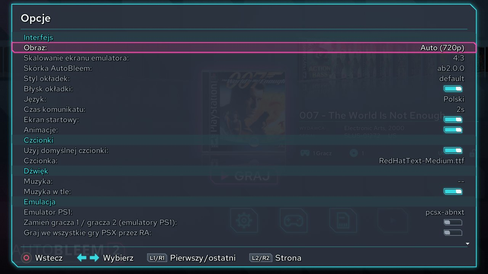


### 3.7 Ustawienia gry

Każda gra może mieć własne ustawienia. Większość działa dobrze bez żadnych zmian, ale czasem któraś potrzebuje
drobnej pomocy - ostrzejszego albo łagodniejszego obrazu, pominiętej klatki dla płynności, innej karty pamięci -
albo po prostu chcesz oznaczyć ją jako ulubioną. W edytorze gry zmieniasz te rzeczy dla jednej gry, nie
ruszając pozostałych.

Gdy gra jest wybrana, naciśnij **Dół**, żeby otworzyć rząd ikon pod nią. Są w nim cztery ikony: *Ustawienia*
(opcje z punktu 3.6), *Gra* (własne ustawienia tej gry), *Karta pamięci* (jej karta pamięci) i *Wznów* (jej stany
gry). Przejdź do jednej z nich i otwórz ją Krzyżykiem.

**Edytor gry** (ikona *Gra*) pokazuje po prawej dane gry - tytuł, wydawcę, rok, liczbę graczy, folder i kartę
pamięci - a po lewej jej ustawienia. Góra i Dół przechodzą między ustawieniami, a Lewo i Prawo je zmieniają, tak
jak w Opcjach; przytrzymanie przycisku powtarza ruch. Gdy skończysz, Kółko zapisuje zmiany i zabiera Cię z
powrotem. Gra, która w swoich danych nie ma tytułu, jest pokazana pod nazwą swojego folderu.

Ustawienia dzielą się na cztery grupy:

- **Gra** dotyczy tego, jak AutoBleem traktuje grę. *Ulubione:* dodaje ją do grupy *Ulubione gry* w wyborze
  zestawu. *Blokuj zmiany:* każe skanowaniu zostawić tytuł, numer seryjny i listę płyt dokładnie takie, jak je
  ustawiłeś, żeby kolejne skanowanie nie nadpisało Twoich poprawek. *Wznawianie:* decyduje, co się dzieje, gdy
  uruchamiasz grę, która ma punkty wznowienia: *Pytaj* pokazuje wybór slotu, *Ostatni slot* od razu wznawia
  grę z najnowszego slotu, a *Nigdy* zawsze uruchamia grę od początku. Tam, gdzie jest RetroArch, są jeszcze dwa
  wiersze. *Gra Lightgun:* jest dla gier na pistolet świetlny: gra trafia wtedy do grupy *Gry Lightgun* i zawsze
  działa w RetroArch, bo to rdzeń PS1 RetroArch obsługuje GunCon (włączenie tej opcji włącza też następny
  wiersz). *Graj przez RA:* uruchamia tę jedną grę w RetroArch zamiast w emulatorze PS1.
- **Obraz** dotyczy wyglądu obrazu. *Rozdzielczość:* rysuje grę w 1x albo 2x (na wbudowanym GPU), a *Usuwanie
  szczelin:*, które działa tylko przy 2x, ukrywa cienkie linie, jakie mogą się wtedy pojawiać między częściami
  obrazu. *Dithering:* (*Wyłączony*, *Włączony*, *Zawsze*) steruje drobnym wzorem kropek, którym PlayStation
  łączy kolory, a *Wygładzanie:* wybiera jeden z wygładzających skalerów emulatora. *Filtr:* decyduje, jak obraz
  jest skalowany do ekranu: *Najbliższy* pokazuje zwykłe piksele, *Liniowy* je wygładza, *Ostry* i *Ostry
  (prosty)* zachowują ostre piksele bez migotania, jest też *Quilez*. Filtry CRT - *CRT (fast)*, *CRT (raster)*
  i *CRT-Pi* - naśladują stary telewizor i same rysują linie, więc gdy wybrany jest któryś z nich, wiersze linii
  są wyszarzone. W pozostałych przypadkach *Linie:* dodaje ciemne linie starego telewizora, a *Jasność linii*
  ustala, jak bardzo są ciemne. *Rozdzielczość*, *Usuwanie szczelin*, *Dithering*, *Wygładzanie* i filtry inne
  niż *Liniowy* i *Najbliższy* działają w `pcsx-abnxt`; klasyczny `pcsx-ab` i RetroArch każdy inny filtr
  pokazują jako *Najbliższy*.
- **Renderowanie** zawiera *Wtyczka:* GPU i *Pomiń klatki:* (*Auto*, wyłączone albo od 1 do 3 klatek). Pomijanie
  klatek pomaga grze, która działa za wolno, utrzymać właściwą prędkość - kosztem mniej płynnego obrazu.
- **Emulator** zawiera *SpeedHack:*, *Zegar:* procesora, *Interpolacja Spu:* (sposób wygładzania dźwięku),
  *Logo startowe:* i, z `pcsx-abnxt`, *Poprawki Sony:*. Wyłącz *Logo startowe:*, żeby pominąć ekran BIOS-u -
  potrzebujesz tego przy płycie homebrew, której własne logo nie pozwala jej wystartować.

Kształtu obrazu i rozdzielczości ekranu nie ustawia się dla każdej gry osobno, tylko dla wszystkich naraz, w
Opcjach (*Skalowanie ekranu emulatora:* i *Obraz:*).

**Inne przyciski w edytorze.** Trójkąt zmienia nazwę gry za pomocą klawiatury ekranowej. Kwadrat daje grze inną
kartę pamięci (*Zmień kartę pamięci*). Dopóki gra korzysta z własnej karty, Start zamienia tę kartę w nowy
wspólny zestaw, z którego mogą korzystać także inne gry (*Udostępnij kartę pamięci*, punkt 3.8). Tych dwóch
możliwości nie ma przy grach wbudowanych w konsolę. Przytrzymanie Lewo / Prawo albo Góra / Dół powtarza ruch -
tutaj, a także na ekranach opcji gier i rdzeni RetroArch.

Gra trzyma swoje ustawienia we własnym pliku `pcsx.cfg`. Każda gra na pendrivie go ma, bo tworzy go skanowanie.
Oryginalna płyta w napędzie USB (punkt 3.9a) dostaje własny folder z plikiem `pcsx.cfg` dopiero wtedy, gdy
uruchomisz ją pierwszy raz; do tego czasu zmiany w edytorze nie da się zachować, a edytor powie Ci *Nie zapisano:
ta gra nie ma pliku pcsx.cfg*. Uruchom więc płytę raz - od tej pory jej ustawienia zostają, tak jak w każdej
innej grze. Płyta należąca do gry, którą masz już w kolekcji, od początku korzysta z folderu i ustawień tej gry.

Dla **płyty w napędzie** (punkt 3.9a) część ustawień nie ma sensu, więc edytor je wyszarza, a gdy na któreś z
nich przejdziesz, wiersz na dole mówi *Niedostępne dla płyty w napędzie*.


**Ustawienia zapisane w emulatorze.** Grę możesz dostroić także w trakcie grania: własne menu emulatora ma
pozycję *Zapisz ustawienia dla tej gry* (punkt 3.9). Gdy gra ma tak zapisane ustawienia, to właśnie z nimi
działa. Edytor gry pokazuje wtedy wiersze grup Obraz, Renderowanie i Emulator jako wyszarzone, z zapisanymi
wartościami, pod nagłówkiem *Zapisane w emulatorze* - możesz je odczytać, ale nie zmienić. Jeśli wolisz wrócić
do ustawień z edytora gry, wybierz *Odblokuj ustawienia* i potwierdź: ustawienia zapisane przez emulator zostaną
usunięte, a wiersze znów da się zmieniać. Oba emulatory, `pcsx-ab` i `pcsx-abnxt`, czytają i zapisują te same
ustawienia, więc nie ma znaczenia, który z nich je zapisał.

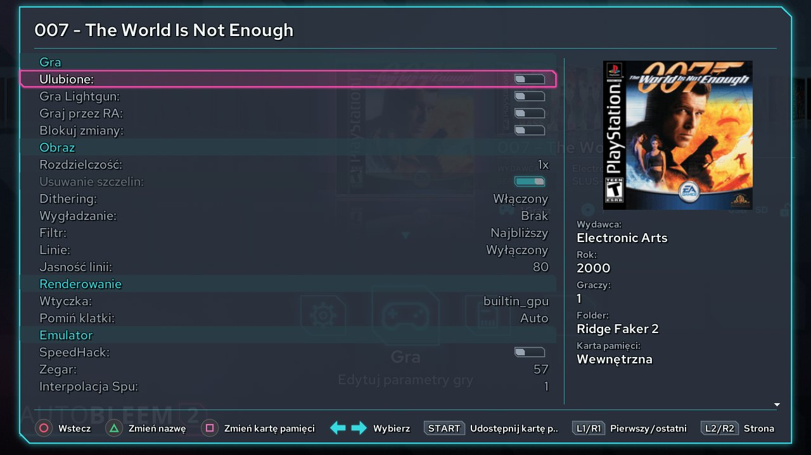

### 3.8 Karty pamięci i stany gry

Na prawdziwym PlayStation wszystkie gry dzieliły jedną czy dwie karty pamięci, na których prędzej czy później
kończyło się miejsce. W AutoBleem każda gra z PS1 ma domyślnie własną kartę pamięci, więc nie musisz myśleć ani
o miejscu, ani o tym, na której karcie jest zapis. Karta jest przechowywana razem ze stanami gry w
`Games/!SaveStates/<folder gry>/`.

**Wspólne zestawy kart pamięci.** Czasem gry muszą widzieć nawzajem swoje zapisy - na przykład kontynuacja, która
wczytuje zapis z pierwszej części, albo kilka gier z serii, które chcesz mieć na jednej karcie. Do tego służy
wspólny zestaw: jedna karta, z której korzysta kilka gier. Zestawy są w `Games/!MemCards/`, a zarządzasz nimi
pozycją *Karty pamięci* w menu systemowym. Kwadrat tworzy nowy zestaw (nazwę wpisujesz klawiaturą ekranową),
Krzyżyk zmienia nazwę wybranego, a Trójkąt go usuwa - po wcześniejszym pytaniu. Żeby przypisać grze zestaw,
użyj *Zmień kartę pamięci* w jej edytorze (punkt 3.7) albo jej ikony *Karta pamięci*.

**Edytor kart pamięci** otwierasz ikoną *Karta pamięci* gry. Pokazuje obok siebie kartę gry i drugą kartę, z
ikoną i tytułem każdego zapisu, tak jak ekran kart pamięci na oryginalnej konsoli. Kwadrat kopiuje wybrany zapis
na drugą kartę, Trójkąt go usuwa, a Select defragmentuje kartę, zbierając wolne bloki w jedno miejsce, żeby
zmieścił się większy zapis. Start pozwala wybrać, który zestaw jest pokazany po prawej, a Krzyżyk wczytuje obie
karty z pendrive'a na nowo. Karta, na którą gra jeszcze nic nie zapisała - bo jeszcze w niej nie zapisywałeś -
jest pusta i ma obok nazwy dopisek *jeszcze brak karty*. Jeśli coś zmieniłeś, przed wyjściem z edytora,
ponownym wczytaniem kart albo pokazaniem innego zestawu AutoBleem zapyta *Czy chcesz zapisać dane kart pamięci?*.

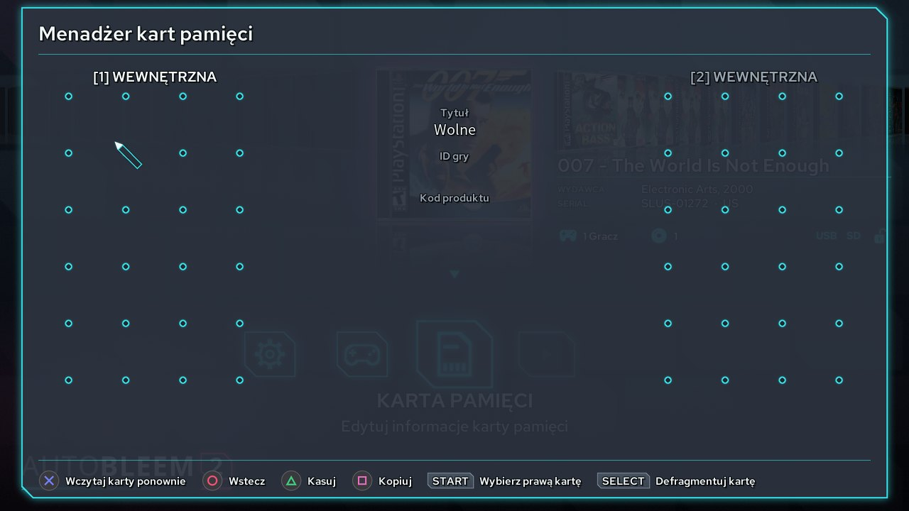

**Punkty wznowienia.** W wielu grach z PS1 da się zapisać stan tylko w określonych miejscach, a nie zawsze
zdążysz do takiego dojść, zanim musisz skończyć. Od tego są punkty wznowienia: gdy wychodzisz z gry z PS1
przyciskiem Reset na konsoli (albo przez menu emulatora na Pi lub komputerze), AutoBleem zapisuje stan gry
dokładnie w tym miejscu, w którym byłeś. W trakcie zapisu, przy wychodzeniu z gry, emulator prosi chwilę
poczekać. Następnym razem grasz dalej od tego momentu.

Znajdziesz je pod ikoną *Wznów* gry. Gra, która ma punkt wznowienia, pokazuje na ikonie jego małą miniaturę;
gra bez żadnego ma ikonę wyszarzoną. Wybór slotu wznowienia ma cztery sloty w postaci kart w ramkach, każdy z
obrazkiem tamtej chwili, numerem slotu i datą. Najnowszy jest oznaczony **NAJNOWSZY**, a nieużywany slot ma napis
*Brak punktu wznowienia*. Krzyżyk wznawia grę z wybranego slotu, a Trójkąt go usuwa. To, czy wybór slotu w ogóle
się pojawia przy uruchamianiu gry, zależy od ustawienia gry *Wznawianie:* (punkt 3.7).

Gry z PS1 uruchamiane w RetroArch też mają sloty wznowienia. Każdy slot ma znaczek - logo AutoBleem 2 albo logo
RetroArch - więc widać, który emulator go zapisał.


### 3.9 Uruchamianie gier, RetroArch i aplikacji

Uruchamianie gier robisz najczęściej, więc wystarczy do tego jeden przycisk: wybierz grę w rzędzie i naciśnij
**Krzyżyk**. Gra z PS1 otworzy się na pełnym ekranie w emulatorze PS1 wybranym w Opcjach (punkt 3.6) i będzie
działać, dopóki z niej nie wyjdziesz. Jeśli wolisz zagrać w grę z PS1 w RetroArch - bo tam działa lepiej albo
lubisz jego opcje - naciśnij zamiast tego **Kwadrat**.

**Wychodzenie z gry.** Na PlayStation Classic przyciski samej konsoli robią to, czego się spodziewasz. **Reset**
z przodu zabiera Cię z powrotem do launchera i zapisuje punkt wznowienia w miejscu, w którym byłeś, więc możesz
później grać dalej (punkt 3.8); działa nawet wtedy, gdy otwarte jest menu w grze. **Power** wyłącza konsolę.
Raspberry Pi i komputer nie mają takich przycisków, więc tam wychodzisz przez menu emulatora, opisane niżej.

Jest też sposób wyjścia, który działa tak samo na każdym padzie - oryginalnym padzie konsoli, padzie USB i
padzie Bluetooth: **przytrzymaj Start + Select albo Home przez 2 sekundy**, a wrócisz do AutoBleem. Krótkie
naciśnięcie tych samych przycisków otwiera za to menu emulatora. Launcher przypomina o obu w swoich podpowiedziach
(*Przytrzymaj Select+Start lub Home przez 2 sekundy: powrót do AutoBleem* oraz *Krótkie naciśnięcie
Select+Start lub Home: menu emulatora*). Aplikacja nie ma menu emulatora, więc tam działa tylko długie
przytrzymanie. Na konsoli Reset zawsze zatrzymuje też aplikację.

**Menu w grze.** W `pcsx-abnxt` emulator ma własne menu na to, czego potrzebujesz w trakcie grania: zapisywanie,
zmianę płyty, ustawienia obrazu i wybór kontrolerów. Naciśnij przycisk menu - Home na padzie, który go ma,
**Select + Start** na padzie bez niego albo **Esc** na klawiaturze - a gra zatrzyma się za menu, z ostatnim
obrazem w tle. Przytrzymanie przycisku menu przez 2 sekundy działa jak Reset: wychodzi z gry. Menu ma trzy
zakładki, między którymi przechodzisz L1 i R1. Zapamiętuje, gdzie byłeś, więc następnym razem otwiera się na tej
samej zakładce i w tym samym wierszu.

- Zakładka **Gra** dotyczy samej gry. *Wróć do gry* zamyka menu i pozwala grać dalej. W części *Zapisy* *Szybki
  zapis* zapamiętuje bieżącą chwilę, a *Szybkie wczytanie* do niej wraca. *Wczytaj autozapis* cofa grę do stanu
  sprzed najwyżej 30 sekund - emulator trzyma tę kopię w pamięci w trakcie gry, co ratuje przed błędem, którego
  nie da się cofnąć. W części *Płyta CD* *Zmień płytę* służy grom na kilku płytach, gdy gra poprosi o następną,
  a *Zresetuj grę* zaczyna grę od nowa. *Zapisz ustawienia dla tej gry* zachowuje ustawienia wybrane dla tej
  jednej gry (punkt 3.7). *Menu PCSX* otwiera własne strony PCSX-ReARMed, z jego opcjami, kodami i informacjami o
  programie, a *Wyjdź* zabiera Cię z powrotem do AutoBleem.
- Zakładka **Obraz** pozwala zmieniać wygląd gry na bieżąco, kiedy na nią patrzysz: *Ekran*, *Rozdzielczość* (1x
  albo 2x), *Usuwanie szczelin*, *Dithering*, *Skalowanie*, *Poświata ekranu*, *Wygładzanie*, *Filtr*, *Maska
  CRT*, *Scanlines* i *Jasność scanlines*. To te same ustawienia co w edytorze gry (punkt 3.7), a każdy wiersz ma
  po prawej opis, do czego służy. *Ekran* to rozdzielczość ekranu; na konsoli wybierasz ją w Opcjach, a tutaj jest
  tylko pokazana. *Poświata ekranu* przydaje się przy ciemnych pasach po bokach obrazu 4:3 na szerokim
  telewizorze: wypełnia je krawędziami samego obrazu, odbitymi jak w lustrze i przyciemnionymi, więc gra jakby
  rozlewa się na boki, zamiast tkwić między dwoma czarnymi pasami. *Maska CRT* nakłada na obraz wzór luminoforu
  starego kineskopu - *Apertura* daje drobne paski Trinitronu, a *Szczelinowa* i *Delta* kropki innych
  kineskopów; jest dostępna tylko z filtrem CRT (raster). Filtr CRT-Pi jest dla konsoli za ciężki przy 1080p. Wiersz, który nie ma zastosowania, jest wyszarzony, a jego opis mówi
  dlaczego.
- Zakładka **Kontrolery** decyduje, co jest podłączone do dwóch portów PlayStation, *Kontroler 1* i *Kontroler
  2*: zwykły (cyfrowy) pad, pad analogowy (DualShock), pistolet albo nic. Niektóre gry działają tylko z jednym
  rodzajem pada. Zmiana zaczyna działać po powrocie do gry.

Menu jest narysowane w wyglądzie samego launchera, ab2.0.0, więc nie sprawia wrażenia innego programu, i pokazuje
baterie padów oraz obrazek z ostatniego szybkiego zapisu.

**Gry RetroArch.** Gra z innego systemu uruchamia się w RetroArch, z rdzeniem, który launcher wybrał dla jej
systemu. Gdy skończysz, *Close Content* albo *Quit RetroArch* w menu RetroArch zabiera Cię z powrotem do
launchera. Jeśli chcesz zmienić rdzeń dla danego systemu, otwórz *Rdzenie RetroArch* w Szybkim menu (punkt
3.4); lista otwiera się z rdzeniem *PlayStation 1* na samej górze. A jeśli potrzebujesz menu samego RetroArch
(XMB), z jego ustawieniami i własnymi listami treści, wybierz *RetroArch* w menu systemowym: RetroArch otworzy się
wtedy bez wczytanej gry.


**Aplikacje.** Aplikacje to raczej programy niż gry: narzędzia konsoli, a na konsoli także dodatkowe aplikacje z
paczki RetroArch - Doom, Quake, Amiga i inne. Znajdziesz je w zestawie Aplikacje. Zanim aplikacja się uruchomi,
AutoBleem pokazuje jej opis, żebyś wiedział, co to jest i jak się nią steruje. Krzyżyk ją uruchamia, a Kółko
wraca do rzędu gier.

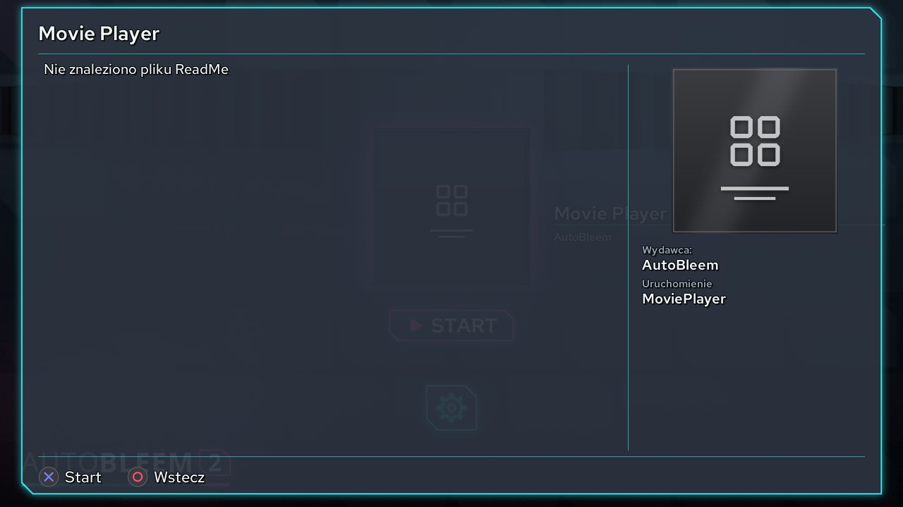

**Ustawienia aplikacji.** Wiele aplikacji napisano z myślą o jednym konkretnym padzie, dlatego możesz zmienić,
jak widzą Twój. Wybierz aplikację, otwórz rząd ikon i wybierz *Gra*: otworzą się *Ustawienia gry* aplikacji
(*Zmień sposób uruchamiania tego programu*). *Tryb pada:* decyduje, jaki pad aplikacja „widzi”. *Automatyczny*
daje jej to, o co sama prosi; *Pad PSC* i *Pad Xbox 360* przedstawiają Twój pad jako pad konsoli albo pad Xbox
360, a *Pad PSC (systemowy)* i *Pad Xbox 360 (systemowy)* robią to samo za pośrednictwem systemu. Spróbuj innego
trybu, gdy aplikacja nie reaguje na pad tak, jak powinna. *Krzyżak jako gałka:* pozwala krzyżakowi poruszać
gałką analogową - dla aplikacji, która słucha tylko gałki - a *Gałka jako krzyżak:* działa odwrotnie.

Niektóre aplikacje przy pierwszym uruchomieniu zadają pytanie. Jedna chce wiedzieć *Jakie sterowanie ma Twój
pad?*, żeby ustawić sterowanie: odpowiedz *Jeden krzyżak* dla pada z samym krzyżakiem albo *Gałki analogowe*.
Aplikacja z Windows pyta *Co chcesz zrobić?* i proponuje uruchomienie Windows, jego instalację, uruchomienie DOS
albo odinstalowanie Windows. Gdy aplikacja pozwala ustawić klawisz, prosi *Naciśnij jeden z przycisków.*


Program dla Windows uruchamiany przez PE runner (aplikacja PE, punkt 3.3) rozmawia z Tobą przez ekrany AutoBleem:
wiadomość, którą chce pokazać, pojawia się jako *Komunikat*, a pytanie z odpowiedziami do wyboru jako *Wybierz
opcję*, oba z nazwą aplikacji w tytule.


### 3.9a Płyta w napędzie USB

Do konsoli, Raspberry Pi albo komputera uruchomionego z pendrive'a AutoBleem możesz podłączyć zwykły napęd CD/DVD
na USB i grać prosto z oryginalnej płyty PlayStation - bez kopiowania czegokolwiek. Włożona płyta pojawia się w
launcherze jak jeszcze jedna gra. W Windows ta funkcja nie działa.

**Kopiowanie płyty na pendrive.** Jeśli chcesz mieć grę zawsze pod ręką, bez wkładania płyty, naciśnij Kwadrat
(*Kopiuj płytę*). AutoBleem najpierw zapyta, czy skopiować grę, i powie, ile miejsca zajmie, a potem zapisze ją
w folderze `Games` jako jeden plik CHD (gra na kilku płytach dostaje też plik `.m3u`, dzięki któremu w grze
działa zmiana płyty). W trakcie widać prędkość i pozostały czas, a przyciskiem *Przerwij* możesz kopiowanie
zatrzymać. Gdy się skończy, gra jest w rzędzie jak każda inna. AutoBleem nie skopiuje gry, która już jest w
`Games`, ani takiej, na którą brakuje miejsca - wtedy powie, ile go potrzeba. Porysowaną płytę też da się
skopiować: miejsca, których nie udało się odczytać, zostaną wypełnione zerami, a AutoBleem powie, ile ich było.
Taka kopia może działać, ale nie musi.

Kwadrat proponuje kopiowanie dla każdej płyty z grą na PlayStation w widoku płyty, także dla takiej, której nie
znają bazy okładek. Gra znana bazom jest kopiowana pod swoim tytułem; grę na kilku płytach kopiujesz płyta po
płycie, a plik `.m3u` wymienia je po kolei, od płyty 1. Płyta nieznana bazom dostaje nazwę od swojego numeru
seryjnego, jest kopiowana jako pojedyncza płyta i nie ma okładki w rzędzie. Okno kopiowania, *Kopiowanie płyty*,
zostaje na ekranie, dopóki kopiowanie się nie skończy albo go nie zatrzymasz - launcher w tym czasie czeka - i
pokazuje prędkość jako wielokrotność zwykłego napędu CD. Jeśli kopiowanie się nie uda, AutoBleem powie dlaczego.


**Granie z płyty.** Gdy włożysz płytę, **widok płyty** otworzy się sam, gdy tylko płyta zostanie odczytana.
Pokazuje okładkę płyty - z baz okładek albo pobraną z internetu - z numerem seryjnym i tytułem, a Krzyżyk
uruchamia grę. Gra z PS1 uruchomiona z płyty trzyma punkty wznowienia i zapisy we własnym folderze, więc możesz
przerwać i wrócić do niej później, tak samo jak przy grze z pendrive'a. Po wyjściu z gry albo z opcji czy
ustawień rozszerzenia wracasz do widoku płyty. Jeśli opuścisz go Kółkiem, żeby przejrzeć inne gry, płyta zostaje
w napędzie, a Kółko w rzędzie gier przywraca jej widok; w pustym rzędzie otwiera go też R1 (*Płyta*). W rzędzie
z grami R1 robi to co zwykle, czyli przeskakuje między pierwszymi literami. Gdy wyjmiesz płytę, widok płyty się
zamyka.


**Znacznik napędu** u góry ekranu mówi, co robi napęd, więc wiesz, czy trzeba poczekać. Gdy napęd nie jest
podłączony, nic tam nie widać. Pusty napęd to przygaszona ikona płyty. W trakcie odczytu ikona miga z napisem
*Odczyt płyty...*, a gdy płyta jest gotowa, ikona się rozjaśnia i pokazuje jej tytuł. Jeśli włożysz płytę, która
nie jest ani grą na PlayStation, ani płytą z muzyką, znacznik powie *To nie jest płyta PlayStation*, a jeśli
napęd chwilowo nie może jej odczytać - *Nie można teraz odczytać płyty*.


**Płyty z muzyką.** Napęd odtwarza też płyty audio. Płyta z muzyką otwiera zamiast widoku płyty **odtwarzacz
CD**. Pokazuje on płytę jako *Płyta audio CD* z listą utworów i łącznym czasem, a wiersz pod spodem podaje
wybrany utwór i mówi, czy włączone jest powtarzanie i odtwarzanie losowe. Płyta, której odtwarzacz nie potrafi
odtworzyć, ma odpowiednią adnotację. Przyciski odtwarzacza:

| Przycisk | W odtwarzaczu CD |
|---|---|
| Krzyżyk | Odtwarza wybrany utwór. |
| Start | Wstrzymuje muzykę i wznawia ją. |
| Kwadrat | Zatrzymuje muzykę. |
| L1 / R1 | Przechodzą do poprzedniego albo następnego utworu. |
| L2 / R2 | Przewijają utwór do tyłu albo do przodu, po pięć sekund. |
| Trójkąt | Zmienia powtarzanie: nic, cała płyta albo bieżący utwór. |
| Select | Włącza albo wyłącza odtwarzanie losowe, w którym utwory grają w przypadkowej kolejności. |
| Kółko | Zamyka odtwarzacz CD. |


**Płyty z zabezpieczeniem LibCrypt.** Część gier na PlayStation, głównie europejskich, ma zabezpieczenie przed
kopiowaniem o nazwie LibCrypt. Żeby działały, emulator potrzebuje małego pliku `.sbi` z danymi tego
zabezpieczenia. AutoBleem sam pobiera ten plik ze strony, zanim taka płyta się uruchomi i gdy ją kopiujesz, a
przy kopiowaniu plik trafia razem z grą. Potrzebna jest do tego sieć: na Raspberry Pi i komputerze ta, którą już
mają, a na konsoli WiFi ustawione w PSC-Bios.

Dla płyty w napędzie część ustawień gry nie ma sensu, więc jej edytor gry je wyszarza (punkt 3.7).

### 3.10 Dodawanie gier

AutoBleem sam znajduje Twoje gry, o ile leżą we właściwym miejscu. Ten punkt mówi, gdzie trafia każdy rodzaj gier,
żeby każde skanowanie pokazało je w rzędzie z nazwami i okładkami.

**Gry z PS1** wgrywasz do folderu `Games`, **każdą do osobnego folderu** nazwanego tak jak gra. Możesz też
grupować gry we własnych folderach - każdy taki folder staje się osobną grupą w wyborze zestawu (punkt 3.3):

```
Games/
  Crash Bandicoot/            Crash Bandicoot.cue + Crash Bandicoot.bin
  Final Fantasy VII/          Final Fantasy VII (Disc 1).chd, (Disc 2).chd, (Disc 3).chd
  Platformers/                folder z grami: osobna grupa w wyborze zestawu
    Klonoa/                   Klonoa.pbp
```

AutoBleem czyta popularne formaty obrazów płyt: `.cue` z plikiem `.bin` (albo `.img`), `.pbp`, `.chd` (także
skompresowane zstd), `.iso` oraz `.ecm`, który skanowanie samo rozpakowuje. Gra spakowana zipem też zadziała:
procesor **Unzip** rozpakuje ją, zanim skanowanie ją odczyta (punkt 3.14).

Nie musisz być pedantem. Gra na kilku płytach powinna leżeć w jednym folderze ze wszystkimi płytami, ale jeśli
wgrasz foldery nazwane `Gra (Disc 1)`, `Gra (Disc 2)` i tak dalej, skanowanie połączy je w jeden folder `Gra`.
Gry wrzucone luzem prosto do `Games/` skanowanie też samo rozłoży do osobnych folderów.

**Nazwy i okładki** pojawiają się same. Skanowanie odczytuje numer seryjny każdej płyty i bierze tytuł, wydawcę,
rok, liczbę graczy i region z bazy PlayStation w RetroArch albo z baz okładek. Jeśli chcesz mieć własną okładkę,
połóż plik PNG albo JPEG obok obrazu gry, pod tą samą nazwą. Bez niej okładka pochodzi z baz okładek albo, gdy
jest RetroArch, z zestawu miniatur libretro; na Raspberry Pi, komputerze i w Windows brakująca okładka jest
pobierana z internetu (Opcje → *Pobieraj okładki z sieci:*). Jeśli skanowanie coś pomyli, popraw to w edytorze
gry i włącz *Blokuj zmiany:*, żeby kolejne skanowanie zostawiło Twoją poprawkę.

**Gry z innych systemów** trafiają do `RetroArch/roms/`, **każdy system do osobnego folderu, nazwanego tak, jak
nazywają go bazy RetroArch** - na przykład `Nintendo - Nintendo Entertainment System`, `Nintendo - Super Nintendo
Entertainment System`, `Sega - Mega Drive - Genesis`, `Nintendo - Game Boy Advance` albo `FBNeo - Arcade Games`
(lub `Arcade`). Foldery zakłada się same, a ROM-y mogą zostać spakowane. Na Raspberry Pi, komputerze i w Windows
skanowanie samo je odczytuje i zapisuje playlisty RetroArch. Pendrive konsoli nie poradzi sobie z tym sam, więc
tam uruchamiasz **UpdateRoms** na komputerze (rozdział 5).

**Aplikacje** trafiają do `Apps/<nazwa>/`, każda z plikiem `app.ini` - z nazwą, ikoną i tym, co uruchomić - oraz
plikiem `run.sh`.

**Pakiety.** Niektóre aplikacje to silniki gier: zanim w coś zagrasz, potrzebują danych gry, którą masz. Tak
działają Doom, Quake, OpenArena, Heretic, Hexen, Strife, Duke Nukem 3D, Shadow Warrior, Theme Hospital, gry DOS i
inne. Pliki gry wgraj do folderu `Packages` na pendrivie, każdą grę do osobnego folderu - na przykład
`Packages/Doom/DOOM2.WAD` - a AutoBleem rozpozna je według tabeli, którą ma w zestawie (`rc/packages.ini`). W
rozpoznanym folderze luźne pliki gry są osobnymi pakietami. AutoBleem tylko czyta Twoje pliki i nigdy ich nie
zmienia. Pakiet może też pochodzić ze Sklepu (punkt 3.13).

Tam, gdzie launcher go pokazuje, wiersz *Pakiety* w zakładce Aplikacje (punkt 3.3) wymienia znalezione dane gier.
Krzyżyk na pozycji otwiera **informacje o pakiecie**: co zawierają dane, opis, gdzie leżą pliki i skąd pochodzą
(Twoje własne pliki, Sklep, mod albo pliki dołączone do aplikacji), czy to shareware lub darmowa gra i która
zainstalowana aplikacja je uruchamia. Jeśli żadna z Twoich aplikacji nie potrafi ich uruchomić, informacje Ci to
powiedzą.

Gdy uruchamiasz aplikację-silnik, AutoBleem szuka danych gry, które ona obsługuje. Jeśli jest jeden zestaw danych,
gra startuje od razu. Jeśli jest ich kilka, lista *Wybierz dane gry* pyta, w co chcesz zagrać, i zaczyna od
tego, co wybrałeś ostatnim razem. Jeśli nie ma żadnych, AutoBleem mówi, jakich danych aplikacja potrzebuje i
gdzie je położyć, i nic się nie uruchamia.

**Własne gry.** Gdy AutoBleem nie rozpozna jakichś danych, ich informacje o pakiecie mówią *Nie rozpoznano.
Jeśli to gra, zajrzyj do instrukcji: Własne gry.* Tabela zna tylko gry, dla których ją przygotowano. Dla innej
gry dopisz dla niej wiersz we własnym pliku `packages.ini` w folderze `Packages`: AutoBleem czyta Twój plik
najpierw, więc Twoje wiersze mają pierwszeństwo.


**Skanowanie jednej części.** Jeśli dodałeś gry tylko do jednego zestawu albo folderu, *Ponownie skanuj gry* może
przeskanować tylko tę część - to szybsze niż skanowanie wszystkiego - a jego dymek znika, gdy skończy.

**Motywy** trafiają do `Themes/<nazwa>/`, z plikiem `theme.json` i obrazkami - możesz też wrzucić plik zip
motywu do `Themes/` tak, jak jest.

### 3.11 BIOS PS1

BIOS to własny program startowy PlayStation, a z prawdziwym BIOS-em emulator odtwarza gry najwierniej. Na
**PlayStation Classic** nie musisz nic robić: emulator korzysta z BIOS-u samej konsoli. Na **Raspberry Pi,
komputerze i w Windows** wgraj własne pliki BIOS PS1 do `System/Bios/`: `romw.bin` (amerykańsko-europejski
SCPH-5501/5502) i `romJP.bin` (japoński SCPH-5500, używany dla gier japońskich). Instalatory uzupełniają je z
paczek BIOS RetroArch, chyba że Twoje pliki już tam są - Twoich nigdy nie zastępują. Bez nich emulator działa na
wbudowanym BIOS-ie HLE, zastępczym, który wiele gier akceptuje, ale nie wszystkie. Jeśli więc gra nie chce
wystartować, brak BIOS-u sprawdź w pierwszej kolejności.

### 3.12 Aktualizacje

AutoBleem sam dba o to, żeby był aktualny, więc nowe funkcje i poprawki dostajesz bez ponownej instalacji. Przy
starcie launchera, a potem raz dziennie, sprawdza na stronie, czy na jego **kanale** jest nowa wersja. Kanał
wybierasz w Opcjach → *Aktualizacje:*: `release`, `testing`, `nightly` albo `off`, jeśli nie chcesz, żeby w ogóle
sprawdzał. Jeśli nie chcesz czekać na codzienne sprawdzenie, *Aktualizacja oprogramowania* w menu systemowym
sprawdzi od razu.

Gdy pojawi się nowa wersja, AutoBleem zapyta, co zrobić. *Aktualizuj teraz* pobiera ją i instaluje, co trwa kilka
minut. *Przypomnij jutro* zapyta znowu za dzień, a *Pomiń tę wersję* nie będzie już pytać o tę wersję. Cokolwiek
wybierzesz, Twoje gry, zapisy i ustawienia zawsze zostają; po aktualizacji launcher jeszcze raz skanuje gry.
Znacznik kanału w lewym górnym rogu (punkt 3.1) pokazuje, którą wersję masz.

Sposób instalacji aktualizacji zależy od urządzenia:

- Na **Raspberry Pi** i **pendrivie dla PC** po pobraniu jeszcze raz uruchamia się instalator, z tym samym
  ekranem postępu co przy pierwszym starcie, i proponuje też nowszy RetroArch. Potem wraca launcher.
- W **Windows** otwiera się pobrany instalator, instaluje nową wersję i uruchamia nowy launcher.
- Na **PlayStation Classic** zaktualizować się sama może tylko konsola z **jądrem AutoBleem** (ABFlashKit, punkt
  6.2) i **siecią WiFi** ustawioną w PSC-Bios (punkt 6.1) - konsola w stanie fabrycznym nie ma sieci, więc
  launcher nawet nie sprawdza. Po *Aktualizuj teraz* launcher się zamyka, a na ekranie zostaje obrazek AutoBleem,
  dopóki pendrive jest aktualizowany, co trwa kilka minut; potem startuje nowy launcher. Bez sieci *Aktualizacja
  oprogramowania* powie *Nie połączono*. Każdy pendrive konsoli możesz też zaktualizować z komputera
  programem `AutoBleemInstaller.exe` (punkt 2.1).

### 3.13 Rozszerzenia i Sklep AutoBleem

**Rozszerzenia** dodają do launchera nowe rzeczy - własne ekrany i funkcje - bez zmieniania samego AutoBleem.
Sklep AutoBleem i PSC-Bios to rozszerzenia. Rozszerzenie mieszka w `Extensions/<nazwa>/` na pendrivie (na
Raspberry Pi na partycji z danymi, w Windows w folderze z danymi); żeby je zainstalować, rozpakuj tam jego zip.

Żeby je zobaczyć, otwórz menu systemowe (**L2 + R2**) i wybierz *Rozszerzenia*. Te od zespołu AutoBleem są na
górze, a pozostałe pod nimi, w części *Rozszerzenia innych firm*. Krzyżyk uruchamia wybrane rozszerzenie, a
Trójkąt je wyłącza albo włącza z powrotem. Wyjątkiem jest PSC-Bios na konsoli: to nim ustawiasz WiFi, pady i
zegar, więc tam nie da się go wyłączyć. Gdy rozszerzenie nie może działać, jego wiersz mówi dlaczego - potrzebuje
sieci, a sieci nie ma; nie jest przeznaczone dla tego systemu; powstało dla innej wersji AutoBleem i wymaga
aktualizacji; albo nie udało się go wczytać. Jeśli jakieś rozszerzenie kiedyś zatrzyma launcher, AutoBleem je
wyłączy, a lista Ci o tym powie; możesz je tutaj włączyć ponownie.

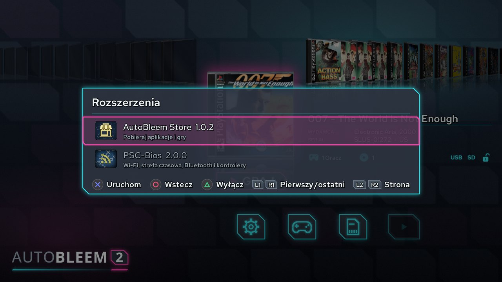

**Sklep AutoBleem** to pierwsze rozszerzenie: miejsce, w którym przeglądasz aplikacje i gry i instalujesz je
jednym naciśnięciem, na każdym systemie, na którym działa AutoBleem. PlayStation Classic potrzebuje do niego
jądra AutoBleem, bo dopiero ono daje WiFi. Otwierasz go z Szybkiego menu (*Sklep*, punkt 3.4). Ma cztery
zakładki, między którymi przechodzisz L1 i R1.

Zakładki **Aplikacje** i **Gry** wymieniają to, co oferują źródła - każda pozycja ma obrazek, wersję, rozmiar i
małą ikonę źródła, z którego pochodzi. Zakładka Aplikacje pokazuje też aplikacje PE, z ich licencją i źródłem,
oraz pakiety z danymi gier (punkt 3.10). To, co już zainstalowałeś, ma oznaczenie, że jest zainstalowane. Pasek
podpowiedzi pokazuje przyciski, które działają w wybranym wierszu:

| Przycisk | W zakładkach Aplikacje i Gry |
|---|---|
| Krzyżyk | Instaluje pozycję - albo ją aktualizuje, ponawia po nieudanej próbie lub anuluje pobieranie, które czeka albo trwa. |
| Trójkąt | Usuwa coś, co zainstalował Sklep. |
| Kwadrat | Odświeża listy ze źródeł. |
| L2 / R2 | Przeskakują do poprzedniej albo następnej pierwszej litery. |
| Select | Pokazuje jedno źródło naraz, gdy chcesz zobaczyć, co oferuje tylko ono. |
| Start | Przeszukuje tytuły. |

Raz wczytane obrazki są zapamiętywane, więc następnym razem listy pojawiają się szybko, a obrazek, który się nie
wczytał, można spróbować pobrać jeszcze raz.

Zakładka **Pobieranie** pokazuje, co się pobiera, co czeka, co się nie udało i co jest już zainstalowane, z
równomiernie przesuwającym się paskiem postępu. Nie musisz jej pilnować: pobieranie trwa w tle, także po wyjściu
ze Sklepu, a gdy jesteś gdzie indziej w launcherze, dymek pokazuje bieżące pobieranie z prędkością i pozostałym
czasem (na przykład `1.4 MB/s · 0:42`). Uruchomienie gry albo wyłączenie urządzenia tylko wstrzymuje pobieranie,
a przerwane pobieranie wznawia się od miejsca, w którym stanęło. Jeśli zniknie sieć, pozycja czeka na nią i
rusza dalej od tego samego miejsca, gdy sieć wróci; po 30 minutach bez sieci rezygnuje. Pliki większe niż 2 GB
pobierają się na każdej platformie, także w wersjach 32-bitowych. Zainstalowana gra pojawia się w rzędzie po
następnym skanowaniu, z obrazkiem ze Sklepu jako okładką.

Zakładka **Źródła** pokazuje, skąd pochodzą listy, każde źródło z ikoną: własny katalog AutoBleem, każda lista
TSV wrzucona do `System/Extensions/store/sources/` oraz adresy dodane przez Ciebie przyciskiem dodawania adresu
źródła. Krzyżyk na źródle, które dodałeś, pozwala zmienić jego nazwę, zmienić adres, przełączyć go między
`http://` a `https://` albo je usunąć.

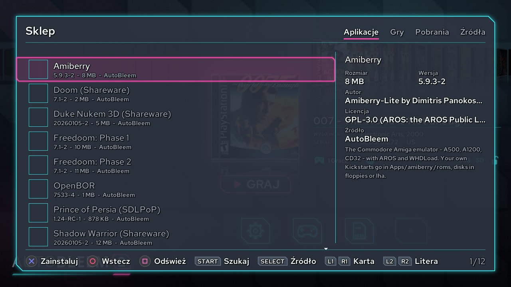

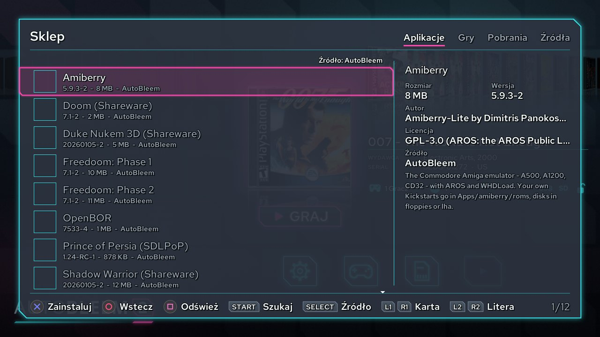

To, co oferuje własny katalog AutoBleem, jest też wymienione na stronie pobierania, pod adresem
`https://autobleem.retromenele.pl/store/`. Źródło dodane przez Ciebie to inna sprawa: **za zawartość źródeł,
które dodajesz, odpowiadasz Ty.**

**Własne gry w domowej sieci.** Jeśli trzymasz gry z PS1 na innym komputerze w domu, `abstored`, serwer
sieciowy Sklepu, może udostępnić je Sklepowi przez Twoją sieć, a Ty instalujesz je jak każdą inną pozycję.
Działa na każdym komputerze z Linuksem - Raspberry Pi, domowym serwerze - i tylko czyta folder, nigdy go nie
zmieniając. Uruchom go poleceniem `abstored <folder z grami>`, a potem otwórz w przeglądarce
`http://<ten komputer>:8124/`: strona pokazuje, co serwer udostępnia i jakie problemy znalazł. W Sklepie dodaj
źródło `http://<ten komputer>:8124/store.tsv`. Gotowe programy dla Linuksa i Windows są na stronie Sklepu, w
zakładce **LAN server**, a plik `INSTALL-linux.md` (`ext_store/server/` w kodzie źródłowym) wyjaśnia, jak
ustawić go jako usługę. **LAN Share** (punkt 5.2) wgrywa na taki serwer gry i płyty z komputera.

### 3.14 Procesory skanowania

Procesory skanowania przygotowują Twoje gry, zanim AutoBleem je odczyta. Procesor to mały program, który każde
skanowanie uruchamia na samym początku. Może zamienić format, którego AutoBleem nie czyta, na taki, który czyta -
na przykład rozpakować grę z zipa - albo zmienić dane gry, na przykład nałożyć łatkę z tłumaczeniem. Procesory
są w `System/Processors/<nazwa>/` na pendrivie (na Raspberry Pi na partycji z danymi, w Windows w folderze z
danymi); żeby zainstalować procesor, rozpakuj tam jego folder, a następne skanowanie go uruchomi.

**Unzip jest w zestawie z AutoBleem.** Rozpakowuje spakowane gry z PS1 w `Games/`, zanim skanowanie je odczyta,
a spakowane ROM-y po jednym; zestawy gier z automatów zostają spakowane, bo tak czytają je rdzenie automatów.
Aktualizacja AutoBleem aktualizuje też Unzip, a jeśli go wyłączyłeś, zostaje wyłączony.

Procesor wykonuje swoją pracę raz: gdy już zajmie się grą, nie uruchamia się na niej ponownie, dopóki gra się
nie zmieni. Gdy procesor pracuje, dymek w prawym górnym rogu pokazuje, co robi, a ostrzeżenie albo błąd pojawia
się w wierszu pod nim; szczegóły są w pliku `processors.log` w folderze z logami. Uruchomienie gry albo RetroArch
zatrzymuje procesor, który zmienia pliki, żeby gra miała urządzenie tylko dla siebie, a następne skanowanie
dokończy pracę.

Żeby nimi zarządzać, otwórz menu systemowe (**L2 + R2**) i wybierz *Procesory skanowania*. Widzisz je w
kolejności, w jakiej się uruchamiają, z jedną zakładką dla gier z PS1 i jedną dla ROM-ów; L1 i R1 przełączają
zakładki. Kolejność ma znaczenie: procesor, który rozpakowuje, musi działać przed tym, który łata to, co
rozpakowano.

| Przycisk | W procesorach skanowania |
|---|---|
| Kwadrat | Podnosi wybrany procesor, żeby Góra i Dół przeniosły go na nowe miejsce; Kwadrat odkłada go z powrotem. |
| Krzyżyk | Wyłącza procesor albo włącza go ponownie. |
| Trójkąt | Każe procesorowi przy następnym skanowaniu jeszcze raz przejrzeć wszystkie gry, także te, którymi już się zajął. |
| Kółko | Wraca, a jeśli coś zmieniłeś, uruchamia skanowanie. |

Procesor zbudowany na inne urządzenie zostaje na liście, wyszarzony, więc widzisz, że jest, ale że tutaj nie
działa.

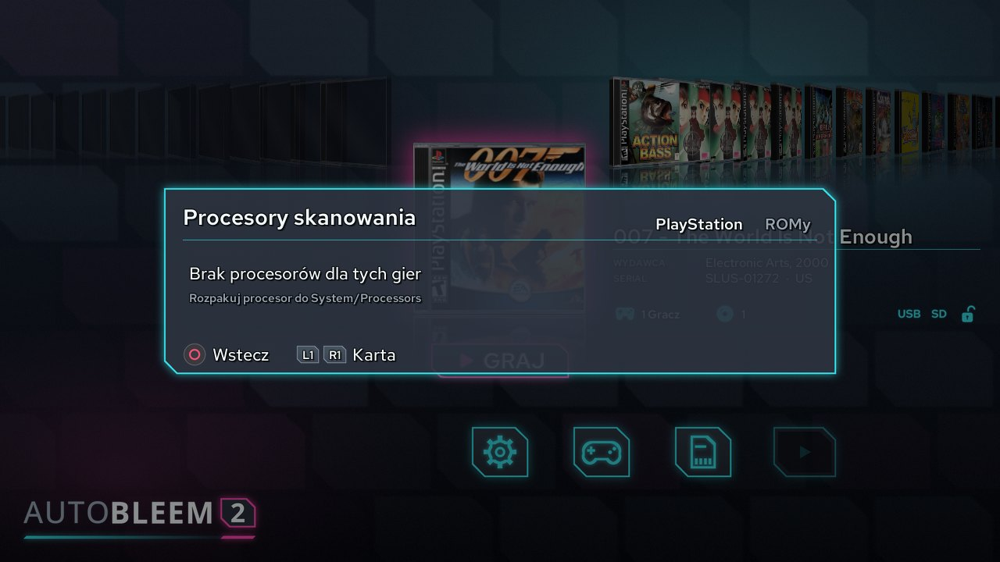

Jeśli chcesz napisać własny procesor, strona Unzip, `https://github.com/autobleem2/proc_unzip`, wyjaśnia
wszystko, co procesor musi robić, a `tools/proc_check.py` w kodzie źródłowym AutoBleem sprawdzi Twój procesor,
zanim się nim podzielisz.

<!-- pagebreak -->

## 4. Ekrany

### 4.1 Menadżer gier

Menadżer gier służy do porządków w bibliotece PS1. Przyda Ci się, gdy chcesz usunąć grę, w którą już nie grasz,
otworzyć ustawienia gry bez szukania jej w rzędzie albo sprawić, żeby AutoBleem pobrał wszystkie okładki od nowa.
Otwierasz go z menu systemowego (L2 + R2, *Menadżer gier*). W trakcie skanowania jest wyszarzony i czeka, aż
skanowanie się skończy.

Ekran ma tytuł *Menadżer gier - wybierz grę*. Po lewej widać wszystkie Twoje gry z PS1 jako listę tytułów w
kolejności alfabetycznej, a po prawej okładkę wybranej gry z wydawcą, rokiem, numerem seryjnym i folderem, w
którym leży. W prawym górnym rogu widać wolne miejsce na dysku, więc wiesz, ile miejsca odzyskasz, usuwając grę.
Góra i Dół przesuwają po liście, L2 / R2 przewijają stronę, a L1 / R1 skaczą do pierwszej albo ostatniej gry.

- **Krzyżyk** otwiera wybraną grę w edytorze gry - tym samym, co ikona Gra w rzędzie (punkt 3.7). Po wyjściu z
  niego wracasz do tej samej gry na liście.
- **Kwadrat usuwa grę.** AutoBleem najpierw pyta, a potem usuwa cały folder gry. Jeśli jej stany gry i karta
  pamięci nie są używane przez żadną inną grę, zada drugie pytanie: czy usunąć także je. Odpowiedz „nie”, jeśli
  możesz kiedyś chcieć wrócić do tej gry razem ze swoimi zapisami.
- **Trójkąt usuwa wszystkie obrazki okładek** (PNG albo JPEG), które leżą obok Twoich gier - po pytaniu. Przydaje
  się, gdy uzbierały Ci się okładki, które Ci się nie podobają: następne skanowanie weźmie okładki z baz okładek
  od nowa.

Na końcu listy, za grami, mogą być foldery oznaczone jako *Nie dodano*. To foldery w `Games`, które skanowanie
obejrzało, ale nie umiało z nich zrobić gry. Wybierz taki folder, a prawa strona powie, gdzie leży i dlaczego go
nie dodano - na przykład z powodu brakującego pliku cue (rozdział 7). Kwadrat usuwa taki folder po pytaniu. Gdy
po zmianach wyjdziesz Kółkiem, AutoBleem jeszcze raz przeskanuje gry.

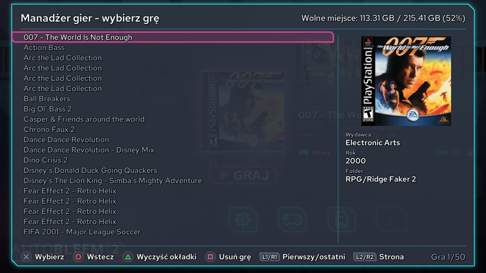

### 4.2 Informacje o sprzęcie

Informacje o sprzęcie to strona, do której zaglądasz, gdy chcesz wiedzieć, co to za urządzenie i co widzi: ile
miejsca zostało na pendrivie, jaki ma adres w sieci, jakich sterowników ekranu i dźwięku używa i które pady są
podłączone. Na każdej platformie, łącznie z konsolą, to ta sama strona. Otwierasz ją z menu systemowego (L2 +
R2, *Informacje o sprzęcie*); Kółko wraca do menu systemowego.

Strona pokazuje system, sprzęt, pamięć masową z wolnym miejscem, adresy sieciowe, sterowniki ekranu i dźwięku
oraz podłączone pady. Wszystko odczytuje na nowo co sekundę, więc możesz ją zostawić otwartą, podłączyć pad albo
kabel i patrzeć, jak zmiana się pojawia. Strona tylko pokazuje - żeby ustawić sieć albo pad, użyj *Sieć i
kontrolery* (PSC-Bios, rozdział 6).

Część o padach odpowiada na pytanie „który pad jest którym graczem?”. Dwa pierwsze pady są pokazane jako *Gracz
1* i *Gracz 2* - takie porty przydziela im emulator PS1. Każdy kolejny pad ma dopisek *nieużywany przez emulator
PS1*. RetroArch przydziela porty według własnych ustawień, więc w grze RetroArch kolejność może być inna. Nie
musisz za każdym razem otwierać tej strony: gdy podłączysz albo odłączysz pad, launcher na chwilę pokazuje, który
pad jest teraz Graczem 1, a który Graczem 2.

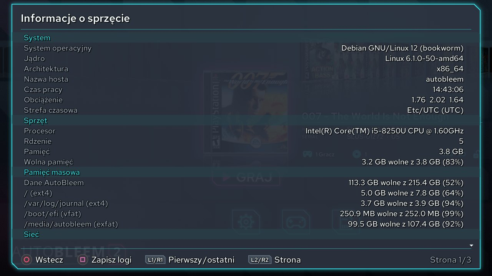

### 4.3 Przewodnik po przyciskach

Jeśli gdzieś zapomnisz, co robi przycisk, naciśnij **Trójkąt** w rzędzie gier. Przewodnik po przyciskach pokazuje
na jednej stronie przyciski wszystkich ekranów, więc sprawdzisz to bez wychodzenia z launchera. Jeśli
podłączona jest klawiatura USB albo była używana, kolumna *Klawiatura* pokazuje obok każdego przycisku pada
odpowiadający mu klawisz.

Przewodnik przypomina też o jednej rzeczy, którą warto pamiętać w każdej grze: jak z niej wyjść. Przytrzymaj
Select + Start albo Home przez 2 sekundy, żeby wrócić do AutoBleem; krótkie naciśnięcie otwiera za to menu
emulatora.

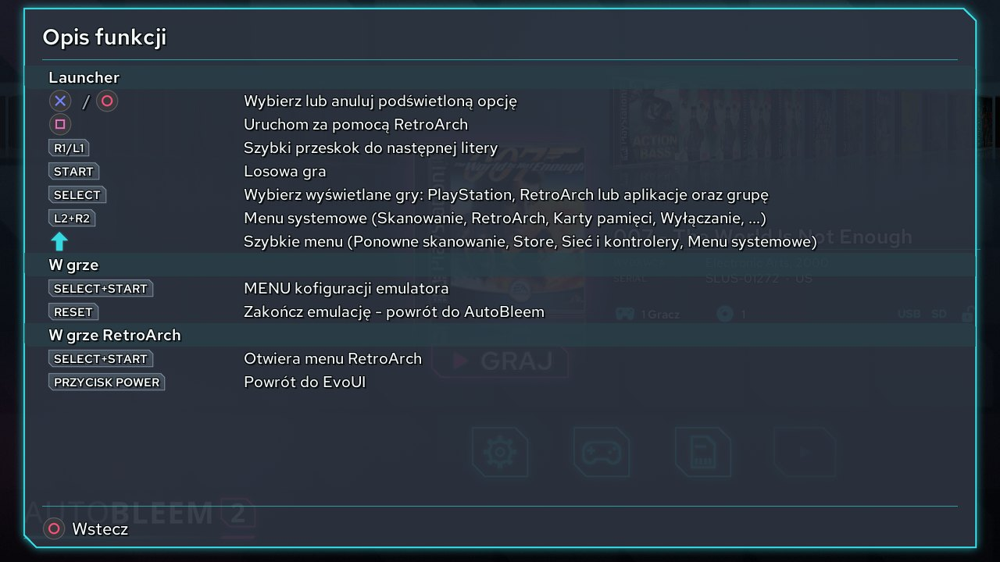

### 4.4 Klawiatura ekranowa

Gdy AutoBleem potrzebuje, żebyś coś wpisał - nazwę zestawu kart pamięci, tytuł gry, hasło do WiFi, adres źródła
w Sklepie - pojawia się zawsze ta sama klawiatura ekranowa, więc piszesz samym padem. Jest ułożona jak klawiatura
w telefonie. Oprócz liter ma stronę ze znakami, z `/ \ : ? & = % @ #` i resztą tego, czego potrzeba w adresie
albo haśle, oraz dwie strony liter z akcentami, także polskich. W dolnym rzędzie są Shift, klawisz zmiany strony,
spacja, Backspace i zatwierdzenie.

Po klawiszach poruszasz się kierunkami, a **Krzyżyk** wpisuje znak pod kursorem. **Trójkąt** usuwa literę, a
**Kwadrat** wstawia spację. **L1** to Shift; naciśnij go dwa razy, żeby włączyć Caps Lock. **R1** przechodzi do
następnej strony klawiszy, a **L2 / R2** przesuwają kursor w tekście. **Start** zatwierdza to, co wpisałeś, a
**Kółko** anuluje. Jeśli podłączona jest klawiatura USB, możesz w każdej chwili pisać na niej: Enter zatwierdza,
a Esc anuluje.

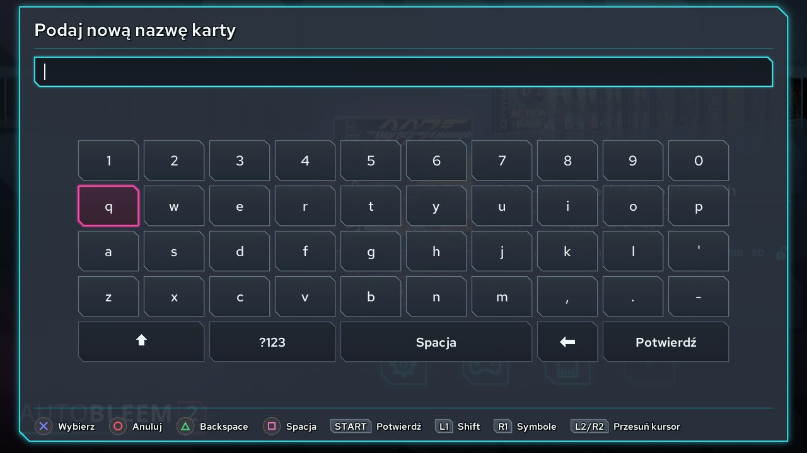

### 4.5 Wirtualny pad

Aplikacje - programy z zestawu Aplikacje, na przykład Doom czy Quake - nie czytają Twojego pada same. Robi to
mały program pomocniczy, demon wirtualnego pada: odczytuje prawdziwe pady i daje każdej aplikacji pad, który ona
rozumie. Ta strona pokazuje, które pady ten pomocnik widzi i jak je odczytuje. Zajrzyj tu, gdy aplikacja nie
reaguje na Twój pad albo ma pomieszane przyciski. Otwierasz ją z menu systemowego (L2 + R2, *Wirtualny pad*);
Kółko wraca do menu systemowego.

W części *Pady widoczne dla demona* każdy pad ma numer i nazwę. Obok widać trzy rzeczy: czy pomocnik zdołał pad
otworzyć (*podłączony*), czy nie (*nie do odczytu*); przez jaki sterownik pad przyszedł; i skąd pochodzi układ
jego przycisków - *z bazy kontrolerów* znaczy, że pad jest znany i przyciski są tam, gdzie powinny, a
*odgadnięty przez demona* znaczy, że pad jest nieznany i pomocnik zgadywał najlepiej, jak umiał. Jeśli przyciski
w aplikacji wydają się nie tam, gdzie trzeba, najpewniej winny jest odgadnięty układ.

Pomocnik działa tylko wtedy, gdy działa aplikacja, więc strona pyta go raz, przy otwarciu. Jeśli podłączysz pad,
gdy strona jest otwarta, naciśnij **Krzyżyk** (*Sprawdź ponownie*), żeby zapytać jeszcze raz. W Windows takiego
pomocnika nie ma, a strona mówi *Brak w tej wersji*.


<!-- pagebreak -->

## 5. Na komputerze

### 5.1 UpdateRoms - odświeżanie pendrive'a konsoli

Na Raspberry Pi, komputerze i w Windows skanowanie launchera samo układa gry RetroArch w listy i pobiera do nich
okładki. PlayStation Classic tego nie potrafi, bo nie ma własnej sieci. Tę pracę wykonuje za nią **UpdateRoms**
na Twoim komputerze z Windows: korzysta z sieci komputera, ale wszystko zapisuje ze ścieżkami, jakich oczekuje
konsola, więc gdy włożysz pendrive z powrotem, konsola uruchomi się i znajdzie wszystko na swoim miejscu.
Uruchamiaj go za każdym razem, gdy dodasz albo usuniesz gry RetroArch na pendrivie konsoli.

1. Wgraj ROM-y na pendrive do `RetroArch/roms/<system>/` (punkt 3.10). Nazwy folderów muszą być nazwami z baz
   RetroArch; najpopularniejsze instalator już założył.
2. Uruchom **`UpdateRoms\UpdateRoms.exe` z pendrive'a** - instalator go tam umieścił. Program sam ustala, na
   którym pendrivie jest. W trakcie pracy widzisz wiersz z tym, co właśnie robi, pasek postępu i dziennik.
   - Jeśli na pendrivie nie ma jeszcze bazy RetroArch, najpierw pobiera paczkę baz RetroArch. Potem rozpoznaje
     z jej pomocą każdy ROM, więc gra znana bazie dostaje swoją właściwą nazwę.
   - Zapisuje po jednej playliście na system do `RetroArch/bin/playlists/`, ze ścieżkami konsoli. Wszystko, co
     sam RetroArch dopisał do tych list, zostaje.
   - Dla każdego ROM-u bez okładki pobiera okładkę z serwerów miniatur libretro do `RetroArch/bin/thumbnails/`.
3. Bezpiecznie odłącz pendrive i włóż go z powrotem do konsoli. Zakładka RetroArch w wyborze zestawu pokazuje
   teraz każdy system, do którego masz gry.

Możesz go uruchamiać, ile razy chcesz: folder, w którym nic się nie zmieniło, jest pomijany, więc kolejne
uruchomienie trwa krótko. Jeśli coś pójdzie nie tak, dziennik jest w `System/Logs/updateroms.log` na pendrivie.
Kartę Raspberry Pi w czytniku kart odświeżysz tak samo, poleceniem `UpdateRoms.exe <dysk> --target rpi`, choć Pi z
dostępem do sieci robi to sam.

### 5.2 LAN Share - Twoje gry i płyty na serwerze w domowej sieci

Sklep potrafi instalować gry z serwera w Twojej domowej sieci (punkt 3.13). **LAN Share** to program dla Windows,
który zapełnia ten serwer z Twojego komputera: wgrywa na niego gry z PS1, które masz na komputerze, a do tego
potrafi odczytać płytę PS1 w napędzie CD/DVD komputera i też ją tam umieścić. Serwerem jest `abstored`
działający na Raspberry Pi, dysku sieciowym NAS albo innym komputerze. Gdy gra jest już na serwerze, Sklep na
konsoli, Pi albo komputerze może ją stamtąd zainstalować.

`LanShare.exe` pobierzesz ze strony Sklepu, z zakładki **LAN server**. Niczego nie trzeba instalować: uruchamiasz
go, a swoje ustawienia trzyma w `%LOCALAPPDATA%\AutoBleem LAN Share\`.

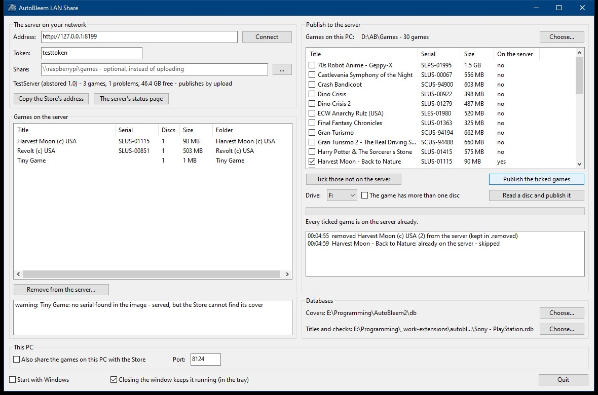

1. **Połącz się z serwerem.** Wpisz jego adres tak, jak ma go Sklep, `http://<jego adres>:<port>`, i naciśnij
   **Connect**. Po lewej pojawią się gry, które już są na serwerze, i problemy, jakie znalazło jego własne
   skanowanie. Żeby wgrywać gry na serwer, LAN Share potrzebuje jednej z dwóch dróg dostępu:
   - **Share** to folder z grami serwera, udostępniony w Twojej sieci (Samba), na przykład
     `\\raspberrypi\games`. LAN Share kopiuje do niego gry i prosi serwer o skanowanie; sam serwer nadal tylko
     czyta swój folder.
   - **Token** jest dla serwera uruchomionego z `--allow-uploads`. Wpisz jego token - serwer wypisuje go przy
     starcie i przechowuje w `<state>/upload-token`. LAN Share wysyła wtedy gry przez HTTP, a przerwane
     wysyłanie wznawia się od miejsca, w którym stanęło.
2. **Opublikuj gry z komputera.** Wybierz folder, w którym są Twoje gry (każda w osobnym folderze), zaznacz te,
   które chcesz, i naciśnij **Publish the ticked games**. Kolumna **On the server** mówi, czy serwer ma już daną
   grę - porównuje numer seryjny, a gdy go nie ma, tytuł - i gra, którą serwer już ma, nigdy nie jest wysyłana
   drugi raz. **Tick those not on the server** zaznacza za Ciebie wszystkie pozostałe.
3. **Opublikuj płytę.** Włóż płytę PS1 do napędu komputera i naciśnij **Read a disc and publish it**. LAN Share
   odczyta całą płytę do plików `.bin` + `.cue` nazwanych tytułem gry. Przy grze z LibCrypt zapisze też plik
   `.sbi`, jeśli napęd potrafi odczytać podkanał. Jeśli wskazałeś bazy (niżej), sprawdzi kopię ze znanym dobrym
   zrzutem. Potem opublikuje grę. Przy grze na kilku płytach najpierw zaznacz **The game has more than one
   disc**: LAN Share poprosi o każdą kolejną płytę i opublikuje je razem jako jedną grę.
4. **Zdejmij gry z serwera.** Zaznacz je i naciśnij **Remove from the server...**. Nic nie jest kasowane: każda
   gra trafia do folderu `.removed` obok gier serwera, a przeniesienie jej z powrotem przywraca ją na serwer.

**Bazy** (*Databases*) są opcjonalne. Jeśli wskażesz LAN Share folder okładek AutoBleem (`coversU/P/J.db`) i plik
`Sony - PlayStation.rdb` z RetroArch, użyje ich do nazywania gier i sprawdzania odczytanych płyt.

Jeśli wolisz niczego nie kopiować, zaznacz **Also share the games on this PC with the Store** (domyślnie jest
wyłączone): LAN Share będzie wtedy udostępniał Sklepowi folder z grami na Twoim komputerze bezpośrednio. Za
pierwszym razem Windows zapyta o zaporę - zezwól tylko na sieci prywatne.

<!-- pagebreak -->

## 6. Narzędzia konsoli (PlayStation Classic)

Z pendrivem dla PlayStation Classic przychodzą dwa narzędzia, które pozwalają ustawić konsolę ponad to, co
potrafi fabrycznie. Oba wyglądają jak reszta launchera, w jego motywie i języku, i obsługujesz je padem - a w
kreatorze mapowania pada także przednimi przyciskami konsoli. **PSC-Bios** to rozszerzenie z paczki dla konsoli:
otwiera je pozycja *Sieć i kontrolery* w Szybkim menu i w menu systemowym, a znajdziesz je też na liście
rozszerzeń. **ABFlashKit** to aplikacja, w zestawie Aplikacje.

### 6.1 PSC-Bios

W PSC-Bios łączysz urządzenie ze światem: z siecią WiFi, strefą czasową, padami Bluetooth, a także ustawiasz
układ przycisków pada, którego AutoBleem nie zna. Przychodzi z paczką dla konsoli i jest też na Raspberry Pi i
pendrivie dla PC. Otwierasz go pozycją *Sieć i kontrolery* w menu systemowym (albo w Szybkim menu) lub z listy
rozszerzeń. Jeśli rozszerzenie jest zainstalowane, ale wyłączone, pozycja *Sieć i kontrolery* jest wyszarzona i
mówi, że *jest wyłączone - włącz je w Rozszerzeniach*; naciśnij na niej Krzyżyk, a lista rozszerzeń otworzy się
na PSC-Bios, żebyś mógł go z powrotem włączyć.

Pierwszy ekran to przegląd: godzina i strefa czasowa, karty sieciowe (WiFi, Ethernet, Bluetooth) z adresami oraz
każdy podłączony pad z informacją, czy ma mapowanie przycisków. Na konsoli części sieci i Bluetooth wymagają
jądra AutoBleem (punkt 6.2); na Raspberry Pi i pendrivie dla PC korzystają z narzędzi samego systemu. Kreator
mapowania pada działa wszędzie.

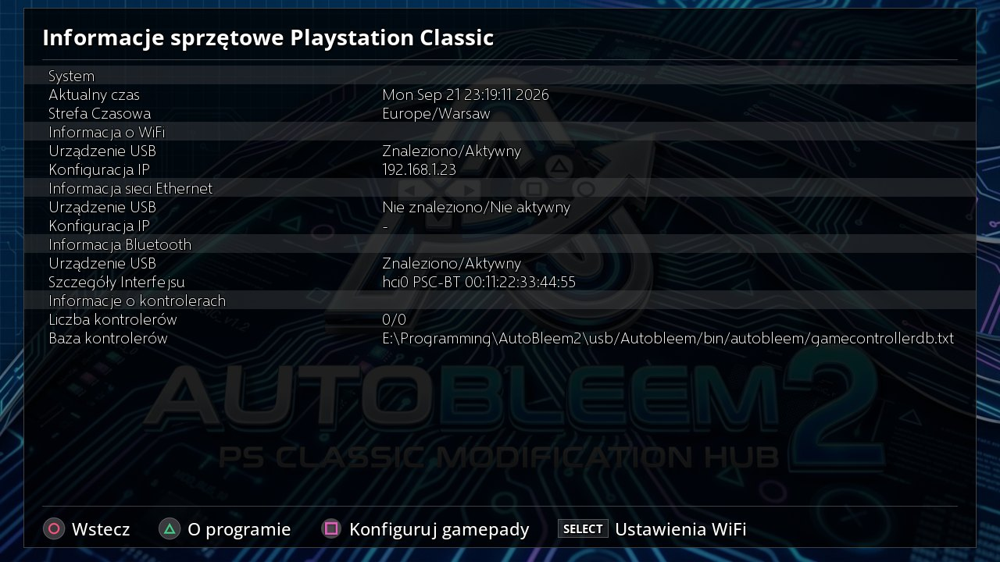

Z pierwszego ekranu do każdej części prowadzi jeden przycisk:

| Przycisk | Co otwiera |
|---|---|
| Select | **Sieć WiFi** łączy z Twoim WiFi (przez jądro, a na Pi i komputerze przez NetworkManager): wpisz nazwę sieci albo wybierz ją z wyszukanych, podaj hasło, wybierz tryb sterownika i naciśnij *Zastosuj / Restartuj sieć*. Tu też ustawiasz strefę czasową, a po połączeniu widzisz adres IP konsoli. |
| Kwadrat | **Pady Bluetooth** wyszukuje pady Bluetooth, takie jak DualShock 4, żebyś mógł sparować nowy albo usunąć ten, którego już nie używasz. |
| L1 | **Parowanie DualShock 3** łączy Twojego pierwszego DualShocka 3 - musi być wtedy podłączony kablem USB - przez wtyczkę sixaxis jądra. |
| R1 | **Mapowanie pada** otwiera kreator mapowania, opisany niżej. |
| Trójkąt | **O programie** mówi, czym jest PSC-Bios. |
| Kółko | **Powrót** zamyka PSC-Bios i wraca do launchera. |

**Kreator mapowania pada.** Użyj go, gdy pad nic nie robi w AutoBleem albo ma przyciski nie na swoich miejscach.
Kreator pokazuje podłączony pad taki, jaki jest naprawdę - każdą oś, przycisk i krzyżak jako liczby - oraz
obrazek DualShocka, który podświetla się, gdy coś naciskasz. Ponieważ testowanemu padowi nie można jeszcze ufać,
kreatorem sterujesz **przednimi przyciskami** konsoli: **RESET** przełącza na następny pad, **OPEN** zaczyna
mapowanie, a **POWER** anuluje albo zamyka kreator. W trakcie mapowania kreator prosi o kolejne przyciski:
naciśnij przycisk podświetlony na obrazku albo OPEN, jeśli Twój pad takiego przycisku nie ma. Krótkie
naciśnięcie mapuje się normalnie.

Wyjść możesz też padem: przytrzymaj Kółko przez 2 sekundy - zapełnia się pasek, a stopka przypomina o
przytrzymaniu. Dopóki pad nie ma mapowania, to samo daje przytrzymanie dowolnego przycisku przez 2 sekundy. Na
klawiaturze Esc, spacja i Enter zastępują POWER, RESET i OPEN.

Na koniec nowe mapowanie zostaje włączone, żebyś mógł je wypróbować, a OPEN zapisuje je pod wybraną przez Ciebie
nazwą. Od tej chwili launcher wczytuje je przy każdym starcie.

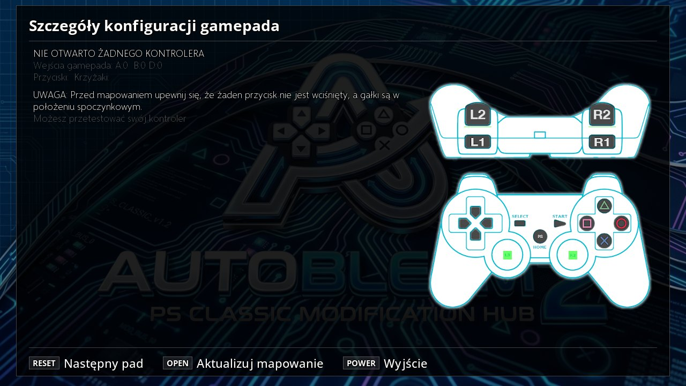

### 6.2 ABFlashKit - jądro AutoBleem

Jądro AutoBleem zastępuje oryginalne jądro Linuksa w konsoli i jest opcjonalne. Przyda Ci się, jeśli chcesz z
konsoli wycisnąć więcej: daje jej działający zegar, uruchamia adaptery WiFi i Bluetooth na USB (dla PSC-Bios i
padów Bluetooth) i dodaje obsługę przednich przycisków, z której emulator korzysta przy punktach wznowienia.
ABFlashKit to narzędzie, które je instaluje. Najpierw robi kopię zapasową konsoli, a potrafi też przywrócić ją do
stanu fabrycznego przez oryginalny tryb odzyskiwania Sony.

> **To narzędzie zapisuje pamięć flash konsoli.** Jeśli zapis zostanie przerwany - zabraknie prądu albo ktoś
> wyjmie pendrive - konsola może przestać się uruchamiać, a instalacja własnego jądra unieważnia gwarancję. Nie
> odłączaj zasilania ani pendrive'a, dopóki konsola sama się nie uruchomi ponownie. ABFlashKit otwiera się na
> tym ostrzeżeniu: *Rozumiem* idzie dalej, *Koniec* zamyka program.

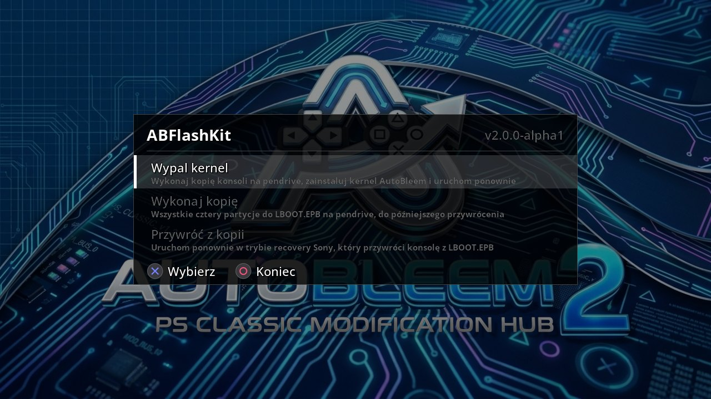

ABFlashKit ma trzy działania:

- **Wypal kernel** instaluje jądro. Jeśli na pendrivie nie ma jeszcze kopii zapasowej do odzyskiwania, najpierw
  robi kopię partycji konsoli (`LBOOT.EPB`). Sprawdza kopię i obraz jądra, zapisuje jądro i pliki systemowe
  AutoBleem, a potem uruchamia konsolę ponownie. Gdy pojawi się *Gotowe - gdy ekran zgaśnie, wepnij ponownie
  kabel zasilający*, poczekaj, aż ekran zgaśnie, a potem wyjmij kabel zasilający konsoli i włóż go z powrotem.
- **Wykonaj kopię** zapisuje wszystkie cztery partycje konsoli do `LBOOT.EPB`, żebyś mógł je później przywrócić.
  Jeśli kopia już istnieje, zapyta, zanim ją nadpisze.
- **Przywróć z kopii** to droga powrotu do oryginalnego oprogramowania. Sprawdza, czy kopia na pendrivie jest
  fabryczna, ustawia znacznik odzyskiwania i uruchamia konsolę w trybie odzyskiwania Sony, który przywraca ją z
  `LBOOT.EPB`.

Pod każdym krokiem pasek postępu pokazuje, jak daleko zaszła praca. ABFlashKit nie wgra jądra na konsolę z innym
nieoficjalnym oprogramowaniem, takim jak BleemSync czy Project Eris: taką konsolę najpierw przywróć do stanu
fabrycznego.

**Logowanie z komputera.** Jeśli znasz Linuksa i chcesz zajrzeć do wnętrza konsoli, możesz się do niej zalogować
z komputera przez kabel USB. Wymaga to jądra AutoBleem; na konsoli w stanie fabrycznym nie zadziała.

1. Połącz port micro-USB konsoli z komputerem kablem USB. Komputer zobaczy konsolę jako nową kartę sieciową, a
   adres konsoli znajdziesz w ustawieniach tej karty na komputerze.
2. Zaloguj się poleceniem `ssh root@<adres konsoli>`. Domyślne hasło to `autobleem`.

Zamiast hasła możesz użyć klucza. Wgraj swój klucz publiczny do pliku `System/ssh/authorized_keys` na pendrivie i
uruchom konsolę ponownie: przy następnym starcie zostanie dodany do konta root. Aktualizacja ani ponowna
instalacja launchera go nie usuwa.

> **Domyślne hasło jest takie samo na każdej konsoli**, więc każdy, kto podłączy kabel do Twojej, może się
> zalogować jako root. Tam, gdzie się da, używaj klucza i nie zostawiaj konsoli z domyślnym hasłem w miejscu,
> do którego mają dostęp inni.

<!-- pagebreak -->

## 7. Gdy coś pójdzie nie tak

Większość problemów ma prostą przyczynę. Każdy opis poniżej zaczyna się od tego, co widzisz, potem mówi, skąd to
się bierze, a na koniec, co zrobić. Jeśli będziesz prosić o pomoc, pierwsze, o co ktoś zapyta, to logi - dlatego
od nich zaczynamy.

**Gdzie są logi.** W trakcie działania AutoBleem trzyma logi w pamięci, żeby nie zapisywać pendrive'a bez
przerwy. Do `System/Logs/` na pendrivie, karcie albo w folderze z danymi trafiają tylko wtedy, gdy coś poszło nie
tak: gdy launcher, gra z PS1 albo RetroArch ulegną awarii, logi są zapisywane do `System/Logs/crash-<n>/`
(przechowywane są trzy ostatnie awarie), a launcher po powrocie raz Ci o tym mówi. Jeśli szukasz przyczyny
problemu, który nie jest awarią, zachowuj wszystkie logi: włącz Opcje → *Diagnostyka* → *Zachowuj logi na
pendrivie:* (działa od następnego startu) albo załóż z komputera pusty plik `System/Logs/keep`. *Informacje o
sprzęcie* (punkt 4.2) też pokazują, gdzie są logi, a Kwadrat zapisuje tam bieżące logi do
`System/Logs/saved-<n>/`.

Oto pliki, które tam znajdziesz:

| Plik | Co z niego wyczytasz |
|---|---|
| `autobleem.log` | Co robił sam launcher. |
| `launch.log`, `pcsx.log` | Jak została uruchomiona gra z PS1 i co emulator mówił w trakcie działania. |
| `retroarch.log` | Co RetroArch mówił w trakcie działania. |
| `update.log` | Jak poszła aktualizacja przez internet; jest zawsze zachowywany na pendrivie. |
| `updateroms.log` | Jak poszło działanie UpdateRoms na komputerze (rozdział 5); jest zawsze zachowywany na pendrivie. |

**Obrazek prosi o włożenie pendrive'a albo konsola zasnęła.** AutoBleem nie może znaleźć swojego pendrive'a: nie
było go przy starcie konsoli albo został wyjęty. Włóż go do dowolnego portu USB (najlepiej przedniego, punkt 2.1),
zanim minie 5 minut, albo naciśnij Power. Jeśli pendrive nie został poprawnie odłączony, AutoBleem najpierw go
sprawdzi - poczekaj, aż pasek postępu dojdzie do końca.

**RetroArch mówi, że potrzebuje nowszej biblioteki systemowej, niż ma ta konsola.** Ten RetroArch zbudowano na
nowszy system niż system konsoli, więc nie może na niej działać. Użyj RetroArch, który przychodzi z AutoBleem.

**Gra mówi, że jest chroniona licencją PSN i nie da się jej uruchomić.** Gry kupione w PlayStation Network są
przywiązane do swojej licencji i AutoBleem nie może ich uruchomić. Tu nie ma czego naprawiać.

**Gry nie ma w rzędzie.** Zwykle jej folder nie jest ułożony tak, jak oczekuje skanowanie. Sprawdź, czy każda
gra ma osobny folder i jest w jednym z formatów z punktu 3.10. *Menadżer gier* (punkt 4.1) pokazuje za grami
foldery odrzucone przez skanowanie, oznaczone jako *Nie dodano*, i mówi, dlaczego każdy został odrzucony; Kwadrat
usuwa taki folder. Po poprawieniu folderu *Ponownie skanuj gry* w menu systemowym uruchomi skanowanie jeszcze raz.

**Gry nie mają okładek.** Albo nie zainstalowano baz okładek - uruchom instalator jeszcze raz i zaznacz je - albo,
w przypadku gier RetroArch na konsoli, nie uruchomiono jeszcze UpdateRoms na komputerze (rozdział 5).

**Pad nic nie robi albo ma pomieszane przyciski.** AutoBleem nie zna układu tego pada. Na konsoli zmapuj go
kreatorem mapowania w PSC-Bios (punkt 6.1). Na Pi albo komputerze strona Informacje o sprzęcie (punkt 4.2)
pokazuje, co system widzi z pada, co pomaga ustalić, czy w ogóle został wykryty.

**Po grze na konsoli ekran zostaje czarny.** Obraz launchera nie wrócił po zakończeniu gry. AutoBleem sam
odbudowuje swoje okno, do trzech razy. Jeśli ekran nadal jest czarny, przytrzymaj przycisk Power i włącz konsolę
ponownie.

**Na Raspberry Pi** w razie potrzeby możesz zajrzeć za launcher: `Alt+F2` daje ekran logowania na drugiej
konsoli tekstowej, a SSH jest włączone od pierwszego startu. `sudo journalctl -u autobleem` pokazuje, co robiła
usługa launchera, a `sudo systemctl restart autobleem` uruchamia ją ponownie. Jeśli pierwsze uruchomienie nie
mogło się dokończyć z braku sieci, spróbuje ponownie przy następnym starcie.

**W Windows** `Esc` zamyka launcher. Folder z danymi to ten, który wybrałeś przy instalacji (`Documents\AutoBleem`,
jeśli go nie zmieniałeś), a logi są w jego folderze `System\Logs`.

**Po aktualizacji przez internet konsola uruchamia się ponownie w kółko (pendrive sformatowany jako ext4).**
Niektórzy formatują pendrive jako ext4, linuksowy system plików, zamiast FAT32 czy exFAT. Do następnego wydania
AutoBleem aktualizacja przez internet rozpakowuje na takim pendrivie wszystkie pliki bez uprawnienia, które
pozwala uruchamiać je jako programy. AutoBleem nie może wtedy wystartować, a konsola restartuje się bez końca.
Pendrive'ów FAT32 i exFAT to nie dotyczy. Są dwa sposoby, żeby to naprawić.

**Sposób A** wymaga komputera z Linuksem. Podłącz pendrive i przywróć programom AutoBleem możliwość
uruchamiania. W miejsce `/media/USER/STICK` wpisz własną ścieżkę montowania; ostatni wiersz jest potrzebny tylko
wtedy, gdy zainstalowany jest RetroArch:

```
chmod +x /media/USER/STICK/Autobleem/*.sh /media/USER/STICK/Autobleem/rc/*.sh
chmod +x /media/USER/STICK/Autobleem/bin/autobleem/* /media/USER/STICK/Autobleem/bin/emu*/pcsx-ab /media/USER/STICK/Autobleem/bin/abpad/abpadd
chmod +x /media/USER/STICK/RetroArch/bin/retroarch
```

Wzorzec `bin/emu*/pcsx-ab` w drugim wierszu obejmuje oba emulatory: klasyczny `pcsx-ab` i `pcsx-abnxt`, który jest
instalowany jako `Autobleem/bin/emunxt/pcsx-ab`, więc nowszy nie potrzebuje osobnego polecenia.

**Sposób B**: zainstaluj na pendrivie jeszcze raz najnowsze wydanie AutoBleem, tak jak w punkcie 2.1. Instalator
potrzebuje komputera, który odczyta pendrive. Jeśli Twojego nie odczyta, pendrive trzeba najpierw sformatować, co
kasuje wszystko, co na nim jest - wcześniej skopiuj z niego swoje gry.

> Żeby tego uniknąć, używaj **FAT32** (konsola w stanie fabrycznym czyta tylko FAT32; exFAT wymaga jądra
> AutoBleem, rozdział 6). Następne wydanie zachowuje uprawnienia, a AutoBleem naprawia je przy każdym starcie.

AutoBleem to wolne oprogramowanie (GNU GPL w wersji 3 lub nowszej) i jest dostarczany bez żadnej gwarancji. Po
pomoc i nowości zajrzyj na serwer Discord, do którego link jest na ekranie *O programie*, albo na
https://autobleem.retromenele.pl/.
